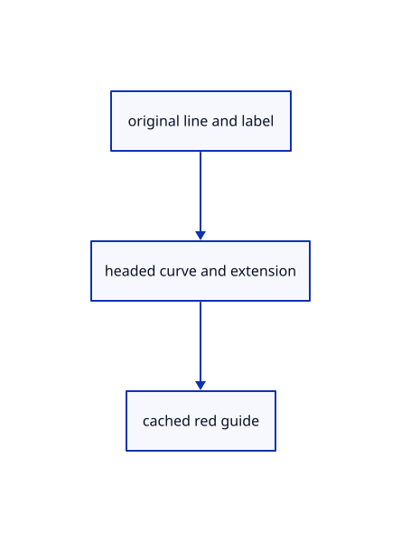

# 16.5.52 · Exercise current original commands together

**Chapter 16 · Geometry editing and measurement · Section 16.5 · Text, styles and command integration** · [Contents](contents.md)

**Typing: 0–0 minutes.** [Estimate](typing-load.md).

Connect current input to original owners, then inspect cached guides and archive identity.

## Type

Continue from [Observe current original command state](85ax-observe-current-original-command-state.md). [Save or recover your work](recovery.md).

<details>
<summary>Supplied validation fixture</summary>

Copy this supplied authoring fixture once. Continue with the browser build below; the course does not require running native tests.

### 1. `src/command_inventory_tests.rs`

Copy the integrated original, archive, history, guide and source-fetch fixtures.

Copy this supplied file:

```text
--8<-- "journey/code/85ay-exercise-current-original-commands-together-01.rs"
```

</details>

<details>
<summary>Supplied validation fixture</summary>

Copy this supplied authoring fixture once. Continue with the browser build below; the course does not require running native tests.

### 2. `src/lib.rs`

Register this command owner.

<details>
<summary>Locate the existing block</summary>

```text

pub mod command_request;
```

</details>

After that block, append this supplied code:

```text
--8<-- "journey/code/85ay-exercise-current-original-commands-together-02.rs" skip=26
```

</details>

<details>
<summary>Supplied validation fixture</summary>

Copy this supplied authoring fixture once. Continue with the browser build below; the course does not require running native tests.

### 3. `src/command_owner_tests.rs`

Copy the integrated original, archive, history, guide and source-fetch fixtures.

Copy this supplied file:

```text
--8<-- "journey/code/85ay-exercise-current-original-commands-together-03.rs"
```

</details>

<details>
<summary>Supplied validation fixture</summary>

Copy this supplied authoring fixture once. Continue with the browser build below; the course does not require running native tests.

### 4. `src/lib.rs`

Register this command owner.

<details>
<summary>Locate the existing block</summary>

```text
#[cfg(test)]
mod command_inventory_tests;
```

</details>

After that block, append this supplied code:

```text
--8<-- "journey/code/85ay-exercise-current-original-commands-together-04.rs" skip=42
```

</details>

<details>
<summary>Supplied validation fixture</summary>

Copy this supplied authoring fixture once. Continue with the browser build below; the course does not require running native tests.

### 5. `src/command_fetch_tests.rs`

Copy the integrated original, archive, history, guide and source-fetch fixtures.

Copy this supplied file:

```text
--8<-- "journey/code/85ay-exercise-current-original-commands-together-05.rs"
```

</details>

<details>
<summary>Supplied validation fixture</summary>

Copy this supplied authoring fixture once. Continue with the browser build below; the course does not require running native tests.

### 6. `src/lib.rs`

Register this command owner.

<details>
<summary>Locate the existing block</summary>

```text
#[cfg(test)]
mod command_owner_tests;
```

</details>

After that block, append this supplied code:

```text
--8<-- "journey/code/85ay-exercise-current-original-commands-together-06.rs" skip=38
```

</details>

<details>
<summary>Supplied validation fixture</summary>

Copy this supplied authoring fixture once. Continue with the browser build below; the course does not require running native tests.

### 7. `src/lasso_geometry_tests.rs`

Copy the integrated original, archive, history, guide and source-fetch fixtures.

Copy this supplied file:

```text
--8<-- "journey/code/85ay-exercise-current-original-commands-together-07.rs"
```

</details>

<details>
<summary>Supplied validation fixture</summary>

Copy this supplied authoring fixture once. Continue with the browser build below; the course does not require running native tests.

### 8. `src/lib.rs`

Register this command owner.

<details>
<summary>Locate the existing block</summary>

```text
#[cfg(test)]
mod command_fetch_tests;
```

</details>

After that block, append this supplied code:

```text
--8<-- "journey/code/85ay-exercise-current-original-commands-together-08.rs" skip=38
```

</details>

## Run and check

Run this from `session_viewer` to select the fixed dependency versions and install supplied binary assets. It updates Cargo.lock and preserves the previous lock. It does not write implementation code:

```sh
npm --prefix ../session_tests run course -- dependencies 16.5.52
```

In your project:

```sh
cd workspace/journey
REGEN_PROTO=0 cargo build --lib --locked --target wasm32-unknown-unknown -j1
REGEN_PROTO=0 CARGO_BUILD_JOBS=1 trunk serve --port 8780
```

Open `http://127.0.0.1:8780/`. Keep an existing Trunk server running; saving rebuilds it.

An original headed line, world Text and a red dashed extension guide with a+0.800chip are visible. The guide remains outside source rows, history and integer ownership.

### Recorded visual result

**Previous native render — current verification pending.**

The rendered headed line and world text remain black; a red dashed extension tail ends at its black +0.800 chip.


*This recorded image predates a source or checker change. Rebuild this checkpoint before using it as current evidence; browser controls require separate acceptance.*

<details>
<summary>Code explanation and diagram</summary>


original line and label → headed curve and extension → cached red guide.



What proves the current command endpoint?

Its supplied native fixtures and rendered frame check real owners, history and actual pixels. Browser acceptance remains a separate required check.

Study estimate, including typing and experiments: 0.5–1 hours.

</details>

<details>
<summary>Optional experiment</summary>

Type Close, CPlane XY and Line w-1,0,0 w1,0,0. Type Select All and Arrowhead Both; Save/Open keeps the original Line family and arrowheads. Type Text timber, Height 0.25 and w0,0,0.6. Select the line, type Extend Distance 0.8 and move near its endpoint: expect a red dashed tail and +0.800 chip. Escape removes only the preview. Add Group after selecting two originals; clicking one selects the group. Add Edge creates one document-scoped graph link and opens the graph table. Select By Name "timber" finds the label; Select Small 0.5 uses world bounds. Select Lasso accepts one loop, Shift adds and Ctrl removes. Trim accepts whole targets, cutters and removable parts; Enter finishes and one Undo restores all originals. Orbit and zoom retain completed Measure Distance annotations. Compare invalid input, cancelled previews, appended-document graph links and source-backed edits after Unload Sources.

</details>

<details>
<summary>Check and save your work</summary>

Restore experimental edits, then run from `session_viewer`:

```sh
npm --prefix ../session_tests run course -- check 16.5.52
npm --prefix ../session_tests run course -- save 16.5.52
```

Source comparison leaves your project untouched. [Save and recovery instructions](recovery.md).

</details>

<details>
<summary>Viewer coverage and verification</summary>

Connect current command owners to original geometry, independent placements and one reversible edit. Named views preserve pending tools and put the grid on the current drawing plane. Text, arrows, exploded pieces and planes retain original families through Save/Open. Trim owns target/cutter/part phases, cached guides and disposable previews. Groups and graph edges remain document-scoped when documents append. Lasso samples physical canvas coordinates and preserves selection on misses. Source-backed commands capture identities, placement, selected parts and interaction epoch before fetching originals; view motion is safe, changed targets cancel replay. Rendering verbs are completed in86–93; Control, unit UI, instance editing and performance owners are audited in95–96.

All714native tests pass. New fixtures cover command parsing, original archives, trim previews and cancellation, namespaced group/graph links, Text membership, physical-pixel lasso, touch measurement retention and guarded source-fetch replay. The real software-GPU frame checks headed geometry, world text and cached dashed guides. Browser acceptance remains unrun.

The preceding measurement browser contract remains authored and unrun. The final current-command browser contract adds actual input, grouping, source ownership, lasso and measurement retention. A real browser run is still required.

[Full validation scope](release.md).

To reproduce the scripted acceptance of the reference checkpoint, run from `session_viewer` with the [course bundle server](release.md#reproduce) running on port 8781:

```sh
npm --prefix ../session_tests run course -- capture 16.5.52
```

This uses the verified reference bundle; it does not check or change your typed project.

</details>
