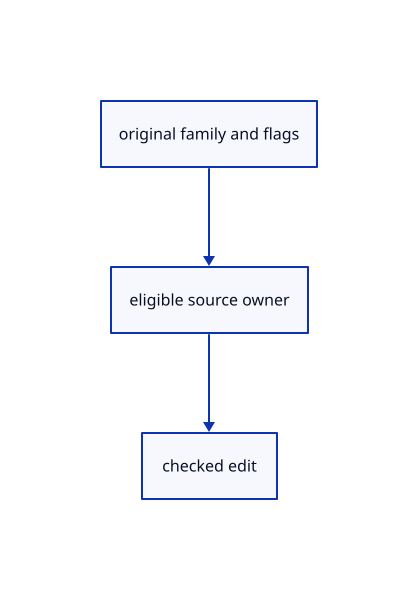

# 16.5.3 · Retain original Plane and Text edit eligibility

**Chapter 16 · Geometry editing and measurement · Section 16.5 · Text, styles and command integration** · [Contents](contents.md)

**Typing: 7–14 minutes.** [Estimate](typing-load.md).

Retain original Plane and Text edit eligibility.

## Type

Continue from [Validate original Plane display and precise bounds](85a-validate-original-plane-display-and-precise-bounds.md). [Save or recover your work](recovery.md).

### 1. `src/source_edit.rs`

Resolve original planes and eligible text owners.

<details>
<summary>Locate the existing block</summary>

```rust
use crate::scene::{ObjectId, Scene};
use session_rust::{Geometry, Xform};
use std::rc::Rc;
pub fn original(scene: &Scene, id: ObjectId) -> Option<Geometry> {
    if let Some(row) = scene.objects().iter().find(|r| r.id == id) {
        if let Some(original)=&row.original{return Some(original.clone())}
        if let Some(cad) = &row.cad {
            return Some(Geometry::BRep(cad.source.clone()));
        }
        if let Some(s) = &row.surface {
            return Some(Geometry::NurbsSurface(s.source.clone()));
        }
        return row.geometry().map(|g| Geometry::Mesh(g.clone()));
    }
    if let Some(row) = scene.points().iter().find(|r| r.id == id) {
        return Some(Geometry::Point(row.prepared.source.clone()));
    }
    crate::gather_draft::Draft::source(scene, id)
}
pub fn same(a: &Geometry, b: &Geometry) -> bool {
    match (a, b) {
        (Geometry::OBB(a), Geometry::OBB(b)) => Rc::ptr_eq(a, b),
        (Geometry::Line(a), Geometry::Line(b)) => Rc::ptr_eq(a, b),
        (Geometry::Polyline(a), Geometry::Polyline(b)) => Rc::ptr_eq(a, b),
        (Geometry::NurbsCurve(a), Geometry::NurbsCurve(b)) => Rc::ptr_eq(a, b),
        (Geometry::Point(a), Geometry::Point(b)) => Rc::ptr_eq(a, b),
        (Geometry::Mesh(a), Geometry::Mesh(b)) => Rc::ptr_eq(a, b),
        (Geometry::BRep(a), Geometry::BRep(b)) => Rc::ptr_eq(a, b),
        (Geometry::NurbsSurface(a), Geometry::NurbsSurface(b)) => Rc::ptr_eq(a, b),
        _ => false,
    }
}
#[derive(Clone)]
pub struct Owner {
    pub id: ObjectId,
    pub source: Geometry,
    pub model: Xform,
}
impl Owner {
    pub fn capture(scene: &Scene, id: ObjectId) -> Result<Self, &'static str> {
        if scene.pick_id(id.value()) != Some(id) {
            return Err("Pick a visible unlocked original");
        }
        Ok(Self {
            id,
            source: original(scene, id).ok_or("Reload an editable original source")?,
            model: scene.placement(id).ok_or("Source placement is missing")?,
        })
    }
    pub fn valid(&self, scene: &Scene) -> Result<(), &'static str> {
        if scene.pick_id(self.id.value()) != Some(self.id)
            || scene.placement(self.id).is_none_or(|p| p.m != self.model.m)
            || original(scene, self.id).is_none_or(|g| !same(&self.source, &g))
        {
            return Err("Original source changed; start again");
        }
        Ok(())
    }
}
```

</details>

Edit the existing block to match this code; keep unchanged lines:

```rust
use crate::scene::{ObjectId, Scene};
use session_rust::{Geometry, Xform};
use std::rc::Rc;
pub fn original(scene: &Scene, id: ObjectId) -> Option<Geometry> {
    if let Some(row) = scene.objects().iter().find(|r| r.id == id) {
        if let Some(original)=&row.original{return Some(original.clone())}
        if let Some(cad) = &row.cad {
            return Some(Geometry::BRep(cad.source.clone()));
        }
        if let Some(s) = &row.surface {
            return Some(Geometry::NurbsSurface(s.source.clone()));
        }
        return row.geometry().map(|g| Geometry::Mesh(g.clone()));
    }
    if let Some(row) = scene.points().iter().find(|r| r.id == id) {
        return Some(Geometry::Point(row.prepared.source.clone()));
    }
    if let Some(row)=scene.clouds().iter().find(|r|r.id==id){return Some(Geometry::PointCloud(row.prepared.source.clone()))}
    crate::gather_draft::Draft::source(scene, id)
}
pub fn same(a: &Geometry, b: &Geometry) -> bool {
    match (a, b) {
        (Geometry::PointCloud(a), Geometry::PointCloud(b)) => Rc::ptr_eq(a,b),
        (Geometry::Plane(a), Geometry::Plane(b)) => Rc::ptr_eq(a,b),
        (Geometry::OBB(a), Geometry::OBB(b)) => Rc::ptr_eq(a, b),
        (Geometry::Line(a), Geometry::Line(b)) => Rc::ptr_eq(a, b),
        (Geometry::Polyline(a), Geometry::Polyline(b)) => Rc::ptr_eq(a, b),
        (Geometry::NurbsCurve(a), Geometry::NurbsCurve(b)) => Rc::ptr_eq(a, b),
        (Geometry::Point(a), Geometry::Point(b)) => Rc::ptr_eq(a, b),
        (Geometry::Mesh(a), Geometry::Mesh(b)) => Rc::ptr_eq(a, b),
        (Geometry::BRep(a), Geometry::BRep(b)) => Rc::ptr_eq(a, b),
        (Geometry::NurbsSurface(a), Geometry::NurbsSurface(b)) => Rc::ptr_eq(a, b),
        _ => false,
    }
}
#[derive(Clone)]
pub struct Owner {
    pub id: ObjectId,
    pub source: Geometry,
    pub model: Xform,
}
impl Owner {
    pub fn capture(scene: &Scene, id: ObjectId) -> Result<Self, &'static str> {
        if scene.pick_id(id.value()) != Some(id) {
            return Err("Pick a visible unlocked original");
        }
        Ok(Self {
            id,
            source: original(scene, id).ok_or("Reload an editable original source")?,
            model: scene.placement(id).ok_or("Source placement is missing")?,
        })
    }
    pub fn valid(&self, scene: &Scene) -> Result<(), &'static str> {
        if scene.pick_id(self.id.value()) != Some(self.id)
            || scene.placement(self.id).is_none_or(|p| p.m != self.model.m)
            || original(scene, self.id).is_none_or(|g| !same(&self.source, &g))
        {
            return Err("Original source changed; start again");
        }
        Ok(())
    }
}

pub fn editable(scene:&Scene,id:ObjectId)->Result<(),&'static str>{
    if scene.pick_id(id.value())!=Some(id){return Err("Pick a visible unlocked original")}
    if scene.objects().iter().any(|r|r.id==id&&r.original.is_none()&&r.geometry().is_none()){return Err("Reload an editable original source")}
    Ok(())
}
```

<details>
<summary>Optional patch references</summary>

Use these original edit fragments when comparing a saved checkpoint. Apply the complete blocks above.

```text
--8<-- "journey/code/85b-retain-original-plane-and-text-edit-eligibility-01.rs"
```

```text
--8<-- "journey/code/85b-retain-original-plane-and-text-edit-eligibility-02.rs"
```

</details>

### 2. `src/source_part.rs`

Expose original Plane geometry to source algorithms.

<details>
<summary>Locate the existing block</summary>

```rust
pub fn geometry(scene:&Scene,id:ObjectId)->Result<Geometry,&'static str> {
    let row=scene.objects().iter().find(|row|row.id==id).ok_or("Source object is missing")?;
    if let Some(cad)=&row.cad{return Ok(Geometry::BRep(Rc::clone(&cad.source)))}
    if let Some(surface)=&row.surface{return Ok(Geometry::NurbsSurface(Rc::clone(&surface.source)))}
```

</details>

Edit the existing block to match this code; keep unchanged lines:

```rust
--8<-- "journey/code/85b-retain-original-plane-and-text-edit-eligibility-03.rs"
```

## Run and check

Run this from `session_viewer` to select the fixed dependency versions and install supplied binary assets. It updates Cargo.lock and preserves the previous lock. It does not write implementation code:

```sh
npm --prefix ../session_tests run course -- dependencies 16.5.3
```

In your project:

```sh
cd workspace/journey
REGEN_PROTO=0 cargo build --lib --locked --target wasm32-unknown-unknown -j1
REGEN_PROTO=0 CARGO_BUILD_JOBS=1 trunk serve --port 8780
```

Open `http://127.0.0.1:8780/`. Keep an existing Trunk server running; saving rebuilds it.


### Recorded visual result

**Previous native render — current verification pending.**

The preceding solid, wire bounding box and temporary distance annotation remain visible.


*This recorded image predates a source or checker change. Rebuild this checkpoint before using it as current evidence; browser controls require separate acceptance.*

This reference image is shared with [16.4.14 · Exercise original boxes and temporary distance annotations](84m-exercise-original-boxes-and-temporary-distance-annotations.md). It does not demonstrate a new feature by itself.

<details>
<summary>Code explanation and diagram</summary>


original family and flags → eligible source owner → checked edit.



Should Text be excluded from a group?

No. Text retains its original label owner and participates in eligible group and graph edits.

Study estimate, including typing and experiments: 0.5–1 hours.

</details>

<details>
<summary>Optional experiment</summary>

Inspect released-source guards and original Plane resolution.

</details>

<details>
<summary>Check and save your work</summary>

Restore experimental edits, then run from `session_viewer`:

```sh
npm --prefix ../session_tests run course -- check 16.5.3
npm --prefix ../session_tests run course -- save 16.5.3
```

Source comparison leaves your project untouched. [Save and recovery instructions](recovery.md).

</details>

<details>
<summary>Viewer coverage and verification</summary>

Retain original Plane and Text edit eligibility.

The inherited measurement browser contract remains authored and unrun. The current-command browser contract connects at85ay and still requires real browser execution.

[Full validation scope](release.md).

To reproduce the scripted acceptance of the reference checkpoint, run from `session_viewer` with the [course bundle server](release.md#reproduce) running on port 8781:

```sh
npm --prefix ../session_tests run course -- capture 16.5.3
```

This uses the verified reference bundle; it does not check or change your typed project.

</details>
