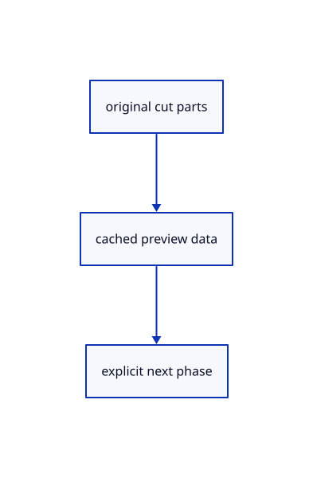

# 16.5.14 · Preview cuts without changing originals

**Chapter 16 · Geometry editing and measurement · Section 16.5 · Text, styles and command integration** · [Contents](contents.md)

**Typing: 12–24 minutes.** [Estimate](typing-load.md).

Preview cuts without changing originals.

## Type

Continue from [Hit remaining trim parts in canvas pixels](85l-hit-remaining-trim-parts-in-canvas-pixels.md). [Save or recover your work](recovery.md).

### 1. `src/trim_draft.rs`

<details>
<summary>Locate the existing block</summary>

```rust
        for(i,cut)in self.cuts.iter().enumerate(){let back=cut.owner.model.inverse()?;let local=unit_ray(&ray.origin,&ray.direction,&back);for(part,mesh)in cut.parts.hit_meshes(){if cut.removed.contains(&part){continue}if let Some(hits)=intersection::ray_mesh(&local,mesh,1e-12,false){if let Some(hit)=hits.first(){let distance=hit.transformed(&cut.owner.model).distance(&ray.origin,None);if best.is_none_or(|(near,_)|distance<near){best=Some((distance,(i,part)))}}}}}best.map(|(_,hit)|hit)
    }


}
```

</details>

Edit the existing block to match this code; keep unchanged lines:

```rust
--8<-- "journey/code/85m-preview-cuts-without-changing-originals-01.rs"
```

## Run and check

Run this from `session_viewer` to select the fixed dependency versions and install supplied binary assets. It updates Cargo.lock and preserves the previous lock. It does not write implementation code:

```sh
npm --prefix ../session_tests run course -- dependencies 16.5.14
```

In your project:

```sh
cd workspace/journey
REGEN_PROTO=0 cargo build --lib --locked --target wasm32-unknown-unknown -j1
REGEN_PROTO=0 CARGO_BUILD_JOBS=1 trunk serve --port 8780
```

Open `http://127.0.0.1:8780/`. Keep an existing Trunk server running; saving rebuilds it.


### Recorded visual result

**Previous native render — current verification pending.**

The preceding solid, wire bounding box and temporary distance annotation remain visible.


*This recorded image predates a source or checker change. Rebuild this checkpoint before using it as current evidence; browser controls require separate acceptance.*

This reference image is shared with [16.4.14 · Exercise original boxes and temporary distance annotations](84m-exercise-original-boxes-and-temporary-distance-annotations.md). It does not demonstrate a new feature by itself.

<details>
<summary>Code explanation and diagram</summary>


original cut parts → cached preview data → explicit next phase.



Can the last piece disappear through Trim?

No. At least one part stays; Delete removes the whole owner. Preview uses a disposable scene clone.

Study estimate, including typing and experiments: 0.5–1 hours.

</details>

<details>
<summary>Optional experiment</summary>

Inspect source freshness, one remaining part, Escape and the prepared one-transaction edits.

</details>

<details>
<summary>Check and save your work</summary>

Restore experimental edits, then run from `session_viewer`:

```sh
npm --prefix ../session_tests run course -- check 16.5.14
npm --prefix ../session_tests run course -- save 16.5.14
```

Source comparison leaves your project untouched. [Save and recovery instructions](recovery.md).

</details>

<details>
<summary>Viewer coverage and verification</summary>

Preview cuts without changing originals.

The inherited measurement browser contract remains authored and unrun. The current-command browser contract connects at85ay and still requires real browser execution.

[Full validation scope](release.md).

To reproduce the scripted acceptance of the reference checkpoint, run from `session_viewer` with the [course bundle server](release.md#reproduce) running on port 8781:

```sh
npm --prefix ../session_tests run course -- capture 16.5.14
```

This uses the verified reference bundle; it does not check or change your typed project.

</details>
