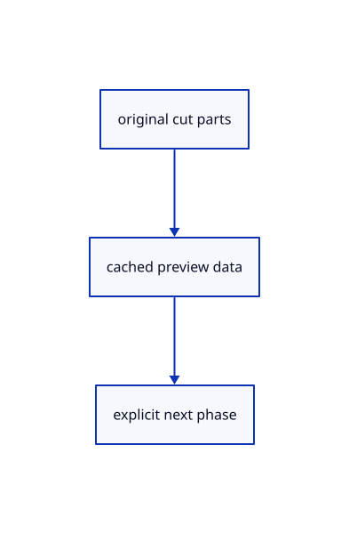

# 16.5.15 · Show remaining cuts and removed-part guides

**Chapter 16 · Geometry editing and measurement · Section 16.5 · Text, styles and command integration** · [Contents](contents.md)

**Typing: 9–18 minutes.** [Estimate](typing-load.md).

Show remaining cuts and removed-part guides.

## Type

Continue from [Preview cuts without changing originals](85m-preview-cuts-without-changing-originals.md). [Save or recover your work](recovery.md).

### 1. `src/trim_draft.rs`

<details>
<summary>Locate the existing block</summary>

```rust
        self.preview=Some(preview);Ok(())
    }

    pub fn changed(&self)->bool{self.cuts.iter().any(|c|!c.removed.is_empty())}
    pub fn prepared_edits(&self,scene:&Scene)->Result<Vec<(ObjectId,Vec<Geometry>)>,String>{self.cuts.iter().filter(|c|!c.removed.is_empty()).map(|c|{c.owner.valid(scene)?;Ok((c.owner.id,crate::trim_parts::kept(&c.owner.source,&c.parts,&c.removed)?))}).collect()}
```

</details>

Edit the existing block to match this code; keep unchanged lines:

```rust
--8<-- "journey/code/85n-show-remaining-cuts-and-removed-part-guides-01.rs"
```

## Run and check

Run this from `session_viewer` to select the fixed dependency versions and install supplied binary assets. It updates Cargo.lock and preserves the previous lock. It does not write implementation code:

```sh
npm --prefix ../session_tests run course -- dependencies 16.5.15
```

In your project:

```sh
cd workspace/journey
REGEN_PROTO=0 cargo build --lib --locked --target wasm32-unknown-unknown -j1
REGEN_PROTO=0 CARGO_BUILD_JOBS=1 trunk serve --port 8780
```

Open `http://127.0.0.1:8780/`. Keep an existing Trunk server running; saving rebuilds it.


### Recorded visual result

**Previous native render — current verification pending.**

The preceding solid, wire bounding box and temporary distance annotation remain visible.


*This recorded image predates a source or checker change. Rebuild this checkpoint before using it as current evidence; browser controls require separate acceptance.*

This reference image is shared with [16.4.14 · Exercise original boxes and temporary distance annotations](84m-exercise-original-boxes-and-temporary-distance-annotations.md). It does not demonstrate a new feature by itself.

<details>
<summary>Code explanation and diagram</summary>


original cut parts → cached preview data → explicit next phase.



Do colored guides enter Undo history?

No. Remaining parts are blue; hovered parts are dashed red with a remove chip.

Study estimate, including typing and experiments: 0.5–1 hours.

</details>

<details>
<summary>Optional experiment</summary>

Compare retained section strokes and cut points with temporary guide IDs.

</details>

<details>
<summary>Check and save your work</summary>

Restore experimental edits, then run from `session_viewer`:

```sh
npm --prefix ../session_tests run course -- check 16.5.15
npm --prefix ../session_tests run course -- save 16.5.15
```

Source comparison leaves your project untouched. [Save and recovery instructions](recovery.md).

</details>

<details>
<summary>Viewer coverage and verification</summary>

Show remaining cuts and removed-part guides.

The inherited measurement browser contract remains authored and unrun. The current-command browser contract connects at85ay and still requires real browser execution.

[Full validation scope](release.md).

To reproduce the scripted acceptance of the reference checkpoint, run from `session_viewer` with the [course bundle server](release.md#reproduce) running on port 8781:

```sh
npm --prefix ../session_tests run course -- capture 16.5.15
```

This uses the verified reference bundle; it does not check or change your typed project.

</details>
