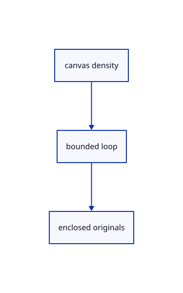

# 16.5.16 · Sample bounded physical-pixel lasso loops

**Chapter 16 · Geometry editing and measurement · Section 16.5 · Text, styles and command integration** · [Contents](contents.md)

**Typing: 22–43 minutes.** [Estimate](typing-load.md).

Sample bounded physical-pixel lasso loops.

## Type

Continue from [Show remaining cuts and removed-part guides](85n-show-remaining-cuts-and-removed-part-guides.md). [Save or recover your work](recovery.md).

### 1. `src/lasso.rs`

Create the file and type:

```rust
--8<-- "journey/code/85o-sample-bounded-physical-pixel-lasso-loops-01.rs"
```

### 2. `src/lib.rs`

Register this command owner.

<details>
<summary>Locate the existing block</summary>

```rust

pub mod trim_draft;
```

</details>

After that block, type:

```rust
--8<-- "journey/code/85o-sample-bounded-physical-pixel-lasso-loops-02.rs" skip=21
```

<details>
<summary>Supplied validation fixture</summary>

Copy this supplied authoring fixture once. Continue with the browser build below; the course does not require running native tests.

### 3. `src/lasso.rs`

Copy the maintained bounded-loop spacing fixture.

<details>
<summary>Locate the existing block</summary>

```text
    pub fn abandoned(&mut self){self.points.clear();self.pointer=None;}
}
```

</details>

After that block, append this supplied code:

```text
--8<-- "journey/code/85o-sample-bounded-physical-pixel-lasso-loops-03.rs" skip=74
```

</details>

## Run and check

Run this from `session_viewer` to select the fixed dependency versions and install supplied binary assets. It updates Cargo.lock and preserves the previous lock. It does not write implementation code:

```sh
npm --prefix ../session_tests run course -- dependencies 16.5.16
```

In your project:

```sh
cd workspace/journey
REGEN_PROTO=0 cargo build --lib --locked --target wasm32-unknown-unknown -j1
REGEN_PROTO=0 CARGO_BUILD_JOBS=1 trunk serve --port 8780
```

Open `http://127.0.0.1:8780/`. Keep an existing Trunk server running; saving rebuilds it.


### Recorded visual result

**Previous native render — current verification pending.**

The preceding solid, wire bounding box and temporary distance annotation remain visible.


*This recorded image predates a source or checker change. Rebuild this checkpoint before using it as current evidence; browser controls require separate acceptance.*

This reference image is shared with [16.4.14 · Exercise original boxes and temporary distance annotations](84m-exercise-original-boxes-and-temporary-distance-annotations.md). It does not demonstrate a new feature by itself.

<details>
<summary>Code explanation and diagram</summary>


canvas density → bounded loop → enclosed originals.



Does display density stretch the lasso?

No. Sampling and projection both use physical pixels; the overlay converts back to CSS.

Study estimate, including typing and experiments: 0.5–1 hours.

</details>

<details>
<summary>Optional experiment</summary>

Compare density 1 and 2,4096-point thinning, whole-object enclosure and miss retention.

</details>

<details>
<summary>Check and save your work</summary>

Restore experimental edits, then run from `session_viewer`:

```sh
npm --prefix ../session_tests run course -- check 16.5.16
npm --prefix ../session_tests run course -- save 16.5.16
```

Source comparison leaves your project untouched. [Save and recovery instructions](recovery.md).

</details>

<details>
<summary>Viewer coverage and verification</summary>

Sample bounded physical-pixel lasso loops.

The inherited measurement browser contract remains authored and unrun. The current-command browser contract connects at85ay and still requires real browser execution.

[Full validation scope](release.md).

To reproduce the scripted acceptance of the reference checkpoint, run from `session_viewer` with the [course bundle server](release.md#reproduce) running on port 8781:

```sh
npm --prefix ../session_tests run course -- capture 16.5.16
```

This uses the verified reference bundle; it does not check or change your typed project.

</details>
