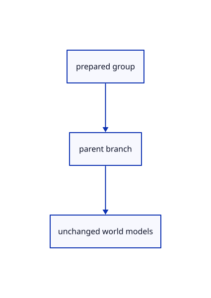

# 16.5.22 · Adopt group branches with one reversible edit

**Chapter 16 · Geometry editing and measurement · Section 16.5 · Text, styles and command integration** · [Contents](contents.md)

**Typing: 18–36 minutes.** [Estimate](typing-load.md).

Adopt group branches with one reversible edit.

## Type

Continue from [Plan world-preserving original groups](85t-plan-world-preserving-original-groups.md). [Save or recover your work](recovery.md).

### 1. `src/layer_edit.rs`

Adopt a checked group and preserve copied group membership.

Edit these blocks from bottom to top. Keep the surrounding lines unchanged.

<details>
<summary>Locate this block</summary>

```rust
    for(owner,parent,tree,_model)in sources{let copy=copy_branch(scene,tree,false)?;let id=copy.node.object.ok_or("Copy owner is missing")?;place_copy(scene,&copy,delta)?;copies.push(id);find(&mut trees[owner],&parent).ok_or("Copy parent is missing")?.children.push(copy);}
    for(owner,tree)in trees.into_iter().enumerate(){replace(scene,owner,tree);}Ok(copies)
}
```

</details>

Replace it with:

```rust
    for(owner,parent,tree,_model)in sources{let copy=copy_branch(scene,tree,false)?;let id=copy.node.object.ok_or("Copy owner is missing")?;place_copy(scene,&copy,delta)?;copies.push(id);find(&mut trees[owner],&parent).ok_or("Copy parent is missing")?.children.push(copy);}
    for(owner,tree)in trees.into_iter().enumerate(){replace(scene,owner,tree);}Ok(copies)
}

pub fn group(scene:&mut Scene,ids:&[crate::scene::ObjectId],name:&str)->Result<String,&'static str>{
    let crate::group_plan::Plan{owner,document:doc,name,parent,members}=crate::group_plan::Plan::new(scene,ids,name)?;
    let parent_node=&doc.nodes[parent];let parent_world=parent_node.placement.world.clone();let back=parent_world.inverse().ok_or("The layer is degenerate")?;
    let source=session_rust::proto::TreeNode{guid:uuid::Uuid::new_v4().to_string(),name:name.clone(),..Default::default()};let group_guid=source.guid.clone();
    let mut group=Branch{node:Node{placement:crate::nested_placement::Node{local:Default::default(),world:parent_world.clone(),parent:parent_world.clone()},portable_guid:group_guid.clone(),source,object:None,label:name.clone(),parent:None,depth:0,end:1,readonly:false},children:Vec::new()};let mut tree=branch(&doc,0);
    for id in members{let mut member=take(&mut tree,id).ok_or("Object tree is gone")?;let world=scene.placement(id).ok_or("Source placement is missing")?;member.node.placement=crate::nested_placement::Node{local:&back*&world,world,parent:parent_world.clone()};group.children.push(member);}
    find(&mut tree,&parent_node.source.guid).ok_or("Shared layer is gone")?.children.push(group);let mut nodes=Vec::new();flatten(tree.clone(),None,0,&mut nodes);if nodes.iter().any(|node|node.depth>crate::hierarchy::MAX_DEPTH){return Err("Tree exceeds its depth limit")}
    replace(scene,owner,tree);Rc::make_mut(&mut scene.groups).insert((doc.key,group_guid));Ok(name)
}
```

<details>
<summary>Locate this block</summary>

```rust
}

fn copy_branch(scene:&mut Scene,mut tree:Branch,all:bool)->Result<Branch,&'static str> {
    tree.node.source.guid=uuid::Uuid::new_v4().to_string();tree.node.portable_guid=tree.node.source.guid.clone();
    if let Some(id)=tree.node.object {let copy=scene.copy_row(id,all)?;tree.node.object=Some(copy);tree.node.source.name=scene.row_guid(copy).unwrap().to_owned();}
    tree.children=tree.children.into_iter().map(|child|copy_branch(scene,child,all)).collect::<Result<_,_>>()?;Ok(tree)
}
```

</details>

Replace it with:

```rust
}

fn copy_branch(scene:&mut Scene,mut tree:Branch,all:bool)->Result<Branch,&'static str> {
    let group_doc=scene.forest.documents.iter().find(|d|scene.groups.contains(&(d.key,tree.node.source.guid.clone()))).map(|d|d.key);
    tree.node.source.guid=uuid::Uuid::new_v4().to_string();tree.node.portable_guid=tree.node.source.guid.clone();
    if let Some(key)=group_doc {Rc::make_mut(&mut scene.groups).insert((key,tree.node.source.guid.clone()));}
    if let Some(id)=tree.node.object {let copy=scene.copy_row(id,all)?;tree.node.object=Some(copy);tree.node.source.name=scene.row_guid(copy).unwrap().to_owned();}
    tree.children=tree.children.into_iter().map(|child|copy_branch(scene,child,all)).collect::<Result<_,_>>()?;Ok(tree)
}
```

<details>
<summary>Complete updated block reference</summary>

```rust
use crate::{hierarchy::{Document,Node},scene::Scene};
use std::rc::Rc;

pub enum Edit {Current,New {sublayer:bool},Rename(String),Delete,Duplicate,Move(Vec<crate::scene::ObjectId>),Copy(Vec<crate::scene::ObjectId>)}

// Temporary branches make subtree edits atomic while the saved scene continues sharing its original source and display allocations.
#[derive(Clone)]
struct Branch {node:Node,children:Vec<Branch>}

fn branch(doc:&Document,index:usize)->Branch {
    Branch {node:doc.nodes[index].clone(),children:(index+1..doc.nodes[index].end).filter(|child|doc.nodes[*child].parent==Some(index)).map(|child|branch(doc,child)).collect()}
}

fn find<'a>(root:&'a mut Branch,guid:&str)->Option<&'a mut Branch> {
    if root.node.source.guid==guid {return Some(root);}
    root.children.iter_mut().find_map(|child|find(child,guid))
}

fn flatten(root:Branch,parent:Option<usize>,depth:usize,nodes:&mut Vec<Node>) {
    let index=nodes.len();let mut node=root.node;node.parent=parent;node.depth=depth;
    node.source.parent_guid=parent.map_or_else(String::new,|parent|nodes[parent].source.guid.clone());
    nodes.push(node);
    for child in root.children {flatten(child,Some(index),depth+1,nodes);}
    nodes[index].end=nodes.len();
}

pub fn locate(scene:&Scene,key:&str)->Result<(usize,usize), &'static str> {locate_group(scene,key,true)}

fn locate_group(scene:&Scene,key:&str,editable:bool)->Result<(usize,usize), &'static str> {
    for (owner,doc) in scene.forest.documents.iter().enumerate() {
        for (index,node) in doc.nodes.iter().enumerate() {
            if format!("{}/{}",doc.key,node.source.guid)!=key {continue;}
            let mut ancestor=Some(index);
            while let Some(index)=ancestor {
                if doc.nodes[index].object.is_some() {return Err("Objects and their attributes are not layers");}
                ancestor=doc.nodes[index].parent;
            }
            if editable && doc.nodes.iter().filter_map(|node|node.object).any(|id|scene.objects().iter().any(|row|row.id==id&&row.geometry().is_none())) {return Err("Reload editable sources before editing layers");}
            return Ok((owner,index));
        }
    }
    Err("This layer is gone")
}

pub fn holds_current(scene:&Scene,key:&str)->bool {
    let Some(current)=current_key(scene) else {return false;};
    let rows=crate::hierarchy::rows(scene);
    rows.iter().position(|row|row.key==key).is_some_and(|index|rows[index..rows[index].end].iter().any(|row|row.key==current))
}

pub fn current_key(scene:&Scene)->Option<String> {
    if let Some(key)=scene.view.current.as_ref() && locate_group(scene,key,false).is_ok() {return Some(key.clone());}
    let doc=scene.forest.documents.iter().find(|doc|Some(doc.key)==scene.created)?;
    Some(format!("{}/{}",doc.key,doc.nodes[0].source.guid))
}

fn replace(scene:&mut Scene,owner:usize,tree:Branch) {
    let old=&scene.forest.documents[owner];let mut document=Document {header:old.header.clone(),key:old.key,label:old.label.clone(),nodes:Vec::new()};
    flatten(tree,None,0,&mut document.nodes);scene.forest.replace(owner,document);Rc::make_mut(&mut scene.view).refresh(&scene.forest);
}

pub(crate) fn attach_generated(scene:&mut Scene,id:crate::scene::ObjectId,guid:String,label:String)->Result<(), &'static str> {
    if current_key(scene).is_none() {
        scene.forest.add(id.value(),"Created".into(),None,&[]);scene.created=Some(id.value());
    }
    let key=current_key(scene).unwrap();let (owner,index)=locate(scene,&key)?;let doc=&scene.forest.documents[owner];
    if doc.nodes.len()>=crate::hierarchy::MAX_NODES||doc.nodes[index].depth>=crate::hierarchy::MAX_DEPTH {return Err("Current layer exceeds its tree limit");}
    let parent=doc.nodes[index].source.guid.clone();let mut tree=branch(doc,0);
    let source=session_rust::proto::TreeNode {guid:uuid::Uuid::new_v4().to_string(),name:guid,..Default::default()};
    find(&mut tree,&parent).unwrap().children.push(Branch {node:Node {placement:Default::default(),portable_guid:source.guid.clone(),source,object:Some(id),label,parent:None,depth:0,end:1,readonly:false},children:Vec::new()});
    replace(scene,owner,tree);Ok(())
}

fn take(root:&mut Branch,id:crate::scene::ObjectId)->Option<Branch> {
    if let Some(index)=root.children.iter().position(|child|child.node.object==Some(id)) {return Some(root.children.remove(index));}
    root.children.iter_mut().find_map(|child|take(child,id))
}

fn copy_branch(scene:&mut Scene,mut tree:Branch,all:bool)->Result<Branch,&'static str> {
    let group_doc=scene.forest.documents.iter().find(|d|scene.groups.contains(&(d.key,tree.node.source.guid.clone()))).map(|d|d.key);
    tree.node.source.guid=uuid::Uuid::new_v4().to_string();tree.node.portable_guid=tree.node.source.guid.clone();
    if let Some(key)=group_doc {Rc::make_mut(&mut scene.groups).insert((key,tree.node.source.guid.clone()));}
    if let Some(id)=tree.node.object {let copy=scene.copy_row(id,all)?;tree.node.object=Some(copy);tree.node.source.name=scene.row_guid(copy).unwrap().to_owned();}
    tree.children=tree.children.into_iter().map(|child|copy_branch(scene,child,all)).collect::<Result<_,_>>()?;Ok(tree)
}

fn transfer(scene:&mut Scene,key:&str,ids:Vec<crate::scene::ObjectId>,copy:bool)->Result<(), &'static str> {
    let (owner,index)=locate(scene,key)?;let target=scene.forest.documents[owner].nodes[index].source.guid.clone();
    if ids.is_empty() {return Err("Select objects first");}
    if ids.iter().any(|id|scene.pick_id(id.value())!=Some(*id)) {return Err("Choose visible unlocked editable objects");}
    let chosen=ids.into_iter().collect::<std::collections::HashSet<_>>();let mut trees=scene.forest.documents.iter().map(|doc|branch(doc,0)).collect::<Vec<_>>();let mut moved=Vec::new();
    for (doc_index,doc) in scene.forest.documents.iter().enumerate() {
        for (index,node) in doc.nodes.iter().enumerate() {
            let Some(id)=node.object.filter(|id|chosen.contains(id)) else {continue;};let mut parent=node.parent;let mut follows=false;
            while let Some(index)=parent {follows|=doc.nodes[index].object.is_some_and(|id|chosen.contains(&id));parent=doc.nodes[index].parent;}
            if follows&&!copy {continue;}
            if !copy&&doc_index==owner&&node.parent.is_some_and(|parent|doc.nodes[parent].source.guid==target) {continue;}
            let mut tree=if copy {branch(doc,index)} else {take(&mut trees[doc_index],id).ok_or("Object tree is gone")?};
            if copy {tree.children.clear();}
            moved.push(tree);
        }
    }
    if moved.is_empty() {return Err("The objects are already on this layer");}
    let mut target_nodes=Vec::new();flatten(trees[owner].clone(),None,0,&mut target_nodes);let count=target_nodes.len()+moved.iter().map(|tree|{let mut nodes=Vec::new();flatten(tree.clone(),None,0,&mut nodes);nodes.len()}).sum::<usize>();
    if count>crate::hierarchy::MAX_NODES {return Err("Target layer exceeds its node limit");}
    for tree in moved {let tree=if copy {copy_branch(scene,tree,false)?} else {tree};find(&mut trees[owner],&target).unwrap().children.push(tree);}
    for (owner,tree) in trees.into_iter().enumerate() {let mut nodes=Vec::new();flatten(tree.clone(),None,0,&mut nodes);if nodes.iter().any(|node|node.depth>crate::hierarchy::MAX_DEPTH) {return Err("Target layer exceeds its depth limit");}replace(scene,owner,tree);}
    Ok(())
}

fn new_layer(scene:&mut Scene,key:&str,sublayer:bool)->Result<(), &'static str> {
    let (owner,index)=locate(scene,key)?;let doc=&scene.forest.documents[owner];let node=&doc.nodes[index];
    if doc.nodes.len()>=crate::hierarchy::MAX_NODES {return Err("Tree exceeds its node limit");}
    let parent=if sublayer {index} else {node.parent.unwrap_or(index)};
    if doc.nodes[parent].depth>=crate::hierarchy::MAX_DEPTH {return Err("Tree exceeds its depth limit");}
    let label=(1..).map(|i|format!("Layer {i:02}")).find(|name|!doc.nodes.iter().any(|node|node.label==*name||node.source.name==*name)).unwrap();
    let source=session_rust::proto::TreeNode {guid:uuid::Uuid::new_v4().to_string(),name:label.clone(),..Default::default()};
    let child=Branch {node:Node {placement:Default::default(),portable_guid:source.guid.clone(),source,object:None,label,parent:None,depth:0,end:1,readonly:false},children:Vec::new()};
    let mut tree=branch(doc,0);find(&mut tree,&doc.nodes[parent].source.guid).unwrap().children.push(child);replace(scene,owner,tree);Ok(())
}

fn rename(scene:&mut Scene,key:&str,label:&str)->Result<(), &'static str> {
    let (owner,index)=locate(scene,key)?;let doc=&scene.forest.documents[owner];let node=&doc.nodes[index];
    if node.parent.is_none() {return Err("The root layer cannot be renamed");}
    let label=label.trim();
    if label.is_empty()||label.contains('/') {return Err("A layer name must be non-empty and without /");}
    if label==node.label {return Err("The layer already has that name");}
    if doc.nodes.iter().any(|other|other.label==label||other.source.name==label) {return Err("This name is already used in the document");}
    let mut tree=branch(doc,0);let node=&mut find(&mut tree,&node.source.guid).unwrap().node;node.label=label.to_owned();node.source.name=label.to_owned();replace(scene,owner,tree);Ok(())
}

fn delete(scene:&mut Scene,key:&str)->Result<(), &'static str> {
    let (owner,index)=locate(scene,key)?;let doc=&scene.forest.documents[owner];let node=&doc.nodes[index];
    let parent=node.parent.ok_or("The root layer cannot be deleted")?;
    if holds_current(scene,key) {return Err("The current layer cannot be deleted");}
    let ids=doc.nodes[index..node.end].iter().filter_map(|node|node.object).collect::<Vec<_>>();let mut tree=branch(doc,0);
    find(&mut tree,&doc.nodes[parent].source.guid).unwrap().children.retain(|child|child.node.source.guid!=node.source.guid);
    for id in ids {scene.remove(id);}replace(scene,owner,tree);Ok(())
}

fn duplicate(scene:&mut Scene,key:&str)->Result<(), &'static str> {
    let (owner,index)=locate(scene,key)?;let doc=&scene.forest.documents[owner];let node=&doc.nodes[index];
    let parent=node.parent.ok_or("The root layer cannot be duplicated")?;
    if doc.nodes.len()+node.end-index>crate::hierarchy::MAX_NODES {return Err("Tree exceeds its node limit");}
    let label=(1..).map(|i|format!("{} copy {i:02}",node.label)).find(|name|!doc.nodes.iter().any(|node|node.label==*name||node.source.name==*name)).unwrap();
    let parent=doc.nodes[parent].source.guid.clone();let source=branch(doc,index);let mut tree=branch(doc,0);let mut copy=copy_branch(scene,source,true)?;copy.node.label=label.clone();copy.node.source.name=label;
    find(&mut tree,&parent).unwrap().children.push(copy);replace(scene,owner,tree);Ok(())
}

pub fn apply(scene:&mut Scene,key:&str,edit:Edit)->Result<(), &'static str> {
    match edit {
        Edit::Current=>{locate(scene,key)?;Rc::make_mut(&mut scene.view).current=Some(key.to_owned());Ok(())},
        Edit::New {sublayer}=>new_layer(scene,key,sublayer),
        Edit::Rename(label)=>rename(scene,key,&label),
        Edit::Delete=>delete(scene,key),
        Edit::Duplicate=>duplicate(scene,key),
        Edit::Move(ids)=>transfer(scene,key,ids,false),
        Edit::Copy(ids)=>transfer(scene,key,ids,true),
    }
}

pub(crate) fn copy_objects(scene:&mut Scene,ids:&[crate::scene::ObjectId],delta:&session_rust::Xform)->Result<Vec<crate::scene::ObjectId>, &'static str> {
    if ids.is_empty(){return Err("Select objects before Copy");}
    if !crate::placement::valid(&delta.m){return Err("Copy transform is invalid");}
    let mut chosen=ids.to_vec();chosen.sort_unstable_by_key(|id|id.value());chosen.dedup();
    if chosen.iter().any(|id|scene.pick_id(id.value())!=Some(*id)){return Err("Copy needs visible unlocked editable objects");}
    let mut trees=scene.forest.documents.iter().map(|doc|branch(doc,0)).collect::<Vec<_>>();let mut sources=Vec::new();
    for (owner,doc) in scene.forest.documents.iter().enumerate(){for(index,node)in doc.nodes.iter().enumerate(){let Some(id)=node.object.filter(|id|chosen.contains(id))else{continue};let parent=node.parent.ok_or("Object has no parent")?;let mut tree=branch(doc,index);tree.children.retain(|child|child.node.object.is_none()&&child.node.source.name=="attributes");sources.push((owner,doc.nodes[parent].source.guid.clone(),tree,scene.placement(id).ok_or("Copy placement is missing")?));}}
    if sources.len()!=chosen.len(){return Err("Copy source tree is missing");}
    for(owner,doc)in scene.forest.documents.iter().enumerate(){let extra=sources.iter().filter(|source|source.0==owner).map(|source|{let mut nodes=Vec::new();flatten(source.2.clone(),None,0,&mut nodes);nodes.len()}).sum::<usize>();if doc.nodes.len()+extra>crate::hierarchy::MAX_NODES{return Err("Copy exceeds the tree limit");}}
    let mut copies=Vec::new();
    fn place_copy(scene:&mut Scene,tree:&Branch,delta:&session_rust::Xform)->Result<(),&'static str>{if let Some(id)=tree.node.object{let model=scene.placement(id).ok_or("Copy placement is missing")?;scene.place_following(id,delta*&model)?;}for child in &tree.children{place_copy(scene,child,delta)?;}Ok(())}
    for(owner,parent,tree,_model)in sources{let copy=copy_branch(scene,tree,false)?;let id=copy.node.object.ok_or("Copy owner is missing")?;place_copy(scene,&copy,delta)?;copies.push(id);find(&mut trees[owner],&parent).ok_or("Copy parent is missing")?.children.push(copy);}
    for(owner,tree)in trees.into_iter().enumerate(){replace(scene,owner,tree);}Ok(copies)
}

pub fn group(scene:&mut Scene,ids:&[crate::scene::ObjectId],name:&str)->Result<String,&'static str>{
    let crate::group_plan::Plan{owner,document:doc,name,parent,members}=crate::group_plan::Plan::new(scene,ids,name)?;
    let parent_node=&doc.nodes[parent];let parent_world=parent_node.placement.world.clone();let back=parent_world.inverse().ok_or("The layer is degenerate")?;
    let source=session_rust::proto::TreeNode{guid:uuid::Uuid::new_v4().to_string(),name:name.clone(),..Default::default()};let group_guid=source.guid.clone();
    let mut group=Branch{node:Node{placement:crate::nested_placement::Node{local:Default::default(),world:parent_world.clone(),parent:parent_world.clone()},portable_guid:group_guid.clone(),source,object:None,label:name.clone(),parent:None,depth:0,end:1,readonly:false},children:Vec::new()};let mut tree=branch(&doc,0);
    for id in members{let mut member=take(&mut tree,id).ok_or("Object tree is gone")?;let world=scene.placement(id).ok_or("Source placement is missing")?;member.node.placement=crate::nested_placement::Node{local:&back*&world,world,parent:parent_world.clone()};group.children.push(member);}
    find(&mut tree,&parent_node.source.guid).ok_or("Shared layer is gone")?.children.push(group);let mut nodes=Vec::new();flatten(tree.clone(),None,0,&mut nodes);if nodes.iter().any(|node|node.depth>crate::hierarchy::MAX_DEPTH){return Err("Tree exceeds its depth limit")}
    replace(scene,owner,tree);Rc::make_mut(&mut scene.groups).insert((doc.key,group_guid));Ok(name)
}
```

</details>

<details>
<summary>Optional patch references</summary>

Use these original edit fragments when comparing a saved checkpoint. Apply the complete blocks above.

```text
--8<-- "journey/code/85u-adopt-group-branches-with-one-reversible-edit-01.rs"
```

```text
--8<-- "journey/code/85u-adopt-group-branches-with-one-reversible-edit-02.rs"
```

</details>

## Run and check

Run this from `session_viewer` to select the fixed dependency versions and install supplied binary assets. It updates Cargo.lock and preserves the previous lock. It does not write implementation code:

```sh
npm --prefix ../session_tests run course -- dependencies 16.5.22
```

In your project:

```sh
cd workspace/journey
REGEN_PROTO=0 cargo build --lib --locked --target wasm32-unknown-unknown -j1
REGEN_PROTO=0 CARGO_BUILD_JOBS=1 trunk serve --port 8780
```

Open `http://127.0.0.1:8780/`. Keep an existing Trunk server running; saving rebuilds it.


### Recorded visual result

**Previous native render — current verification pending.**

The preceding solid, wire bounding box and temporary distance annotation remain visible.


*This recorded image predates a source or checker change. Rebuild this checkpoint before using it as current evidence; browser controls require separate acceptance.*

This reference image is shared with [16.4.14 · Exercise original boxes and temporary distance annotations](84m-exercise-original-boxes-and-temporary-distance-annotations.md). It does not demonstrate a new feature by itself.

<details>
<summary>Code explanation and diagram</summary>


prepared group → parent branch → unchanged world models.



Can grouping released display proxies proceed?

No. Group only eligible original owners; source loading is connected later.

Study estimate, including typing and experiments: 0.5–1 hours.

</details>

<details>
<summary>Optional experiment</summary>

Inspect branch GUIDs, marked duplicated groups and one scene transaction.

</details>

<details>
<summary>Check and save your work</summary>

Restore experimental edits, then run from `session_viewer`:

```sh
npm --prefix ../session_tests run course -- check 16.5.22
npm --prefix ../session_tests run course -- save 16.5.22
```

Source comparison leaves your project untouched. [Save and recovery instructions](recovery.md).

</details>

<details>
<summary>Viewer coverage and verification</summary>

Adopt group branches with one reversible edit.

The inherited measurement browser contract remains authored and unrun. The current-command browser contract connects at85ay and still requires real browser execution.

[Full validation scope](release.md).

To reproduce the scripted acceptance of the reference checkpoint, run from `session_viewer` with the [course bundle server](release.md#reproduce) running on port 8781:

```sh
npm --prefix ../session_tests run course -- capture 16.5.22
```

This uses the verified reference bundle; it does not check or change your typed project.

</details>
