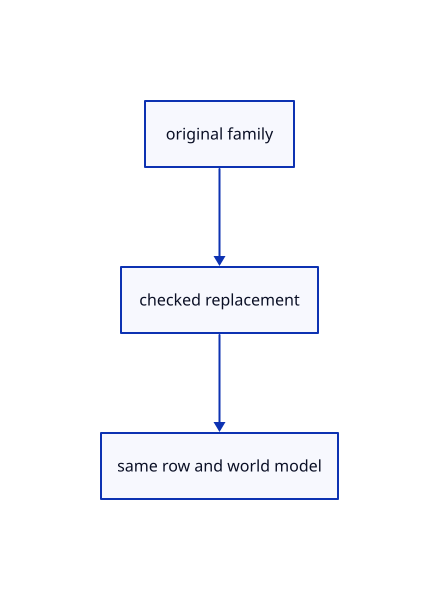

# 16.5.24 · Replace original families without changing world placement

**Chapter 16 · Geometry editing and measurement · Section 16.5 · Text, styles and command integration** · [Contents](contents.md)

**Typing: 19–38 minutes.** [Estimate](typing-load.md).

Replace original families without changing world placement.

## Type

Continue from [Append namespaced graphs and preserve original row identities](85v-append-namespaced-graphs-and-preserve-original-row-identities.md). [Save or recover your work](recovery.md).

### 1. `src/scene.rs`

Preserve original families during source replacement.

<details>
<summary>Locate the existing block</summary>

```rust
        use session_rust::Geometry;
        if self.pick_id(id.value())!=Some(id){return Err("Edit a visible unlocked original")}
        let original=crate::source_edit::original(self,id).ok_or("Reload an editable original source")?;
        let model=self.placement(id).ok_or("Source placement is missing")?;geometry.set_guid(original.guid());
        match geometry{
            Geometry::OBB(source)=>{let prepared=crate::bounds_original::prepared(&source)?;let bounds=crate::bounds_original::placed(&source,&model);if bounds.min.into_iter().chain(bounds.max).any(|v|!(v as f32).is_finite()){return Err("Edited box exceeds display range")}let row=self.objects.iter_mut().find(|r|r.id==id).ok_or("Expected a box source")?;row.mesh=Rc::new(prepared.display);row.original=Some(Geometry::OBB(source));row.editable=crate::edit_source::EditSource::Loaded{geometry:prepared.geometry,source:None};},
            Geometry::Point(source)=>{let prepared=crate::marker::PreparedPoint::new(source)?;let p=model.transform_point(&prepared.source);if(0..3).any(|i|!(p[i]as f32).is_finite()){return Err("Edited point exceeds display range")}self.points.iter_mut().find(|r|r.id==id).ok_or("Expected a point source")?.prepared=prepared;},
            Geometry::Line(source)if self.lines.iter().any(|r|r.id==id)=>{let prepared=crate::stroke::PreparedLine::new(source)?;for p in [prepared.source.start(),prepared.source.end()]{let p=model.transform_point(&p);if(0..3).any(|i|!(p[i]as f32).is_finite()){return Err("Edited line exceeds display range")}}self.lines.iter_mut().find(|r|r.id==id).unwrap().prepared=prepared;},
            Geometry::Line(_)|Geometry::Polyline(_)|Geometry::NurbsCurve(_)=>{
                let prepared=match geometry{Geometry::Line(source)=>crate::chain::PreparedChain::line(source)?,Geometry::Polyline(source)=>crate::chain::PreparedChain::polyline(source)?,Geometry::NurbsCurve(source)=>crate::chain::PreparedChain::curve(source)?,_=>unreachable!()};
```

</details>

Edit the existing block to match this code; keep unchanged lines:

```rust
--8<-- "journey/code/85w-replace-original-families-without-changing-world-placement-01.rs"
```

## Run and check

Run this from `session_viewer` to select the fixed dependency versions and install supplied binary assets. It updates Cargo.lock and preserves the previous lock. It does not write implementation code:

```sh
npm --prefix ../session_tests run course -- dependencies 16.5.24
```

In your project:

```sh
cd workspace/journey
REGEN_PROTO=0 cargo build --lib --locked --target wasm32-unknown-unknown -j1
REGEN_PROTO=0 CARGO_BUILD_JOBS=1 trunk serve --port 8780
```

Open `http://127.0.0.1:8780/`. Keep an existing Trunk server running; saving rebuilds it.


### Recorded visual result

**Previous native render — current verification pending.**

The preceding solid, wire bounding box and temporary distance annotation remain visible.


*This recorded image predates a source or checker change. Rebuild this checkpoint before using it as current evidence; browser controls require separate acceptance.*

This reference image is shared with [16.4.14 · Exercise original boxes and temporary distance annotations](84m-exercise-original-boxes-and-temporary-distance-annotations.md). It does not demonstrate a new feature by itself.

<details>
<summary>Code explanation and diagram</summary>


original family → checked replacement → same row and world model.



What must survive replacement of an original family's source?

The original row identity and world placement. Rebuild the appropriate derived display lane without turning that display into a different editable original.

Study estimate, including typing and experiments: 0.5–1 hours.

</details>

<details>
<summary>Optional experiment</summary>

Replace an original with a headed-line source. Verify its world placement and row ID, and check that its arrowheads draw through the headed-chain lane.

</details>

<details>
<summary>Check and save your work</summary>

Restore experimental edits, then run from `session_viewer`:

```sh
npm --prefix ../session_tests run course -- check 16.5.24
npm --prefix ../session_tests run course -- save 16.5.24
```

Source comparison leaves your project untouched. [Save and recovery instructions](recovery.md).

</details>

<details>
<summary>Viewer coverage and verification</summary>

Replace original families without changing world placement.

The inherited measurement browser contract remains authored and unrun. The current-command browser contract connects at85ay and still requires real browser execution.

[Full validation scope](release.md).

To reproduce the scripted acceptance of the reference checkpoint, run from `session_viewer` with the [course bundle server](release.md#reproduce) running on port 8781:

```sh
npm --prefix ../session_tests run course -- capture 16.5.24
```

This uses the verified reference bundle; it does not check or change your typed project.

</details>
