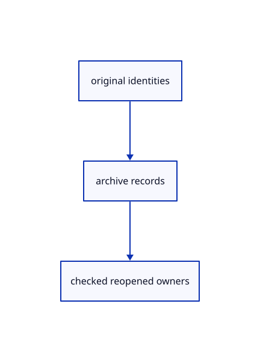

# 16.5.25 · Save group namespaces and original planes

**Chapter 16 · Geometry editing and measurement · Section 16.5 · Text, styles and command integration** · [Contents](contents.md)

**Typing: 18–36 minutes.** [Estimate](typing-load.md).

Save group namespaces and original planes.

## Type

Continue from [Replace original families without changing world placement](85w-replace-original-families-without-changing-world-placement.md). [Save or recover your work](recovery.md).

### 1. `src/archive_document.rs`

Preserve original family and document-scoped metadata.

<details>
<summary>Locate the existing block</summary>

```rust
    for root in &mut roots {crate::archive_identity::tree(root,&names);}for entry in &mut xforms {if let Some(guid)=names.get(&entry.guid) {entry.guid=guid.clone();}}
    let mut source=namespace.doc.as_ref().and_then(|doc|doc.header.as_ref()).map_or_else(proto::Session::default,|header|header.header.clone());if source.name.is_empty() {source.name=namespace.name.clone();}
    let root=if namespace.doc.is_some()&&roots.len()==1 {roots.pop().unwrap()} else {proto::TreeNode {name:source.name.clone(),children:roots,..Default::default()}};
    source.definitions=crate::instance_snapshot::definitions(scene,&namespace.ids)?;source.objects=Some(objects);source.tree=Some(proto::Tree {root:Some(root),..Default::default()});source.xforms=xforms;source.bvh_boxes.clear();
```

</details>

Edit the existing block to match this code; keep unchanged lines:

```rust
--8<-- "journey/code/85x-save-group-namespaces-and-original-planes-01.rs"
```

### 2. `src/archive_identity.rs`

Preserve original family and document-scoped metadata.

<details>
<summary>Locate the existing block</summary>

```rust
pub(crate) fn objects(objects:&mut proto::Objects,names:&HashMap<String,String>) {
    macro_rules! remap {($field:ident)=>{for object in &mut objects.$field {if let Some(guid)=names.get(&object.guid) {object.guid=guid.clone();}}};}
    remap!(bboxes);remap!(meshes);remap!(lines);remap!(points);remap!(polylines);remap!(nurbscurves);remap!(nurbssurfaces);remap!(breps);remap!(pointclouds);remap!(instances);remap!(sheets);
}
pub(crate) fn tree(node:&mut proto::TreeNode,names:&HashMap<String,String>) {
```

</details>

Edit the existing block to match this code; keep unchanged lines:

```rust
--8<-- "journey/code/85x-save-group-namespaces-and-original-planes-02.rs"
```

### 3. `src/archive_presentation.rs`

Preserve original family and document-scoped metadata.

<details>
<summary>Locate the existing block</summary>

```rust
        if scene.created==Some(doc.key) {metadata.created_doc=Some(index);}
        if let Some(current)=scene.view.current.as_ref() {if let Some(guid)=current.strip_prefix(&format!("{}/",doc.key)) {if let Some(node)=doc.nodes.iter().find(|node|node.source.guid==guid) {metadata.current_layer=Some((index,node.portable_guid.clone()));}}}
    }Ok(())
}
```

</details>

Edit the existing block to match this code; keep unchanged lines:

```rust
--8<-- "journey/code/85x-save-group-namespaces-and-original-planes-03.rs"
```

### 4. `src/archive_restore_flags.rs`

Preserve original family and document-scoped metadata.

<details>
<summary>Locate the existing block</summary>

```rust
    if let Some((index,guid))=metadata.current_layer.as_ref() {let doc=scene.forest.documents.iter().find(|doc|doc.key==keys[*index]).unwrap();let node=doc.nodes.iter().find(|node|node.source.guid==*guid).ok_or("Saved current layer is missing")?;let key=format!("{}/{}",doc.key,node.source.guid);crate::layer_edit::locate(scene,&key).map_err(str::to_owned)?;Rc::make_mut(&mut scene.view).current=Some(key);}
    if let Some(index)=metadata.created_doc {scene.created=Some(keys[index]);}
    Ok(())
}
```

</details>

Edit the existing block to match this code; keep unchanged lines:

```rust
--8<-- "journey/code/85x-save-group-namespaces-and-original-planes-04.rs"
```

### 5. `src/document_geometry.rs`

Preserve original family and document-scoped metadata.

<details>
<summary>Locate the existing block</summary>

```rust
        add!(source,scene.insert(prepared));
    }
    for source in &loaded.document.objects.bboxes {add!(source,crate::bounds_original::insert(scene,source.clone()));}
    for source in &loaded.document.objects.points {add!(source,scene.insert_point(crate::marker::PreparedPoint::new(source.clone()).map_err(str::to_owned)?));}
```

</details>

Edit the existing block to match this code; keep unchanged lines:

```rust
--8<-- "journey/code/85x-save-group-namespaces-and-original-planes-05.rs"
```

### 6. `src/document_source.rs`

Preserve original family and document-scoped metadata.

<details>
<summary>Locate the existing block</summary>

```rust
use session_rust::{proto,Session,Xform};
use prost::Message;
use std::{collections::{HashMap,HashSet},rc::Rc};

pub(crate) struct Source {pub document:Rc<Session>,pub origin:Rc<crate::origin::Origin>,pub tree:Option<proto::TreeNode>,pub world:HashMap<String,Xform>,pub sheets:Vec<Rc<crate::sheet_source::Prepared>>}
pub(crate) fn prepare(bytes:&[u8],place:&Xform,point_px:f32)->Result<Source,String> {
    if bytes.len()>crate::archive::LIMIT {return Err("Session exceeds the 512 MiB file limit".into());}
    let message=proto::Session::decode(bytes).map_err(|e|e.to_string())?;
    crate::source_validate::session(&message)?;
    supported(&message)?;
    if !crate::placement::valid(&place.m)||!point_px.is_finite() {return Err("Invalid document placement or point size".into());}
    let tree=message.tree.as_ref().and_then(|tree|tree.root.clone());
    let mut guids=HashSet::new();let objects=message.objects.as_ref().ok_or("Session has no objects")?;
    macro_rules! identity {($field:ident)=>{for object in &objects.$field {if object.guid.is_empty()||!guids.insert(object.guid.as_str()) {return Err("Source GUIDs must be distinct within a document".into());}}};}
    identity!(bboxes);identity!(meshes);identity!(points);identity!(lines);identity!(polylines);identity!(nurbscurves);identity!(nurbssurfaces);identity!(breps);identity!(pointclouds);identity!(instances);identity!(sheets);
    if let Some(root)=tree.as_ref() {crate::hierarchy::validate(root,&guids).map_err(str::to_owned)?;}
    let mut placed=HashSet::new();for entry in &message.xforms {if !placed.insert(entry.guid.as_str())||!crate::placement::valid(&entry.xform.as_ref().ok_or("Missing placement matrix")?.matrix) {return Err("Invalid source placement".into());}}
    let sheets=objects.sheets.iter().cloned().map(|sheet|crate::sheet_source::Prepared::new(Rc::new(sheet)).map(Rc::new).map_err(str::to_owned)).collect::<Result<Vec<_>,_>>()?;
    let origin=Rc::new(crate::origin::Origin::new(&message,bytes));
    let document=Rc::new(Session::from_proto(message).map_err(|e|e.to_string())?);
    let world=crate::nested_placement::prepare(&document,place).map_err(str::to_owned)?;
    Ok(Source {document,origin,tree,world,sheets})
}

fn supported(source:&proto::Session)->Result<(),String> {
    crate::instance_plan::validate(source)?;
    if !source.interactions.is_empty() {return Err("Interactions arrive with element features".into());}
    let objects=source.objects.as_ref().ok_or("Session has no objects")?;
    if !objects.planes.is_empty()||!objects.elements.is_empty()||!objects.components.is_empty() {return Err("This subject cannot open planes, boxes or assemblies yet".into());}
    Ok(())
}
```

</details>

Edit the existing block to match this code; keep unchanged lines:

```rust
use session_rust::{proto,Session,Xform};
use prost::Message;
use std::{collections::{HashMap,HashSet},rc::Rc};

pub(crate) struct Source {pub document:Rc<Session>,pub origin:Rc<crate::origin::Origin>,pub tree:Option<proto::TreeNode>,pub world:HashMap<String,Xform>,pub sheets:Vec<Rc<crate::sheet_source::Prepared>>}
pub(crate) fn prepare(bytes:&[u8],place:&Xform,point_px:f32)->Result<Source,String> {
    if bytes.len()>crate::archive::LIMIT {return Err("Session exceeds the 512 MiB file limit".into());}
    let message=proto::Session::decode(bytes).map_err(|e|e.to_string())?;
    crate::source_validate::session(&message)?;
    supported(&message)?;
    if !crate::placement::valid(&place.m)||!point_px.is_finite() {return Err("Invalid document placement or point size".into());}
    let tree=message.tree.as_ref().and_then(|tree|tree.root.clone());
    let mut guids=HashSet::new();let objects=message.objects.as_ref().ok_or("Session has no objects")?;
    macro_rules! identity {($field:ident)=>{for object in &objects.$field {if object.guid.is_empty()||!guids.insert(object.guid.as_str()) {return Err("Source GUIDs must be distinct within a document".into());}}};}
    identity!(planes);identity!(bboxes);identity!(meshes);identity!(points);identity!(lines);identity!(polylines);identity!(nurbscurves);identity!(nurbssurfaces);identity!(breps);identity!(pointclouds);identity!(instances);identity!(sheets);
    if let Some(root)=tree.as_ref() {crate::hierarchy::validate(root,&guids).map_err(str::to_owned)?;}
    let mut placed=HashSet::new();for entry in &message.xforms {if !placed.insert(entry.guid.as_str())||!crate::placement::valid(&entry.xform.as_ref().ok_or("Missing placement matrix")?.matrix) {return Err("Invalid source placement".into());}}
    let sheets=objects.sheets.iter().cloned().map(|sheet|crate::sheet_source::Prepared::new(Rc::new(sheet)).map(Rc::new).map_err(str::to_owned)).collect::<Result<Vec<_>,_>>()?;
    let origin=Rc::new(crate::origin::Origin::new(&message,bytes));
    let document=Rc::new(Session::from_proto(message).map_err(|e|e.to_string())?);
    let world=crate::nested_placement::prepare(&document,place).map_err(str::to_owned)?;
    Ok(Source {document,origin,tree,world,sheets})
}

fn supported(source:&proto::Session)->Result<(),String> {
    crate::instance_plan::validate(source)?;
    if !source.interactions.is_empty() {return Err("Interactions arrive with element features".into());}
    let objects=source.objects.as_ref().ok_or("Session has no objects")?;
    if !objects.elements.is_empty()||!objects.components.is_empty() {return Err("This subject cannot open assemblies yet".into());}
    Ok(())
}
```

<details>
<summary>Optional patch references</summary>

Use these original edit fragments when comparing a saved checkpoint. Apply the complete blocks above.

```text
--8<-- "journey/code/85x-save-group-namespaces-and-original-planes-06.rs"
```

```text
--8<-- "journey/code/85x-save-group-namespaces-and-original-planes-07.rs"
```

</details>

### 7. `src/geometry_snapshot.rs`

Preserve original family and document-scoped metadata.

<details>
<summary>Locate the existing block</summary>

```rust
    }
    for row in scene.objects().iter().filter(|row|ids.contains(&row.id)&&!scene.instances.contains_key(&row.id)) {
        if let Some(session_rust::Geometry::OBB(source))=&row.original {push!(bboxes,row.id,source.to_proto());}
        else if let Some(cad)=row.cad.as_ref() {push!(breps,row.id,cad.source.to_proto());}
        else if let Some(surface)=row.surface.as_ref() {push!(nurbssurfaces,row.id,surface.source.to_proto());}
```

</details>

Edit the existing block to match this code; keep unchanged lines:

```rust
--8<-- "journey/code/85x-save-group-namespaces-and-original-planes-08.rs"
```

### 8. `src/source_validate.rs`

Preserve original family and document-scoped metadata.

Edit these blocks from bottom to top. Keep the surrounding lines unchanged.

<details>
<summary>Locate this block</summary>

```rust
            return Err(TOO_MANY.into());
        }

        for item in &objects.bboxes {if !crate::bounds_original::valid(&session_rust::OBB::from_proto(item.clone()).map_err(|e|e.to_string())?){return Err("Invalid original box frame".into())}}
        for item in &objects.points {
            point(item)?;
```

</details>

Replace it with:

```rust
            return Err(TOO_MANY.into());
        }

        for item in &objects.planes {if !crate::plane_original::valid(&session_rust::Plane::from_proto(item.clone())) {return Err("Invalid original plane frame".into())}}
        for item in &objects.bboxes {if !crate::bounds_original::valid(&session_rust::OBB::from_proto(item.clone()).map_err(|e|e.to_string())?){return Err("Invalid original box frame".into())}}
        for item in &objects.points {
            point(item)?;
```

<details>
<summary>Locate this block</summary>

```rust
/// Check every record of a protobuf session.
pub fn session(source: &proto::Session) -> Result<(), String> {
    if let Some(objects) = &source.objects {
        let count = objects.bboxes.len()+objects.points.len()
            + objects.lines.len()
            + objects.polylines.len()
            + objects.meshes.len()
```

</details>

Replace it with:

```rust
/// Check every record of a protobuf session.
pub fn session(source: &proto::Session) -> Result<(), String> {
    if let Some(objects) = &source.objects {
        let count = objects.planes.len()+objects.bboxes.len()+objects.points.len()
            + objects.lines.len()
            + objects.polylines.len()
            + objects.meshes.len()
```

<details>
<summary>Complete updated block reference</summary>

```rust
use prost::Message;
use session_rust::proto;

/// Source objects a scene may hold.
pub const MAX_OBJECTS: usize = 2_000_000;

/// Why a scene with more objects is refused.
pub const TOO_MANY: &str = "scene exceeds two million source objects";

/// Deepest tree level a scene may have.
pub const MAX_DEPTH: usize = 64;

/// Why a scene with a deeper tree is refused.
pub const TOO_DEEP: &str = "scene hierarchy exceeds 64 levels";

/// Every value must be finite.
fn finite(values: &[f64], label: &str) -> Result<(), String> {
    for value in values {
        if !value.is_finite() {
            return Err(format!("{label}: non-finite value"));
        }
    }

    Ok(())
}

/// A finite array of whole xyz triples.
fn triples(values: &[f64], label: &str) -> Result<(), String> {
    if !values.len().is_multiple_of(3) {
        return Err(format!("{label}: incomplete coordinate triple"));
    }

    finite(values, label)
}

/// A protobuf decode error as a message.
fn decode_error(error: prost::DecodeError) -> String {
    format!("invalid element geometry: {error}")
}

/// The varint at `i` and its byte length.
pub fn varint(b: &[u8], mut i: usize) -> Option<(u64, usize)> {
    let (mut v, mut shift) = (0u64, 0u32);
    let start = i;

    loop {
        let byte = *b.get(i)?;

        if shift == 63 && byte > 1 {
            return None;
        }

        v |= ((byte & 0x7f) as u64) << shift;
        i += 1;

        if byte & 0x80 == 0 {
            return Some((v, i - start));
        }

        shift += 7;

        if shift > 63 {
            return None;
        }
    }
}

/// The highest control index a surface reads, None on overflow.
fn addressed_surface_controls(
    rows: usize,
    columns: usize,
    stride_u: usize,
    stride_v: usize,
    size: usize,
) -> Option<usize> {
    (rows - 1)
        .checked_mul(stride_u)?
        .checked_add((columns - 1).checked_mul(stride_v)?)?
        .checked_add(size)
}

/// Check order, count and knots; returns the knot count.
fn axis(order: i32, count: i32, knots: &[f64]) -> Result<usize, String> {
    if !(2..=64).contains(&order) || count < order || count > 1_000_000 {
        return Err("invalid or oversized NURBS order/control count".into());
    }

    if knots.len() != (order + count - 2) as usize {
        return Err("NURBS knot count does not match its order and controls".into());
    }

    finite(knots, "NURBS knots")?;

    for pair in knots.windows(2) {
        if pair[0] > pair[1] {
            return Err("NURBS knots are not monotonic".into());
        }
    }

    if knots[(order - 2) as usize] >= knots[(count - 1) as usize] {
        return Err("NURBS parameter domain is empty".into());
    }

    Ok(count as usize)
}

/// A JSON parse error as a message.
fn json_error(error: serde_json::Error) -> String {
    format!("invalid session JSON: {error}")
}

/// A count field, defaulted and capped.
fn json_count(
    source: &serde_json::Value,
    key: &str,
    default: u64,
    maximum: u64,
) -> Result<usize, String> {
    let count = match source.get(key) {
        Some(value) => match value.as_u64() {
            Some(value) => value,
            None => return Err(format!("invalid JSON {key}")),
        },
        None => default,
    };

    if count > maximum {
        return Err(format!("JSON {key} exceeds its supported count"));
    }

    Ok(count as usize)
}

/// Check one JSON knot vector.
fn json_axis(
    source: &serde_json::Value,
    order_key: &str,
    count: usize,
    knots_key: &str,
) -> Result<(), String> {
    let order = json_count(source, order_key, 4, 64)?;
    let values = source[knots_key]
        .as_array()
        .ok_or("missing JSON NURBS knots")?;
    let mut knots = Vec::with_capacity(values.len());

    for value in values {
        knots.push(value.as_f64().ok_or("invalid JSON NURBS knot")?);
    }

    axis(order as i32, count as i32, &knots)?;
    Ok(())
}

/// Check one JSON curve or surface's controls against its counts.
fn json_controls(source: &serde_json::Value) -> Result<(), String> {
    let controls = source["control_points"]
        .as_array()
        .ok_or("JSON controls must be an array")?;
    let dimension = json_count(source, "dimension", 3, 3)?;

    if dimension < 2 {
        return Err("invalid JSON control dimension".into());
    }

    let size = dimension + usize::from(source["is_rational"].as_bool().unwrap_or(false));

    if source.get("cv_count_u").is_some() {
        let rows = json_count(source, "cv_count_u", 0, 1_000_000)?;
        let columns = json_count(source, "cv_count_v", 0, 1_000_000)?;
        let total = rows as u64 * columns as u64;

        if total > 4_000_000 || controls.len() as u64 != total * size as u64 {
            return Err("JSON surface controls disagree with their declared counts".into());
        }

        json_axis(source, "order_u", rows, "nurbsknots_u")?;
        json_axis(source, "order_v", columns, "nurbsknots_v")?;
    } else {
        let count = json_count(source, "cv_count", 0, 1_000_000)?;
        let stride = json_count(source, "cv_stride", size as u64, 4)?;

        if count != controls.len() || stride != size {
            return Err("JSON curve controls disagree with their declared count or stride".into());
        }

        for control in controls {
            if control.as_array().map(Vec::len) != Some(size) {
                return Err("incomplete JSON curve control".into());
            }
        }

        json_axis(source, "order", count, "nurbsknots")?;
    }

    Ok(())
}

/// Check every NURBS record in session JSON before it is parsed.
pub fn json(text: &str) -> Result<(), String> {
    let source: serde_json::Value = serde_json::from_str(text).map_err(json_error)?;
    let mut pending = vec![(&source, 0usize)];

    while let Some((value, depth)) = pending.pop() {
        if depth > 64 {
            return Err("session JSON exceeds 64 nested levels".into());
        }

        match value {
            serde_json::Value::Object(fields) => {
                if fields.contains_key("control_points")
                    && (fields.contains_key("cv_count") || fields.contains_key("cv_count_u"))
                {
                    json_controls(value)?;
                }

                for child in fields.values() {
                    pending.push((child, depth + 1));
                }
            }
            serde_json::Value::Array(values) => {
                for child in values {
                    pending.push((child, depth + 1));
                }
            }
            _ => {}
        }
    }

    Ok(())
}

/// Check one protobuf point.
pub fn point(source: &proto::Point) -> Result<(), String> {
    finite(&[source.x, source.y, source.z, source.width], "point")
}

/// Check one protobuf line.
pub fn line(source: &proto::Line) -> Result<(), String> {
    if source.coords.len() != 6 {
        return Err("line needs exactly two endpoint triples".into());
    }

    finite(&source.coords, "line coordinates")?;
    finite(&source.dash, "line dashes")
}

/// Check one protobuf polyline.
pub fn polyline(source: &proto::Polyline) -> Result<(), String> {
    triples(&source.coords, "polyline coordinates")
}

/// Check one object placement.
pub fn xform(entry: &proto::XformEntry) -> Result<(), String> {
    let Some(transform) = &entry.xform else {
        return Err("missing object transform".into());
    };
    finite(&transform.matrix, "object transform")?;

    if transform.matrix.len() != 16
        || transform.matrix[3] != 0.0
        || transform.matrix[7] != 0.0
        || transform.matrix[11] != 0.0
        || transform.matrix[15] != 1.0
    {
        return Err("object placement must be a sixteen-value affine matrix".into());
    }

    Ok(())
}

/// Nothing to check.
pub fn any<T>(_: &T) -> Result<(), String> {
    Ok(())
}

/// Every index must name a vertex.
fn mesh_indices(source: &proto::Mesh, indices: &[u64]) -> Result<(), String> {
    for index in indices {
        if !source.vertices.contains_key(index) {
            return Err(format!("mesh references missing vertex {index}"));
        }
    }

    Ok(())
}

/// Check one protobuf mesh.
pub fn mesh(source: &proto::Mesh) -> Result<(), String> {
    for (key, vertex) in &source.vertices {
        if *key > u32::MAX as u64 {
            return Err("mesh vertex key exceeds the browser index range".into());
        }

        finite(&[vertex.x, vertex.y, vertex.z], "mesh vertex")?;

        for value in vertex.attributes.values() {
            if !value.is_finite() {
                return Err("mesh vertex has a non-finite attribute".into());
            }
        }
    }

    for face in source.faces.values() {
        if face.vertices.len() < 3 {
            return Err("mesh face has fewer than three vertices".into());
        }

        mesh_indices(source, &face.vertices)?;

        for hole in &face.holes {
            mesh_indices(source, &hole.vertices)?;
        }
    }

    for (face, triangles) in &source.triangulation {
        if !source.faces.contains_key(face) || !triangles.vertices.len().is_multiple_of(3) {
            return Err("invalid mesh triangulation record".into());
        }

        mesh_indices(source, &triangles.vertices)?;
    }

    Ok(())
}

/// Check one protobuf curve.
pub fn curve(source: &proto::NurbsCurve) -> Result<(), String> {
    if !(2..=3).contains(&source.dimension) {
        return Err("NURBS curve dimension must be 2 or 3".into());
    }

    let count = axis(source.order, source.cv_count, &source.nurbsknots)?;
    let size = source.dimension as usize + usize::from(source.is_rational);

    if source.cvs.len() != count * size {
        return Err("NURBS curve control storage is incomplete".into());
    }

    finite(&source.cvs, "NURBS curve controls")
}

/// Check one protobuf surface.
pub fn surface(source: &proto::NurbsSurface) -> Result<(), String> {
    if source.dimension != 3 {
        return Err("NURBS surface dimension must be 3".into());
    }

    let rows = axis(source.order_u, source.cv_count_u, &source.nurbsknots_u)?;
    let columns = axis(source.order_v, source.cv_count_v, &source.nurbsknots_v)?;

    if rows.saturating_mul(columns) > 4_000_000 {
        return Err("surface exceeds four million controls".into());
    }

    let size = 3 + usize::from(source.is_rational);
    let stride_u = if source.cv_stride_u > 0 {
        source.cv_stride_u as usize
    } else {
        columns * size
    };
    let stride_v = if source.cv_stride_v > 0 {
        source.cv_stride_v as usize
    } else {
        size
    };
    let addressed = addressed_surface_controls(rows, columns, stride_u, stride_v, size);

    if !matches!(addressed, Some(length) if length <= source.cvs.len()) {
        return Err("NURBS surface control storage is incomplete".into());
    }

    finite(&source.cvs, "NURBS surface controls")?;

    if let Some(cached) = &source.cached_mesh {
        mesh(cached)?;
    }

    Ok(())
}

/// Check one protobuf point cloud.
pub fn cloud(source: &proto::PointCloud) -> Result<(), String> {
    triples(&source.coords, "point cloud")?;
    finite(&source.normals, "point normals")?;
    let points = source.coords.len() / 3;

    if (!source.normals.is_empty() && source.normals.len() != source.coords.len())
        || (!source.colors.is_empty() && source.colors.len() != points * 4)
        || (!source.point_ids.is_empty() && source.point_ids.len() != points)
    {
        return Err("point-cloud attribute counts disagree".into());
    }

    let nodes = source.lod_size.len();

    if nodes > 0 {
        if source.lod_min.len() != nodes * 3
            || source.lod_spacing.len() != nodes
            || source.lod_level.len() != nodes
            || source.lod_first.len() != nodes
            || source.lod_count.len() != nodes
            || source.lod_children.len() != nodes * 8
        {
            return Err("point-cloud octree arrays disagree".into());
        }

        finite(&source.lod_min, "octree bounds")?;
        finite(&source.lod_size, "octree sizes")?;

        for node in 0..nodes {
            if source.lod_first[node] < 0
                || source.lod_count[node] < 0
                || source.lod_first[node] as u64 + source.lod_count[node] as u64 > points as u64
            {
                return Err("octree range exceeds its source points".into());
            }
        }

        for child in &source.lod_children {
            if *child < -1 || *child >= nodes as i32 {
                return Err("octree references an absent child".into());
            }
        }
    }

    Ok(())
}

/// Check one protobuf BRep.
pub fn brep(source: &proto::BRep) -> Result<(), String> {
    for item in &source.curves_2d {
        curve(item)?;
    }

    for item in &source.curves_3d {
        curve(item)?;
    }

    for item in &source.surfaces {
        surface(item)?;
    }

    for vertex in &source.vertices {
        if let Some(point) = &vertex.point {
            finite(&[point.x, point.y, point.z], "BRep vertex")?;
        }
    }

    Ok(())
}

/// Check one protobuf element's mesh or BRep.
pub fn element(source: &proto::Element) -> Result<(), String> {
    match source.geometry_type.as_str() {
        "Mesh" => {
            mesh(&proto::Mesh::decode(source.geometry_data.as_slice()).map_err(decode_error)?)
        }
        "BRep" => {
            brep(&proto::BRep::decode(source.geometry_data.as_slice()).map_err(decode_error)?)
        }
        _ => Ok(()),
    }
}

/// Check every definition record, and the definitions with `instances` within the cap.
pub fn definitions(d: &proto::Objects, instances: usize) -> Result<(), String> {
    let count = d.points.len()
        + d.lines.len()
        + d.polylines.len()
        + d.meshes.len()
        + d.pointclouds.len()
        + d.nurbscurves.len()
        + d.nurbssurfaces.len()
        + d.breps.len()
        + d.elements.len();

    if count + instances > MAX_OBJECTS {
        return Err(TOO_MANY.into());
    }

    for item in &d.points {
        point(item)?;
    }

    for item in &d.lines {
        line(item)?;
    }

    for item in &d.polylines {
        polyline(item)?;
    }

    for item in &d.meshes {
        mesh(item)?;
    }

    for item in &d.pointclouds {
        cloud(item)?;
    }

    for item in &d.nurbscurves {
        curve(item)?;
    }

    for item in &d.nurbssurfaces {
        surface(item)?;
    }

    for item in &d.breps {
        brep(item)?;
    }

    for item in &d.elements {
        element(item)?;
    }

    Ok(())
}

/// Check every record of a protobuf session.
pub fn session(source: &proto::Session) -> Result<(), String> {
    if let Some(objects) = &source.objects {
        let count = objects.planes.len()+objects.bboxes.len()+objects.points.len()
            + objects.lines.len()
            + objects.polylines.len()
            + objects.meshes.len()
            + objects.pointclouds.len()
            + objects.nurbscurves.len()
            + objects.nurbssurfaces.len()
            + objects.breps.len()
            + objects.elements.len();

        if count > MAX_OBJECTS {
            return Err(TOO_MANY.into());
        }

        for item in &objects.planes {if !crate::plane_original::valid(&session_rust::Plane::from_proto(item.clone())) {return Err("Invalid original plane frame".into())}}
        for item in &objects.bboxes {if !crate::bounds_original::valid(&session_rust::OBB::from_proto(item.clone()).map_err(|e|e.to_string())?){return Err("Invalid original box frame".into())}}
        for item in &objects.points {
            point(item)?;
        }

        for item in &objects.lines {
            line(item)?;
        }

        for item in &objects.polylines {
            polyline(item)?;
        }

        for item in &objects.meshes {
            mesh(item)?;
        }

        for item in &objects.pointclouds {
            cloud(item)?;
        }

        for item in &objects.nurbscurves {
            curve(item)?;
        }

        for item in &objects.nurbssurfaces {
            surface(item)?;
        }

        for item in &objects.breps {
            brep(item)?;
        }

        for item in &objects.elements {
            element(item)?;
        }
    }

    for entry in &source.xforms {
        xform(entry)?;
    }

    if let Some(tree) = &source.tree
        && let Some(root) = &tree.root
    {
        let mut pending = vec![(root, 0usize)];

        while let Some((node, depth)) = pending.pop() {
            if depth > MAX_DEPTH {
                return Err(TOO_DEEP.into());
            }

            for child in &node.children {
                pending.push((child, depth + 1));
            }
        }
    }

    Ok(())
}

/// Check every geometry of a loaded session.
pub fn retained(source: &session_rust::Session) -> Result<(), String> {
    for item in &source.objects.meshes {
        mesh(&item.to_proto())?;
    }

    for item in &source.objects.pointclouds {
        cloud(&item.to_proto())?;
    }

    for item in &source.objects.nurbscurves {
        curve(&item.to_proto())?;
    }

    for item in &source.objects.nurbssurfaces {
        surface(&item.to_proto())?;
    }

    for item in &source.objects.breps {
        brep(&item.to_proto())?;
    }

    Ok(())
}

#[cfg(test)]
mod tests {
    use super::*;

    /// Huge or wrong counts are refused.
    #[test]
    fn hostile_counts_do_not_reach_kernel_allocations() {
        let source = proto::NurbsCurve {
            dimension: 3,
            order: 2,
            cv_count: i32::MAX,
            ..Default::default()
        };
        assert!(curve(&source).is_err());
        let source = proto::NurbsSurface {
            dimension: 3,
            order_u: 2,
            order_v: 2,
            cv_count_u: -1,
            cv_count_v: 2,
            ..Default::default()
        };
        assert!(surface(&source).is_err());
    }

    /// Bad indices and short cloud arrays are refused.
    #[test]
    fn missing_indices_and_partial_cloud_attributes_are_errors() {
        let mut source = proto::Mesh::default();
        source.faces.insert(
            0,
            proto::FaceData {
                vertices: vec![0, 1, 2],
                ..Default::default()
            },
        );
        assert!(mesh(&source).is_err());
        let cloud_source = proto::PointCloud {
            coords: vec![0., 0., 0.],
            point_ids: vec![7, 8],
            ..Default::default()
        };
        assert!(cloud(&cloud_source).is_err());
    }

    /// JSON counts must match the controls given.
    #[test]
    fn json_declared_controls_are_checked_before_constructor_allocation() {
        assert!(
            json(r#"{"control_points":[],"cv_count":18446744073709551615,"dimension":3}"#).is_err()
        );
        assert!(
            json(r#"{"control_points":[],"cv_count_u":1000000,"cv_count_v":1000000}"#).is_err()
        );
        assert!(json(r#"{"control_points":[[0,0,0],[1,0,0]],"cv_count":2,"dimension":3,"order":2,"nurbsknots":[0,1]}"#).is_ok());
    }
}
```

</details>

<details>
<summary>Optional patch references</summary>

Use these original edit fragments when comparing a saved checkpoint. Apply the complete blocks above.

```text
--8<-- "journey/code/85x-save-group-namespaces-and-original-planes-09.rs"
```

```text
--8<-- "journey/code/85x-save-group-namespaces-and-original-planes-10.rs"
```

</details>

## Run and check

Run this from `session_viewer` to select the fixed dependency versions and install supplied binary assets. It updates Cargo.lock and preserves the previous lock. It does not write implementation code:

```sh
npm --prefix ../session_tests run course -- dependencies 16.5.25
```

In your project:

```sh
cd workspace/journey
REGEN_PROTO=0 cargo build --lib --locked --target wasm32-unknown-unknown -j1
REGEN_PROTO=0 CARGO_BUILD_JOBS=1 trunk serve --port 8780
```

Open `http://127.0.0.1:8780/`. Keep an existing Trunk server running; saving rebuilds it.


### Recorded visual result

**Previous native render — current verification pending.**

The preceding solid, wire bounding box and temporary distance annotation remain visible.


*This recorded image predates a source or checker change. Rebuild this checkpoint before using it as current evidence; browser controls require separate acceptance.*

This reference image is shared with [16.4.14 · Exercise original boxes and temporary distance annotations](84m-exercise-original-boxes-and-temporary-distance-annotations.md). It does not demonstrate a new feature by itself.

<details>
<summary>Code explanation and diagram</summary>


original identities → archive records → checked reopened owners.



Can Save write only the plane proxy?

No. Preserve its original frame and remap graph and group identities into the document archive.

Study estimate, including typing and experiments: 0.5–1 hours.

</details>

<details>
<summary>Optional experiment</summary>

Inspect original Plane validation and portable group membership.

</details>

<details>
<summary>Check and save your work</summary>

Restore experimental edits, then run from `session_viewer`:

```sh
npm --prefix ../session_tests run course -- check 16.5.25
npm --prefix ../session_tests run course -- save 16.5.25
```

Source comparison leaves your project untouched. [Save and recovery instructions](recovery.md).

</details>

<details>
<summary>Viewer coverage and verification</summary>

Save group namespaces and original planes.

The inherited measurement browser contract remains authored and unrun. The current-command browser contract connects at85ay and still requires real browser execution.

[Full validation scope](release.md).

To reproduce the scripted acceptance of the reference checkpoint, run from `session_viewer` with the [course bundle server](release.md#reproduce) running on port 8781:

```sh
npm --prefix ../session_tests run course -- capture 16.5.25
```

This uses the verified reference bundle; it does not check or change your typed project.

</details>
