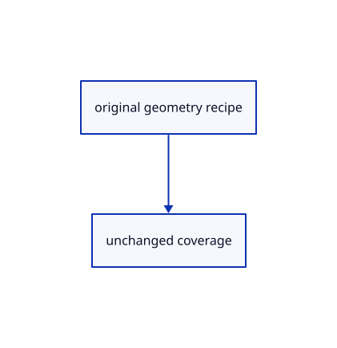

# 17.1.37 · Reuse original marker coverage

**Chapter 17 · GPU visibility, clipping and sections · Section 17.1 · Finite ink and tiled visibility** · [Contents](contents.md)

**Typing: 4–8 minutes.** [Estimate](typing-load.md).

Reuse original marker coverage.

## Type

Continue from [Keep chain crop ownership aligned](86aa-keep-chain-crop-ownership-aligned.md). [Save or recover your work](recovery.md).

### 1. `src/marker_coverage.wgsl`

Move this already-written coverage function into one shared shader file; no new coverage algorithm is introduced.

Move the previously typed implementation as described. Keep its code; type the following wiring edits separately.

<details>
<summary>Previously typed code reference</summary>

Use this reference when moving the existing code; it is excluded from the typing estimate.

Create the destination by moving the existing code:

```text
--8<-- "journey/code/86ab-reuse-original-marker-coverage-share-coverage-02.rs"
```

</details>

### 2. `src/marker.wgsl`

Use the same coverage predicate in the ordinary and finite shader.

<details>
<summary>Locate the existing block</summary>

```wgsl
fn colour(input: Output) -> vec4<f32> {
    let coverage = clamp(input.radius + 0.5 - length(input.offset), 0.0, 1.0);
    return vec4<f32>(input.colour.rgb, input.colour.a * coverage);
}
```

</details>

Edit the existing block to match this code; keep unchanged lines:

```wgsl
#include "marker_coverage.wgsl"
```

<details>
<summary>Optional patch references</summary>

Use these original edit fragments when comparing a saved checkpoint. Apply the complete blocks above.

```text
--8<-- "journey/code/86ab-reuse-original-marker-coverage-share-coverage-03.rs"
```

</details>

### 3. `src/marker.rs`

Assemble the ordinary shader with the shared source expander already written.

<details>
<summary>Locate the existing block</summary>

```rust
pub const SHADER: &str = include_str!("marker.wgsl");
```

</details>

Edit the existing block to match this code; keep unchanged lines:

```rust
pub fn shader() -> String { crate::finite_project_source::expand(include_str!("marker.wgsl")) }
```

<details>
<summary>Optional patch references</summary>

Use these original edit fragments when comparing a saved checkpoint. Apply the complete blocks above.

```text
--8<-- "journey/code/86ab-reuse-original-marker-coverage-share-coverage-04.rs"
```

</details>

### 4. `src/finite_project_source.rs`

Expand one shared coverage source for ordinary, finite and integer variants.

<details>
<summary>Locate the existing block</summary>

```rust
        .replace("#include \"chain_coverage.wgsl\"", include_str!("chain_coverage.wgsl"))
```

</details>

After that block, type:

```rust
        .replace("#include \"marker_coverage.wgsl\"", include_str!("marker_coverage.wgsl"))
```

<details>
<summary>Optional patch references</summary>

Use these original edit fragments when comparing a saved checkpoint. Apply the complete blocks above.

```text
--8<-- "journey/code/86ab-reuse-original-marker-coverage-share-coverage-05.rs"
```

</details>

### 5. `src/stroke_gpu.rs`

Route the existing GPU lane through shared coverage assembly.

<details>
<summary>Locate the existing block</summary>

```rust
        Self::layout(device, format, crate::marker::SHADER, 32, 6,
```

</details>

Edit the existing block to match this code; keep unchanged lines:

```rust
        Self::layout(device, format, &crate::marker::shader(), 32, 6,
```

<details>
<summary>Optional patch references</summary>

Use these original edit fragments when comparing a saved checkpoint. Apply the complete blocks above.

```text
--8<-- "journey/code/86ab-reuse-original-marker-coverage-share-coverage-06.rs"
```

</details>

### 6. `src/finite_marker.wgsl`

Reuse the existing shader after extracting shared coverage; later edits add the finite projection.

Reuse the shader you have already written:

```sh
cp src/marker.wgsl src/finite_marker.wgsl
```

<details>
<summary>Reused source reference</summary>

```wgsl
--8<-- "journey/code/86ab-reuse-original-marker-coverage-01-shared-intro.rs"
```

</details>

## Run and check

Run this from `session_viewer` to select the fixed dependency versions and install supplied binary assets. It updates Cargo.lock and preserves the previous lock. It does not write implementation code:

```sh
npm --prefix ../session_tests run course -- dependencies 17.1.37
```

In your project:

```sh
cd workspace/journey
REGEN_PROTO=0 cargo build --lib --locked --target wasm32-unknown-unknown -j1
REGEN_PROTO=0 CARGO_BUILD_JOBS=1 trunk serve --port 8780
```

Open `http://127.0.0.1:8780/`. Keep an existing Trunk server running; saving rebuilds it.


### Recorded visual result

**Previous native render — current verification pending.**

The rendered headed line and world text remain black; a red dashed extension tail ends at its black +0.800 chip.


*This recorded image predates a source or checker change. Rebuild this checkpoint before using it as current evidence; browser controls require separate acceptance.*

This reference image is shared with [16.5.52 · Exercise current original commands together](85ay-exercise-current-original-commands-together.md). It does not demonstrate a new feature by itself.

<details>
<summary>Code explanation and diagram</summary>

A marker uses distance from its centre and a screen-space radius. Move that circular predicate into one shared file used by both marker variants. The next stage carries finite centreline information; it keeps the existing disc coverage and CSS-pixel diameter.

original geometry recipe → unchanged coverage.



Does an original marker become a square after adding visibility?

Its existing disc coverage still rejects the quad corners. Reuse the [separate coverage and visibility contract](86t-reuse-original-stroke-coverage.md).

Study estimate, including typing and experiments: 0.5–1 hours.

</details>

<details>
<summary>Optional experiment</summary>

Trace the center, rim and corner of a marker quad. The disc rejects the corner independently of any surface-visibility result.

</details>

<details>
<summary>Check and save your work</summary>

Restore experimental edits, then run from `session_viewer`:

```sh
npm --prefix ../session_tests run course -- check 17.1.37
npm --prefix ../session_tests run course -- save 17.1.37
```

Source comparison leaves your project untouched. [Save and recovery instructions](recovery.md).

</details>

<details>
<summary>Viewer coverage and verification</summary>

Retain finite original-triangle projection and tile lists. The tutorial adapter connects identical center-line visibility to color and cropped integer picking; full plane fitting, curved-edge sag and packed production arenas are audited in94–96.

The browser contract is authored and requires an actual browser run. Native software-GPU results do not measure the Lenovo.

[Full validation scope](release.md).

To reproduce the scripted acceptance of the reference checkpoint, run from `session_viewer` with the [course bundle server](release.md#reproduce) running on port 8781:

```sh
npm --prefix ../session_tests run course -- capture 17.1.37
```

This uses the verified reference bundle; it does not check or change your typed project.

</details>
