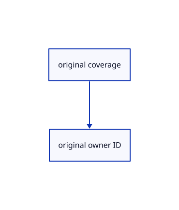

# 17.1.39 · Reuse original marker integer coverage

**Chapter 17 · GPU visibility, clipping and sections · Section 17.1 · Finite ink and tiled visibility** · [Contents](contents.md)

**Typing: 0–0 minutes.** [Estimate](typing-load.md).

Reuse original marker integer coverage.

## Type

Continue from [Carry marker axis and depth](86ac-carry-marker-axis-and-depth.md). [Save or recover your work](recovery.md).

### 1. `src/finite_marker_pick.wgsl`

Reuse the existing shader after extracting shared coverage; later edits add the finite projection.

Reuse the shader you have already written:

```sh
cp src/marker_pick.wgsl src/finite_marker_pick.wgsl
```

<details>
<summary>Reused source reference</summary>

```wgsl
--8<-- "journey/code/86ad-reuse-original-marker-integer-coverage-01.rs"
```

</details>

## Run and check

Run this from `session_viewer` to select the fixed dependency versions and install supplied binary assets. It updates Cargo.lock and preserves the previous lock. It does not write implementation code:

```sh
npm --prefix ../session_tests run course -- dependencies 17.1.39
```

In your project:

```sh
cd workspace/journey
REGEN_PROTO=0 cargo build --lib --locked --target wasm32-unknown-unknown -j1
REGEN_PROTO=0 CARGO_BUILD_JOBS=1 trunk serve --port 8780
```

Open `http://127.0.0.1:8780/`. Keep an existing Trunk server running; saving rebuilds it.

The point's integer entry point now has its reused source reference. The following edits add its finite visibility consumer.

### Recorded visual result

**Previous native render — current verification pending.**

The rendered headed line and world text remain black; a red dashed extension tail ends at its black +0.800 chip.


*This recorded image predates a source or checker change. Rebuild this checkpoint before using it as current evidence; browser controls require separate acceptance.*

This reference image is shared with [16.5.52 · Exercise current original commands together](85ay-exercise-current-original-commands-together.md). It does not demonstrate a new feature by itself.

<details>
<summary>Code explanation and diagram</summary>


original coverage → original owner ID.



Can the transparent corner of a marker quad win a pick?

The marker ID fragment uses the same disc rejection as color, following the [shared coverage rule](86v-reuse-original-stroke-integer-coverage.md).

Study estimate, including typing and experiments: 0.5–1 hours.

</details>

<details>
<summary>Optional experiment</summary>

Locate the shared disc-coverage call in the reused point pick source and identify its original-owner output. Compare the existing point's selection in the browser; finite point visibility has not been connected by this reuse alone.

</details>

<details>
<summary>Check and save your work</summary>

Restore experimental edits, then run from `session_viewer`:

```sh
npm --prefix ../session_tests run course -- check 17.1.39
npm --prefix ../session_tests run course -- save 17.1.39
```

Source comparison leaves your project untouched. [Save and recovery instructions](recovery.md).

</details>

<details>
<summary>Viewer coverage and verification</summary>

Retain finite original-triangle projection and tile lists. The tutorial adapter connects identical center-line visibility to color and cropped integer picking; full plane fitting, curved-edge sag and packed production arenas are audited in94–96.

The browser contract is authored and requires an actual browser run. Native software-GPU results do not measure the Lenovo.

[Full validation scope](release.md).

To reproduce the scripted acceptance of the reference checkpoint, run from `session_viewer` with the [course bundle server](release.md#reproduce) running on port 8781:

```sh
npm --prefix ../session_tests run course -- capture 17.1.39
```

This uses the verified reference bundle; it does not check or change your typed project.

</details>
