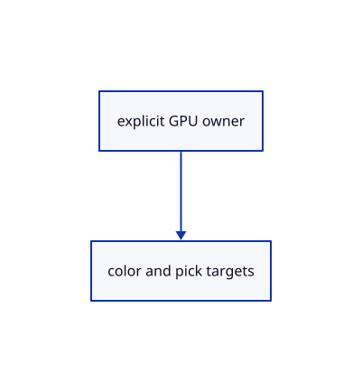

# 17.1.42 · Own finite color and integer pipelines

**Chapter 17 · GPU visibility, clipping and sections · Section 17.1 · Finite ink and tiled visibility** · [Contents](contents.md)

**Typing: 4–7 minutes.** [Estimate](typing-load.md).

Declare the finite color/integer pipeline owner and its cached table bindings. Register it alongside the existing finite-source assembler. The next helpers create pipelines and bind these resources; the existing ribbon pass remains active until renderer adoption.

## Type

Continue from [Assemble one shared finite shader predicate](86af-assemble-one-shared-finite-shader-predicate.md). [Save or recover your work](recovery.md).

### 1. `src/finite_ink.rs`

Own finite color and integer pipelines.

Create the file and type:

```rust
--8<-- "journey/code/86ag-own-finite-color-and-integer-pipelines-01.rs"
```

### 2. `src/lib.rs`

Register the resource types immediately so every following method is checked by the browser compiler.

<details>
<summary>Locate the existing block</summary>

```rust

pub mod finite_sources;
```

</details>

After that block, type:

```rust
--8<-- "journey/code/86aj-reuse-bindings-and-draw-original-owners-02.rs" skip=25
```

## Run and check

Run this from `session_viewer` to select the fixed dependency versions and install supplied binary assets. It updates Cargo.lock and preserves the previous lock. It does not write implementation code:

```sh
npm --prefix ../session_tests run course -- dependencies 17.1.42
```

In your project:

```sh
cd workspace/journey
REGEN_PROTO=0 cargo build --lib --locked --target wasm32-unknown-unknown -j1
REGEN_PROTO=0 CARGO_BUILD_JOBS=1 trunk serve --port 8780
```

Open `http://127.0.0.1:8780/`. Keep an existing Trunk server running; saving rebuilds it.

Ink and Tables are compiled resource types. This declaration does not create or draw the finite pipelines yet.

### Recorded visual result

**Previous native render — current verification pending.**

The rendered headed line and world text remain black; a red dashed extension tail ends at its black +0.800 chip.


*This recorded image predates a source or checker change. Rebuild this checkpoint before using it as current evidence; browser controls require separate acceptance.*

This reference image is shared with [16.5.52 · Exercise current original commands together](85ay-exercise-current-original-commands-together.md). It does not demonstrate a new feature by itself.

<details>
<summary>Code explanation and diagram</summary>


explicit GPU owner → color and pick targets.



Does finite ink write scene depth?

No. It samples existing depth and accepts fragments through the shared predicate.

Study estimate, including typing and experiments: 0.5–1 hours.

</details>

<details>
<summary>Optional experiment</summary>

Build the browser, then locate the new module and compare its color, integer and cached-binding fields. Identify which resources will be supplied per frame and which belong to the lane lifetime.

</details>

<details>
<summary>Check and save your work</summary>

Restore experimental edits, then run from `session_viewer`:

```sh
npm --prefix ../session_tests run course -- check 17.1.42
npm --prefix ../session_tests run course -- save 17.1.42
```

Source comparison leaves your project untouched. [Save and recovery instructions](recovery.md).

</details>

<details>
<summary>Viewer coverage and verification</summary>

Retain finite original-triangle projection and tile lists. The tutorial adapter connects identical center-line visibility to color and cropped integer picking; full plane fitting, curved-edge sag and packed production arenas are audited in94–96.

The browser contract is authored and requires an actual browser run. Native software-GPU results do not measure the Lenovo.

[Full validation scope](release.md).

To reproduce the scripted acceptance of the reference checkpoint, run from `session_viewer` with the [course bundle server](release.md#reproduce) running on port 8781:

```sh
npm --prefix ../session_tests run course -- capture 17.1.42
```

This uses the verified reference bundle; it does not check or change your typed project.

</details>
