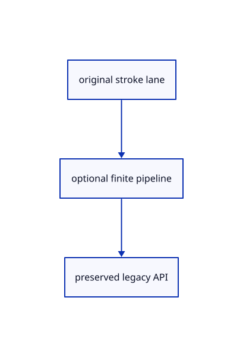

# 17.1.47 · Connect finite visibility to all original ink lanes

**Chapter 17 · GPU visibility, clipping and sections · Section 17.1 · Finite ink and tiled visibility** · [Contents](contents.md)

**Typing: 18–35 minutes.** [Estimate](typing-load.md).

Connect finite visibility to all original ink lanes.

## Type

Continue from [Expose original GPU models to projection](86ak-expose-original-gpu-models-to-projection.md). [Save or recover your work](recovery.md).

### 1. `src/stroke_gpu.rs`

Connect optional finite state and cached coverage.

Edit these blocks from bottom to top. Keep the surrounding lines unchanged.

<details>
<summary>Locate this block</summary>

```rust
        let group = device.create_bind_group(&wgpu::BindGroupDescriptor { label: Some("stroke view"),
            layout: &pipeline.get_bind_group_layout(0),
            entries: &[wgpu::BindGroupEntry { binding: 0, resource: uniform.as_entire_binding() }] });
        Self { pipeline, pick_pipeline, ids: None, id_data: Vec::new(), uniform, group, vertices: None, data: Vec::new(), stride, vertices_per_instance, uploads: 0, uploaded_bytes: 0 }
    }
}
```

</details>

Replace it with:

```rust
        let group = device.create_bind_group(&wgpu::BindGroupDescriptor { label: Some("stroke view"),
            layout: &pipeline.get_bind_group_layout(0),
            entries: &[wgpu::BindGroupEntry { binding: 0, resource: uniform.as_entire_binding() }] });
        Self {finite:None,strict_depth, pipeline, pick_pipeline, ids: None, id_data: Vec::new(), uniform, group, vertices: None, data: Vec::new(), stride, vertices_per_instance, uploads: 0, uploaded_bytes: 0 }
    }
}
```

<details>
<summary>Locate this block</summary>

```rust
        let shader = device.create_shader_module(wgpu::ShaderModuleDescriptor {
            label: Some("stroke"), source: wgpu::ShaderSource::Wgsl(source.into()),
        });
        let pipeline = device.create_render_pipeline(&wgpu::RenderPipelineDescriptor {
            label: Some("stroke"), layout: Some(&layout),
            vertex: wgpu::VertexState { module: &shader, entry_point: Some("vertex"),
```

</details>

Replace it with:

```rust
        let shader = device.create_shader_module(wgpu::ShaderModuleDescriptor {
            label: Some("stroke"), source: wgpu::ShaderSource::Wgsl(source.into()),
        });
        let strict_depth=depth.depth_compare==Some(wgpu::CompareFunction::Less);
        let pipeline = device.create_render_pipeline(&wgpu::RenderPipelineDescriptor {
            label: Some("stroke"), layout: Some(&layout),
            vertex: wgpu::VertexState { module: &shader, entry_point: Some("vertex"),
```

<details>
<summary>Locate this block</summary>

```rust
        pass.draw(0..self.vertices_per_instance, 0..(self.data.len() as u64 / self.stride) as u32);
    }

    pub fn pick_bytes(&self) -> u64 { self.ids.as_ref().map_or(0, wgpu::Buffer::size) }

    pub fn usage(&self) -> [u64; 2] {
```

</details>

Replace it with:

```rust
        pass.draw(0..self.vertices_per_instance, 0..(self.data.len() as u64 / self.stride) as u32);
    }

    pub fn pick_finite(&self,device:&wgpu::Device,pass:&mut wgpu::RenderPass<'_>,crop:&wgpu::BindGroup,tables:Option<&crate::finite_ink::Tables>,depth:&wgpu::TextureView){
        if let(Some(ink),Some(tables),Some(vertices),Some(ids))=(&self.finite,tables,&self.vertices,&self.ids){ink.pick(device,pass,&self.group,crop,vertices,ids,(self.data.len()as u64/self.stride)as u32,self.vertices_per_instance,tables,depth)}else{self.pick(pass,crop)}
    }
    pub fn pick_bytes(&self) -> u64 { self.ids.as_ref().map_or(0, wgpu::Buffer::size) }

    pub fn usage(&self) -> [u64; 2] {
```

<details>
<summary>Locate this block</summary>

```rust
        queue.write_buffer(&self.uniform, 0, &bytes);
    }

    pub fn draw(&self, pass: &mut wgpu::RenderPass<'_>) {
        let Some(vertices) = &self.vertices else { return; };
        pass.set_pipeline(&self.pipeline); pass.set_bind_group(0, &self.group, &[]);
        pass.set_vertex_buffer(0, vertices.slice(..));
        pass.draw(0..self.vertices_per_instance, 0..(self.data.len() as u64 / self.stride) as u32);
```

</details>

Replace it with:

```rust
        queue.write_buffer(&self.uniform, 0, &bytes);
    }

    pub fn enable_finite(&mut self,device:&wgpu::Device,format:wgpu::TextureFormat){self.finite=Some(crate::finite_ink::Ink::new(device,format,self.stride,self.strict_depth));}
    pub fn finite_frame(&self,device:&wgpu::Device,tables:&crate::finite_ink::Tables,depth:&wgpu::TextureView){if let Some(ink)=&self.finite{ink.set(device,tables,depth)}}
    pub fn draw(&self, pass: &mut wgpu::RenderPass<'_>) {
        let Some(vertices) = &self.vertices else { return; };
        if self.finite.as_ref().is_some_and(|ink|ink.draw(pass,&self.group,vertices,(self.data.len()as u64/self.stride)as u32,self.vertices_per_instance)){return}
        pass.set_pipeline(&self.pipeline); pass.set_bind_group(0, &self.group, &[]);
        pass.set_vertex_buffer(0, vertices.slice(..));
        pass.draw(0..self.vertices_per_instance, 0..(self.data.len() as u64 / self.stride) as u32);
```

<details>
<summary>Locate this block</summary>

```rust
pub struct Lane {
    pipeline: wgpu::RenderPipeline,
    pick_pipeline: wgpu::RenderPipeline,
    ids: Option<wgpu::Buffer>,
```

</details>

Replace it with:

```rust
pub struct Lane {
    finite:Option<crate::finite_ink::Ink>,
    strict_depth:bool,
    pipeline: wgpu::RenderPipeline,
    pick_pipeline: wgpu::RenderPipeline,
    ids: Option<wgpu::Buffer>,
```

<details>
<summary>Complete updated block reference</summary>

```rust
pub struct Lane {
    finite:Option<crate::finite_ink::Ink>,
    strict_depth:bool,
    pipeline: wgpu::RenderPipeline,
    pick_pipeline: wgpu::RenderPipeline,
    ids: Option<wgpu::Buffer>,
    id_data: Vec<u8>,
    uniform: wgpu::Buffer,
    group: wgpu::BindGroup,
    vertices: Option<wgpu::Buffer>,
    data: Vec<u8>,
    stride: u64,
    vertices_per_instance: u32,
    pub uploads: u64,
    pub uploaded_bytes: u64,
}

impl Lane {
    pub fn set(&mut self, device: &wgpu::Device, strokes: impl IntoIterator<Item = crate::stroke::Stroke>) -> Result<(), &'static str> {
        let mut data = Vec::new();
        for stroke in strokes {
            if stroke.width <= 0.0 || stroke.values().iter().any(|value| !value.is_finite()) {
                return Err("Invalid stroke display data");
            }
            data.extend(stroke.bytes());
        }
        if self.stride != 44 { return Err("Stroke data needs the stroke layout"); }
        self.set_bytes(device, data)
    }

    pub fn set_guides(&mut self,device:&wgpu::Device,segments:&[crate::guide_gpu::Segment])->Result<(),&'static str>{if self.stride!=48{return Err("Guide data needs the guide layout")}let mut bytes=Vec::with_capacity(segments.len()*48);for segment in segments{if segment.stroke.width<=0.||segment.stroke.values().iter().any(|v|!v.is_finite()){return Err("Invalid guide stroke")}bytes.extend(segment.stroke.bytes());bytes.extend(u32::from(segment.dashed).to_ne_bytes());}self.set_bytes(device,bytes)}
    pub fn set_chains(&mut self, device: &wgpu::Device, segments: impl IntoIterator<Item = crate::chain::Segment>) -> Result<(), &'static str> {
        if self.stride != 72 { return Err("Connected data needs the connected layout"); }
        let mut data = Vec::new();
        for segment in segments {
            if segment.stroke.width <= 0.0 || segment.heads > 3
                || segment.stroke.values().iter().chain(segment.previous.iter()).chain(segment.next.iter()).any(|v| !v.is_finite()) {
                return Err("Invalid connected display data");
            }
            data.extend(segment.bytes());
        }
        self.set_bytes(device, data)
    }

    pub fn set_points(&mut self, device: &wgpu::Device, markers: impl IntoIterator<Item = crate::marker::Marker>) -> Result<(), &'static str> {
        if self.stride != 32 { return Err("Marker data needs the marker layout"); }
        let mut data = Vec::new();
        for marker in markers {
            if marker.diameter <= 0.0 || marker.values().iter().any(|v| !v.is_finite()) { return Err("Invalid marker display data"); }
            data.extend(marker.bytes());
        }
        self.set_bytes(device, data)
    }

    fn set_bytes(&mut self, device: &wgpu::Device, data: Vec<u8>) -> Result<(), &'static str> {
        use wgpu::util::DeviceExt;
        u32::try_from(data.len() as u64 / self.stride).map_err(|_| "Too many stroke instances")?;
        if data == self.data { return Ok(()); }
        self.vertices = if data.is_empty() { None } else {
            self.uploads += 1; self.uploaded_bytes += data.len() as u64;
            Some(device.create_buffer_init(&wgpu::util::BufferInitDescriptor {
                label: Some("stroke instances"), contents: &data, usage: wgpu::BufferUsages::VERTEX,
            }))
        };
        self.data = data; Ok(())
    }

    pub fn view(&self, queue: &wgpu::Queue, transform: &[f32; 16], size: [u32; 2], density: f32) {
        if self.vertices.is_none() { return; }
        let bytes: Vec<u8> = transform.iter().copied().chain([size[0] as f32, size[1] as f32, density, 0.0])
            .flat_map(f32::to_ne_bytes).collect();
        queue.write_buffer(&self.uniform, 0, &bytes);
    }

    pub fn enable_finite(&mut self,device:&wgpu::Device,format:wgpu::TextureFormat){self.finite=Some(crate::finite_ink::Ink::new(device,format,self.stride,self.strict_depth));}
    pub fn finite_frame(&self,device:&wgpu::Device,tables:&crate::finite_ink::Tables,depth:&wgpu::TextureView){if let Some(ink)=&self.finite{ink.set(device,tables,depth)}}
    pub fn draw(&self, pass: &mut wgpu::RenderPass<'_>) {
        let Some(vertices) = &self.vertices else { return; };
        if self.finite.as_ref().is_some_and(|ink|ink.draw(pass,&self.group,vertices,(self.data.len()as u64/self.stride)as u32,self.vertices_per_instance)){return}
        pass.set_pipeline(&self.pipeline); pass.set_bind_group(0, &self.group, &[]);
        pass.set_vertex_buffer(0, vertices.slice(..));
        pass.draw(0..self.vertices_per_instance, 0..(self.data.len() as u64 / self.stride) as u32);
    }

    pub fn set_ids(&mut self, device: &wgpu::Device, ids: impl IntoIterator<Item = [u32; 2]>) -> Result<(), &'static str> {
        use wgpu::util::DeviceExt;
        let data: Vec<u8> = ids.into_iter().flatten().flat_map(u32::to_ne_bytes).collect();
        if data.len() as u64 / 8 != self.data.len() as u64 / self.stride { return Err("Pick IDs must match display instances"); }
        if data == self.id_data { return Ok(()); }
        self.ids = if data.is_empty() { None } else { Some(device.create_buffer_init(&wgpu::util::BufferInitDescriptor {
            label: Some("ink IDs"), contents: &data, usage: wgpu::BufferUsages::VERTEX })) };
        self.id_data = data; Ok(())
    }

    pub fn pick(&self, pass: &mut wgpu::RenderPass<'_>, crop: &wgpu::BindGroup) {
        let (Some(vertices), Some(ids)) = (&self.vertices, &self.ids) else { return; };
        pass.set_pipeline(&self.pick_pipeline); pass.set_bind_group(0, &self.group, &[]); pass.set_bind_group(1, crop, &[]);
        pass.set_vertex_buffer(0, vertices.slice(..)); pass.set_vertex_buffer(1, ids.slice(..));
        pass.draw(0..self.vertices_per_instance, 0..(self.data.len() as u64 / self.stride) as u32);
    }

    pub fn pick_finite(&self,device:&wgpu::Device,pass:&mut wgpu::RenderPass<'_>,crop:&wgpu::BindGroup,tables:Option<&crate::finite_ink::Tables>,depth:&wgpu::TextureView){
        if let(Some(ink),Some(tables),Some(vertices),Some(ids))=(&self.finite,tables,&self.vertices,&self.ids){ink.pick(device,pass,&self.group,crop,vertices,ids,(self.data.len()as u64/self.stride)as u32,self.vertices_per_instance,tables,depth)}else{self.pick(pass,crop)}
    }
    pub fn pick_bytes(&self) -> u64 { self.ids.as_ref().map_or(0, wgpu::Buffer::size) }

    pub fn usage(&self) -> [u64; 2] {
        [self.data.len() as u64 / self.stride, self.vertices.as_ref().map_or(0, wgpu::Buffer::size)]
    }

    pub fn new(device: &wgpu::Device, format: wgpu::TextureFormat) -> Self {
        Self::layout(device, format, &crate::stroke::shader(), 44, 6,
            &wgpu::vertex_attr_array![0 => Float32x3, 1 => Float32x3, 2 => Float32x4, 3 => Float32])
    }

    pub fn joined(device: &wgpu::Device, format: wgpu::TextureFormat) -> Self {
        Self::layout(device, format, &crate::chain::shader(), 72, 18,
            &wgpu::vertex_attr_array![0 => Float32x3, 1 => Float32x3, 2 => Float32x4, 3 => Float32,
                4 => Float32x3, 5 => Float32x3, 6 => Uint32])
    }

    pub fn markers(device: &wgpu::Device, format: wgpu::TextureFormat) -> Self {
        Self::layout(device, format, &crate::marker::shader(), 32, 6,
            &wgpu::vertex_attr_array![0 => Float32x3, 1 => Float32, 2 => Float32x4])
    }

    fn layout(device: &wgpu::Device, format: wgpu::TextureFormat, source: &str,
        stride: u64, vertices_per_instance: u32, attributes: &[wgpu::VertexAttribute]) -> Self {
        Self::layout_depth(device, format, source, stride, vertices_per_instance, attributes, crate::depth::ink())
    }

    pub fn guides(device:&wgpu::Device,format:wgpu::TextureFormat)->Self{let mut depth=crate::depth::ink();depth.depth_compare=Some(wgpu::CompareFunction::Always);Self::layout_depth(device,format,include_str!("guide.wgsl"),48,6,&wgpu::vertex_attr_array![0=>Float32x3,1=>Float32x3,2=>Float32x4,3=>Float32,4=>Uint32],depth)}
    pub fn overlay(device:&wgpu::Device,format:wgpu::TextureFormat)->Self{
        let mut depth=crate::depth::ink();depth.depth_compare=Some(wgpu::CompareFunction::Always);
        Self::layout_depth(device,format,&crate::stroke::shader(),44,6,&wgpu::vertex_attr_array![0=>Float32x3,1=>Float32x3,2=>Float32x4,3=>Float32],depth)
    }
    pub fn grid(device: &wgpu::Device, format: wgpu::TextureFormat) -> Self {
        Self::layout_depth(device, format, &crate::stroke::shader(), 44, 6,
            &wgpu::vertex_attr_array![0 => Float32x3, 1 => Float32x3, 2 => Float32x4, 3 => Float32], crate::depth::grid())
    }

    fn layout_depth(device: &wgpu::Device, format: wgpu::TextureFormat, source: &str,
        stride: u64, vertices_per_instance: u32, attributes: &[wgpu::VertexAttribute], depth: wgpu::DepthStencilState,
    ) -> Self {
        let view_layout = crate::gpu_layout::uniform(device, 80);
        let crop_layout = crate::gpu_layout::uniform(device, 80);
        let layout = device.create_pipeline_layout(&wgpu::PipelineLayoutDescriptor {
            label: Some("ink settings"), bind_group_layouts: &[Some(&view_layout)], immediate_size: 0 });
        let pick_layout = device.create_pipeline_layout(&wgpu::PipelineLayoutDescriptor {
            label: Some("ink pick settings"), bind_group_layouts: &[Some(&view_layout), Some(&crop_layout)], immediate_size: 0 });
        let pick_source = match stride { 48=>include_str!("guide_pick.wgsl"),44 => include_str!("stroke_pick.wgsl"), 72 => include_str!("chain_pick.wgsl"), 32 => include_str!("marker_pick.wgsl"), _ => unreachable!() };
        let pick_shader = device.create_shader_module(wgpu::ShaderModuleDescriptor { label: Some("ink IDs"),
            source: wgpu::ShaderSource::Wgsl(format!("{source}\n{}\n{pick_source}", include_str!("pick_crop.wgsl")).into()) });
        let shader = device.create_shader_module(wgpu::ShaderModuleDescriptor {
            label: Some("stroke"), source: wgpu::ShaderSource::Wgsl(source.into()),
        });
        let strict_depth=depth.depth_compare==Some(wgpu::CompareFunction::Less);
        let pipeline = device.create_render_pipeline(&wgpu::RenderPipelineDescriptor {
            label: Some("stroke"), layout: Some(&layout),
            vertex: wgpu::VertexState { module: &shader, entry_point: Some("vertex"),
                compilation_options: Default::default(),
                buffers: &[wgpu::VertexBufferLayout { array_stride: stride, step_mode: wgpu::VertexStepMode::Instance, attributes }],
            },
            fragment: Some(wgpu::FragmentState { module: &shader, entry_point: Some("fragment"),
                compilation_options: Default::default(),
                targets: &[Some(wgpu::ColorTargetState { format, blend: Some(wgpu::BlendState::ALPHA_BLENDING),
                    write_mask: wgpu::ColorWrites::ALL })],
            }),
            primitive: Default::default(),
            depth_stencil: Some(depth),
            multisample: Default::default(), multiview_mask: None, cache: None,
        });
        let pick_pipeline = device.create_render_pipeline(&wgpu::RenderPipelineDescriptor {
            label: Some("ink IDs"), layout: Some(&pick_layout),
            vertex: wgpu::VertexState { module: &pick_shader, entry_point: Some("pick_vertex"), compilation_options: Default::default(),
                buffers: &[wgpu::VertexBufferLayout { array_stride: stride, step_mode: wgpu::VertexStepMode::Instance, attributes },
                    wgpu::VertexBufferLayout { array_stride: 8, step_mode: wgpu::VertexStepMode::Instance, attributes: &wgpu::vertex_attr_array![7 => Uint32x2] }] },
            fragment: Some(wgpu::FragmentState { module: &pick_shader, entry_point: Some("pick_fragment"), compilation_options: Default::default(),
                targets: &[Some(wgpu::TextureFormat::Rg32Uint.into())] }), primitive: Default::default(),
            depth_stencil: Some(crate::depth::ink()), multisample: Default::default(), multiview_mask: None, cache: None,
        });
        let uniform = device.create_buffer(&wgpu::BufferDescriptor { label: Some("stroke view"), size: 80,
            usage: wgpu::BufferUsages::UNIFORM | wgpu::BufferUsages::COPY_DST, mapped_at_creation: false });
        let group = device.create_bind_group(&wgpu::BindGroupDescriptor { label: Some("stroke view"),
            layout: &pipeline.get_bind_group_layout(0),
            entries: &[wgpu::BindGroupEntry { binding: 0, resource: uniform.as_entire_binding() }] });
        Self {finite:None,strict_depth, pipeline, pick_pipeline, ids: None, id_data: Vec::new(), uniform, group, vertices: None, data: Vec::new(), stride, vertices_per_instance, uploads: 0, uploaded_bytes: 0 }
    }
}
```

</details>

<details>
<summary>Optional patch references</summary>

Use these original edit fragments when comparing a saved checkpoint. Apply the complete blocks above.

```text
--8<-- "journey/code/86al-connect-finite-visibility-to-all-original-ink-lanes-01.rs"
```

```text
--8<-- "journey/code/86al-connect-finite-visibility-to-all-original-ink-lanes-02.rs"
```

```text
--8<-- "journey/code/86al-connect-finite-visibility-to-all-original-ink-lanes-03.rs"
```

```text
--8<-- "journey/code/86al-connect-finite-visibility-to-all-original-ink-lanes-04.rs"
```

```text
--8<-- "journey/code/86al-connect-finite-visibility-to-all-original-ink-lanes-05.rs"
```

</details>

### 2. `src/highlight.rs`

Connect optional finite state and cached coverage.

<details>
<summary>Locate the existing block</summary>

```rust
    }

    pub fn set(&mut self, device: &wgpu::Device, layout: &wgpu::BindGroupLayout, scene: &Scene, target: Option<Target>) -> Result<(), &'static str> {
        self.mesh = None; let mut strokes = Vec::new(); let mut paths = Vec::new(); let mut markers = Vec::new();
```

</details>

Edit the existing block to match this code; keep unchanged lines:

```rust
--8<-- "journey/code/86al-connect-finite-visibility-to-all-original-ink-lanes-06.rs"
```

## Run and check

Run this from `session_viewer` to select the fixed dependency versions and install supplied binary assets. It updates Cargo.lock and preserves the previous lock. It does not write implementation code:

```sh
npm --prefix ../session_tests run course -- dependencies 17.1.47
```

In your project:

```sh
cd workspace/journey
REGEN_PROTO=0 cargo build --lib --locked --target wasm32-unknown-unknown -j1
REGEN_PROTO=0 CARGO_BUILD_JOBS=1 trunk serve --port 8780
```

Open `http://127.0.0.1:8780/`. Keep an existing Trunk server running; saving rebuilds it.


### Recorded visual result

**Previous native render — current verification pending.**

The rendered headed line and world text remain black; a red dashed extension tail ends at its black +0.800 chip.


*This recorded image predates a source or checker change. Rebuild this checkpoint before using it as current evidence; browser controls require separate acceptance.*

This reference image is shared with [16.5.52 · Exercise current original commands together](85ay-exercise-current-original-commands-together.md). It does not demonstrate a new feature by itself.

<details>
<summary>Code explanation and diagram</summary>


original stroke lane → optional finite pipeline → preserved legacy API.



Can direct inherited lane tests still run?

Yes. A lane without finite bindings retains its existing color and pick routes.

Study estimate, including typing and experiments: 0.5–1 hours.

</details>

<details>
<summary>Optional experiment</summary>

Inspect original lines, headed chains, points, grid and selected original boundaries.

</details>

<details>
<summary>Check and save your work</summary>

Restore experimental edits, then run from `session_viewer`:

```sh
npm --prefix ../session_tests run course -- check 17.1.47
npm --prefix ../session_tests run course -- save 17.1.47
```

Source comparison leaves your project untouched. [Save and recovery instructions](recovery.md).

</details>

<details>
<summary>Viewer coverage and verification</summary>

Retain finite original-triangle projection and tile lists. The tutorial adapter connects identical center-line visibility to color and cropped integer picking; full plane fitting, curved-edge sag and packed production arenas are audited in94–96.

The browser contract is authored and requires an actual browser run. Native software-GPU results do not measure the Lenovo.

[Full validation scope](release.md).

To reproduce the scripted acceptance of the reference checkpoint, run from `session_viewer` with the [course bundle server](release.md#reproduce) running on port 8781:

```sh
npm --prefix ../session_tests run course -- capture 17.1.47
```

This uses the verified reference bundle; it does not check or change your typed project.

</details>
