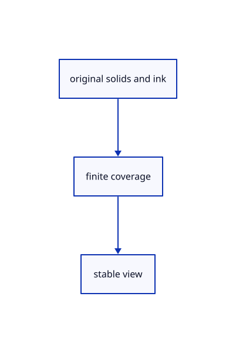

# 17.1.52 · Exercise finite color and original picking

**Chapter 17 · GPU visibility, clipping and sections · Section 17.1 · Finite ink and tiled visibility** · [Contents](contents.md)

**Typing: 0–0 minutes.** [Estimate](typing-load.md).

Exercise finite color and original picking.

## Type

Continue from [Observe actual derived tile resources](86ap-observe-actual-derived-tile-resources.md). [Save or recover your work](recovery.md).

<details>
<summary>Supplied validation fixture</summary>

Copy this supplied authoring fixture once. Continue with the browser build below; the course does not require running native tests.

### 1. `src/tile_shader_tests.rs`

Copy the shader validation and actual GPU fixtures.

Copy this supplied file:

```text
--8<-- "journey/code/86aq-exercise-finite-color-and-original-picking-01-shared-source-shared-bins.rs"
```

</details>

<details>
<summary>Supplied validation fixture</summary>

Copy this supplied authoring fixture once. Continue with the browser build below; the course does not require running native tests.

### 2. `src/lib.rs`

Register the completed source owner.

<details>
<summary>Locate the existing block</summary>

```text

pub mod finite_ink;
```

</details>

After that block, append this supplied code:

```text
--8<-- "journey/code/86aq-exercise-finite-color-and-original-picking-02.rs" skip=21
```

</details>

<details>
<summary>Supplied validation fixture</summary>

Copy this supplied authoring fixture once. Continue with the browser build below; the course does not require running native tests.

### 3. `src/tile_gpu_tests.rs`

Copy the shader validation and actual GPU fixtures.

Copy this supplied file:

```text
--8<-- "journey/code/86aq-exercise-finite-color-and-original-picking-03.rs"
```

</details>

<details>
<summary>Supplied validation fixture</summary>

Copy this supplied authoring fixture once. Continue with the browser build below; the course does not require running native tests.

### 4. `src/lib.rs`

Register the completed source owner.

<details>
<summary>Locate the existing block</summary>

```text
#[cfg(test)]
mod tile_shader_tests;
```

</details>

After that block, append this supplied code:

```text
--8<-- "journey/code/86aq-exercise-finite-color-and-original-picking-04.rs" skip=36
```

</details>

<details>
<summary>Supplied validation fixture</summary>

Copy this supplied authoring fixture once. Continue with the browser build below; the course does not require running native tests.

### 5. `src/finite_visibility_tests.rs`

Copy the shader validation and actual GPU fixtures.

Copy this supplied file:

```text
--8<-- "journey/code/86aq-exercise-finite-color-and-original-picking-05.rs"
```

</details>

<details>
<summary>Supplied validation fixture</summary>

Copy this supplied authoring fixture once. Continue with the browser build below; the course does not require running native tests.

### 6. `src/lib.rs`

Register the completed source owner.

<details>
<summary>Locate the existing block</summary>

```text
#[cfg(test)]
mod tile_gpu_tests;
```

</details>

After that block, append this supplied code:

```text
--8<-- "journey/code/86aq-exercise-finite-color-and-original-picking-06.rs" skip=33
```

</details>

<details>
<summary>Supplied validation fixture</summary>

Copy this supplied authoring fixture once. Continue with the browser build below; the course does not require running native tests.

### 7. `src/pick_gpu_tests.rs`

Copy the original CAD boundary fixture with a precise failure diagnostic.

<details>
<summary>Locate the existing block</summary>

```text
    for border in &scene.objects()[0].cad.as_ref().unwrap().edges {
        let points=&border.points;if !points.iter().all(|p|(p[2]-0.12).abs()<1e-10) {continue;}
        let middle=points.windows(2).nth((points.len()-1)/2).unwrap();let p=std::array::from_fn::<_,3,_>(|i|(middle[0][i]+middle[1][i])*0.5);let p=camera.view_projection().transform_point(&session_rust::Point::new(p[0],p[1],p[2]));renderer.request_pick([p[0] as f32,p[1] as f32],transform).unwrap();assert_eq!(finish_at(&mut renderer).unwrap().part,Part::BRepEdge(border.edge));seen+=1;
    }
    assert_eq!(seen,5,"All four outer edges and the original hole rim resolve");assert_eq!(renderer.stats(),gpu);assert_eq!(source.to_proto(),before);
```

</details>

Update the existing block with this supplied code; keep unchanged lines:

```text
--8<-- "journey/code/86aq-exercise-finite-color-and-original-picking-07.rs"
```

</details>

## Run and check

Run this from `session_viewer` to select the fixed dependency versions and install supplied binary assets. It updates Cargo.lock and preserves the previous lock. It does not write implementation code:

```sh
npm --prefix ../session_tests run course -- dependencies 17.1.52
```

In your project:

```sh
cd workspace/journey
REGEN_PROTO=0 cargo build --lib --locked --target wasm32-unknown-unknown -j1
REGEN_PROTO=0 CARGO_BUILD_JOBS=1 trunk serve --port 8780
```

Open `http://127.0.0.1:8780/`. Keep an existing Trunk server running; saving rebuilds it.

A red original stroke and point appear in front of a blue solid; the original line behind it remains hidden.

### Recorded visual result

**Previous native render — current verification pending.**

Actual finite visibility keeps the front red originals and blue solid visible while suppressing the hidden rear stroke.


*This recorded image predates a source or checker change. Rebuild this checkpoint before using it as current evidence; browser controls require separate acceptance.*

<details>
<summary>Code explanation and diagram</summary>


original solids and ink → finite coverage → stable view.



What proves hidden originals stay hidden?

The supplied native fixtures read actual color pixels and integer results, including picks before the first frame.

Study estimate, including typing and experiments: 0.5–1 hours.

</details>

<details>
<summary>Optional experiment</summary>

Create a Box at w0,0,0 with sides 1 1 1. Add Line w-1,0,1 w1,0,1, Line w-1,0,-1 w1,0,-1 and Point w0.5,0.5,1. Use View Top, View Orthographic, Select None and Fit. Compare the front and hidden ink, then select the visible line. Exact sloping-width, crop and device-fallback cases remain separate supplied GPU evidence.

</details>

<details>
<summary>Check and save your work</summary>

Restore experimental edits, then run from `session_viewer`:

```sh
npm --prefix ../session_tests run course -- check 17.1.52
npm --prefix ../session_tests run course -- save 17.1.52
```

Source comparison leaves your project untouched. [Save and recovery instructions](recovery.md).

</details>

<details>
<summary>Viewer coverage and verification</summary>

Retain finite original-triangle projection and tile lists. The tutorial adapter connects identical center-line visibility to color and cropped integer picking; full plane fitting, curved-edge sag and packed production arenas are audited in94–96.

Retain earlier original-source and numerical fixtures. The final supplied GPU checks inspect real tile records, front/hidden originals, sloping-face width, crop ownership, device fallback, resize and dense-view settlement.

The browser contract is authored and requires an actual browser run. Native software-GPU results do not measure the Lenovo.

[Full validation scope](release.md).

To reproduce the scripted acceptance of the reference checkpoint, run from `session_viewer` with the [course bundle server](release.md#reproduce) running on port 8781:

```sh
npm --prefix ../session_tests run course -- capture 17.1.52
```

This uses the verified reference bundle; it does not check or change your typed project.

</details>
