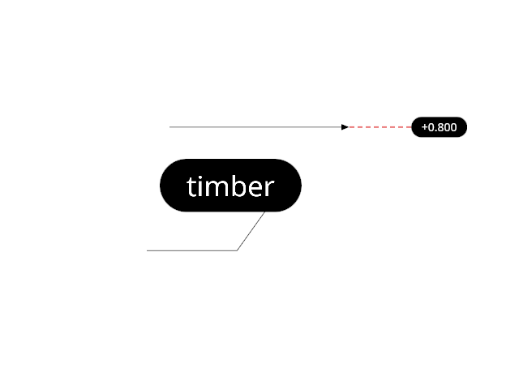

# 17.1.9 · Count conservative triangle coverage per tile

**Chapter 17 · GPU visibility, clipping and sections · Section 17.1 · Finite ink and tiled visibility** · [Contents](contents.md)

**Typing: 21–42 minutes.** [Estimate](typing-load.md).

Add the count pass to the [tile bindings](86d-copy-the-triangle-tiles-recipe.md). Its vertex stage covers each triangle’s tile-grid rectangle; its fragment stage applies the shared inward-edge test before incrementing a tile count. It reserves no reference-pool entries.

## Type

Continue from [Declare atomic tile records and flat triangle inputs](86d-copy-the-triangle-tiles-recipe.md). [Save or recover your work](recovery.md).

### 1. `src/finite_triangle_tiles.wgsl`

Rasterize one tile-grid quad per triangle and reject tiles outside any inward edge before counting.

<details>
<summary>Locate the existing block</summary>

```wgsl
    @location(6) @interpolate(flat) gradient: vec3<f32>, // depth slope and nearest depth
    @location(7) @interpolate(flat) reference: vec3<f32>, // reference point and its depth
};
#include "projected_triangle.wgsl"
#include "projected_triangle.wgsl:viewport-span"
```

</details>

After that block, type:

```wgsl

@vertex
fn vs_main(@builtin(vertex_index) vertex: u32, @builtin(instance_index) instance: u32) -> TileVertex {
    let triangle = projected[instance];
    var out: TileVertex;
    out.clip = vec4<f32>(2.0, 2.0, 0.0, 1.0);

    // empty triangle: off screen
    if (triangle.edge3.w<3.0) {
        return out;
    }

    // tile grid size
    let size = ceil(vec2<f32>(line.vp_w, line.vp_h)/f32(visibility_tile_span()));
    let lo = clamp(floor((triangle.bounds.xy-0.00390625)/f32(visibility_tile_span())), vec2<f32>(0.0), size);
    let hi = clamp(floor((triangle.bounds.zw+0.00390625)/f32(visibility_tile_span()))+1.0, vec2<f32>(0.0), size);
    // triangle strip: two triangles from four corners
    let corners = array<vec2<f32>, 4>(vec2<f32>(0.0, 0.0), vec2<f32>(1.0, 0.0), vec2<f32>(0.0, 1.0), vec2<f32>(1.0, 1.0));
    let position = mix(lo, hi, corners[vertex])/size;
    out.clip = vec4<f32>(position.x*2.0-1.0, 1.0-position.y*2.0, 0.0, 1.0);
    out.edge0 = triangle.edge0.xyz;
    out.edge1 = triangle.edge1.xyz;
    out.edge2 = triangle.edge2.xyz;
    out.edge3 = triangle.edge3.xyz;
    out.bounds = triangle.bounds;
    out.primitive = instance+1u;
    out.gradient = triangle.gradient.xyz;
    out.reference = vec3<f32>(triangle.edge0.w, triangle.edge1.w, triangle.edge2.w);
    return out;
}
fn tile_outside(edge: vec3<f32>, centre: vec2<f32>) -> bool {
    return dot(edge.xy, centre)+edge.z+0.5*f32(visibility_tile_span())*(abs(edge.x)+abs(edge.y)) < -0.00390625;
}
fn covered_tile(v: TileVertex) -> u32 {
    let centre = (floor(v.clip.xy)+0.5)*f32(visibility_tile_span());

    if (tile_outside(v.edge0, centre) || tile_outside(v.edge1, centre) || tile_outside(v.edge2, centre) || tile_outside(v.edge3, centre)) {
        discard;
    }

    let size = vec2<u32>(ceil(vec2<f32>(line.vp_w, line.vp_h)/f32(visibility_tile_span())));
    let tile = 1u+u32(v.clip.y)*size.x+u32(v.clip.x);
    return tile;
}
@fragment
fn fs_count(v: TileVertex) -> @location(0) f32 {
    let tile = covered_tile(v);
    atomicAdd(&tile_records[tile].values[0], 1u);
    return 0.0;
}
```

<details>
<summary>Optional patch references</summary>

Use these original edit fragments when comparing a saved checkpoint. Apply the complete blocks above.

```text
--8<-- "journey/code/86da-count-conservative-triangle-coverage-per-tile-01.wgsl"
```

</details>

## Run and check

Run this from `session_viewer` to select the fixed dependency versions and install supplied binary assets. It updates Cargo.lock and preserves the previous lock. It does not write implementation code:

```sh
npm --prefix ../session_tests run course -- dependencies 17.1.9
```

In your project:

```sh
cd workspace/journey
REGEN_PROTO=0 cargo build --lib --locked --target wasm32-unknown-unknown -j1
REGEN_PROTO=0 CARGO_BUILD_JOBS=1 trunk serve --port 8780
```

Open `http://127.0.0.1:8780/`. Keep an existing Trunk server running; saving rebuilds it.


### Recorded visual result

**Previous native render — current verification pending.**

The rendered headed line and world text remain black; a red dashed extension tail ends at its black +0.800 chip.



*This recorded image predates a source or checker change. Rebuild this checkpoint before using it as current evidence; browser controls require separate acceptance.*

This reference image is shared with [17.1.1 · Bound the physical tile grid and reference storage](86-copy-finite-tile-allocation-rules.md). It does not demonstrate a new feature by itself.

<details>
<summary>Code explanation and diagram</summary>


count conservative triangle coverage per tile.


Why reject a whole tile with an edge equation instead of testing only its centre?

A centre can be outside while a corner overlaps the triangle. Include the tile half-span in the edge bound to keep the test conservative.

Study estimate, including typing and experiments: 0.5–1 hours.

</details>

<details>
<summary>Optional experiment</summary>

Trace a triangle crossing a tile corner. Predict its count and reserved list slots, then compare the later connected demand readback. Why reject a whole tile with an edge equation instead of testing only its centre?

</details>

<details>
<summary>Check and save your work</summary>

Restore experimental edits, then run from `session_viewer`:

```sh
npm --prefix ../session_tests run course -- check 17.1.9
npm --prefix ../session_tests run course -- save 17.1.9
```

Source comparison leaves your project untouched. [Save and recovery instructions](recovery.md).

</details>

<details>
<summary>Viewer coverage and verification</summary>

Develop the current bounded tiles algorithm using existing original buffers and the shared projected-triangle helper. Packed current GPU storage remains a separate bridge.

The browser contract is authored and requires an actual browser run. Native software-GPU results do not measure the Lenovo.

[Full validation scope](release.md).

To reproduce the scripted acceptance of the reference checkpoint, run from `session_viewer` with the [course bundle server](release.md#reproduce) running on port 8781:

```sh
npm --prefix ../session_tests run course -- capture 17.1.9
```

This uses the verified reference bundle; it does not check or change your typed project.

</details>
