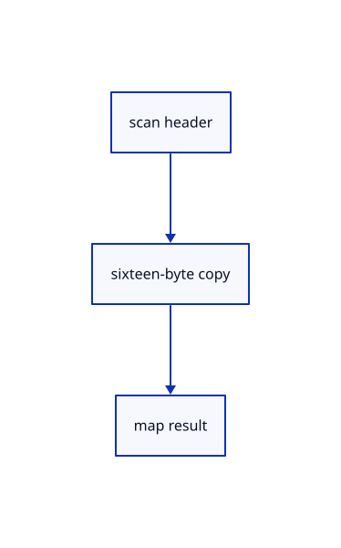

# 17.1.17 · Read actual pool demand asynchronously

**Chapter 17 · GPU visibility, clipping and sections · Section 17.1 · Finite ink and tiled visibility** · [Contents](contents.md)

**Typing: 26–52 minutes.** [Estimate](typing-load.md).

Read GPU tile-pool demand asynchronously, with one map in flight and one reusable readback buffer.

## Type

Continue from [Wake only after a tile report arrives](86g-wake-only-after-a-tile-report-arrives.md). [Save or recover your work](recovery.md).

### 1. `src/tile_report.rs`

Type the complete existing WebGPU helper and reuse its current consumer. Return actual copy admission so a newer bin generation can retry after an old report.

Create the file and type:

```rust
use std::sync::{Arc,atomic::{AtomicU8,Ordering}};
/// Reads back how many words the last scan needed.
pub struct PoolReport {
    buffer: wgpu::Buffer, // 16-byte CPU-readable copy
    ready: Arc<AtomicU8>, // 0 waiting, 1 mapped, 2 failed
    copied: bool,         // a copy was encoded this frame
    inflight: bool,       // the copy is being mapped
}

impl PoolReport {
    /// Create the readback buffer.
    pub fn new(device: &wgpu::Device) -> Self {
        Self {
            buffer: device.create_buffer(&wgpu::BufferDescriptor {
                label: Some("triangle.tiles.report"),
                size: 16,
                usage: wgpu::BufferUsages::COPY_DST | wgpu::BufferUsages::MAP_READ,
                mapped_at_creation: false,
            }),
            ready: Arc::new(AtomicU8::new(0)),
            copied: false,
            inflight: false,
        }
    }

    /// Copy the first tile record into the readback buffer.
    pub fn copy(&mut self, encoder: &mut wgpu::CommandEncoder, tiles: &wgpu::Buffer) ->bool {
        if self.inflight {
            return false;
        }

        encoder.copy_buffer_to_buffer(tiles, 0, &self.buffer, 0, 16);
        self.copied = true;
        true
    }

    /// Start mapping the copy; call once after submit.
    pub fn map(&mut self) {
        if !self.copied || self.inflight {
            return;
        }

        self.copied = false;
        self.inflight = true;
        let flag = self.ready.clone();
        self.buffer
            .slice(..)
            .map_async(wgpu::MapMode::Read, move |result| {
                flag.store(if result.is_ok() { 1 } else { 2 }, Ordering::Release);
                #[cfg(target_arch="wasm32")] crate::browser_tiles::wake();
            });
    }

    /// Words the last scan needed, once the copy is readable.
    pub fn poll(&mut self) -> Option<u64> {
        if !self.inflight {
            return None;
        }

        let status = self.ready.load(Ordering::Acquire);

        if status == 0 {
            return None;
        }

        self.ready.store(0, Ordering::Release);
        self.inflight = false;

        if status != 1 {
            return None;
        }

        let words = {
            let bytes = self.buffer.slice(..).get_mapped_range();
            u32::from_le_bytes(bytes[4..8].try_into().expect("report words"))
        };
        self.buffer.unmap();
        Some(u64::from(words))
    }
}
```

<details>
<summary>Optional patch references</summary>

Use these original edit fragments when comparing a saved checkpoint. Apply the complete blocks above.

```text
--8<-- "journey/code/86h-read-actual-pool-demand-asynchronously-typed-tile_report.rs"
```

```text
--8<-- "journey/code/86h-read-actual-pool-demand-asynchronously-02.rs"
```

</details>

### 2. `src/lib.rs`

Register the completed source owner.

<details>
<summary>Locate the existing block</summary>

```rust

pub mod browser_tiles;
```

</details>

After that block, type:

```rust
--8<-- "journey/code/86h-read-actual-pool-demand-asynchronously-03.rs" skip=24
```

## Run and check

Run this from `session_viewer` to select the fixed dependency versions and install supplied binary assets. It updates Cargo.lock and preserves the previous lock. It does not write implementation code:

```sh
npm --prefix ../session_tests run course -- dependencies 17.1.17
```

In your project:

```sh
cd workspace/journey
REGEN_PROTO=0 cargo build --lib --locked --target wasm32-unknown-unknown -j1
REGEN_PROTO=0 CARGO_BUILD_JOBS=1 trunk serve --port 8780
```

Open `http://127.0.0.1:8780/`. Keep an existing Trunk server running; saving rebuilds it.


### Recorded visual result

**Previous native render — current verification pending.**

The rendered headed line and world text remain black; a red dashed extension tail ends at its black +0.800 chip.


*This recorded image predates a source or checker change. Rebuild this checkpoint before using it as current evidence; browser controls require separate acceptance.*

This reference image is shared with [17.1.1 · Bound the physical tile grid and reference storage](86-copy-finite-tile-allocation-rules.md). It does not demonstrate a new feature by itself.

<details>
<summary>Code explanation and diagram</summary>

Write the existing sixteen-byte GPU readback owner. Encode a copy only when no map is in flight, start asynchronous mapping after submission, and poll the completion flag without blocking the browser. Drop the mapped view before unmapping and reuse the same buffer for the next report.

scan header → sixteen-byte copy → map result.



Can a mapping in flight accept another copy?

No. Return whether the copy was encoded; the bin generation retries only its unreported current result.

Study estimate, including typing and experiments: 0.5–1 hours.

</details>

<details>
<summary>Optional experiment</summary>

Trace callback state, map failure and buffer unmapping.

</details>

<details>
<summary>Check and save your work</summary>

Restore experimental edits, then run from `session_viewer`:

```sh
npm --prefix ../session_tests run course -- check 17.1.17
npm --prefix ../session_tests run course -- save 17.1.17
```

Source comparison leaves your project untouched. [Save and recovery instructions](recovery.md).

</details>

<details>
<summary>Viewer coverage and verification</summary>

Retain finite original-triangle projection and tile lists. The tutorial adapter connects identical center-line visibility to color and cropped integer picking; full plane fitting, curved-edge sag and packed production arenas are audited in94–96.

The browser contract is authored and requires an actual browser run. Native software-GPU results do not measure the Lenovo.

[Full validation scope](release.md).

To reproduce the scripted acceptance of the reference checkpoint, run from `session_viewer` with the [course bundle server](release.md#reproduce) running on port 8781:

```sh
npm --prefix ../session_tests run course -- capture 17.1.17
```

This uses the verified reference bundle; it does not check or change your typed project.

</details>
