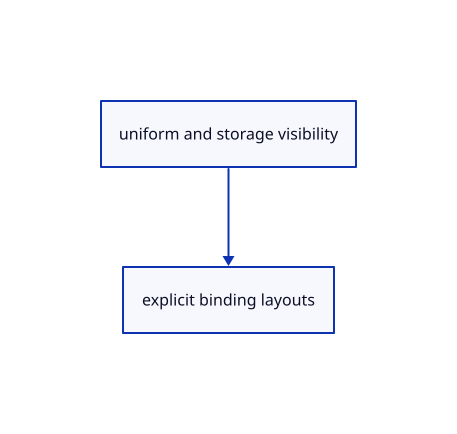

# 17.1.18 · Describe explicit finite GPU layouts

**Chapter 17 · GPU visibility, clipping and sections · Section 17.1 · Finite ink and tiled visibility** · [Contents](contents.md)

**Typing: 5–9 minutes.** [Estimate](typing-load.md).

Declare the pipeline and layout owner, and register its module immediately. These fields establish the resource boundary; the following lessons add the builder helpers and pipeline creation. The existing drawing stays unchanged.

## Type

Continue from [Read actual pool demand asynchronously](86h-read-actual-pool-demand-asynchronously.md). [Save or recover your work](recovery.md).

### 1. `src/tile_pipelines.rs`

Describe explicit finite GPU layouts.

Create the file and type:

```rust
--8<-- "journey/code/86i-describe-explicit-finite-gpu-layouts-01.rs"
```

### 2. `src/lib.rs`

Register the resource types immediately so every following method is checked by the browser compiler.

<details>
<summary>Locate the existing block</summary>

```rust

pub mod tile_report;
```

</details>

After that block, type:

```rust
--8<-- "journey/code/86k-connect-projection-count-scan-and-fill-pipelines-02.rs" skip=22
```

## Run and check

Run this from `session_viewer` to select the fixed dependency versions and install supplied binary assets. It updates Cargo.lock and preserves the previous lock. It does not write implementation code:

```sh
npm --prefix ../session_tests run course -- dependencies 17.1.18
```

In your project:

```sh
cd workspace/journey
REGEN_PROTO=0 cargo build --lib --locked --target wasm32-unknown-unknown -j1
REGEN_PROTO=0 CARGO_BUILD_JOBS=1 trunk serve --port 8780
```

Open `http://127.0.0.1:8780/`. Keep an existing Trunk server running; saving rebuilds it.

The Pipelines type now belongs to the browser module graph. Declaring it creates no GPU pipelines yet.

### Recorded visual result

**Previous native render — current verification pending.**

The rendered headed line and world text remain black; a red dashed extension tail ends at its black +0.800 chip.


*This recorded image predates a source or checker change. Rebuild this checkpoint before using it as current evidence; browser controls require separate acceptance.*

This reference image is shared with [16.5.52 · Exercise current original commands together](85ay-exercise-current-original-commands-together.md). It does not demonstrate a new feature by itself.

<details>
<summary>Code explanation and diagram</summary>


uniform and storage visibility → explicit binding layouts.



Does an inferred shader layout stay compatible with another pipeline?

It need not. These pipelines share explicit layouts for projection, raster counts and scans.

Study estimate, including typing and experiments: 0.5–1 hours.

</details>

<details>
<summary>Optional experiment</summary>

Build the browser and inspect the existing drawing. Read the layout and pipeline fields, then locate the module declaration that makes Rust check the following helper methods.

</details>

<details>
<summary>Check and save your work</summary>

Restore experimental edits, then run from `session_viewer`:

```sh
npm --prefix ../session_tests run course -- check 17.1.18
npm --prefix ../session_tests run course -- save 17.1.18
```

Source comparison leaves your project untouched. [Save and recovery instructions](recovery.md).

</details>

<details>
<summary>Viewer coverage and verification</summary>

Retain finite original-triangle projection and tile lists. The tutorial adapter connects identical center-line visibility to color and cropped integer picking; full plane fitting, curved-edge sag and packed production arenas are audited in94–96.

The browser contract is authored and requires an actual browser run. Native software-GPU results do not measure the Lenovo.

[Full validation scope](release.md).

To reproduce the scripted acceptance of the reference checkpoint, run from `session_viewer` with the [course bundle server](release.md#reproduce) running on port 8781:

```sh
npm --prefix ../session_tests run course -- capture 17.1.18
```

This uses the verified reference bundle; it does not check or change your typed project.

</details>
