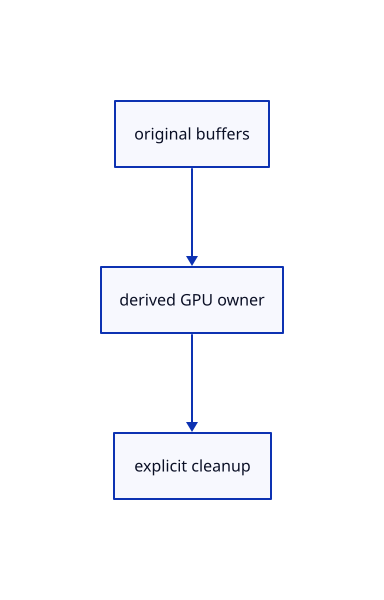

# 17.1.21 · Own bounded finite tile resources

**Chapter 17 · GPU visibility, clipping and sections · Section 17.1 · Finite ink and tiled visibility** · [Contents](contents.md)

**Typing: 12–24 minutes.** [Estimate](typing-load.md).

Declare the tile buffers, cache witnesses and report owner after their pipeline and layout prerequisites. Register the module now so each following method is compiled when introduced. The renderer will supply meshes and dimensions at its later connection.

## Type

Continue from [Connect projection count scan and fill pipelines](86k-connect-projection-count-scan-and-fill-pipelines.md). [Save or recover your work](recovery.md).

### 1. `src/tile_gpu.rs`

Own bounded finite tile resources.

Create the file and type:

```rust
--8<-- "journey/code/86l-own-bounded-finite-tile-resources-01.rs"
```

### 2. `src/gpu_mesh.rs`

Expose existing buffers without changing original data.

<details>
<summary>Locate the existing block</summary>

```rust
    }

    pub(crate) fn packed(&self)->[u8;160] {self.previous}
    pub fn selected(&self)->bool {u32::from_ne_bytes(self.previous[64..68].try_into().unwrap())!=0}
```

</details>

Edit the existing block to match this code; keep unchanged lines:

```rust
--8<-- "journey/code/86ak-expose-original-gpu-models-to-projection-02.rs"
```

### 3. `src/lib.rs`

Register the resource types immediately so every following method is checked by the browser compiler.

<details>
<summary>Locate the existing block</summary>

```rust

pub mod tile_pipelines;
```

</details>

After that block, type:

```rust
--8<-- "journey/code/86r-cache-projection-and-finish-current-reports-02.rs" skip=25
```

## Run and check

Run this from `session_viewer` to select the fixed dependency versions and install supplied binary assets. It updates Cargo.lock and preserves the previous lock. It does not write implementation code:

```sh
npm --prefix ../session_tests run course -- dependencies 17.1.21
```

In your project:

```sh
cd workspace/journey
REGEN_PROTO=0 cargo build --lib --locked --target wasm32-unknown-unknown -j1
REGEN_PROTO=0 CARGO_BUILD_JOBS=1 trunk serve --port 8780
```

Open `http://127.0.0.1:8780/`. Keep an existing Trunk server running; saving rebuilds it.

The tile resource types and buffer factory compile. Their constructor and renderer connection follow in the next lessons.

### Recorded visual result

**Previous native render — current verification pending.**

The rendered headed line and world text remain black; a red dashed extension tail ends at its black +0.800 chip.


*This recorded image predates a source or checker change. Rebuild this checkpoint before using it as current evidence; browser controls require separate acceptance.*

This reference image is shared with [16.5.52 · Exercise current original commands together](85ay-exercise-current-original-commands-together.md). It does not demonstrate a new feature by itself.

<details>
<summary>Code explanation and diagram</summary>


original buffers → derived GPU owner → explicit cleanup.



Do cloned buffer handles allocate geometry again?

No. They reference existing original uploads; the tile owner allocates only its derived records and metadata.

Study estimate, including typing and experiments: 0.5–1 hours.

</details>

<details>
<summary>Optional experiment</summary>

Build the unchanged browser viewer, then trace the tile owner fields to Pipelines, TileLayout and PoolReport. Distinguish declaring a buffer handle from calling the allocation helper.

</details>

<details>
<summary>Check and save your work</summary>

Restore experimental edits, then run from `session_viewer`:

```sh
npm --prefix ../session_tests run course -- check 17.1.21
npm --prefix ../session_tests run course -- save 17.1.21
```

Source comparison leaves your project untouched. [Save and recovery instructions](recovery.md).

</details>

<details>
<summary>Viewer coverage and verification</summary>

Retain finite original-triangle projection and tile lists. The tutorial adapter connects identical center-line visibility to color and cropped integer picking; full plane fitting, curved-edge sag and packed production arenas are audited in94–96.

The browser contract is authored and requires an actual browser run. Native software-GPU results do not measure the Lenovo.

[Full validation scope](release.md).

To reproduce the scripted acceptance of the reference checkpoint, run from `session_viewer` with the [course bundle server](release.md#reproduce) running on port 8781:

```sh
npm --prefix ../session_tests run course -- capture 17.1.21
```

This uses the verified reference bundle; it does not check or change your typed project.

</details>
