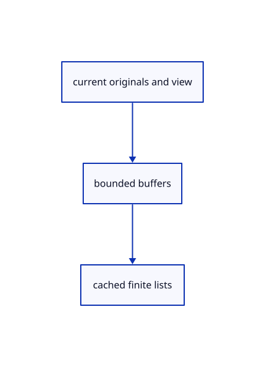

# 17.1.25 · Grow lists only from actual demand

**Chapter 17 · GPU visibility, clipping and sections · Section 17.1 · Finite ink and tiled visibility** · [Contents](contents.md)

**Typing: 19–38 minutes.** [Estimate](typing-load.md).

Grow lists only from actual demand.

## Type

Continue from [Release obsolete tile lists and bindings](86o-release-obsolete-tile-lists-and-bindings.md). [Save or recover your work](recovery.md).

### 1. `src/tile_gpu.rs`

<details>
<summary>Locate the existing block</summary>

```rust
 fn rebind(&mut self,device:&wgpu::Device){self.raster=group(device,&self.pipes.raster_layout,&[&self.projected,&self.buffer]);self.scan=group(device,&self.pipes.scan_layout,&[&self.buffer]);for row in &mut self.rows{row.group=None;}}
 fn release(&mut self,device:&wgpu::Device){if self.layout.take().is_none()&&self.projected.size()==PROJECTED_BYTES&&self.buffer.size()==16{return}self.projected=buffer(device,"finite projected placeholder",PROJECTED_BYTES);self.buffer=buffer(device,"finite tile placeholder",16);self.pool=0;self.target=None;self.key=None;self.rebind(device);}
```

</details>

Edit the existing block to match this code; keep unchanged lines:

```rust
--8<-- "journey/code/86p-grow-lists-only-from-actual-demand-01.rs"
```

## Run and check

Run this from `session_viewer` to select the fixed dependency versions and install supplied binary assets. It updates Cargo.lock and preserves the previous lock. It does not write implementation code:

```sh
npm --prefix ../session_tests run course -- dependencies 17.1.25
```

In your project:

```sh
cd workspace/journey
REGEN_PROTO=0 cargo build --lib --locked --target wasm32-unknown-unknown -j1
REGEN_PROTO=0 CARGO_BUILD_JOBS=1 trunk serve --port 8780
```

Open `http://127.0.0.1:8780/`. Keep an existing Trunk server running; saving rebuilds it.


### Recorded visual result

**Previous native render — current verification pending.**

The rendered headed line and world text remain black; a red dashed extension tail ends at its black +0.800 chip.


*This recorded image predates a source or checker change. Rebuild this checkpoint before using it as current evidence; browser controls require separate acceptance.*

This reference image is shared with [16.5.52 · Exercise current original commands together](85ay-exercise-current-original-commands-together.md). It does not demonstrate a new feature by itself.

<details>
<summary>Code explanation and diagram</summary>


current originals and view → bounded buffers → cached finite lists.



Does every orbit allocate a larger pool?

No. Consume actual scan reports and grow only when demand exceeds capacity, within the device ceiling.

Study estimate, including typing and experiments: 0.5–1 hours.

</details>

<details>
<summary>Optional experiment</summary>

Compare resize, unchanged tile dimensions, spare projected capacity and physical-depth fallback.

</details>

<details>
<summary>Check and save your work</summary>

Restore experimental edits, then run from `session_viewer`:

```sh
npm --prefix ../session_tests run course -- check 17.1.25
npm --prefix ../session_tests run course -- save 17.1.25
```

Source comparison leaves your project untouched. [Save and recovery instructions](recovery.md).

</details>

<details>
<summary>Viewer coverage and verification</summary>

Retain finite original-triangle projection and tile lists. The tutorial adapter connects identical center-line visibility to color and cropped integer picking; full plane fitting, curved-edge sag and packed production arenas are audited in94–96.

The browser contract is authored and requires an actual browser run. Native software-GPU results do not measure the Lenovo.

[Full validation scope](release.md).

To reproduce the scripted acceptance of the reference checkpoint, run from `session_viewer` with the [course bundle server](release.md#reproduce) running on port 8781:

```sh
npm --prefix ../session_tests run course -- capture 17.1.25
```

This uses the verified reference bundle; it does not check or change your typed project.

</details>
