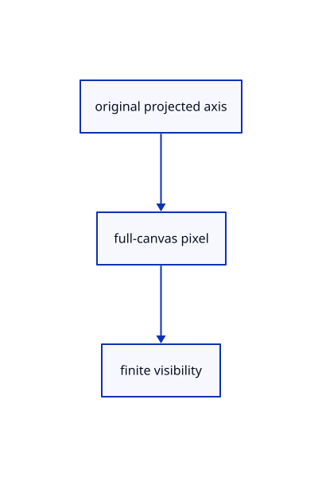

# 17.1.30 · Carry stroke axis and depth

**Chapter 17 · GPU visibility, clipping and sections · Section 17.1 · Finite ink and tiled visibility** · [Contents](contents.md)

**Typing: 8–16 minutes.** [Estimate](typing-load.md).

Carry stroke axis and depth.

## Type

Continue from [Reuse original stroke coverage](86t-reuse-original-stroke-coverage.md). [Save or recover your work](recovery.md).

### 1. `src/finite_stroke.wgsl`

<details>
<summary>Locate the existing block</summary>

```wgsl
struct View { transform: mat4x4<f32>, size: vec2<f32>, density: f32 }
@group(0) @binding(0) var<uniform> view: View;

struct Output {
    @builtin(position) position: vec4<f32>,
    @location(0) colour: vec4<f32>,
    @location(1) @interpolate(linear) side: f32,
    @location(2) @interpolate(flat) half_width: f32,
}

fn hidden(colour: vec4<f32>) -> Output {
    return Output(vec4<f32>(2.0, 2.0, 2.0, 1.0), colour, 0.0, 0.0);
}

fn geometry(start: vec3<f32>, end: vec3<f32>, colour: vec4<f32>, width: f32, index: u32) -> Output {
    var a = view.transform * vec4<f32>(start, 1.0);
    var b = view.transform * vec4<f32>(end, 1.0);
    if (a.z < 0.0 && b.z < 0.0) { return hidden(colour); }
    if (a.z < 0.0) { a = mix(a, b, -a.z / (b.z - a.z)); }
    if (b.z < 0.0) { b = mix(b, a, -b.z / (a.z - b.z)); }
    if (a.w <= 0.0 || b.w <= 0.0) { return hidden(colour); }
    let delta = (b.xy / b.w - a.xy / a.w) * view.size;
    let length2 = dot(delta, delta);
    if (length2 < 0.000001) { return hidden(colour); }
    let normal = vec2<f32>(-delta.y, delta.x) * inverseSqrt(length2);
    let corners = array<vec2<f32>, 6>(vec2<f32>(0.0, -1.0), vec2<f32>(1.0, -1.0),
        vec2<f32>(0.0, 1.0), vec2<f32>(0.0, 1.0), vec2<f32>(1.0, -1.0), vec2<f32>(1.0, 1.0));
    let corner = corners[index];
    let half_width = width * view.density * 0.5;
    let extent = half_width + 0.70711;
    var position = select(a, b, corner.x > 0.5);
    position = vec4<f32>(position.xy + normal * extent * 2.0 / view.size * corner.y * position.w, position.zw);
    return Output(position, colour, corner.y * extent, half_width);
}

#include "stroke_coverage.wgsl"

@vertex
fn vertex(@location(0) start: vec3<f32>, @location(1) end: vec3<f32>,
    @location(2) colour: vec4<f32>, @location(3) width: f32,
    @builtin(vertex_index) index: u32) -> Output { return geometry(start, end, colour, width, index); }
@fragment
fn fragment(input: Output) -> @location(0) vec4<f32> { return colour(input); }
```

</details>

Edit the existing block to match this code; keep unchanged lines:

```wgsl
struct View { transform: mat4x4<f32>, size: vec2<f32>, density: f32 }
@group(0) @binding(0) var<uniform> view: View;

struct Output {
    @builtin(position) position: vec4<f32>,
    @location(0) colour: vec4<f32>,
    @location(1) @interpolate(linear) side: f32,
    @location(2) @interpolate(flat) half_width: f32,
    @location(9) @interpolate(flat) finite_axis_value:vec4<f32>,
    @location(10) @interpolate(flat) finite_depths:vec2<f32>,
    @location(11) @interpolate(linear) finite_pixel:vec2<f32>,
}

fn hidden(colour: vec4<f32>) -> Output {
    return Output(vec4<f32>(2.0, 2.0, 2.0, 1.0), colour, 0.0, 0.0,vec4<f32>(0.0),vec2<f32>(0.0),vec2<f32>(0.0));
}

fn geometry(start: vec3<f32>, end: vec3<f32>, colour: vec4<f32>, width: f32, index: u32) -> Output {
    var a = view.transform * vec4<f32>(start, 1.0);
    var b = view.transform * vec4<f32>(end, 1.0);
    if (a.z < 0.0 && b.z < 0.0) { return hidden(colour); }
    if (a.z < 0.0) { a = mix(a, b, -a.z / (b.z - a.z)); }
    if (b.z < 0.0) { b = mix(b, a, -b.z / (a.z - b.z)); }
    if (a.w <= 0.0 || b.w <= 0.0) { return hidden(colour); }
    let delta = (b.xy / b.w - a.xy / a.w) * view.size;
    let length2 = dot(delta, delta);
    if (length2 < 0.000001) { return hidden(colour); }
    let normal = vec2<f32>(-delta.y, delta.x) * inverseSqrt(length2);
    let corners = array<vec2<f32>, 6>(vec2<f32>(0.0, -1.0), vec2<f32>(1.0, -1.0),
        vec2<f32>(0.0, 1.0), vec2<f32>(0.0, 1.0), vec2<f32>(1.0, -1.0), vec2<f32>(1.0, 1.0));
    let corner = corners[index];
    let half_width = width * view.density * 0.5;
    let extent = half_width + 0.70711;
    var position = select(a, b, corner.x > 0.5);
    position = vec4<f32>(position.xy + normal * extent * 2.0 / view.size * corner.y * position.w, position.zw);
    return Output(position, colour, corner.y * extent, half_width,finite_axis(a,b),vec2<f32>(1.0-a.z/a.w,1.0-b.z/b.w),finite_screen(position));
}

#include "stroke_coverage.wgsl"

@vertex
fn vertex(@location(0) start: vec3<f32>, @location(1) end: vec3<f32>,
    @location(2) colour: vec4<f32>, @location(3) width: f32,
    @builtin(vertex_index) index: u32) -> Output { return geometry(start, end, colour, width, index); }
@fragment
fn fragment(input: Output) -> @location(0) vec4<f32> {if(!finite_visible(input.finite_pixel,input.finite_axis_value,input.finite_depths)){discard;}return colour(input);}


#include "projected_triangle.wgsl"
#include "finite_visibility.wgsl"
fn finite_depth_pixel(pixel:vec2<f32>)->vec2<i32>{return vec2<i32>(pixel);}
```

<details>
<summary>Optional patch references</summary>

Use these original edit fragments when comparing a saved checkpoint. Apply the complete blocks above.

```text
--8<-- "journey/code/86u-carry-stroke-axis-and-depth-01.rs"
```

```text
--8<-- "journey/code/86u-carry-stroke-axis-and-depth-02.rs"
```

```text
--8<-- "journey/code/86u-carry-stroke-axis-and-depth-03.rs"
```

</details>

## Run and check

Run this from `session_viewer` to select the fixed dependency versions and install supplied binary assets. It updates Cargo.lock and preserves the previous lock. It does not write implementation code:

```sh
npm --prefix ../session_tests run course -- dependencies 17.1.30
```

In your project:

```sh
cd workspace/journey
REGEN_PROTO=0 cargo build --lib --locked --target wasm32-unknown-unknown -j1
REGEN_PROTO=0 CARGO_BUILD_JOBS=1 trunk serve --port 8780
```

Open `http://127.0.0.1:8780/`. Keep an existing Trunk server running; saving rebuilds it.


### Recorded visual result

**Previous native render — current verification pending.**

The rendered headed line and world text remain black; a red dashed extension tail ends at its black +0.800 chip.


*This recorded image predates a source or checker change. Rebuild this checkpoint before using it as current evidence; browser controls require separate acceptance.*

This reference image is shared with [17.1.1 · Bound the physical tile grid and reference storage](86-copy-finite-tile-allocation-rules.md). It does not demonstrate a new feature by itself.

<details>
<summary>Code explanation and diagram</summary>


original projected axis → full-canvas pixel → finite visibility.



Does crop-local position describe the original canvas?

No. Retain the original full-canvas pixel as a linear varying; picking later applies its physical origin.

Study estimate, including typing and experiments: 0.5–1 hours.

</details>

<details>
<summary>Optional experiment</summary>

Compare axis endpoints, reversed depth and the shared fragment predicate.

</details>

<details>
<summary>Check and save your work</summary>

Restore experimental edits, then run from `session_viewer`:

```sh
npm --prefix ../session_tests run course -- check 17.1.30
npm --prefix ../session_tests run course -- save 17.1.30
```

Source comparison leaves your project untouched. [Save and recovery instructions](recovery.md).

</details>

<details>
<summary>Viewer coverage and verification</summary>

Retain finite original-triangle projection and tile lists. The tutorial adapter connects identical center-line visibility to color and cropped integer picking; full plane fitting, curved-edge sag and packed production arenas are audited in94–96.

The browser contract is authored and requires an actual browser run. Native software-GPU results do not measure the Lenovo.

[Full validation scope](release.md).

To reproduce the scripted acceptance of the reference checkpoint, run from `session_viewer` with the [course bundle server](release.md#reproduce) running on port 8781:

```sh
npm --prefix ../session_tests run course -- capture 17.1.30
```

This uses the verified reference bundle; it does not check or change your typed project.

</details>
