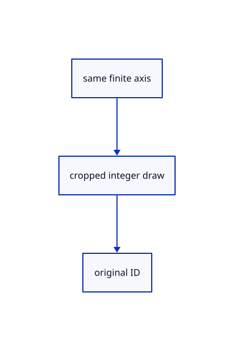

# 17.1.32 · Keep stroke crop ownership aligned

**Chapter 17 · GPU visibility, clipping and sections · Section 17.1 · Finite ink and tiled visibility** · [Contents](contents.md)

**Typing: 6–12 minutes.** [Estimate](typing-load.md).

Keep stroke crop ownership aligned.

## Type

Continue from [Reuse original stroke integer coverage](86v-reuse-original-stroke-integer-coverage.md). [Save or recover your work](recovery.md).

### 1. `src/finite_stroke_pick.wgsl`

<details>
<summary>Locate the existing block</summary>

```wgsl
@group(1) @binding(0) var<uniform> crop: Crop;
struct PickOutput {
    @builtin(position) position: vec4<f32>,
    @location(0) colour: vec4<f32>,
    @location(1) @interpolate(linear) side: f32,
    @location(2) @interpolate(flat) half_width: f32,
    @location(7) @interpolate(flat) id: vec2<u32>,
}
@vertex
fn pick_vertex(@location(0) start: vec3<f32>, @location(1) end: vec3<f32>,
    @location(2) colour: vec4<f32>, @location(3) width: f32,
    @builtin(vertex_index) index: u32, @location(7) id: vec2<u32>) -> PickOutput {
    let source = geometry(start, end, colour, width, index);
    var output: PickOutput;
    output.position = crop.transform * source.position;
    output.colour = source.colour;
    output.side = source.side;
    output.half_width = source.half_width;
    output.id = id; return output;
}
@fragment
fn pick_fragment(input: PickOutput) -> @location(0) vec2<u32> {
    let source = Output(input.position, input.colour, input.side, input.half_width);
    if (!wanted(input.id.y, crop.mode)) { discard; }
    if (colour(source).a <= 0.0) { discard; }
    return input.id;
}
```

</details>

Edit the existing block to match this code; keep unchanged lines:

```wgsl
@group(1) @binding(0) var<uniform> crop: Crop;
struct PickOutput {
    @builtin(position) position: vec4<f32>,
    @location(0) colour: vec4<f32>,
    @location(1) @interpolate(linear) side: f32,
    @location(2) @interpolate(flat) half_width: f32,
    @location(7) @interpolate(flat) id: vec2<u32>,
    @location(9) @interpolate(flat) finite_axis_value:vec4<f32>,
    @location(10) @interpolate(flat) finite_depths:vec2<f32>,
    @location(11) @interpolate(linear) finite_pixel:vec2<f32>,
}
@vertex
fn pick_vertex(@location(0) start: vec3<f32>, @location(1) end: vec3<f32>,
    @location(2) colour: vec4<f32>, @location(3) width: f32,
    @builtin(vertex_index) index: u32, @location(7) id: vec2<u32>) -> PickOutput {
    let source = geometry(start, end, colour, width, index);
    var output: PickOutput;
    output.position = crop.transform * source.position;
    output.colour = source.colour;
    output.side = source.side;
    output.half_width = source.half_width;
    output.finite_axis_value=source.finite_axis_value;output.finite_depths=source.finite_depths;output.finite_pixel=source.finite_pixel;
    output.id = id; return output;
}
@fragment
fn pick_fragment(input: PickOutput) -> @location(0) vec2<u32> {
    let source = Output(input.position, input.colour, input.side, input.half_width,input.finite_axis_value,input.finite_depths,input.finite_pixel);
    if (!wanted(input.id.y, crop.mode)) { discard; }
    if (colour(source).a <= 0.0) { discard; }
    if(!finite_visible(input.finite_pixel,input.finite_axis_value,input.finite_depths)){discard;}
    return input.id;
}
```

<details>
<summary>Optional patch references</summary>

Use these original edit fragments when comparing a saved checkpoint. Apply the complete blocks above.

```text
--8<-- "journey/code/86w-keep-stroke-crop-ownership-aligned-01.rs"
```

```text
--8<-- "journey/code/86w-keep-stroke-crop-ownership-aligned-02.rs"
```

</details>

## Run and check

Run this from `session_viewer` to select the fixed dependency versions and install supplied binary assets. It updates Cargo.lock and preserves the previous lock. It does not write implementation code:

```sh
npm --prefix ../session_tests run course -- dependencies 17.1.32
```

In your project:

```sh
cd workspace/journey
REGEN_PROTO=0 cargo build --lib --locked --target wasm32-unknown-unknown -j1
REGEN_PROTO=0 CARGO_BUILD_JOBS=1 trunk serve --port 8780
```

Open `http://127.0.0.1:8780/`. Keep an existing Trunk server running; saving rebuilds it.


### Recorded visual result

**Previous native render — current verification pending.**

The rendered headed line and world text remain black; a red dashed extension tail ends at its black +0.800 chip.


*This recorded image predates a source or checker change. Rebuild this checkpoint before using it as current evidence; browser controls require separate acceptance.*

This reference image is shared with [16.5.52 · Exercise current original commands together](85ay-exercise-current-original-commands-together.md). It does not demonstrate a new feature by itself.

<details>
<summary>Code explanation and diagram</summary>


same finite axis → cropped integer draw → original ID.



Do temporary screen records acquire scene IDs?

No. The integer result remains the original row and part address.

Study estimate, including typing and experiments: 0.5–1 hours.

</details>

<details>
<summary>Optional experiment</summary>

Compare original coverage and the unchanged ID attribute7.

</details>

<details>
<summary>Check and save your work</summary>

Restore experimental edits, then run from `session_viewer`:

```sh
npm --prefix ../session_tests run course -- check 17.1.32
npm --prefix ../session_tests run course -- save 17.1.32
```

Source comparison leaves your project untouched. [Save and recovery instructions](recovery.md).

</details>

<details>
<summary>Viewer coverage and verification</summary>

Retain finite original-triangle projection and tile lists. The tutorial adapter connects identical center-line visibility to color and cropped integer picking; full plane fitting, curved-edge sag and packed production arenas are audited in94–96.

The browser contract is authored and requires an actual browser run. Native software-GPU results do not measure the Lenovo.

[Full validation scope](release.md).

To reproduce the scripted acceptance of the reference checkpoint, run from `session_viewer` with the [course bundle server](release.md#reproduce) running on port 8781:

```sh
npm --prefix ../session_tests run course -- capture 17.1.32
```

This uses the verified reference bundle; it does not check or change your typed project.

</details>
