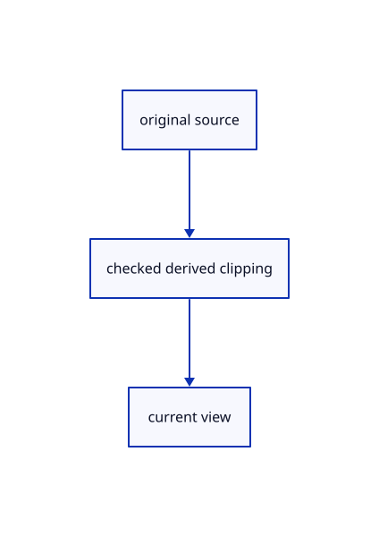

# 17.2.38 · Exercise original clipping color and picking

**Chapter 17 · GPU visibility, clipping and sections · Section 17.2 · Clipping half-spaces** · [Contents](contents.md)

**Typing: 0–0 minutes.** [Estimate](typing-load.md).

Exercise original clipping color and picking.

## Type

Continue from [Observe actual clipping resources and errors](87aa-observe-actual-clipping-resources-and-errors.md). [Save or recover your work](recovery.md).

<details>
<summary>Supplied validation fixture</summary>

Copy this supplied authoring fixture once. Continue with the browser build below; the course does not require running native tests.

### 1. `src/clipping_source_tests.rs`

Retain the original source and explicit derived owner.

Copy this supplied file:

```text
--8<-- "journey/code/87ab-exercise-original-clipping-color-and-picking-01.rs"
```

</details>

<details>
<summary>Supplied validation fixture</summary>

Copy this supplied authoring fixture once. Continue with the browser build below; the course does not require running native tests.

### 2. `src/lib.rs`

Register the completed source owner.

<details>
<summary>Locate the existing block</summary>

```text

pub mod clipping_gpu;
```

</details>

After that block, append this supplied code:

```text
--8<-- "journey/code/87ab-exercise-original-clipping-color-and-picking-02.rs" skip=23
```

</details>

<details>
<summary>Supplied validation fixture</summary>

Copy this supplied authoring fixture once. Continue with the browser build below; the course does not require running native tests.

### 3. `src/clipping_gpu_tests.rs`

Retain the original source and explicit derived owner.

Copy this supplied file:

```text
--8<-- "journey/code/87ab-exercise-original-clipping-color-and-picking-03.rs"
```

</details>

<details>
<summary>Supplied validation fixture</summary>

Copy this supplied authoring fixture once. Continue with the browser build below; the course does not require running native tests.

### 4. `src/lib.rs`

Register the completed source owner.

<details>
<summary>Locate the existing block</summary>

```text
#[cfg(test)]
mod clipping_source_tests;
```

</details>

After that block, append this supplied code:

```text
--8<-- "journey/code/87ab-exercise-original-clipping-color-and-picking-04.rs" skip=40
```

</details>

<details>
<summary>Supplied validation fixture</summary>

Copy this supplied authoring fixture once. Continue with the browser build below; the course does not require running native tests.

### 5. `src/clipping_uniform_tests.rs`

Retain the original source and explicit derived owner.

Copy this supplied file:

```text
--8<-- "journey/code/87ab-exercise-original-clipping-color-and-picking-05.rs"
```

</details>

<details>
<summary>Supplied validation fixture</summary>

Copy this supplied authoring fixture once. Continue with the browser build below; the course does not require running native tests.

### 6. `src/lib.rs`

Register the completed source owner.

<details>
<summary>Locate the existing block</summary>

```text
#[cfg(test)]
mod clipping_gpu_tests;
```

</details>

After that block, append this supplied code:

```text
--8<-- "journey/code/87ab-exercise-original-clipping-color-and-picking-06.rs" skip=37
```

</details>

## Run and check

Run this from `session_viewer` to select the fixed dependency versions and install supplied binary assets. It updates Cargo.lock and preserves the previous lock. It does not write implementation code:

```sh
npm --prefix ../session_tests run course -- dependencies 17.2.38
```

In your project:

```sh
cd workspace/journey
REGEN_PROTO=0 cargo build --lib --locked --target wasm32-unknown-unknown -j1
REGEN_PROTO=0 CARGO_BUILD_JOBS=1 trunk serve --port 8780
```

Open `http://127.0.0.1:8780/`. Keep an existing Trunk server running; saving rebuilds it.

A blue original solid and red original line remain on the kept side; their cut halves are absent.

### Recorded visual result

**Previous native render — current verification pending.**

Actual color clipping removes the right halves while retaining original geometry on the left.


*This recorded image predates a source or checker change. Rebuild this checkpoint before using it as current evidence; browser controls require separate acceptance.*

<details>
<summary>Code explanation and diagram</summary>


original source → checked derived clipping → current view.



What proves clipped owners cannot still be picked?

The supplied native checks read actual integer targets before color frames and compare retained/cut pixels across original families.

Study estimate, including typing and experiments: 0.5–1 hours.

</details>

<details>
<summary>Optional experiment</summary>

Create Example CAD and Clipping Plane YZ 0,0,0. Fit the scene, switch Clipping Plane Off and On, then Flip it and Undo. Click the retained half and inspect the missing half. Save and reopen the drawing; optional GPU fixtures cover the additional ink families and pre-frame picks.

</details>

<details>
<summary>Check and save your work</summary>

Restore experimental edits, then run from `session_viewer`:

```sh
npm --prefix ../session_tests run course -- check 17.2.38
npm --prefix ../session_tests run course -- save 17.2.38
```

Source comparison leaves your project untouched. [Save and recovery instructions](recovery.md).

</details>

<details>
<summary>Viewer coverage and verification</summary>

Retain current original Plane modes, world half-spaces, six-plane uniform and shared shader predicates. Connect derived clipping to original color and integer owners without changing source coordinates, GUIDs or parent placement. Closed-solid section fills connect in88; large-world GPU rebasing and the complete current-file audit follow in95–96.

Retain all earlier fixtures. The final supplied checks cover current modes, malformed and pending input, original Save/Open/Flip/Undo, actual cut color and picks before a frame, all original ink families, clouds, sheets, the sixth text plane and cached uniforms/uploads.

The browser contract is supplied and requires an actual enabled browser. Native software-GPU pixels and picks do not measure Lenovo performance.

[Full validation scope](release.md).

To reproduce the scripted acceptance of the reference checkpoint, run from `session_viewer` with the [course bundle server](release.md#reproduce) running on port 8781:

```sh
npm --prefix ../session_tests run course -- capture 17.2.38
```

This uses the verified reference bundle; it does not check or change your typed project.

</details>
