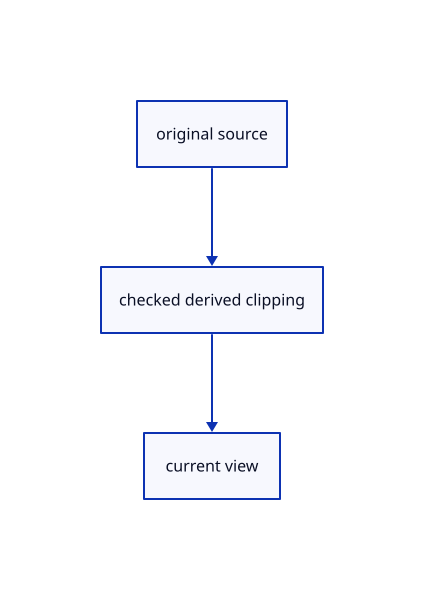

# 17.2.19 · Own one shared clipping GPU uniform

**Chapter 17 · GPU visibility, clipping and sections · Section 17.2 · Clipping half-spaces** · [Contents](contents.md)

**Typing: 23–46 minutes.** [Estimate](typing-load.md).

Own one shared clipping GPU uniform.

## Type

Continue from [Route Clipping Plane and preserve pending points](87h-route-clipping-plane-and-preserve-pending-points.md). [Save or recover your work](recovery.md).

### 1. `src/clipping_gpu.rs`

Retain the original source and explicit derived owner.

Create the file and type:

```rust
--8<-- "journey/code/87i-own-one-shared-clipping-gpu-uniform-01.rs"
```

### 2. `src/lib.rs`

Register the completed source owner.

<details>
<summary>Locate the existing block</summary>

```rust

pub mod clipping_tool;
```

</details>

After that block, type:

```rust
--8<-- "journey/code/87i-own-one-shared-clipping-gpu-uniform-02.rs" skip=24
```

## Run and check

Run this from `session_viewer` to select the fixed dependency versions and install supplied binary assets. It updates Cargo.lock and preserves the previous lock. It does not write implementation code:

```sh
npm --prefix ../session_tests run course -- dependencies 17.2.19
```

In your project:

```sh
cd workspace/journey
REGEN_PROTO=0 cargo build --lib --locked --target wasm32-unknown-unknown -j1
REGEN_PROTO=0 CARGO_BUILD_JOBS=1 trunk serve --port 8780
```

Open `http://127.0.0.1:8780/`. Keep an existing Trunk server running; saving rebuilds it.


### Recorded visual result

**Previous native render — current verification pending.**

Actual finite visibility keeps the front red originals and blue solid visible while suppressing the hidden rear stroke.


*This recorded image predates a source or checker change. Rebuild this checkpoint before using it as current evidence; browser controls require separate acceptance.*

This reference image is shared with [17.2.5 · Gather six visible original world planes](87a-gather-six-visible-original-world-planes.md). It does not demonstrate a new feature by itself.

<details>
<summary>Code explanation and diagram</summary>


original source → checked derived clipping → current view.



Do each of the drawing families need another448-byte buffer?

No. One owner caches the current encoded bytes and lends its uniform binding to color, picks and derived caches.

Study estimate, including typing and experiments: 0.5–1 hours.

</details>

<details>
<summary>Optional experiment</summary>

Compare actual buffer allocation, identical-frame writes and truthful row-gathering errors.

</details>

<details>
<summary>Check and save your work</summary>

Restore experimental edits, then run from `session_viewer`:

```sh
npm --prefix ../session_tests run course -- check 17.2.19
npm --prefix ../session_tests run course -- save 17.2.19
```

Source comparison leaves your project untouched. [Save and recovery instructions](recovery.md).

</details>

<details>
<summary>Viewer coverage and verification</summary>


The browser contract is supplied and requires an actual enabled browser. Native software-GPU pixels and picks do not measure Lenovo performance.

[Full validation scope](release.md).

To reproduce the scripted acceptance of the reference checkpoint, run from `session_viewer` with the [course bundle server](release.md#reproduce) running on port 8781:

```sh
npm --prefix ../session_tests run course -- capture 17.2.19
```

This uses the verified reference bundle; it does not check or change your typed project.

</details>
