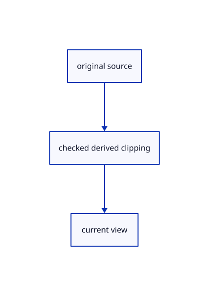

# 17.2.20 · Retain clipping state beside the renderer

**Chapter 17 · GPU visibility, clipping and sections · Section 17.2 · Clipping half-spaces** · [Contents](contents.md)

**Typing: 11–22 minutes.** [Estimate](typing-load.md).

Retain clipping state beside the renderer.

## Type

Continue from [Own one shared clipping GPU uniform](87i-own-one-shared-clipping-gpu-uniform.md). [Save or recover your work](recovery.md).

### 1. `src/renderer.rs`

Own current clipping independently of original uploads.

Edit these blocks from bottom to top. Keep the surrounding lines unchanged.

<details>
<summary>Locate this block</summary>

```rust
    pub fn sheet_camera(&self,camera:&crate::camera::Camera) {self.sheets.camera(camera);}
    #[cfg(test)]
    pub(crate) fn tile_buffers(&self)->[wgpu::Buffer;2]{let tiles=self.tiles.borrow();[tiles.projected.clone(),tiles.buffer.clone()]}
    pub fn tile_usage(&self)->[u64;7]{self.tiles.borrow().usage()}
    pub fn sheet_usage(&self)->[u64;5] {self.sheets.usage()}
    pub fn instance_usage(&self)->[u64;5] {self.instances.usage()}
```

</details>

Replace it with:

```rust
    pub fn sheet_camera(&self,camera:&crate::camera::Camera) {self.sheets.camera(camera);}
    #[cfg(test)]
    pub(crate) fn tile_buffers(&self)->[wgpu::Buffer;2]{let tiles=self.tiles.borrow();[tiles.projected.clone(),tiles.buffer.clone()]}
    pub fn set_clipping(&self,enabled:bool,solid:bool){let mut clip=self.clipping.borrow_mut();clip.enabled=enabled;clip.solid=solid;}
    pub fn clipping_usage(&self)->[u64;5]{let clip=self.clipping.borrow();[clip.rows.len()as u64,u64::from(clip.enabled),u64::from(clip.solid),clip.writes,clip.buffer.size()]}
    pub fn clipping_error(&self)->Option<&'static str>{self.clipping.borrow().error}
    pub fn tile_usage(&self)->[u64;7]{self.tiles.borrow().usage()}
    pub fn sheet_usage(&self)->[u64;5] {self.sheets.usage()}
    pub fn instance_usage(&self)->[u64;5] {self.instances.usage()}
```

<details>
<summary>Locate this block</summary>

```rust
    }

    pub fn set_scene(&mut self, scene: &Scene, selected: Option<ObjectId>) {
        if let Some(outline)=self.outline.borrow_mut().as_mut() {outline.invalidate();}
        self.picker.cancel(); self.faces.clear();
        self.preview.set(&self.device, None).expect("Empty tool preview");
```

</details>

Replace it with:

```rust
    }

    pub fn set_scene(&mut self, scene: &Scene, selected: Option<ObjectId>) {
        self.clipping.borrow_mut().set(scene);
        if let Some(outline)=self.outline.borrow_mut().as_mut() {outline.invalidate();}
        self.picker.cancel(); self.faces.clear();
        self.preview.set(&self.device, None).expect("Empty tool preview");
```

<details>
<summary>Locate this block</summary>

```rust
        let mesh_ink = crate::stroke_gpu::Lane::new(&device, format);
        let sheets=crate::sheet_gpu::Lane::new(&device,format);
        let measurement=crate::measure_gpu::Measurement::new(&device,format);let guides=crate::guide_gpu::Guide::new(&device,format);
        let mut renderer = Self {tiles,guides,measurement,sheets,instances,instance_rows:Default::default(),clouds:Default::default(),cloud_view:Default::default(),cloud_error:Default::default(),outline:Default::default(),full_text_fonts:Default::default(),presentation_text:Default::default(),scene_text:Default::default(), text:std::cell::RefCell::new(None),text_error:std::cell::RefCell::new(None),format,device, queue, pipeline, highlight_pipeline, highlight, preview, widget, meshes: Vec::new(),
            geometry: Default::default(), settings_allocations: 0, settings_writes: 0,
            settings_bytes: 0, uniform, view_group, depth, strokes, paths, markers, grid, grid_settings: None,grid_plane:crate::cplane::CPlane::Xy, size: [640, 480], density: 1.0, picker, faces, mesh_ink, sources: Default::default(), pick_mode: Default::default() };
        for lane in [&mut renderer.mesh_ink,&mut renderer.strokes,&mut renderer.paths,&mut renderer.markers,&mut renderer.grid]{lane.enable_finite(&renderer.device,format);}
```

</details>

Replace it with:

```rust
        let mesh_ink = crate::stroke_gpu::Lane::new(&device, format);
        let sheets=crate::sheet_gpu::Lane::new(&device,format);
        let measurement=crate::measure_gpu::Measurement::new(&device,format);let guides=crate::guide_gpu::Guide::new(&device,format);
        let mut renderer = Self {clipping:std::cell::RefCell::new(crate::clipping_gpu::Clipping::new(&device)),tiles,guides,measurement,sheets,instances,instance_rows:Default::default(),clouds:Default::default(),cloud_view:Default::default(),cloud_error:Default::default(),outline:Default::default(),full_text_fonts:Default::default(),presentation_text:Default::default(),scene_text:Default::default(), text:std::cell::RefCell::new(None),text_error:std::cell::RefCell::new(None),format,device, queue, pipeline, highlight_pipeline, highlight, preview, widget, meshes: Vec::new(),
            geometry: Default::default(), settings_allocations: 0, settings_writes: 0,
            settings_bytes: 0, uniform, view_group, depth, strokes, paths, markers, grid, grid_settings: None,grid_plane:crate::cplane::CPlane::Xy, size: [640, 480], density: 1.0, picker, faces, mesh_ink, sources: Default::default(), pick_mode: Default::default() };
        for lane in [&mut renderer.mesh_ink,&mut renderer.strokes,&mut renderer.paths,&mut renderer.markers,&mut renderer.grid]{lane.enable_finite(&renderer.device,format);}
```

<details>
<summary>Locate this block</summary>

```rust
use crate::{gpu_mesh::GpuMesh, scene::{ObjectId, Scene}};

pub struct Renderer {
    tiles:std::cell::RefCell<crate::tile_gpu::Tiles>,
    guides:crate::guide_gpu::Guide,
    measurement:crate::measure_gpu::Measurement,
```

</details>

Replace it with:

```rust
use crate::{gpu_mesh::GpuMesh, scene::{ObjectId, Scene}};

pub struct Renderer {
    clipping:std::cell::RefCell<crate::clipping_gpu::Clipping>,
    tiles:std::cell::RefCell<crate::tile_gpu::Tiles>,
    guides:crate::guide_gpu::Guide,
    measurement:crate::measure_gpu::Measurement,
```

<details>
<summary>Complete updated block reference</summary>

```rust
use crate::{gpu_mesh::GpuMesh, scene::{ObjectId, Scene}};

pub struct Renderer {
    clipping:std::cell::RefCell<crate::clipping_gpu::Clipping>,
    tiles:std::cell::RefCell<crate::tile_gpu::Tiles>,
    guides:crate::guide_gpu::Guide,
    measurement:crate::measure_gpu::Measurement,
    sheets:crate::sheet_gpu::Lane,
    clouds:std::cell::RefCell<Option<crate::cloud_gpu::Lane>>,
    cloud_view:std::cell::Cell<crate::cloud_gpu::View>,
    cloud_error:std::cell::RefCell<Option<String>>,
    outline:std::cell::RefCell<Option<crate::outline_gpu::Outline>>,
    text:std::cell::RefCell<Option<crate::scene_text_gpu::Lane>>,
    text_error:std::cell::RefCell<Option<String>>,
    full_text_fonts:std::cell::RefCell<Option<Vec<Vec<u8>>>>,
    presentation_text:std::cell::RefCell<Vec<crate::text::TextLabel>>,
    scene_text:std::cell::RefCell<Vec<crate::text::TextLabel>>,
    format:wgpu::TextureFormat,
    pub device: wgpu::Device,
    pub queue: wgpu::Queue,
    instances:crate::instance_gpu::Lane,
    instance_rows:std::collections::HashSet<ObjectId>,
    pipeline: wgpu::RenderPipeline,
    highlight_pipeline: wgpu::RenderPipeline,
    highlight: crate::highlight::Highlight,
    preview: crate::tool_preview::Preview,
    widget: crate::widget::Widget,
    meshes: Vec<GpuMesh>,
    geometry: crate::geometry_cache::GeometryCache,
    settings_allocations: usize,
    settings_writes: usize,
    settings_bytes: usize,
    uniform: wgpu::Buffer,
    view_group: wgpu::BindGroup,
    depth: wgpu::TextureView,
    strokes: crate::stroke_gpu::Lane,
    paths: crate::stroke_gpu::Lane,
    markers: crate::stroke_gpu::Lane,
    grid: crate::stroke_gpu::Lane,
    grid_settings: Option<crate::grid::Settings>,
    grid_plane:crate::cplane::CPlane,
    size: [u32; 2],
    density: f32,
    picker: crate::pick_gpu::Picker,
    sources: crate::pick_sources::Sources,
    faces: crate::face_pick::Faces,
    mesh_ink: crate::stroke_gpu::Lane,
    pick_mode: crate::pick_sources::Mode,
}

impl Renderer {
    pub fn new(
        device: wgpu::Device,
        queue: wgpu::Queue,
        format: wgpu::TextureFormat,
        scene: &Scene,
    ) -> Self {
        crate::shader_check::check(&device, include_str!("cloud_points.wgsl").into(), "Cloud points");
        crate::shader_check::check(&device, include_str!("cloud_resolve.wgsl").into(), "Cloud resolve");
        crate::shader_check::check(&device, crate::finite_project_source::source(), "Finite projection");
        crate::shader_check::check(&device, crate::finite_project_source::tiles(), "Finite tiles");
        crate::shader_check::check(&device, crate::finite_project_source::scan(), "Finite scan");
        let shader = device.create_shader_module(wgpu::ShaderModuleDescriptor {
            label: Some("triangle"),
            source: wgpu::ShaderSource::Wgsl(include_str!("triangle.wgsl").into()),
        });
        let view_layout = crate::gpu_layout::uniform(&device, 80);
        let model_layout = crate::gpu_layout::uniform(&device, 160);
        let layout = device.create_pipeline_layout(&wgpu::PipelineLayoutDescriptor {
            label: Some("mesh settings"), bind_group_layouts: &[Some(&view_layout), Some(&model_layout)], immediate_size: 0 });
        let mesh_pipeline = |depth| device.create_render_pipeline(&wgpu::RenderPipelineDescriptor {
            label: Some("triangle"),
            layout: Some(&layout),
            vertex: wgpu::VertexState {
                module: &shader,
                entry_point: Some("vertex"),
                compilation_options: Default::default(),
                buffers: &[wgpu::VertexBufferLayout {
                    array_stride: 24,
                    step_mode: wgpu::VertexStepMode::Vertex,
                    attributes: &wgpu::vertex_attr_array![0 => Float32x3, 1 => Float32x3],
                }, wgpu::VertexBufferLayout {
                    array_stride: 12, step_mode: wgpu::VertexStepMode::Vertex,
                    attributes: &wgpu::vertex_attr_array![2 => Float32x3],
                }],
            },
            fragment: Some(wgpu::FragmentState {
                module: &shader,
                entry_point: Some("fragment"),
                compilation_options: Default::default(),
                targets: &[Some(format.into())],
            }),
            primitive: Default::default(),
            depth_stencil: Some(depth),
            multisample: Default::default(),
            multiview_mask: None,
            cache: None,
        });
        let pipeline = mesh_pipeline(crate::depth::surface());
        let tiles=std::cell::RefCell::new(crate::tile_gpu::Tiles::new(&device,&view_layout));
        let instances=crate::instance_gpu::Lane::new(&device,format,&view_layout);
        let highlight_pipeline = mesh_pipeline(crate::depth::ink());
        let highlight = crate::highlight::Highlight::new(&device, format);
        let preview = crate::tool_preview::Preview::new(&device, format);
        let widget = crate::widget::Widget::new(&device, format);
        let uniform = device.create_buffer(&wgpu::BufferDescriptor {
            label: Some("view transform and normal diagnostic"),
            size: 80,
            usage: wgpu::BufferUsages::UNIFORM | wgpu::BufferUsages::COPY_DST,
            mapped_at_creation: false,
        });
        let view_group = device.create_bind_group(&wgpu::BindGroupDescriptor {
            label: Some("view settings"),
            layout: &pipeline.get_bind_group_layout(0),
            entries: &[wgpu::BindGroupEntry {
                binding: 0,
                resource: uniform.as_entire_binding(),
            }],
        });
        let depth = Self::depth(&device, 640, 480);
        let strokes = crate::stroke_gpu::Lane::new(&device, format);
        let paths = crate::stroke_gpu::Lane::joined(&device, format);
        let markers = crate::stroke_gpu::Lane::markers(&device, format);
        let grid = crate::stroke_gpu::Lane::grid(&device, format);
        let picker = crate::pick_gpu::Picker::new(&device, &view_layout, &model_layout);
        let faces = crate::face_pick::Faces::new(&device);
        let mesh_ink = crate::stroke_gpu::Lane::new(&device, format);
        let sheets=crate::sheet_gpu::Lane::new(&device,format);
        let measurement=crate::measure_gpu::Measurement::new(&device,format);let guides=crate::guide_gpu::Guide::new(&device,format);
        let mut renderer = Self {clipping:std::cell::RefCell::new(crate::clipping_gpu::Clipping::new(&device)),tiles,guides,measurement,sheets,instances,instance_rows:Default::default(),clouds:Default::default(),cloud_view:Default::default(),cloud_error:Default::default(),outline:Default::default(),full_text_fonts:Default::default(),presentation_text:Default::default(),scene_text:Default::default(), text:std::cell::RefCell::new(None),text_error:std::cell::RefCell::new(None),format,device, queue, pipeline, highlight_pipeline, highlight, preview, widget, meshes: Vec::new(),
            geometry: Default::default(), settings_allocations: 0, settings_writes: 0,
            settings_bytes: 0, uniform, view_group, depth, strokes, paths, markers, grid, grid_settings: None,grid_plane:crate::cplane::CPlane::Xy, size: [640, 480], density: 1.0, picker, faces, mesh_ink, sources: Default::default(), pick_mode: Default::default() };
        for lane in [&mut renderer.mesh_ink,&mut renderer.strokes,&mut renderer.paths,&mut renderer.markers,&mut renderer.grid]{lane.enable_finite(&renderer.device,format);}
        renderer.highlight.enable_finite(&renderer.device,format);
        renderer.set_scene(scene, None);
        renderer
    }

    fn depth(device: &wgpu::Device, width: u32, height: u32) -> wgpu::TextureView {
        let depth_texture = device.create_texture(&wgpu::TextureDescriptor {
            label: Some("opaque depth"),
            size: wgpu::Extent3d { width, height, depth_or_array_layers: 1 },
            mip_level_count: 1,
            sample_count: 1,
            dimension: wgpu::TextureDimension::D2,
            format: crate::depth::FORMAT,
            usage: wgpu::TextureUsages::RENDER_ATTACHMENT|wgpu::TextureUsages::TEXTURE_BINDING,
            view_formats: &[],
        });
        depth_texture.create_view(&Default::default())
    }

    pub fn resize(&mut self, size: crate::viewport::Viewport) {
        if self.size != [size.width, size.height] { self.picker.cancel(); }
        self.size = [size.width, size.height];
        self.depth = Self::depth(&self.device, size.width, size.height);
    }

    pub fn set_density(&mut self, density: f32) {
        if density.is_finite() && density > 0.0 && density != self.density { self.picker.cancel(); self.density = density; }
    }

    pub fn stroke_usage(&self) -> [u64; 4] {
        let [count, bytes] = self.strokes.usage();
        [count, bytes, self.strokes.uploads, self.strokes.uploaded_bytes]
    }

    pub fn path_usage(&self) -> [u64; 4] {
        let [count, bytes] = self.paths.usage();
        [count, bytes, self.paths.uploads, self.paths.uploaded_bytes]
    }

    pub fn point_usage(&self) -> [u64; 4] {
        let [count, bytes] = self.markers.usage();
        [count, bytes, self.markers.uploads, self.markers.uploaded_bytes]
    }

    pub fn set_scene(&mut self, scene: &Scene, selected: Option<ObjectId>) {
        self.clipping.borrow_mut().set(scene);
        if let Some(outline)=self.outline.borrow_mut().as_mut() {outline.invalidate();}
        self.picker.cancel(); self.faces.clear();
        self.preview.set(&self.device, None).expect("Empty tool preview");
        self.highlight.set(&self.device, &self.pipeline.get_bind_group_layout(1), scene, None).expect("Empty selection");
        self.sources = crate::pick_sources::Sources::new(scene).expect("Prepared source topology is bounded");
        self.mesh_ink.set(&self.device, self.sources.mesh_ink.iter().copied()).expect("Prepared source edges");
        self.mesh_ink.set_ids(&self.device, self.sources.mesh_ids.iter().copied()).expect("Source edge IDs match");
        self.markers.set_points(&self.device, scene.points().iter().filter(|row| scene.visible(row.id)).map(|row| {let mut marker=row.marker();if let Some(colour)=scene.face_rgba(row.id) {marker.colour=colour;}marker}).chain(scene.control_markers().into_iter().map(|c| c.display)))
            .expect("Prepared point placement fits the display range");
        self.paths.set_chains(&self.device, scene.paths().iter().filter(|row| scene.visible(row.id)).flat_map(|row| {let mut segments=row.segments();if let Some(colour)=scene.face_rgba(row.id) {for segment in &mut segments {segment.stroke.colour=colour;}}segments}))
            .expect("Prepared path placement fits the display range");
        self.strokes.set(&self.device, scene.lines().iter().filter(|row| scene.visible(row.id)).map(|row| {let mut stroke=row.stroke();if let Some(colour)=scene.face_rgba(row.id) {stroke.colour=colour;}stroke}))
            .expect("Prepared line placement fits the display range");
        self.markers.set_ids(&self.device, self.sources.marker_ids.iter().copied()).expect("Marker owners match");
        self.paths.set_ids(&self.device, self.sources.path_ids.iter().copied()).expect("Path owners match");
        self.strokes.set_ids(&self.device, self.sources.line_ids.iter().copied()).expect("Line owners match");
        let layout = self.pipeline.get_bind_group_layout(1);
        let mut old = std::mem::take(&mut self.meshes);
        for object in scene.objects().iter().filter(|row| scene.visible(row.id)) {
            let matching = old.iter().position(|row| row.id == object.id
                && std::rc::Rc::ptr_eq(&row.geometry.source, &object.mesh));
            let row = if let Some(index) = matching {
                let mut row = old.swap_remove(index);
                let [calls, bytes] = row.update(&self.queue, object,style(scene,object.id,selected==Some(object.id)));
                self.settings_writes += calls;
                self.settings_bytes += bytes;
                row
            } else {
                let geometry = self.geometry.get(&self.device, &object.mesh);
                self.settings_allocations += 1;
                GpuMesh::with_geometry(&self.device, &layout, object,
                    style(scene,object.id,selected==Some(object.id)), geometry)
            };
            self.meshes.push(row);
        }
        drop(old);
        self.tiles.borrow_mut().set(&self.device,&self.meshes);
        self.instance_rows=scene.instances.keys().copied().collect();
        self.instances.set(&self.device,&self.queue,self.meshes.iter().filter(|row|self.instance_rows.contains(&row.id))).expect("Validated instance records fit device limits");
        self.sheets.set(&self.device,&self.queue,scene,selected.as_slice(),&self.sources.sheet_bases).expect("Prepared original sheet batches fit device limits");
        self.geometry.prune();
        if !self.meshes.iter().any(GpuMesh::selected) {self.outline.borrow_mut().take();}
        if let Err(error)=self.set_clouds(scene,selected.as_slice()) {*self.cloud_error.borrow_mut()=Some(error.to_string());}
        if let Err(error)=self.set_scene_text(scene,selected.as_slice()) {*self.text_error.borrow_mut()=Some(error.to_string());}
    }

    pub fn request_pick(&mut self, screen: [f32; 2], transform: [f32; 16]) -> Result<(), &'static str> {
        let window = crate::pick_window::Window::new(screen, self.size, self.density).ok_or("Invalid pick cursor")?;
        self.picker.queue(crate::pick_gpu::Request { window, transform, density: self.density, mode: self.pick_mode })?;
        self.pump_pick(transform); Ok(())
    }

    fn pump_pick(&mut self, transform: [f32; 16]) {
        let Ok(view) = crate::pick_view::View::new(transform, self.size, self.density) else { self.picker.cancel(); return; };
        if self.pick_mode == crate::pick_sources::Mode::Face && !self.faces.ready(self.meshes.len()) {
            self.faces.set(&self.device, &self.meshes, &self.sources.mesh_bases);
        }
        if let Some(lane)=self.text.borrow_mut().as_mut() {if let Err(error)=lane.prepare(&self.text_context(),&self.text_frame(transform)) {*self.text_error.borrow_mut()=Some(error.to_string());return;}}
        self.prepare_clouds(transform);
        if let Some(request) = self.picker.next(view) {
            let mut bytes=transform.iter().flat_map(|v|v.to_ne_bytes()).collect::<Vec<_>>();bytes.resize(80,0);self.queue.write_buffer(&self.uniform,0,&bytes);
            let tables={let mut tiles=self.tiles.borrow_mut();tiles.prepare(&self.device,&self.queue,self.size);let mut encoder=self.device.create_command_encoder(&Default::default());tiles.encode(&self.device,&mut encoder,&self.view_group,transform);self.queue.submit([encoder.finish()]);tiles.map_report();crate::finite_ink::Tables{projected:tiles.projected.clone(),tiles:tiles.buffer.clone()}};
            self.picker.submit_finite(&self.device, &self.queue, request,
            &self.meshes, &[&self.mesh_ink, &self.strokes, &self.paths, &self.markers], &self.faces,self.text.borrow().as_ref(),self.clouds.borrow().as_ref(),Some(&self.sheets),Some(&tables)); }
    }

    pub fn take_pick(&mut self, transform: [f32; 16]) -> Option<Result<Option<[u32; 2]>, &'static str>> {
        let view = match crate::pick_view::View::new(transform, self.size, self.density) { Ok(view) => view, Err(error) => {
            self.picker.cancel(); return Some(Err(error));
        } };
        match self.picker.take(view) {
            Some(Ok(crate::pick_gpu::Reply::Hit(hit))) => Some(Ok(hit)),
            Some(Ok(crate::pick_gpu::Reply::Stale)) => { self.pump_pick(transform); None },
            Some(Err(error)) => Some(Err(error)), None => None,
        }
    }

    pub fn set_pick_mode(&mut self, mode: crate::pick_sources::Mode) {
        if self.pick_mode != mode { self.picker.cancel(); self.pick_mode = mode; }
    }

    pub fn resolve_pick(&self, scene: &Scene, pixel: [u32; 2]) -> Option<crate::pick_sources::Target> {
        self.sources.resolve(scene, pixel, self.pick_mode)
    }

    pub fn part_usage(&self) -> [u64; 4] { let [count, bytes] = self.mesh_ink.usage(); [count, bytes, self.faces.bytes(), self.sources.bytes() as u64] }

    pub fn cancel_pick(&mut self) { self.picker.cancel(); }

    pub fn pick_usage(&self) -> [u64; 5] {
        let [active, pending, bytes] = self.picker.usage();
        [active, pending, bytes + self.strokes.pick_bytes() + self.paths.pick_bytes() + self.markers.pick_bytes() + self.mesh_ink.pick_bytes() + self.mesh_ink.usage()[1] + self.faces.bytes(),
            self.picker.submitted, self.picker.coalesced]
    }

    pub fn geometry_owners(&self) -> impl Iterator<Item = &std::rc::Rc<crate::gpu_geometry::GpuGeometry>> {
        self.meshes.iter().map(|row| &row.geometry)
    }

    pub fn usage(&self) -> [u64; 4] { crate::memory::gpu(&self.meshes) }

    pub fn uploaded_bytes(&self) -> u64 {
        self.instances.written_bytes + self.geometry.uploaded_bytes + self.settings_allocations as u64 * 160 + self.settings_bytes as u64
            + self.strokes.uploaded_bytes + self.paths.uploaded_bytes + self.markers.uploaded_bytes + self.grid.uploaded_bytes
    }

    pub fn set_grid(&mut self,settings:Option<crate::grid::Settings>)->Result<(),&'static str>{self.set_grid_on(settings,crate::cplane::CPlane::Xy)}
    pub fn set_grid_on(&mut self,settings:Option<crate::grid::Settings>,plane:crate::cplane::CPlane)->Result<(),&'static str>{
        if settings==self.grid_settings&&plane==self.grid_plane{return Ok(())}
        let strokes=settings.map(|s|s.strokes_on(plane)).transpose()?.unwrap_or_default();
        self.grid.set(&self.device,strokes)?;self.grid_settings=settings;self.grid_plane=plane;Ok(())
    }

    pub fn grid_usage(&self) -> [u64; 4] {
        let [count, bytes] = self.grid.usage(); [count, bytes, self.grid.uploads, self.grid.uploaded_bytes]
    }

    pub fn set_highlight(&mut self, scene: &Scene, target: Option<crate::pick_sources::Target>) -> Result<(), &'static str> {
        if let Some(outline)=self.outline.borrow_mut().as_mut() {outline.invalidate();}
        self.highlight.set(&self.device, &self.pipeline.get_bind_group_layout(1), scene, target)
    }

    pub fn select_objects(&mut self, scene: &Scene, ids: &[ObjectId]) -> Result<(), &'static str> {
        if let Some(outline)=self.outline.borrow_mut().as_mut() {outline.invalidate();}
        for mesh in &mut self.meshes { if let Some(row) = scene.objects().iter().find(|r| r.id == mesh.id) {
            let [calls, bytes] = mesh.update(&self.queue, row,style(scene,row.id,ids.contains(&row.id)));
            self.settings_writes += calls; self.settings_bytes += bytes;
        } }
        self.instances.set(&self.device,&self.queue,self.meshes.iter().filter(|row|self.instance_rows.contains(&row.id)))?;
        if !self.meshes.iter().any(GpuMesh::selected) {self.outline.borrow_mut().take();}
        self.set_clouds(scene,ids)?;self.sheets.set(&self.device,&self.queue,scene,ids,&self.sources.sheet_bases)?;
        if !ids.is_empty() { self.highlight.objects(&self.device, scene, ids)?; }self.set_scene_text(scene,ids).map_err(|_|"Cannot prepare scene labels")?; Ok(())
    }

    pub fn set_guides(&mut self,overlay:&crate::guide_gpu::Overlay)->Result<(),&'static str>{if self.guides.set(&self.device,overlay)?{self.set_scene_measure_text().map_err(|_|"Cannot prepare editing guide label")?}Ok(())}
    pub fn guide_bytes(&self)->u64{self.guides.bytes()}
    pub fn set_measurement(&mut self,mark:Option<&crate::measure_mark::Mark>)->Result<(),&'static str>{if self.measurement.mark.as_ref()==mark{return Ok(())}self.measurement.set(&self.device,mark)?;self.set_scene_measure_text().map_err(|_|"Cannot prepare measurement annotation")}
    pub fn measurement_bytes(&self)->u64{self.measurement.bytes()}
    fn merge_measurement(&self,mut labels:Vec<crate::text::TextLabel>)->Vec<crate::text::TextLabel>{if let Some(mark)=&self.measurement.mark{labels.extend(mark.labels(&labels));}labels.extend(self.guides.overlay.labels(&labels));labels}
    fn set_scene_measure_text(&self)->anyhow::Result<()>{let mut labels=self.scene_text.borrow().clone();labels.extend(self.presentation_text.borrow().clone());self.adopt_text(self.merge_measurement(labels))}
    pub fn set_preview(&mut self, draft: Option<&crate::tool::Draft>) -> Result<(), &'static str> { self.preview.set(&self.device, draft) }
    pub fn preview_bytes(&self) -> u64 { self.preview.bytes() }

    pub fn set_gizmo(&mut self, camera:&crate::camera::Camera, origin:Option<[f64;3]>, active:f32) {
        let matrix=camera.view_projection();
        let layout=origin.and_then(|p|crate::widget_layout::world_per_pixel(&matrix,p,self.size[1] as f64/self.density as f64)
            .and_then(|scale|crate::widget_layout::layout(&matrix,p,scale,self.size,active)));
        self.widget.prepare(&self.device,&self.queue,layout);
    }
    pub fn gizmo_usage(&self) -> [u64;4] { self.widget.usage() }
    pub fn gizmo_extent(&self) -> Option<[u32;2]> {self.widget.extent()}

    fn text_context(&self)->crate::text_gpu_support::GpuCtx {crate::text_gpu_support::GpuCtx::new(&self.device,&self.queue)}
    fn text_frame(&self,transform:[f32;16])->crate::scene_text_gpu::TextFrame {crate::scene_text_gpu::TextFrame {mvp:transform,origin:[0.;3],framebuffer:self.size,logical:[self.size[0] as f64/self.density as f64,self.size[1] as f64/self.density as f64],ortho_half_height:0.,clip:[[0.;4];4]}}
    fn adopt_text(&self,labels:Vec<crate::text::TextLabel>)->anyhow::Result<()> {
        if labels.is_empty() {self.text.borrow_mut().take();self.text_error.borrow_mut().take();return Ok(());}
        let mut lane=self.text.borrow_mut();if lane.is_none() {let mut new=crate::scene_text_gpu::Lane::new(&self.text_context(),crate::text_gpu_support::Target {format:self.format,samples:1});if let Some(fonts)=self.full_text_fonts.borrow().as_ref() {new.document.replace_fonts(fonts.clone())?;}*lane=Some(new);}lane.as_mut().unwrap().set_labels(labels)
    }
    pub fn set_text(&self,mut labels:Vec<crate::text::TextLabel>)->anyhow::Result<()> {
        for (i,label) in labels.iter_mut().enumerate() {label.id=u32::MAX-i as u32;label.object=None;}
        let mut merged=self.scene_text.borrow().clone();merged.extend(labels.clone());self.adopt_text(self.merge_measurement(merged))?;*self.presentation_text.borrow_mut()=labels;Ok(())
    }
    fn set_scene_text(&self,scene:&Scene,selected:&[ObjectId])->anyhow::Result<()> {
        let labels=scene.text_labels(selected).map_err(anyhow::Error::msg)?;let mut merged=labels.clone();merged.extend(self.presentation_text.borrow().clone());self.adopt_text(self.merge_measurement(merged))?;*self.scene_text.borrow_mut()=labels;Ok(())
    }
    pub fn refresh_text_bounds(&self,scene:&mut Scene) {
        if let Some(lane)=self.text.borrow().as_ref() {for row in scene.texts_mut() {if let Some(run)=lane.document.runs.iter().find(|run|run.label.id==row.id.value()) {row.prepared.extent=run.buffer.layout_runs().fold([0f64;2],|[w,h],line|[w.max(line.line_w as f64),h.max((line.line_top+line.line_height) as f64)]);}}}
    }
    pub fn text_stats(&self)->Option<crate::scene_text_gpu::TextStats> {self.text.borrow().as_ref().map(|lane|lane.stats.clone())}
    pub fn text_scene_usage(&self)->[u64;4] {self.text.borrow().as_ref().map_or([0;4],|lane|[lane.allocated_bytes(),lane.texture_bytes(),lane.stats.world_plane_rasterizations,lane.document.runs.len() as u64])}
    pub fn replace_text_fonts(&self,fonts:Vec<Vec<u8>>)->anyhow::Result<()> {if let Some(lane)=self.text.borrow_mut().as_mut() {lane.document.replace_fonts(fonts.clone())?;} else {let mut document=crate::text::TextDocument::new();document.replace_fonts(fonts.clone())?;}*self.full_text_fonts.borrow_mut()=Some(fonts);Ok(())}
    pub fn clear_text_fonts(&self) {self.full_text_fonts.borrow_mut().take();}

    pub fn text_error(&self)->Option<String> {self.text_error.borrow().clone()}
    pub fn text_usage(&self)->[u64;6] {self.text.borrow().as_ref().map_or([0;6],|lane|{[lane.document.shape_count,lane.stats.preparations,lane.stats.skipped_preparations,lane.stats.raster_images as u64,lane.stats.raster_image_capacity_bytes as u64,lane.stats.atlas_resets]})}
    pub fn text_demo(&self)->anyhow::Result<()> {self.set_text(vec![crate::text_example::label()])}

    pub fn cloud_camera(&self,camera:&crate::camera::Camera) {self.cloud_view.set(crate::cloud_gpu::View::camera(camera));self.sheets.camera(camera);}
    pub fn cloud_usage(&self)->[u64;5] {self.clouds.borrow().as_ref().map_or([0;5],|lane|lane.usage())}
    pub fn cloud_error(&self)->Option<String> {self.cloud_error.borrow().clone()}
    fn set_clouds(&self,scene:&Scene,selected:&[ObjectId])->Result<(),&'static str> {
        if scene.clouds().is_empty()&&scene.streams().is_empty() {self.clouds.borrow_mut().take();self.cloud_error.borrow_mut().take();return Ok(());}
        let mut owner=self.clouds.borrow_mut();let lane=owner.get_or_insert_with(||crate::cloud_gpu::Lane::new(&self.text_context(),self.format));lane.set_scene(&self.text_context(),scene,selected)
    }
    fn prepare_clouds(&self,transform:[f32;16]) {
        if let Some(lane)=self.clouds.borrow_mut().as_mut() {if let Err(error)=lane.prepare(&self.text_context(),transform,self.size,self.density,self.cloud_view.get()) {lane.failed();*self.cloud_error.borrow_mut()=Some(error.to_string());} else {self.cloud_error.borrow_mut().take();}}
    }
    pub fn outline_usage(&self)->[u64;4] {self.outline.borrow().as_ref().map_or([0;4],|outline|outline.usage())}

    pub fn highlight_bytes(&self) -> u64 { self.highlight.bytes() }

    pub fn sheet_camera(&self,camera:&crate::camera::Camera) {self.sheets.camera(camera);}
    #[cfg(test)]
    pub(crate) fn tile_buffers(&self)->[wgpu::Buffer;2]{let tiles=self.tiles.borrow();[tiles.projected.clone(),tiles.buffer.clone()]}
    pub fn set_clipping(&self,enabled:bool,solid:bool){let mut clip=self.clipping.borrow_mut();clip.enabled=enabled;clip.solid=solid;}
    pub fn clipping_usage(&self)->[u64;5]{let clip=self.clipping.borrow();[clip.rows.len()as u64,u64::from(clip.enabled),u64::from(clip.solid),clip.writes,clip.buffer.size()]}
    pub fn clipping_error(&self)->Option<&'static str>{self.clipping.borrow().error}
    pub fn tile_usage(&self)->[u64;7]{self.tiles.borrow().usage()}
    pub fn sheet_usage(&self)->[u64;5] {self.sheets.usage()}
    pub fn instance_usage(&self)->[u64;5] {self.instances.usage()}
    pub fn stats(&self) -> [usize; 4] {
        [self.geometry.uploads, self.settings_allocations, self.settings_writes, self.settings_bytes]
    }

    pub fn draw(
        &self,
        view: &wgpu::TextureView,
        background: &crate::background::Background,
        transform: &[f32; 16],
    ) { self.draw_mode(view, background, transform, false); }

    pub fn draw_mode(&self, view: &wgpu::TextureView, background: &crate::background::Background,
        transform: &[f32; 16], normals: bool,
    ) {
        self.prepare_clouds(*transform);
        let mut bytes: Vec<u8> = transform.iter().flat_map(|value| value.to_ne_bytes()).collect();
        let display = [if normals { 1.0f32 } else { 0.0 }, 0.0, 0.0, 0.0];
        bytes.extend(display.iter().flat_map(|value| value.to_ne_bytes()));
        self.queue.write_buffer(&self.uniform, 0, &bytes);
        self.strokes.view(&self.queue, transform, self.size, self.density);
        self.sheets.view(&self.queue,transform,self.size,self.density);
        self.paths.view(&self.queue, transform, self.size, self.density);
        self.markers.view(&self.queue, transform, self.size, self.density);
        self.grid.view(&self.queue, transform, self.size, self.density);
        self.mesh_ink.view(&self.queue, transform, self.size, self.density);
        self.highlight.view(&self.queue, transform, self.size, self.density);
        self.preview.view(&self.queue, transform, self.size, self.density);
        self.measurement.view(&self.queue,transform,self.size,self.density);self.guides.view(&self.queue,transform,self.size,self.density);
        let [r, g, b] = background.rgb();
        let mut encoder = self.device.create_command_encoder(&Default::default());
        let mut tiles=self.tiles.borrow_mut();tiles.prepare(&self.device,&self.queue,self.size);tiles.encode(&self.device,&mut encoder,&self.view_group,*transform);
        let tables=crate::finite_ink::Tables{projected:tiles.projected.clone(),tiles:tiles.buffer.clone()};for lane in [&self.mesh_ink,&self.strokes,&self.paths,&self.markers,&self.grid]{lane.finite_frame(&self.device,&tables,&self.depth);}self.highlight.finite_frame(&self.device,&tables,&self.depth);
        {
            // The pass borrows the encoder. This scope ends that borrow before finish takes it.
            let mut pass = encoder.begin_render_pass(&wgpu::RenderPassDescriptor {
                label: Some("canvas"),
                depth_stencil_attachment: Some(wgpu::RenderPassDepthStencilAttachment {
                    view: &self.depth,
                    depth_ops: Some(wgpu::Operations {
                        load: wgpu::LoadOp::Clear(1.0),
                        store: wgpu::StoreOp::Store,
                    }),
                    stencil_ops: None,
                }),
                color_attachments: &[Some(wgpu::RenderPassColorAttachment {
                    view,
                    depth_slice: None,
                    resolve_target: None,
                    ops: wgpu::Operations {
                        load: wgpu::LoadOp::Clear(wgpu::Color {
                            r, g, b, a: 1.0,
                        }),
                        store: wgpu::StoreOp::Store,
                    },
                })],
                ..Default::default()
            });
            pass.set_pipeline(&self.pipeline);
            pass.set_bind_group(0, &self.view_group, &[]);
            for mesh in self.meshes.iter().filter(|row|!self.instance_rows.contains(&row.id)) {mesh.draw(&mut pass);}
            self.instances.draw(&mut pass);
            pass.set_pipeline(&self.highlight_pipeline); pass.set_bind_group(0, &self.view_group, &[]);
            self.highlight.mesh(&mut pass);
        }
        {let mut pass=encoder.begin_render_pass(&wgpu::RenderPassDescriptor{label:Some("cloud depth composite"),color_attachments:&[Some(wgpu::RenderPassColorAttachment{view,depth_slice:None,resolve_target:None,ops:wgpu::Operations{load:wgpu::LoadOp::Load,store:wgpu::StoreOp::Store}})],depth_stencil_attachment:Some(wgpu::RenderPassDepthStencilAttachment{view:&self.depth,depth_ops:Some(wgpu::Operations{load:wgpu::LoadOp::Load,store:wgpu::StoreOp::Store}),stencil_ops:None}),..Default::default()});if let Some(clouds)=self.clouds.borrow().as_ref(){clouds.draw(&mut pass);}}
        {
            let mut pass=encoder.begin_render_pass(&wgpu::RenderPassDescriptor{label:Some("finite scene ink"),color_attachments:&[Some(wgpu::RenderPassColorAttachment{view,depth_slice:None,resolve_target:None,ops:wgpu::Operations{load:wgpu::LoadOp::Load,store:wgpu::StoreOp::Store}})],depth_stencil_attachment:Some(wgpu::RenderPassDepthStencilAttachment{view:&self.depth,depth_ops:None,stencil_ops:None}),timestamp_writes:None,occlusion_query_set:None,multiview_mask:None});
            self.highlight.ink(&mut pass);
            self.mesh_ink.draw(&mut pass);
            self.grid.draw(&mut pass);
            self.strokes.draw(&mut pass);self.sheets.draw(&mut pass);
            self.paths.draw(&mut pass);
            self.markers.draw(&mut pass);
            self.preview.draw(&mut pass);
        }
        {let mut pass=encoder.begin_render_pass(&wgpu::RenderPassDescriptor{label:Some("measurement overlay"),color_attachments:&[Some(wgpu::RenderPassColorAttachment{view,depth_slice:None,resolve_target:None,ops:wgpu::Operations{load:wgpu::LoadOp::Load,store:wgpu::StoreOp::Store}})],depth_stencil_attachment:Some(wgpu::RenderPassDepthStencilAttachment{view:&self.depth,depth_ops:Some(wgpu::Operations{load:wgpu::LoadOp::Load,store:wgpu::StoreOp::Store}),stencil_ops:None}),timestamp_writes:None,occlusion_query_set:None,multiview_mask:None});self.measurement.draw(&mut pass);self.guides.draw(&mut pass);}
        if self.meshes.iter().any(GpuMesh::selected) {
            let mut outline=self.outline.borrow_mut();let outline=outline.get_or_insert_with(||crate::outline_gpu::Outline::new(&self.text_context(),self.format));outline.encode(&self.text_context(),&mut encoder,view,&self.depth,&self.view_group,&self.meshes,*transform,self.size,self.density);
        } else {self.outline.borrow_mut().take();}
        self.widget.draw(&mut encoder,view);
        self.text_error.borrow_mut().take();
        if let Some(lane)=self.text.borrow_mut().as_mut() {
            match lane.prepare(&self.text_context(),&self.text_frame(*transform)) {
            Ok(())=>{
                let mut pass=encoder.begin_render_pass(&wgpu::RenderPassDescriptor {label:Some("scene glyphs"),depth_stencil_attachment:Some(wgpu::RenderPassDepthStencilAttachment {view:&self.depth,depth_ops:Some(wgpu::Operations {load:wgpu::LoadOp::Load,store:wgpu::StoreOp::Store}),stencil_ops:None}),color_attachments:&[Some(wgpu::RenderPassColorAttachment {view,depth_slice:None,resolve_target:None,ops:wgpu::Operations {load:wgpu::LoadOp::Load,store:wgpu::StoreOp::Store}})],..Default::default()});if let Err(error)=lane.draw(&mut pass) {*self.text_error.borrow_mut()=Some(error.to_string());}
            }
            Err(error)=>{*self.text_error.borrow_mut()=Some(error.to_string());}
            }
        }
        self.queue.submit([encoder.finish()]);tiles.map_report();
    }
}

fn style(scene:&Scene,id:ObjectId,selected:bool)->crate::gpu_mesh::Style {crate::gpu_mesh::Style {selected,pickable:scene.pick_id(id.value()).is_some(),colour:scene.face_rgba(id)}}

fn rgba(rgb:[u8;3])->[f32;4] {[rgb[0] as f32/255.,rgb[1] as f32/255.,rgb[2] as f32/255.,1.]}

#[cfg(all(test,not(target_arch="wasm32")))]
impl Renderer {
 pub fn outline_alpha(&self)->Vec<u8> {
  let owner=self.outline.borrow();let Some(outline)=owner.as_ref() else {return Vec::new();};let Some(texture)=outline.alpha_texture() else {return Vec::new();};let [width,height]=self.size;let pitch=width.div_ceil(256)*256;
  let buffer=self.device.create_buffer(&wgpu::BufferDescriptor {label:Some("actual outline alpha readback"),size:pitch as u64*height as u64,usage:wgpu::BufferUsages::COPY_DST|wgpu::BufferUsages::MAP_READ,mapped_at_creation:false});let mut encoder=self.device.create_command_encoder(&Default::default());encoder.copy_texture_to_buffer(texture.as_image_copy(),wgpu::TexelCopyBufferInfo {buffer:&buffer,layout:wgpu::TexelCopyBufferLayout {offset:0,bytes_per_row:Some(pitch),rows_per_image:Some(height)}},wgpu::Extent3d {width,height,depth_or_array_layers:1});self.queue.submit([encoder.finish()]);let (tx,rx)=std::sync::mpsc::channel();buffer.slice(..).map_async(wgpu::MapMode::Read,move|r|tx.send(r).unwrap());self.device.poll(wgpu::PollType::Wait {submission_index:None,timeout:Some(std::time::Duration::from_secs(5))}).unwrap();rx.recv().unwrap().unwrap();let bytes=buffer.slice(..).get_mapped_range();let pixels=bytes.chunks_exact(pitch as usize).flat_map(|row|row[..width as usize].iter().copied()).collect();drop(bytes);buffer.unmap();pixels
 }
}
```

</details>

<details>
<summary>Optional patch references</summary>

Use these original edit fragments when comparing a saved checkpoint. Apply the complete blocks above.

```text
--8<-- "journey/code/87j-retain-clipping-state-beside-the-renderer-01.rs"
```

```text
--8<-- "journey/code/87j-retain-clipping-state-beside-the-renderer-02.rs"
```

```text
--8<-- "journey/code/87j-retain-clipping-state-beside-the-renderer-03.rs"
```

```text
--8<-- "journey/code/87j-retain-clipping-state-beside-the-renderer-04.rs"
```

</details>

## Run and check

Run this from `session_viewer` to select the fixed dependency versions and install supplied binary assets. It updates Cargo.lock and preserves the previous lock. It does not write implementation code:

```sh
npm --prefix ../session_tests run course -- dependencies 17.2.20
```

In your project:

```sh
cd workspace/journey
REGEN_PROTO=0 cargo build --lib --locked --target wasm32-unknown-unknown -j1
REGEN_PROTO=0 CARGO_BUILD_JOBS=1 trunk serve --port 8780
```

Open `http://127.0.0.1:8780/`. Keep an existing Trunk server running; saving rebuilds it.


### Recorded visual result

**Previous native render — current verification pending.**

Actual finite visibility keeps the front red originals and blue solid visible while suppressing the hidden rear stroke.


*This recorded image predates a source or checker change. Rebuild this checkpoint before using it as current evidence; browser controls require separate acceptance.*

This reference image is shared with [17.2.5 · Gather six visible original world planes](87a-gather-six-visible-original-world-planes.md). It does not demonstrate a new feature by itself.

<details>
<summary>Code explanation and diagram</summary>


original source → checked derived clipping → current view.



Does changing clipping upload original mesh vertices?

No. Update the shared derived uniform and gather current original planes; original geometry ownership stays unchanged.

Study estimate, including typing and experiments: 0.5–1 hours.

</details>

<details>
<summary>Optional experiment</summary>

Inspect the448-byte allocation and original row/model inputs before wiring drawing passes.

</details>

<details>
<summary>Check and save your work</summary>

Restore experimental edits, then run from `session_viewer`:

```sh
npm --prefix ../session_tests run course -- check 17.2.20
npm --prefix ../session_tests run course -- save 17.2.20
```

Source comparison leaves your project untouched. [Save and recovery instructions](recovery.md).

</details>

<details>
<summary>Viewer coverage and verification</summary>


The browser contract is supplied and requires an actual enabled browser. Native software-GPU pixels and picks do not measure Lenovo performance.

[Full validation scope](release.md).

To reproduce the scripted acceptance of the reference checkpoint, run from `session_viewer` with the [course bundle server](release.md#reproduce) running on port 8781:

```sh
npm --prefix ../session_tests run course -- capture 17.2.20
```

This uses the verified reference bundle; it does not check or change your typed project.

</details>
