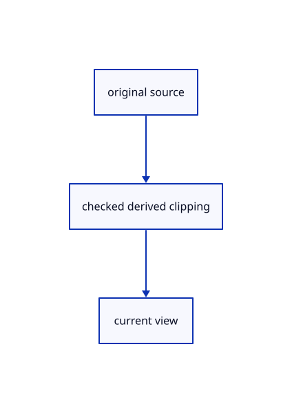

# 17.2.21 · Prepare shared clipping shader declarations

**Chapter 17 · GPU visibility, clipping and sections · Section 17.2 · Clipping half-spaces** · [Contents](contents.md)

**Typing: 5–9 minutes.** [Estimate](typing-load.md).

Prepare shared clipping shader declarations. Keep the existing pick layout until the integer draw binds the new uniform in 87n.

## Type

Continue from [Retain clipping state beside the renderer](87j-retain-clipping-state-beside-the-renderer.md). [Save or recover your work](recovery.md).

### 1. `src/pick_pipeline.rs`

Connect matching source ownership and derived clipping.

<details>
<summary>Locate the existing block</summary>

```rust
    model_layout: &wgpu::BindGroupLayout, crop_layout: &wgpu::BindGroupLayout) -> wgpu::RenderPipeline {
        let layout = device.create_pipeline_layout(&wgpu::PipelineLayoutDescriptor { label: Some("mesh IDs"),
            bind_group_layouts: &[Some(view_layout), Some(model_layout), Some(crop_layout)], immediate_size: 0 });
        let shader = device.create_shader_module(wgpu::ShaderModuleDescriptor { label: Some("mesh IDs"),
            source: wgpu::ShaderSource::Wgsl(concat!(include_str!("triangle.wgsl"), "\n", include_str!("pick_crop.wgsl"), "\n", include_str!("triangle_pick.wgsl")).into()) });
        // An integer attachment stores exact owner IDs; opaque depth rejects hidden faces before any pixel is read back.
        device.create_render_pipeline(&wgpu::RenderPipelineDescriptor {
```

</details>

Edit the existing block to match this code; keep unchanged lines:

```rust
--8<-- "journey/code/87k-prepare-shared-clipping-shader-declarations-01.rs"
```

### 2. `src/face_pick.rs`

Declare the shared predicate before connecting face clipping.

<details>
<summary>Locate the existing block</summary>

```rust
            bind_group_layouts: &[Some(&view), Some(&model), Some(&storage), Some(&crop)], immediate_size: 0 });
        let source = concat!(include_str!("triangle.wgsl"), "\n", include_str!("pick_crop.wgsl"), "\n", include_str!("face_pick.wgsl"));
        let shader = device.create_shader_module(wgpu::ShaderModuleDescriptor { label: Some("source faces"), source: wgpu::ShaderSource::Wgsl(source.into()) });
        let pipeline = device.create_render_pipeline(&wgpu::RenderPipelineDescriptor { label: Some("source face IDs"), layout: Some(&layout),
            vertex: wgpu::VertexState { module: &shader, entry_point: Some("face_vertex"), buffers: &[], compilation_options: Default::default() },
```

</details>

Edit the existing block to match this code; keep unchanged lines:

```rust
--8<-- "journey/code/87k-prepare-shared-clipping-shader-declarations-02.rs"
```

## Run and check

Run this from `session_viewer` to select the fixed dependency versions and install supplied binary assets. It updates Cargo.lock and preserves the previous lock. It does not write implementation code:

```sh
npm --prefix ../session_tests run course -- dependencies 17.2.21
```

In your project:

```sh
cd workspace/journey
REGEN_PROTO=0 cargo build --lib --locked --target wasm32-unknown-unknown -j1
REGEN_PROTO=0 CARGO_BUILD_JOBS=1 trunk serve --port 8780
```

Open `http://127.0.0.1:8780/`. Keep an existing Trunk server running; saving rebuilds it.


### Recorded visual result

**Previous native render — current verification pending.**

Actual finite visibility keeps the front red originals and blue solid visible while suppressing the hidden rear stroke.


*This recorded image predates a source or checker change. Rebuild this checkpoint before using it as current evidence; browser controls require separate acceptance.*

This reference image is shared with [17.2.5 · Gather six visible original world planes](87a-gather-six-visible-original-world-planes.md). It does not demonstrate a new feature by itself.

<details>
<summary>Code explanation and diagram</summary>


original source → checked derived clipping → current view.



Can an unused color entry still name an undeclared clipping uniform?

No. Assemble the shared declarations in the mesh-pick and face modules before their common triangle recipe starts using clipping.

Study estimate, including typing and experiments: 0.5–1 hours.

</details>

<details>
<summary>Optional experiment</summary>

Compare explicit pick group3 and face group2,binding4 without changing original face addresses.

</details>

<details>
<summary>Check and save your work</summary>

Restore experimental edits, then run from `session_viewer`:

```sh
npm --prefix ../session_tests run course -- check 17.2.21
npm --prefix ../session_tests run course -- save 17.2.21
```

Source comparison leaves your project untouched. [Save and recovery instructions](recovery.md).

</details>

<details>
<summary>Viewer coverage and verification</summary>


The browser contract is supplied and requires an actual enabled browser. Native software-GPU pixels and picks do not measure Lenovo performance.

[Full validation scope](release.md).

To reproduce the scripted acceptance of the reference checkpoint, run from `session_viewer` with the [course bundle server](release.md#reproduce) running on port 8781:

```sh
npm --prefix ../session_tests run course -- capture 17.2.21
```

This uses the verified reference bundle; it does not check or change your typed project.

</details>
