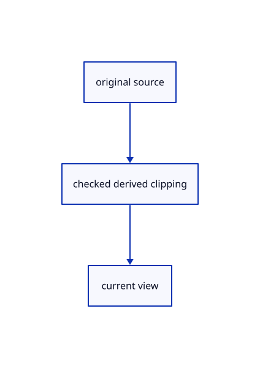

# 17.2.23 · Prepare explicit original mesh pick clipping

**Chapter 17 · GPU visibility, clipping and sections · Section 17.2 · Clipping half-spaces** · [Contents](contents.md)

**Typing: 6–12 minutes.** [Estimate](typing-load.md).

Carry world position and clipping flags through the mesh-pick output. Activate the clipping predicate in 87n together with its pipeline layout and draw binding.

## Type

Continue from [Connect mesh and instance color half-spaces](87l-connect-mesh-and-instance-color-half-spaces.md). [Save or recover your work](recovery.md).

### 1. `src/triangle_pick.wgsl`

Connect matching source ownership and derived clipping.

<details>
<summary>Locate the existing block</summary>

```wgsl
@group(2) @binding(0) var<uniform> crop: Crop;
@vertex
fn pick_vertex(@location(0) position: vec3<f32>, @location(1) colour: vec3<f32>, @location(2) normal: vec3<f32>) -> @builtin(position) vec4<f32> {
    return crop.transform * geometry(position, colour, normal).position;
}
@fragment
fn pick_fragment() -> @location(0) vec2<u32> { return vec2<u32>(select(0u, object.selection.y, crop.mode == 0u), 0u); }
```

</details>

Edit the existing block to match this code; keep unchanged lines:

```wgsl
--8<-- "journey/code/87m-prepare-explicit-original-mesh-pick-clipping-01.rs"
```

## Run and check

Run this from `session_viewer` to select the fixed dependency versions and install supplied binary assets. It updates Cargo.lock and preserves the previous lock. It does not write implementation code:

```sh
npm --prefix ../session_tests run course -- dependencies 17.2.23
```

In your project:

```sh
cd workspace/journey
REGEN_PROTO=0 cargo build --lib --locked --target wasm32-unknown-unknown -j1
REGEN_PROTO=0 CARGO_BUILD_JOBS=1 trunk serve --port 8780
```

Open `http://127.0.0.1:8780/`. Keep an existing Trunk server running; saving rebuilds it.


### Recorded visual result

**Previous native render — current verification pending.**

Actual finite visibility keeps the front red originals and blue solid visible while suppressing the hidden rear stroke.


*This recorded image predates a source or checker change. Rebuild this checkpoint before using it as current evidence; browser controls require separate acceptance.*

This reference image is shared with [17.2.5 · Gather six visible original world planes](87a-gather-six-visible-original-world-planes.md). It does not demonstrate a new feature by itself.

<details>
<summary>Code explanation and diagram</summary>


original source → checked derived clipping → current view.



Must integer picks use a different cut predicate?

No. Preserve original IDs and world positions while using the shared half-space predicate.

Study estimate, including typing and experiments: 0.5–1 hours.

</details>

<details>
<summary>Optional experiment</summary>

Inspect un-cropped source positions before the small integer draw transform.

</details>

<details>
<summary>Check and save your work</summary>

Restore experimental edits, then run from `session_viewer`:

```sh
npm --prefix ../session_tests run course -- check 17.2.23
npm --prefix ../session_tests run course -- save 17.2.23
```

Source comparison leaves your project untouched. [Save and recovery instructions](recovery.md).

</details>

<details>
<summary>Viewer coverage and verification</summary>


The browser contract is supplied and requires an actual enabled browser. Native software-GPU pixels and picks do not measure Lenovo performance.

[Full validation scope](release.md).

To reproduce the scripted acceptance of the reference checkpoint, run from `session_viewer` with the [course bundle server](release.md#reproduce) running on port 8781:

```sh
npm --prefix ../session_tests run course -- capture 17.2.23
```

This uses the verified reference bundle; it does not check or change your typed project.

</details>
