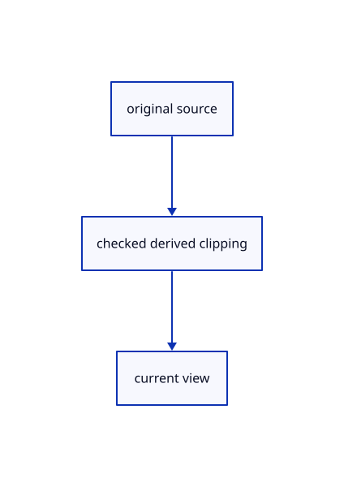

# 17.2.24 · Bind shared clipping before the first integer request

**Chapter 17 · GPU visibility, clipping and sections · Section 17.2 · Clipping half-spaces** · [Contents](contents.md)

**Typing: 27–54 minutes.** [Estimate](typing-load.md).

Bind shared clipping before the first integer request. Enable the mesh-pick predicate and its required layout in the same checkpoint; an explicit layout requires every declared bind group at draw time.

## Type

Continue from [Prepare explicit original mesh pick clipping](87m-prepare-explicit-original-mesh-pick-clipping.md). [Save or recover your work](recovery.md).

### 1. `src/pick_gpu.rs`

Connect matching source ownership and derived clipping.

Edit these blocks from bottom to top. Keep the surrounding lines unchanged.

<details>
<summary>Locate this block</summary>

```rust

    pub fn usage(&self) -> [u64; 3] {
        [u64::from(self.active.is_some()), u64::from(self.pending.is_some()), self.image.as_ref().map_or(0, |image|
            image.readback.size() + u64::from(image.window.draw[2]) * u64::from(image.window.draw[3]) * 12) + 160]
    }
}
```

</details>

Replace it with:

```rust

    pub fn usage(&self) -> [u64; 3] {
        [u64::from(self.active.is_some()), u64::from(self.pending.is_some()), self.image.as_ref().map_or(0, |image|
            image.readback.size() + u64::from(image.window.draw[2]) * u64::from(image.window.draw[3]) * 12) + 160+u64::from(self.legacy_clipping.is_some())*448]
    }
}
```

<details>
<summary>Locate this block</summary>

```rust
        for lane in ink { lane.view(queue, &request.transform, window.full, request.density); }
        if let Some(sheets)=sheets {sheets.view(queue,&request.transform,window.full,request.density);}
        queue.submit([crate::pick_encode::draw(device, image, window, &self.pipeline,
            &self.view_group, &self.crop_group, meshes, ink, faces, request.mode,text,clouds,sheets,&crate::text_gpu_support::GpuCtx {device:device.clone(),queue:queue.clone()},tables)]);
        let ready = Arc::new(AtomicU8::new(0)); self.active = Some(Flight { ready: Arc::clone(&ready), ticket: queued.ticket, view: queued.view }); let alive = Arc::clone(&self.alive);
        // Mapping finishes asynchronously; the callback publishes readiness, and the owner reads the bytes without blocking browser input.
        image.readback.slice(..).map_async(wgpu::MapMode::Read, move |result| {
```

</details>

Replace it with:

```rust
        for lane in ink { lane.view(queue, &request.transform, window.full, request.density); }
        if let Some(sheets)=sheets {sheets.view(queue,&request.transform,window.full,request.density);}
        queue.submit([crate::pick_encode::draw(device, image, window, &self.pipeline,
            &self.view_group, &self.crop_group, meshes, ink, faces, request.mode,text,clouds,sheets,&crate::text_gpu_support::GpuCtx {device:device.clone(),queue:queue.clone()},tables,clipping)]);
        let ready = Arc::new(AtomicU8::new(0)); self.active = Some(Flight { ready: Arc::clone(&ready), ticket: queued.ticket, view: queued.view }); let alive = Arc::clone(&self.alive);
        // Mapping finishes asynchronously; the callback publishes readiness, and the owner reads the bytes without blocking browser input.
        image.readback.slice(..).map_async(wgpu::MapMode::Read, move |result| {
```

<details>
<summary>Locate this block</summary>

```rust
    }


    pub(crate) fn submit(&mut self, device: &wgpu::Device, queue: &wgpu::Queue, queued: Queued, meshes: &[GpuMesh], ink: &[&Lane], faces: &crate::face_pick::Faces,text:Option<&crate::scene_text_gpu::Lane>,clouds:Option<&crate::cloud_gpu::Lane>,sheets:Option<&crate::sheet_gpu::Lane>) {self.submit_finite(device,queue,queued,meshes,ink,faces,text,clouds,sheets,None)}
    pub(crate) fn submit_finite(&mut self, device: &wgpu::Device, queue: &wgpu::Queue, queued: Queued, meshes: &[GpuMesh], ink: &[&Lane], faces: &crate::face_pick::Faces,text:Option<&crate::scene_text_gpu::Lane>,clouds:Option<&crate::cloud_gpu::Lane>,sheets:Option<&crate::sheet_gpu::Lane>,tables:Option<&crate::finite_ink::Tables>) {
        assert!(self.active.is_none(), "Only one pick may be in flight");
        let request = queued.request; let window = request.window;
        if self.image.as_ref().is_none_or(|image| image.window.draw[2..] != window.draw[2..] || image.readback.size() != window.bytes()) {
```

</details>

Replace it with:

```rust
    }


    pub(crate) fn submit(&mut self, device: &wgpu::Device, queue: &wgpu::Queue, queued: Queued, meshes: &[GpuMesh], ink: &[&Lane], faces: &crate::face_pick::Faces,text:Option<&crate::scene_text_gpu::Lane>,clouds:Option<&crate::cloud_gpu::Lane>,sheets:Option<&crate::sheet_gpu::Lane>) {let group=self.legacy_clipping.get_or_insert_with(||crate::clipping_gpu::Clipping::new(device)).group.clone();self.submit_finite(device,queue,queued,meshes,ink,faces,text,clouds,sheets,None,&group)}
    pub(crate) fn submit_finite(&mut self, device: &wgpu::Device, queue: &wgpu::Queue, queued: Queued, meshes: &[GpuMesh], ink: &[&Lane], faces: &crate::face_pick::Faces,text:Option<&crate::scene_text_gpu::Lane>,clouds:Option<&crate::cloud_gpu::Lane>,sheets:Option<&crate::sheet_gpu::Lane>,tables:Option<&crate::finite_ink::Tables>,clipping:&wgpu::BindGroup) {
        assert!(self.active.is_none(), "Only one pick may be in flight");
        let request = queued.request; let window = request.window;
        if self.image.as_ref().is_none_or(|image| image.window.draw[2..] != window.draw[2..] || image.readback.size() != window.bytes()) {
```

<details>
<summary>Locate this block</summary>

```rust
        let view = buffer(80); let crop = buffer(80);
        let view_group = crate::gpu_layout::group(device, view_layout, &view);
        let crop_group = crate::gpu_layout::group(device, &crop_layout, &crop);
        Self { pipeline, view, view_group, crop, crop_group, image: None, active: None, pending: None,
            alive: Arc::new(AtomicBool::new(true)), gate: Default::default(), submitted: 0, coalesced: 0 }
    }
```

</details>

Replace it with:

```rust
        let view = buffer(80); let crop = buffer(80);
        let view_group = crate::gpu_layout::group(device, view_layout, &view);
        let crop_group = crate::gpu_layout::group(device, &crop_layout, &crop);
        Self { legacy_clipping:None,pipeline, view, view_group, crop, crop_group, image: None, active: None, pending: None,
            alive: Arc::new(AtomicBool::new(true)), gate: Default::default(), submitted: 0, coalesced: 0 }
    }
```

<details>
<summary>Locate this block</summary>

```rust


pub struct Picker {
    pipeline: wgpu::RenderPipeline,
    view: wgpu::Buffer,
    view_group: wgpu::BindGroup,
```

</details>

Replace it with:

```rust


pub struct Picker {
    legacy_clipping:Option<crate::clipping_gpu::Clipping>,
    pipeline: wgpu::RenderPipeline,
    view: wgpu::Buffer,
    view_group: wgpu::BindGroup,
```

<details>
<summary>Complete updated block reference</summary>

```rust
use crate::{gpu_mesh::GpuMesh, pick_window::Window, stroke_gpu::Lane};
use std::sync::{Arc, atomic::{AtomicBool, AtomicU8, Ordering}};

#[derive(Clone, Copy)]
pub struct Request { pub window: Window, pub transform: [f32; 16], pub density: f32, pub mode: crate::pick_sources::Mode }

pub(crate) struct Queued { request: Request, ticket: crate::pick_gate::Ticket, view: crate::pick_view::View }
struct Flight { ready: Arc<AtomicU8>, ticket: crate::pick_gate::Ticket, view: crate::pick_view::View }
pub enum Reply { Hit(Option<[u32; 2]>), Stale }


pub struct Picker {
    legacy_clipping:Option<crate::clipping_gpu::Clipping>,
    pipeline: wgpu::RenderPipeline,
    view: wgpu::Buffer,
    view_group: wgpu::BindGroup,
    crop: wgpu::Buffer,
    crop_group: wgpu::BindGroup,
    image: Option<crate::pick_image::Image>,
    active: Option<Flight>,
    pending: Option<Queued>,
    alive: Arc<AtomicBool>,
    gate: crate::pick_gate::Gate,
    pub submitted: u64,
    pub coalesced: u64,
}

impl Drop for Picker { fn drop(&mut self) { self.alive.store(false, Ordering::Release); self.gate.close(); } }

impl Picker {
    pub fn new(device: &wgpu::Device, view_layout: &wgpu::BindGroupLayout, model_layout: &wgpu::BindGroupLayout) -> Self {
        let crop_layout = crate::gpu_layout::uniform(device, 80);
        let pipeline = crate::pick_pipeline::mesh(device, view_layout, model_layout, &crop_layout);
        let buffer = |size| device.create_buffer(&wgpu::BufferDescriptor { label: Some("pick view"), size,
            usage: wgpu::BufferUsages::UNIFORM | wgpu::BufferUsages::COPY_DST, mapped_at_creation: false });
        let view = buffer(80); let crop = buffer(80);
        let view_group = crate::gpu_layout::group(device, view_layout, &view);
        let crop_group = crate::gpu_layout::group(device, &crop_layout, &crop);
        Self { legacy_clipping:None,pipeline, view, view_group, crop, crop_group, image: None, active: None, pending: None,
            alive: Arc::new(AtomicBool::new(true)), gate: Default::default(), submitted: 0, coalesced: 0 }
    }

    pub fn queue(&mut self, request: Request) -> Result<(), &'static str> {
        let view = crate::pick_view::View::new(request.transform, request.window.full, request.density)?;
        let ticket = self.gate.issue()?;
        if self.pending.replace(Queued { request, ticket, view }).is_some() { self.coalesced += 1; }
        Ok(())
    }

    pub fn queued(&self) -> bool { self.pending.is_some() }

    pub fn cancel(&mut self) {
        self.gate.invalidate(); self.pending = None;
        let mapped = self.active.take().is_some_and(|flight| flight.ready.load(Ordering::Acquire) <= 1);
        if let Some(image) = self.image.take() { if mapped { image.readback.unmap(); } }
    }

    pub(crate) fn next(&mut self, view: crate::pick_view::View) -> Option<Queued> {
        if self.active.is_some() { return None; }
        let queued = self.pending.take()?;
        if queued.view == view { Some(queued) } else { self.gate.invalidate(); None }
    }


    pub(crate) fn submit(&mut self, device: &wgpu::Device, queue: &wgpu::Queue, queued: Queued, meshes: &[GpuMesh], ink: &[&Lane], faces: &crate::face_pick::Faces,text:Option<&crate::scene_text_gpu::Lane>,clouds:Option<&crate::cloud_gpu::Lane>,sheets:Option<&crate::sheet_gpu::Lane>) {let group=self.legacy_clipping.get_or_insert_with(||crate::clipping_gpu::Clipping::new(device)).group.clone();self.submit_finite(device,queue,queued,meshes,ink,faces,text,clouds,sheets,None,&group)}
    pub(crate) fn submit_finite(&mut self, device: &wgpu::Device, queue: &wgpu::Queue, queued: Queued, meshes: &[GpuMesh], ink: &[&Lane], faces: &crate::face_pick::Faces,text:Option<&crate::scene_text_gpu::Lane>,clouds:Option<&crate::cloud_gpu::Lane>,sheets:Option<&crate::sheet_gpu::Lane>,tables:Option<&crate::finite_ink::Tables>,clipping:&wgpu::BindGroup) {
        assert!(self.active.is_none(), "Only one pick may be in flight");
        let request = queued.request; let window = request.window;
        if self.image.as_ref().is_none_or(|image| image.window.draw[2..] != window.draw[2..] || image.readback.size() != window.bytes()) {
            self.image = Some(crate::pick_image::Image::new(device, window));
        }
        let image = self.image.as_mut().unwrap(); image.window = window;
        let mut bytes: Vec<u8> = request.transform.iter().flat_map(|n| n.to_ne_bytes()).collect(); bytes.resize(80, 0);
        queue.write_buffer(&self.view, 0, &bytes);
        let mut bytes: Vec<u8> = window.crop().iter().flat_map(|n| n.to_ne_bytes()).collect();
        bytes.extend((request.mode as u32).to_ne_bytes());bytes.extend(window.draw[0].to_ne_bytes());bytes.extend(window.draw[1].to_ne_bytes());bytes.resize(80, 0); queue.write_buffer(&self.crop, 0, &bytes);
        for lane in ink { lane.view(queue, &request.transform, window.full, request.density); }
        if let Some(sheets)=sheets {sheets.view(queue,&request.transform,window.full,request.density);}
        queue.submit([crate::pick_encode::draw(device, image, window, &self.pipeline,
            &self.view_group, &self.crop_group, meshes, ink, faces, request.mode,text,clouds,sheets,&crate::text_gpu_support::GpuCtx {device:device.clone(),queue:queue.clone()},tables,clipping)]);
        let ready = Arc::new(AtomicU8::new(0)); self.active = Some(Flight { ready: Arc::clone(&ready), ticket: queued.ticket, view: queued.view }); let alive = Arc::clone(&self.alive);
        // Mapping finishes asynchronously; the callback publishes readiness, and the owner reads the bytes without blocking browser input.
        image.readback.slice(..).map_async(wgpu::MapMode::Read, move |result| {
            ready.store(if result.is_ok() { 1 } else { 2 }, Ordering::Release);
            if alive.load(Ordering::Acquire) {
                #[cfg(target_arch = "wasm32")] crate::browser_pick::wake();
            }
        });
        self.submitted += 1;
    }

    pub fn take(&mut self, view: crate::pick_view::View) -> Option<Result<Reply, &'static str>> {
        let status = self.active.as_ref()?.ready.load(Ordering::Acquire);
        if status == 0 { return None; }
        let flight = self.active.take().unwrap();
        let current = self.gate.accept(flight.ticket) && flight.view == view;
        let image = self.image.as_ref().unwrap();
        if status != 1 { return Some(if current { Err("Cannot read GPU pick image") } else { Ok(Reply::Stale) }); }
        let bytes = image.readback.slice(..).get_mapped_range();
        let result = if current { image.window.closest(&bytes).map(Reply::Hit) } else { Ok(Reply::Stale) };
        drop(bytes); image.readback.unmap(); Some(result)
    }

    pub fn usage(&self) -> [u64; 3] {
        [u64::from(self.active.is_some()), u64::from(self.pending.is_some()), self.image.as_ref().map_or(0, |image|
            image.readback.size() + u64::from(image.window.draw[2]) * u64::from(image.window.draw[3]) * 12) + 160+u64::from(self.legacy_clipping.is_some())*448]
    }
}
```

</details>

<details>
<summary>Optional patch references</summary>

Use these original edit fragments when comparing a saved checkpoint. Apply the complete blocks above.

```text
--8<-- "journey/code/87n-bind-shared-clipping-before-the-first-integer-request-01.rs"
```

```text
--8<-- "journey/code/87n-bind-shared-clipping-before-the-first-integer-request-02.rs"
```

```text
--8<-- "journey/code/87n-bind-shared-clipping-before-the-first-integer-request-03.rs"
```

```text
--8<-- "journey/code/87n-bind-shared-clipping-before-the-first-integer-request-04.rs"
```

```text
--8<-- "journey/code/87n-bind-shared-clipping-before-the-first-integer-request-05.rs"
```

</details>

### 2. `src/pick_encode.rs`

Bind shared clipping to compatible integer passes.

<details>
<summary>Locate the existing block</summary>

```rust
use crate::{gpu_mesh::GpuMesh, pick_image::Image, pick_window::Window, stroke_gpu::Lane};

pub(crate) fn draw(device: &wgpu::Device, image: &Image, window: Window, pipeline: &wgpu::RenderPipeline,
    view_group: &wgpu::BindGroup, crop_group: &wgpu::BindGroup, meshes: &[GpuMesh], ink: &[&Lane], faces: &crate::face_pick::Faces, mode: crate::pick_sources::Mode,text:Option<&crate::scene_text_gpu::Lane>,clouds:Option<&crate::cloud_gpu::Lane>,sheets:Option<&crate::sheet_gpu::Lane>,ctx:&crate::text_gpu_support::GpuCtx,tables:Option<&crate::finite_ink::Tables>) -> wgpu::CommandBuffer {
        let mut encoder = device.create_command_encoder(&Default::default());
        {
            let mut pass = encoder.begin_render_pass(&wgpu::RenderPassDescriptor { label: Some("IDs"),
                color_attachments: &[Some(wgpu::RenderPassColorAttachment { view: &image.colour, depth_slice: None, resolve_target: None,
                    ops: wgpu::Operations { load: wgpu::LoadOp::Clear(wgpu::Color::TRANSPARENT), store: wgpu::StoreOp::Store } })],
                depth_stencil_attachment: Some(wgpu::RenderPassDepthStencilAttachment { view: &image.depth,
                    depth_ops: Some(wgpu::Operations { load: wgpu::LoadOp::Clear(1.0), store: wgpu::StoreOp::Store }), stencil_ops: None }), ..Default::default() });
            pass.set_pipeline(pipeline); pass.set_bind_group(0, view_group, &[]); pass.set_bind_group(2, crop_group, &[]);
            for mesh in meshes { mesh.draw(&mut pass); }
            if mode == crate::pick_sources::Mode::Face { faces.draw(&mut pass, meshes, view_group, crop_group); }
        }
        {
            let mut pass=encoder.begin_render_pass(&wgpu::RenderPassDescriptor{label:Some("finite integer ink"),color_attachments:&[Some(wgpu::RenderPassColorAttachment{view:&image.colour,depth_slice:None,resolve_target:None,ops:wgpu::Operations{load:wgpu::LoadOp::Load,store:wgpu::StoreOp::Store}})],depth_stencil_attachment:Some(wgpu::RenderPassDepthStencilAttachment{view:&image.depth,depth_ops:None,stencil_ops:None}),..Default::default()});
            for lane in ink {lane.pick_finite(device,&mut pass,crop_group,tables,&image.depth);}
        }
        {
            let mut pass=encoder.begin_render_pass(&wgpu::RenderPassDescriptor{label:Some("other original integer owners"),color_attachments:&[Some(wgpu::RenderPassColorAttachment{view:&image.colour,depth_slice:None,resolve_target:None,ops:wgpu::Operations{load:wgpu::LoadOp::Load,store:wgpu::StoreOp::Store}})],depth_stencil_attachment:Some(wgpu::RenderPassDepthStencilAttachment{view:&image.depth,depth_ops:Some(wgpu::Operations{load:wgpu::LoadOp::Load,store:wgpu::StoreOp::Store}),stencil_ops:None}),..Default::default()});
            if let Some(clouds)=clouds {clouds.pick(ctx,&mut pass,window,mode);}
            if let Some(sheets)=sheets {sheets.pick(&mut pass,crop_group);}
            if let Some(text)=text {text.draw_ids(&mut pass,crop_group);}
        }
        // The surrounding halo supports rasterization; only the smaller cursor window is copied back for hit testing.
        encoder.copy_texture_to_buffer(wgpu::TexelCopyTextureInfo { texture: &image.texture, mip_level: 0,
            origin: wgpu::Origin3d { x: window.copy[0] - window.draw[0], y: window.copy[1] - window.draw[1], z: 0 }, aspect: wgpu::TextureAspect::All },
            wgpu::TexelCopyBufferInfo { buffer: &image.readback, layout: wgpu::TexelCopyBufferLayout { offset: 0,
                bytes_per_row: Some(window.row_bytes()), rows_per_image: Some(window.copy[3]) } },
            wgpu::Extent3d { width: window.copy[2], height: window.copy[3], depth_or_array_layers: 1 });
        encoder.finish()
}
```

</details>

Edit the existing block to match this code; keep unchanged lines:

```rust
use crate::{gpu_mesh::GpuMesh, pick_image::Image, pick_window::Window, stroke_gpu::Lane};

pub(crate) fn draw(device: &wgpu::Device, image: &Image, window: Window, pipeline: &wgpu::RenderPipeline,
    view_group: &wgpu::BindGroup, crop_group: &wgpu::BindGroup, meshes: &[GpuMesh], ink: &[&Lane], faces: &crate::face_pick::Faces, mode: crate::pick_sources::Mode,text:Option<&crate::scene_text_gpu::Lane>,clouds:Option<&crate::cloud_gpu::Lane>,sheets:Option<&crate::sheet_gpu::Lane>,ctx:&crate::text_gpu_support::GpuCtx,tables:Option<&crate::finite_ink::Tables>,clipping:&wgpu::BindGroup) -> wgpu::CommandBuffer {
        let mut encoder = device.create_command_encoder(&Default::default());
        {
            let mut pass = encoder.begin_render_pass(&wgpu::RenderPassDescriptor { label: Some("IDs"),
                color_attachments: &[Some(wgpu::RenderPassColorAttachment { view: &image.colour, depth_slice: None, resolve_target: None,
                    ops: wgpu::Operations { load: wgpu::LoadOp::Clear(wgpu::Color::TRANSPARENT), store: wgpu::StoreOp::Store } })],
                depth_stencil_attachment: Some(wgpu::RenderPassDepthStencilAttachment { view: &image.depth,
                    depth_ops: Some(wgpu::Operations { load: wgpu::LoadOp::Clear(1.0), store: wgpu::StoreOp::Store }), stencil_ops: None }), ..Default::default() });
            pass.set_bind_group(3,clipping,&[]);
            pass.set_pipeline(pipeline); pass.set_bind_group(0, view_group, &[]); pass.set_bind_group(2, crop_group, &[]);
            for mesh in meshes { mesh.draw(&mut pass); }
            if mode == crate::pick_sources::Mode::Face { faces.draw(&mut pass, meshes, view_group, crop_group); }
        }
        {
            let mut pass=encoder.begin_render_pass(&wgpu::RenderPassDescriptor{label:Some("finite integer ink"),color_attachments:&[Some(wgpu::RenderPassColorAttachment{view:&image.colour,depth_slice:None,resolve_target:None,ops:wgpu::Operations{load:wgpu::LoadOp::Load,store:wgpu::StoreOp::Store}})],depth_stencil_attachment:Some(wgpu::RenderPassDepthStencilAttachment{view:&image.depth,depth_ops:None,stencil_ops:None}),..Default::default()});
            pass.set_bind_group(3,clipping,&[]);
            for lane in ink {lane.pick_finite(device,&mut pass,crop_group,tables,&image.depth);}
        }
        {
            let mut pass=encoder.begin_render_pass(&wgpu::RenderPassDescriptor{label:Some("other original integer owners"),color_attachments:&[Some(wgpu::RenderPassColorAttachment{view:&image.colour,depth_slice:None,resolve_target:None,ops:wgpu::Operations{load:wgpu::LoadOp::Load,store:wgpu::StoreOp::Store}})],depth_stencil_attachment:Some(wgpu::RenderPassDepthStencilAttachment{view:&image.depth,depth_ops:Some(wgpu::Operations{load:wgpu::LoadOp::Load,store:wgpu::StoreOp::Store}),stencil_ops:None}),..Default::default()});
            if let Some(clouds)=clouds {clouds.pick(ctx,&mut pass,window,mode);}
            if let Some(sheets)=sheets {sheets.pick(&mut pass,crop_group);}
            if let Some(text)=text {text.draw_ids(&mut pass,crop_group);}
        }
        // The surrounding halo supports rasterization; only the smaller cursor window is copied back for hit testing.
        encoder.copy_texture_to_buffer(wgpu::TexelCopyTextureInfo { texture: &image.texture, mip_level: 0,
            origin: wgpu::Origin3d { x: window.copy[0] - window.draw[0], y: window.copy[1] - window.draw[1], z: 0 }, aspect: wgpu::TextureAspect::All },
            wgpu::TexelCopyBufferInfo { buffer: &image.readback, layout: wgpu::TexelCopyBufferLayout { offset: 0,
                bytes_per_row: Some(window.row_bytes()), rows_per_image: Some(window.copy[3]) } },
            wgpu::Extent3d { width: window.copy[2], height: window.copy[3], depth_or_array_layers: 1 });
        encoder.finish()
}
```

<details>
<summary>Optional patch references</summary>

Use these original edit fragments when comparing a saved checkpoint. Apply the complete blocks above.

```text
--8<-- "journey/code/87n-bind-shared-clipping-before-the-first-integer-request-06.rs"
```

```text
--8<-- "journey/code/87n-bind-shared-clipping-before-the-first-integer-request-07.rs"
```

```text
--8<-- "journey/code/87n-bind-shared-clipping-before-the-first-integer-request-08.rs"
```

</details>

### 3. `src/renderer.rs`

Connect the completed owner through this method.

<details>
<summary>Locate the existing block</summary>

```rust
        }
        if let Some(lane)=self.text.borrow_mut().as_mut() {if let Err(error)=lane.prepare(&self.text_context(),&self.text_frame(transform)) {*self.text_error.borrow_mut()=Some(error.to_string());return;}}
        self.prepare_clouds(transform);
        if let Some(request) = self.picker.next(view) {
            let mut bytes=transform.iter().flat_map(|v|v.to_ne_bytes()).collect::<Vec<_>>();bytes.resize(80,0);self.queue.write_buffer(&self.uniform,0,&bytes);
            let tables={let mut tiles=self.tiles.borrow_mut();tiles.prepare(&self.device,&self.queue,self.size);let mut encoder=self.device.create_command_encoder(&Default::default());tiles.encode(&self.device,&mut encoder,&self.view_group,transform);self.queue.submit([encoder.finish()]);tiles.map_report();crate::finite_ink::Tables{projected:tiles.projected.clone(),tiles:tiles.buffer.clone()}};
            self.picker.submit_finite(&self.device, &self.queue, request,
            &self.meshes, &[&self.mesh_ink, &self.strokes, &self.paths, &self.markers], &self.faces,self.text.borrow().as_ref(),self.clouds.borrow().as_ref(),Some(&self.sheets),Some(&tables)); }
    }
```

</details>

Edit the existing block to match this code; keep unchanged lines:

```rust
--8<-- "journey/code/87n-bind-shared-clipping-before-the-first-integer-request-09.rs"
```

### 4. `src/pick_pipeline.rs`

Enable the clipping predicate and required pipeline layout only when every integer draw binds the shared uniform.

<details>
<summary>Locate the existing block</summary>

```rust
            bind_group_layouts: &[Some(view_layout), Some(model_layout), Some(crop_layout)], immediate_size: 0 });
```

</details>

Edit the existing block to match this code; keep unchanged lines:

```rust
--8<-- "journey/code/87n-bind-shared-clipping-before-the-first-integer-request-10.rs"
```

### 5. `src/triangle_pick.wgsl`

Enable the clipping predicate and required pipeline layout only when every integer draw binds the shared uniform.

<details>
<summary>Locate the existing block</summary>

```wgsl
@fragment fn pick_fragment(input:MeshPickOutput)->@location(0) vec2<u32>{return vec2<u32>(select(0u,object.selection.y,crop.mode==0u),0u);}
```

</details>

Edit the existing block to match this code; keep unchanged lines:

```wgsl
--8<-- "journey/code/87n-bind-shared-clipping-before-the-first-integer-request-11.wgsl"
```

## Run and check

Run this from `session_viewer` to select the fixed dependency versions and install supplied binary assets. It updates Cargo.lock and preserves the previous lock. It does not write implementation code:

```sh
npm --prefix ../session_tests run course -- dependencies 17.2.24
```

In your project:

```sh
cd workspace/journey
REGEN_PROTO=0 cargo build --lib --locked --target wasm32-unknown-unknown -j1
REGEN_PROTO=0 CARGO_BUILD_JOBS=1 trunk serve --port 8780
```

Open `http://127.0.0.1:8780/`. Keep an existing Trunk server running; saving rebuilds it.


### Recorded visual result

**Previous native render — current verification pending.**

Actual finite visibility keeps the front red originals and blue solid visible while suppressing the hidden rear stroke.


*This recorded image predates a source or checker change. Rebuild this checkpoint before using it as current evidence; browser controls require separate acceptance.*

This reference image is shared with [17.2.5 · Gather six visible original world planes](87a-gather-six-visible-original-world-planes.md). It does not demonstrate a new feature by itself.

<details>
<summary>Code explanation and diagram</summary>


original source → checked derived clipping → current view.



Must a pick wait for a color frame?

No. Prepare the current view uniform and shared clipping before submitting the first cropped request.

Study estimate, including typing and experiments: 0.5–1 hours.

</details>

<details>
<summary>Optional experiment</summary>

Compare exact original IDs, stale-request gates, lazy legacy ownership and charged allocation.

</details>

<details>
<summary>Check and save your work</summary>

Restore experimental edits, then run from `session_viewer`:

```sh
npm --prefix ../session_tests run course -- check 17.2.24
npm --prefix ../session_tests run course -- save 17.2.24
```

Source comparison leaves your project untouched. [Save and recovery instructions](recovery.md).

</details>

<details>
<summary>Viewer coverage and verification</summary>


The browser contract is supplied and requires an actual enabled browser. Native software-GPU pixels and picks do not measure Lenovo performance.

[Full validation scope](release.md).

To reproduce the scripted acceptance of the reference checkpoint, run from `session_viewer` with the [course bundle server](release.md#reproduce) running on port 8781:

```sh
npm --prefix ../session_tests run course -- capture 17.2.24
```

This uses the verified reference bundle; it does not check or change your typed project.

</details>
