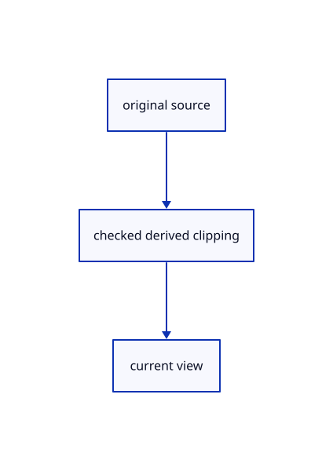

# 17.2.25 · Preserve sparse source face IDs across the cut

**Chapter 17 · GPU visibility, clipping and sections · Section 17.2 · Clipping half-spaces** · [Contents](contents.md)

**Typing: 8–15 minutes.** [Estimate](typing-load.md).

Preserve sparse source face IDs across the cut.

## Type

Continue from [Bind shared clipping before the first integer request](87n-bind-shared-clipping-before-the-first-integer-request.md). [Save or recover your work](recovery.md).

### 1. `src/face_pick.rs`

Connect matching source ownership and derived clipping.

Edit these blocks from bottom to top. Keep the surrounding lines unchanged.

<details>
<summary>Locate this block</summary>

```rust
            let faces = device.create_buffer_init(&wgpu::util::BufferInitDescriptor { label: Some("source triangle faces"), contents: &bytes, usage: wgpu::BufferUsages::STORAGE });
            let data: Vec<u8> = [base, 0, 0, 0].into_iter().flat_map(u32::to_ne_bytes).collect();
            let settings = device.create_buffer_init(&wgpu::util::BufferInitDescriptor { label: Some("source face base"), contents: &data, usage: wgpu::BufferUsages::UNIFORM });
            let buffers = [&geometry.vertices, &geometry.indices, &faces, &settings];
            let entries: Vec<_> = buffers.iter().enumerate().map(|(binding, buffer)| wgpu::BindGroupEntry { binding: binding as u32, resource: buffer.as_entire_binding() }).collect();
            let group = device.create_bind_group(&wgpu::BindGroupDescriptor { label: Some("source face metadata"), layout: &self.pipeline.get_bind_group_layout(2), entries: &entries });
            self.rows.push(Some(Row { group, bytes: faces.size() + settings.size() }));
```

</details>

Replace it with:

```rust
            let faces = device.create_buffer_init(&wgpu::util::BufferInitDescriptor { label: Some("source triangle faces"), contents: &bytes, usage: wgpu::BufferUsages::STORAGE });
            let data: Vec<u8> = [base, 0, 0, 0].into_iter().flat_map(u32::to_ne_bytes).collect();
            let settings = device.create_buffer_init(&wgpu::util::BufferInitDescriptor { label: Some("source face base"), contents: &data, usage: wgpu::BufferUsages::UNIFORM });
            let buffers = [&geometry.vertices, &geometry.indices, &faces, &settings,clipping];
            let entries: Vec<_> = buffers.iter().enumerate().map(|(binding, buffer)| wgpu::BindGroupEntry { binding: binding as u32, resource: buffer.as_entire_binding() }).collect();
            let group = device.create_bind_group(&wgpu::BindGroupDescriptor { label: Some("source face metadata"), layout: &self.pipeline.get_bind_group_layout(2), entries: &entries });
            self.rows.push(Some(Row { group, bytes: faces.size() + settings.size() }));
```

<details>
<summary>Locate this block</summary>

```rust
        Self { pipeline, rows: Vec::new() }
    }

    pub fn set(&mut self, device: &wgpu::Device, meshes: &[GpuMesh], bases: &[(crate::scene::ObjectId, u32)]) {
        self.rows.clear();
        for (mesh, &(owner, base)) in meshes.iter().zip(bases) {
            assert_eq!(mesh.id, owner); let geometry = &mesh.geometry;
```

</details>

Replace it with:

```rust
        Self { pipeline, rows: Vec::new() }
    }

    pub fn set(&mut self, device: &wgpu::Device, meshes: &[GpuMesh], bases: &[(crate::scene::ObjectId, u32)],clipping:&wgpu::Buffer) {
        self.rows.clear();
        for (mesh, &(owner, base)) in meshes.iter().zip(bases) {
            assert_eq!(mesh.id, owner); let geometry = &mesh.geometry;
```

<details>
<summary>Locate this block</summary>

```rust
    for binding in 0..4 { entries.push(wgpu::BindGroupLayoutEntry { binding, visibility: wgpu::ShaderStages::VERTEX,
        ty: wgpu::BindingType::Buffer { ty: if binding == 3 { wgpu::BufferBindingType::Uniform }
            else { wgpu::BufferBindingType::Storage { read_only: true } }, has_dynamic_offset: false, min_binding_size: None }, count: None }); }
    device.create_bind_group_layout(&wgpu::BindGroupLayoutDescriptor { label: Some("source face metadata"), entries: &entries })
}
```

</details>

Replace it with:

```rust
    for binding in 0..4 { entries.push(wgpu::BindGroupLayoutEntry { binding, visibility: wgpu::ShaderStages::VERTEX,
        ty: wgpu::BindingType::Buffer { ty: if binding == 3 { wgpu::BufferBindingType::Uniform }
            else { wgpu::BufferBindingType::Storage { read_only: true } }, has_dynamic_offset: false, min_binding_size: None }, count: None }); }
    entries.push(crate::tile_pipelines::entry(4,wgpu::ShaderStages::FRAGMENT,wgpu::BufferBindingType::Uniform));
    device.create_bind_group_layout(&wgpu::BindGroupLayoutDescriptor { label: Some("source face metadata"), entries: &entries })
}
```

<details>
<summary>Complete updated block reference</summary>

```rust
use crate::gpu_mesh::GpuMesh;
use wgpu::util::DeviceExt;

struct Row { group: wgpu::BindGroup, bytes: u64 }

pub struct Faces { pipeline: wgpu::RenderPipeline, rows: Vec<Option<Row>> }

fn layout(device: &wgpu::Device) -> wgpu::BindGroupLayout {
    let mut entries = Vec::new();
    for binding in 0..4 { entries.push(wgpu::BindGroupLayoutEntry { binding, visibility: wgpu::ShaderStages::VERTEX,
        ty: wgpu::BindingType::Buffer { ty: if binding == 3 { wgpu::BufferBindingType::Uniform }
            else { wgpu::BufferBindingType::Storage { read_only: true } }, has_dynamic_offset: false, min_binding_size: None }, count: None }); }
    entries.push(crate::tile_pipelines::entry(4,wgpu::ShaderStages::FRAGMENT,wgpu::BufferBindingType::Uniform));
    device.create_bind_group_layout(&wgpu::BindGroupLayoutDescriptor { label: Some("source face metadata"), entries: &entries })
}

impl Faces {
    pub fn new(device: &wgpu::Device) -> Self {
        let storage = layout(device); let view = crate::gpu_layout::uniform(device, 80);
        let model = crate::gpu_layout::uniform(device, 160); let crop = crate::gpu_layout::uniform(device, 80);
        let layout = device.create_pipeline_layout(&wgpu::PipelineLayoutDescriptor { label: Some("source face IDs"),
            bind_group_layouts: &[Some(&view), Some(&model), Some(&storage), Some(&crop)], immediate_size: 0 });
        let source = concat!(include_str!("triangle.wgsl"), "\n", include_str!("pick_crop.wgsl"), "\n", include_str!("face_pick.wgsl"));
        let shader = device.create_shader_module(wgpu::ShaderModuleDescriptor { label: Some("source faces"), source: wgpu::ShaderSource::Wgsl(crate::clipping_gpu::source(source,2,4).into()) });
        let pipeline = device.create_render_pipeline(&wgpu::RenderPipelineDescriptor { label: Some("source face IDs"), layout: Some(&layout),
            vertex: wgpu::VertexState { module: &shader, entry_point: Some("face_vertex"), buffers: &[], compilation_options: Default::default() },
            fragment: Some(wgpu::FragmentState { module: &shader, entry_point: Some("face_fragment"), compilation_options: Default::default(),
                targets: &[Some(wgpu::TextureFormat::Rg32Uint.into())] }), primitive: Default::default(), depth_stencil: Some(crate::depth::ink()),
            multisample: Default::default(), multiview_mask: None, cache: None });
        Self { pipeline, rows: Vec::new() }
    }

    pub fn set(&mut self, device: &wgpu::Device, meshes: &[GpuMesh], bases: &[(crate::scene::ObjectId, u32)],clipping:&wgpu::Buffer) {
        self.rows.clear();
        for (mesh, &(owner, base)) in meshes.iter().zip(bases) {
            assert_eq!(mesh.id, owner); let geometry = &mesh.geometry;
            if geometry.source.parts.triangles.is_empty() { self.rows.push(None); continue; }
            // Vertex pulling reads the existing index and position buffers; one small per-triangle stream adds original face identity.
            let bytes: Vec<u8> = geometry.source.parts.triangles.iter().flat_map(|n| n.to_ne_bytes()).collect();
            let faces = device.create_buffer_init(&wgpu::util::BufferInitDescriptor { label: Some("source triangle faces"), contents: &bytes, usage: wgpu::BufferUsages::STORAGE });
            let data: Vec<u8> = [base, 0, 0, 0].into_iter().flat_map(u32::to_ne_bytes).collect();
            let settings = device.create_buffer_init(&wgpu::util::BufferInitDescriptor { label: Some("source face base"), contents: &data, usage: wgpu::BufferUsages::UNIFORM });
            let buffers = [&geometry.vertices, &geometry.indices, &faces, &settings,clipping];
            let entries: Vec<_> = buffers.iter().enumerate().map(|(binding, buffer)| wgpu::BindGroupEntry { binding: binding as u32, resource: buffer.as_entire_binding() }).collect();
            let group = device.create_bind_group(&wgpu::BindGroupDescriptor { label: Some("source face metadata"), layout: &self.pipeline.get_bind_group_layout(2), entries: &entries });
            self.rows.push(Some(Row { group, bytes: faces.size() + settings.size() }));
        }
        assert_eq!(meshes.len(), bases.len());
    }

    pub fn draw(&self, pass: &mut wgpu::RenderPass<'_>, meshes: &[GpuMesh], view: &wgpu::BindGroup, crop: &wgpu::BindGroup) {
        pass.set_pipeline(&self.pipeline); pass.set_bind_group(0, view, &[]); pass.set_bind_group(3, crop, &[]);
        for (mesh, row) in meshes.iter().zip(&self.rows) { if let Some(row) = row {
            mesh.bind_model(pass); pass.set_bind_group(2, &row.group, &[]); pass.draw(0..mesh.geometry.index_count, 0..1);
        } }
    }

    pub fn clear(&mut self) { self.rows.clear(); }
    pub fn ready(&self, count: usize) -> bool { self.rows.len() == count }

    pub fn bytes(&self) -> u64 { self.rows.iter().flatten().map(|row| row.bytes).sum() }
}
```

</details>

<details>
<summary>Optional patch references</summary>

Use these original edit fragments when comparing a saved checkpoint. Apply the complete blocks above.

```text
--8<-- "journey/code/87o-preserve-sparse-source-face-ids-across-the-cut-01.rs"
```

```text
--8<-- "journey/code/87o-preserve-sparse-source-face-ids-across-the-cut-02.rs"
```

```text
--8<-- "journey/code/87o-preserve-sparse-source-face-ids-across-the-cut-03.rs"
```

</details>

### 2. `src/face_pick.wgsl`

Connect matching source ownership and derived clipping.

<details>
<summary>Locate the existing block</summary>

```wgsl
struct PackedVertex { x: f32, y: f32, z: f32, r: f32, g: f32, b: f32 }
struct FaceSettings { base: u32, _a: u32, _b: u32, _c: u32 }
@group(2) @binding(0) var<storage, read> positions: array<PackedVertex>;
@group(2) @binding(1) var<storage, read> indices: array<u32>;
@group(2) @binding(2) var<storage, read> faces: array<u32>;
@group(2) @binding(3) var<uniform> source: FaceSettings;
@group(3) @binding(0) var<uniform> crop: Crop;
struct FaceOutput {
    @builtin(position) position: vec4<f32>,
    @location(0) @interpolate(flat) face: u32,
}
@vertex
fn face_vertex(@builtin(vertex_index) index: u32) -> FaceOutput {
    let vertex = positions[indices[index]];
    let placed = geometry(vec3<f32>(vertex.x, vertex.y, vertex.z), vec3<f32>(vertex.r, vertex.g, vertex.b), vec3<f32>(0.0));
    return FaceOutput(crop.transform * placed.position, faces[index / 3u] + source.base);
}
@fragment
fn face_fragment(input: FaceOutput) -> @location(0) vec2<u32> {
    return vec2<u32>(object.selection.y, (0x20000000u | input.face) + 1u);
}
```

</details>

Edit the existing block to match this code; keep unchanged lines:

```wgsl
struct PackedVertex { x: f32, y: f32, z: f32, r: f32, g: f32, b: f32 }
struct FaceSettings { base: u32, _a: u32, _b: u32, _c: u32 }
@group(2) @binding(0) var<storage, read> positions: array<PackedVertex>;
@group(2) @binding(1) var<storage, read> indices: array<u32>;
@group(2) @binding(2) var<storage, read> faces: array<u32>;
@group(2) @binding(3) var<uniform> source: FaceSettings;
@group(3) @binding(0) var<uniform> crop: Crop;
struct FaceOutput {
    @builtin(position) position: vec4<f32>,
    @location(0) @interpolate(flat) face: u32,
    @location(1) world:vec3<f32>,@location(2) @interpolate(flat) flags:u32,
}
@vertex
fn face_vertex(@builtin(vertex_index) index: u32) -> FaceOutput {
    let vertex = positions[indices[index]];
    let placed = geometry(vec3<f32>(vertex.x, vertex.y, vertex.z), vec3<f32>(vertex.r, vertex.g, vertex.b), vec3<f32>(0.0));
    return FaceOutput(crop.transform * placed.position, faces[index / 3u] + source.base,placed.world,placed.clip_flags);
}
@fragment
fn face_fragment(input: FaceOutput) -> @location(0) vec2<u32> {
    if(clip_active()&&clip_cut(input.flags,input.world)){discard;}
    return vec2<u32>(object.selection.y, (0x20000000u | input.face) + 1u);
}
```

<details>
<summary>Optional patch references</summary>

Use these original edit fragments when comparing a saved checkpoint. Apply the complete blocks above.

```text
--8<-- "journey/code/87o-preserve-sparse-source-face-ids-across-the-cut-04.rs"
```

```text
--8<-- "journey/code/87o-preserve-sparse-source-face-ids-across-the-cut-05.rs"
```

</details>

### 3. `src/renderer.rs`

Connect the completed owner through this method.

<details>
<summary>Locate the existing block</summary>

```rust
        let Ok(view) = crate::pick_view::View::new(transform, self.size, self.density) else { self.picker.cancel(); return; };
        if self.pick_mode == crate::pick_sources::Mode::Face && !self.faces.ready(self.meshes.len()) {
            self.faces.set(&self.device, &self.meshes, &self.sources.mesh_bases);
        }
        if let Some(lane)=self.text.borrow_mut().as_mut() {if let Err(error)=lane.prepare(&self.text_context(),&self.text_frame(transform)) {*self.text_error.borrow_mut()=Some(error.to_string());return;}}
```

</details>

Edit the existing block to match this code; keep unchanged lines:

```rust
--8<-- "journey/code/87o-preserve-sparse-source-face-ids-across-the-cut-06.rs"
```

## Run and check

Run this from `session_viewer` to select the fixed dependency versions and install supplied binary assets. It updates Cargo.lock and preserves the previous lock. It does not write implementation code:

```sh
npm --prefix ../session_tests run course -- dependencies 17.2.25
```

In your project:

```sh
cd workspace/journey
REGEN_PROTO=0 cargo build --lib --locked --target wasm32-unknown-unknown -j1
REGEN_PROTO=0 CARGO_BUILD_JOBS=1 trunk serve --port 8780
```

Open `http://127.0.0.1:8780/`. Keep an existing Trunk server running; saving rebuilds it.


### Recorded visual result

**Previous native render — current verification pending.**

Actual finite visibility keeps the front red originals and blue solid visible while suppressing the hidden rear stroke.


*This recorded image predates a source or checker change. Rebuild this checkpoint before using it as current evidence; browser controls require separate acceptance.*

This reference image is shared with [17.2.5 · Gather six visible original world planes](87a-gather-six-visible-original-world-planes.md). It does not demonstrate a new feature by itself.

<details>
<summary>Code explanation and diagram</summary>


original source → checked derived clipping → current view.



Can the fifth clipping group fit the browser binding limit?

No. Bind it alongside existing face metadata at group2,binding4, keeping the original four-group layout.

Study estimate, including typing and experiments: 0.5–1 hours.

</details>

<details>
<summary>Optional experiment</summary>

Compare original face addresses, crop ownership and the exact current world clipping predicate.

</details>

<details>
<summary>Check and save your work</summary>

Restore experimental edits, then run from `session_viewer`:

```sh
npm --prefix ../session_tests run course -- check 17.2.25
npm --prefix ../session_tests run course -- save 17.2.25
```

Source comparison leaves your project untouched. [Save and recovery instructions](recovery.md).

</details>

<details>
<summary>Viewer coverage and verification</summary>


The browser contract is supplied and requires an actual enabled browser. Native software-GPU pixels and picks do not measure Lenovo performance.

[Full validation scope](release.md).

To reproduce the scripted acceptance of the reference checkpoint, run from `session_viewer` with the [course bundle server](release.md#reproduce) running on port 8781:

```sh
npm --prefix ../session_tests run course -- capture 17.2.25
```

This uses the verified reference bundle; it does not check or change your typed project.

</details>
