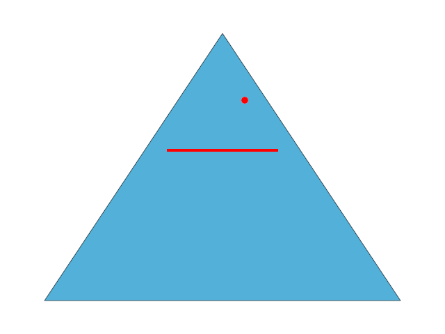
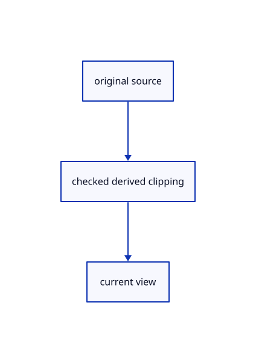

# 17.2.26 · Invalidate selected masks on clipping changes

**Chapter 17 · GPU visibility, clipping and sections · Section 17.2 · Clipping half-spaces** · [Contents](contents.md)

**Typing: 13–25 minutes.** [Estimate](typing-load.md).

Invalidate selected masks on clipping changes.

## Type

Continue from [Preserve sparse source face IDs across the cut](87o-preserve-sparse-source-face-ids-across-the-cut.md). [Save or recover your work](recovery.md).

### 1. `src/outline_mask.wgsl`

Connect matching source ownership and derived clipping.

<details>
<summary>Locate the existing block</summary>

```wgsl
@group(0) @binding(0) var<uniform> view:View;
@group(1) @binding(0) var<uniform> object:Object;
@vertex fn vertex(@location(0) position:vec3<f32>)->@builtin(position) vec4<f32> {return view.transform*object.model*vec4<f32>(position,1.0);}
@fragment fn fragment()->@location(0) vec4<f32> {return vec4<f32>(1.0);}
```

</details>

Edit the existing block to match this code; keep unchanged lines:

```wgsl
--8<-- "journey/code/87p-invalidate-selected-masks-on-clipping-changes-01.rs"
```

### 2. `src/outline_gpu.rs`

Connect matching source ownership and derived clipping.

Edit these blocks from bottom to top. Keep the surrounding lines unchanged.

<details>
<summary>Locate this block</summary>

```rust
fn mask_pipeline(device: &wgpu::Device) -> wgpu::RenderPipeline {
  let shader = device.create_shader_module(wgpu::ShaderModuleDescriptor {
    label: Some("selected visible coverage"),
    source: wgpu::ShaderSource::Wgsl(include_str!("outline_mask.wgsl").into()),
  });
  let view = crate::gpu_layout::uniform(device, 80);
  let model = crate::gpu_layout::uniform(device, 160);
  let layout = device.create_pipeline_layout(&wgpu::PipelineLayoutDescriptor {
    label: Some("selected mask"),
    bind_group_layouts: &[Some(&view), Some(&model)],
    immediate_size: 0,
  });
  device.create_render_pipeline(&wgpu::RenderPipelineDescriptor {
```

</details>

Replace it with:

```rust
fn mask_pipeline(device: &wgpu::Device) -> wgpu::RenderPipeline {
  let shader = device.create_shader_module(wgpu::ShaderModuleDescriptor {
    label: Some("selected visible coverage"),
    source: wgpu::ShaderSource::Wgsl(crate::clipping_gpu::source(include_str!("outline_mask.wgsl"),2,0).into()),
  });
  let view = crate::gpu_layout::uniform(device, 80);
  let model = crate::gpu_layout::uniform(device, 160);
  let layout = device.create_pipeline_layout(&wgpu::PipelineLayoutDescriptor {
    label: Some("selected mask"),
    bind_group_layouts: &[Some(&view), Some(&model),Some(&crate::clipping_gpu::layout(device))],
    immediate_size: 0,
  });
  device.create_render_pipeline(&wgpu::RenderPipelineDescriptor {
```

<details>
<summary>Locate this block</summary>

```rust
          ..Default::default()
        });
        pass.set_pipeline(&self.mask_pipeline);
        pass.set_bind_group(0, view_group, &[]);
        for mesh in meshes.iter().filter(|m| m.selected()) {
          mesh.draw(&mut pass);
        }
```

</details>

Replace it with:

```rust
          ..Default::default()
        });
        pass.set_pipeline(&self.mask_pipeline);
        pass.set_bind_group(0, view_group, &[]);pass.set_bind_group(2,clipping,&[]);
        for mesh in meshes.iter().filter(|m| m.selected()) {
          mesh.draw(&mut pass);
        }
```

<details>
<summary>Locate this block</summary>

```rust
    transform: [f32; 16],
    size: [u32; 2],
    density: f32,
  ) {
    if !meshes.iter().any(GpuMesh::selected) {
      self.release();
      return;
    }
    self.prepare(ctx, size, density);
    let key = Key { transform, size, density: density.to_bits(), revision: self.revision };
    let m = self.masks.as_ref().unwrap();
    if self.key.as_ref() != Some(&key) {
      {
```

</details>

Replace it with:

```rust
    transform: [f32; 16],
    size: [u32; 2],
    density: f32,
    clipping:&wgpu::BindGroup,clip_revision:u64,
  ) {
    if !meshes.iter().any(GpuMesh::selected) {
      self.release();
      return;
    }
    self.prepare(ctx, size, density);
    let key = Key { transform, size, density: density.to_bits(), revision: self.revision,clipping:clip_revision };
    let m = self.masks.as_ref().unwrap();
    if self.key.as_ref() != Some(&key) {
      {
```

<details>
<summary>Locate this block</summary>

```rust
  size: [u32; 2],
  density: u32,
  revision: u64,
}

pub struct Outline {
```

</details>

Replace it with:

```rust
  size: [u32; 2],
  density: u32,
  revision: u64,
  clipping:u64,
}

pub struct Outline {
```

<details>
<summary>Complete updated block reference</summary>

```rust
use crate::{
  gpu_mesh::GpuMesh,
  text_gpu_support::{GpuCtx, resource_group, texture_entry},
};
use wgpu::{ShaderStages as Stages, TextureSampleType as Sample};

struct Image {
  texture: wgpu::Texture,
  view: wgpu::TextureView,
  size: [u32; 2],
}
impl Image {
  fn new(device: &wgpu::Device, size: [u32; 2], label: &str) -> Self {
    let texture = device.create_texture(&wgpu::TextureDescriptor {
      label: Some(label),
      size: wgpu::Extent3d { width: size[0], height: size[1], depth_or_array_layers: 1 },
      mip_level_count: 1,
      sample_count: 1,
      dimension: wgpu::TextureDimension::D2,
      format: wgpu::TextureFormat::R8Unorm,
      usage: wgpu::TextureUsages::RENDER_ATTACHMENT
        | wgpu::TextureUsages::TEXTURE_BINDING
        | wgpu::TextureUsages::COPY_SRC,
      view_formats: &[],
    });
    let view = texture.create_view(&Default::default());
    Self { texture, view, size }
  }
  fn bytes(&self) -> u64 {
    self.size[0] as u64 * self.size[1] as u64
  }
}
impl Drop for Image {
  fn drop(&mut self) {
    self.texture.destroy();
  }
}
struct Masks {
  coverage: Image,
  coarse: Image,
  dilated: Image,
  alpha: Image,
  block: u32,
  pool: wgpu::BindGroup,
  dilate: wgpu::BindGroup,
  search: wgpu::BindGroup,
  composite: wgpu::BindGroup,
}
#[derive(Clone, PartialEq)]
struct Key {
  transform: [f32; 16],
  size: [u32; 2],
  density: u32,
  revision: u64,
  clipping:u64,
}

pub struct Outline {
  mask_pipeline: wgpu::RenderPipeline,
  pool_pipeline: wgpu::RenderPipeline,
  dilate_pipeline: wgpu::RenderPipeline,
  alpha_pipeline: wgpu::RenderPipeline,
  composite_pipeline: wgpu::RenderPipeline,
  pool_layout: wgpu::BindGroupLayout,
  search_layout: wgpu::BindGroupLayout,
  composite_layout: wgpu::BindGroupLayout,
  radius: wgpu::Buffer,
  taps: wgpu::Buffer,
  tap_group: wgpu::BindGroup,
  masks: Option<Masks>,
  key: Option<Key>,
  tap_radius: Option<f32>,
  revision: u64,
  pub rebuilds: u64,
  pub skips: u64,
  pub draws: u64,
}
impl Outline {
  pub fn new(ctx: &GpuCtx, format: wgpu::TextureFormat) -> Self {
    let texture = |binding| texture_entry(binding, Stages::FRAGMENT, Sample::Float { filterable: false }, false);
    let uniform = |binding, bytes| wgpu::BindGroupLayoutEntry {
      binding,
      visibility: Stages::FRAGMENT,
      ty: wgpu::BindingType::Buffer {
        ty: wgpu::BufferBindingType::Uniform,
        has_dynamic_offset: false,
        min_binding_size: wgpu::BufferSize::new(bytes),
      },
      count: None,
    };
    let layout = |label, entries: &[wgpu::BindGroupLayoutEntry]| {
      ctx.device.create_bind_group_layout(&wgpu::BindGroupLayoutDescriptor { label: Some(label), entries })
    };
    let pool_layout = layout("outline pooling", &[texture(0), uniform(1, 16)]);
    let search_layout = layout("outline mask search", &[texture(0), uniform(1, 16), texture(2)]);
    let tap_layout = layout("outline sorted taps", &[uniform(0, 16 + 16 * 512)]);
    let composite_layout = layout("outline alpha", &[texture(0)]);
    let buffer = |label, size| {
      ctx.device.create_buffer(&wgpu::BufferDescriptor {
        label: Some(label),
        size,
        usage: wgpu::BufferUsages::UNIFORM | wgpu::BufferUsages::COPY_DST,
        mapped_at_creation: false,
      })
    };
    let radius = buffer("outline radius", 16);
    let taps = buffer("outline sorted taps", 16 + 16 * 512);
    let tap_group = resource_group(ctx, &tap_layout, "outline sorted taps", [(0, taps.as_entire_binding())]);
    let shader = ctx.device.create_shader_module(wgpu::ShaderModuleDescriptor {
      label: Some("current surface outline"),
      source: wgpu::ShaderSource::Wgsl(include_str!("outline.wgsl").into()),
    });
    Self {
      mask_pipeline: mask_pipeline(&ctx.device),
      pool_pipeline: fullscreen(&ctx.device, &shader, &[&pool_layout], "fs_pool", wgpu::TextureFormat::R8Unorm, false),
      dilate_pipeline: fullscreen(
        &ctx.device,
        &shader,
        &[&pool_layout],
        "fs_dilate",
        wgpu::TextureFormat::R8Unorm,
        false,
      ),
      alpha_pipeline: fullscreen(
        &ctx.device,
        &shader,
        &[&search_layout, &search_layout, &tap_layout],
        "fs_alpha",
        wgpu::TextureFormat::R8Unorm,
        false,
      ),
      composite_pipeline: fullscreen(&ctx.device, &shader, &[&composite_layout], "fs_main", format, true),
      pool_layout,
      search_layout,
      composite_layout,
      radius,
      taps,
      tap_group,
      masks: None,
      key: None,
      tap_radius: None,
      revision: 1,
      rebuilds: 0,
      skips: 0,
      draws: 0,
    }
  }
  pub fn invalidate(&mut self) {
    self.revision = self.revision.wrapping_add(1);
  }
  pub fn release(&mut self) {
    self.masks = None;
    self.key = None;
  }
  pub fn usage(&self) -> [u64; 4] {
    self.masks.as_ref().map_or([self.radius.size() + self.taps.size(), self.rebuilds, self.skips, self.draws], |m| {
      [
        m.coverage.bytes()
          + m.coarse.bytes()
          + m.dilated.bytes()
          + m.alpha.bytes()
          + self.radius.size()
          + self.taps.size(),
        self.rebuilds,
        self.skips,
        self.draws,
      ]
    })
  }
  fn prepare(&mut self, ctx: &GpuCtx, size: [u32; 2], density: f32) {
    let radius = crate::outline_math::radius((size[0], size[1]), size[0] as f64 / density as f64);
    let block = crate::outline_math::block(radius);
    if self.masks.as_ref().is_none_or(|m| m.coverage.size != size || m.block != block) {
      let coverage = Image::new(&ctx.device, size, "selected coverage");
      let coarse_size = size.map(|n| n.div_ceil(block).max(1));
      let coarse = Image::new(&ctx.device, coarse_size, "selected coarse mask");
      let dilated = Image::new(&ctx.device, coarse_size, "selected dilated mask");
      let alpha = Image::new(&ctx.device, size, "selected outline alpha");
      let pool = resource_group(
        ctx,
        &self.pool_layout,
        "selected mask pooling",
        [(0, wgpu::BindingResource::TextureView(&coverage.view)), (1, self.radius.as_entire_binding())],
      );
      let dilate = resource_group(
        ctx,
        &self.pool_layout,
        "selected coarse dilation",
        [(0, wgpu::BindingResource::TextureView(&coarse.view)), (1, self.radius.as_entire_binding())],
      );
      let search = resource_group(
        ctx,
        &self.search_layout,
        "selected outline search",
        [
          (0, wgpu::BindingResource::TextureView(&coverage.view)),
          (1, self.radius.as_entire_binding()),
          (2, wgpu::BindingResource::TextureView(&dilated.view)),
        ],
      );
      let composite = resource_group(
        ctx,
        &self.composite_layout,
        "selected outline alpha",
        [(0, wgpu::BindingResource::TextureView(&alpha.view))],
      );
      self.masks = Some(Masks { coverage, coarse, dilated, alpha, block, pool, dilate, search, composite });
      self.key = None;
    }
    ctx.queue.write_buffer(
      &self.radius,
      0,
      &[radius, 1., block as f32, 0.].into_iter().flat_map(f32::to_ne_bytes).collect::<Vec<_>>(),
    );
    if self.tap_radius != Some(radius) {
      let table = crate::outline_math::taps(radius);
      assert!(table.len() <= 512);
      let mut bytes = vec![0u8; 16 + 16 * 512];
      bytes[..4].copy_from_slice(&(table.len() as u32).to_ne_bytes());
      for (i, tap) in table.iter().enumerate() {
        for (j, value) in tap.iter().enumerate() {
          let offset = 16 + 16 * i + 4 * j;
          bytes[offset..offset + 4].copy_from_slice(&value.to_ne_bytes());
        }
      }
      ctx.queue.write_buffer(&self.taps, 0, &bytes);
      self.tap_radius = Some(radius);
    }
  }
  pub fn encode(
    &mut self,
    ctx: &GpuCtx,
    encoder: &mut wgpu::CommandEncoder,
    colour: &wgpu::TextureView,
    depth: &wgpu::TextureView,
    view_group: &wgpu::BindGroup,
    meshes: &[GpuMesh],
    transform: [f32; 16],
    size: [u32; 2],
    density: f32,
    clipping:&wgpu::BindGroup,clip_revision:u64,
  ) {
    if !meshes.iter().any(GpuMesh::selected) {
      self.release();
      return;
    }
    self.prepare(ctx, size, density);
    let key = Key { transform, size, density: density.to_bits(), revision: self.revision,clipping:clip_revision };
    let m = self.masks.as_ref().unwrap();
    if self.key.as_ref() != Some(&key) {
      {
        let mut pass = encoder.begin_render_pass(&wgpu::RenderPassDescriptor {
          label: Some("selected visible coverage"),
          color_attachments: &[Some(wgpu::RenderPassColorAttachment {
            view: &m.coverage.view,
            depth_slice: None,
            resolve_target: None,
            ops: wgpu::Operations { load: wgpu::LoadOp::Clear(wgpu::Color::TRANSPARENT), store: wgpu::StoreOp::Store },
          })],
          depth_stencil_attachment: Some(wgpu::RenderPassDepthStencilAttachment {
            view: depth,
            depth_ops: Some(wgpu::Operations { load: wgpu::LoadOp::Load, store: wgpu::StoreOp::Store }),
            stencil_ops: None,
          }),
          ..Default::default()
        });
        pass.set_pipeline(&self.mask_pipeline);
        pass.set_bind_group(0, view_group, &[]);pass.set_bind_group(2,clipping,&[]);
        for mesh in meshes.iter().filter(|m| m.selected()) {
          mesh.draw(&mut pass);
        }
      }
      raster(encoder, &m.coarse.view, &self.pool_pipeline, &[&m.pool]);
      raster(encoder, &m.dilated.view, &self.dilate_pipeline, &[&m.dilate]);
      raster(encoder, &m.alpha.view, &self.alpha_pipeline, &[&m.search, &m.search, &self.tap_group]);
      self.key = Some(key);
      self.rebuilds += 1;
    } else {
      self.skips += 1;
    }
    {
      let mut pass = encoder.begin_render_pass(&wgpu::RenderPassDescriptor {
        label: Some("selected black silhouette"),
        color_attachments: &[Some(wgpu::RenderPassColorAttachment {
          view: colour,
          depth_slice: None,
          resolve_target: None,
          ops: wgpu::Operations { load: wgpu::LoadOp::Load, store: wgpu::StoreOp::Store },
        })],
        ..Default::default()
      });
      pass.set_pipeline(&self.composite_pipeline);
      pass.set_bind_group(0, &m.composite, &[]);
      pass.draw(0..3, 0..1);
    }
    self.draws += 1;
  }
}
fn raster(
  encoder: &mut wgpu::CommandEncoder,
  view: &wgpu::TextureView,
  pipeline: &wgpu::RenderPipeline,
  groups: &[&wgpu::BindGroup],
) {
  let mut pass = encoder.begin_render_pass(&wgpu::RenderPassDescriptor {
    label: Some("outline preparation"),
    color_attachments: &[Some(wgpu::RenderPassColorAttachment {
      view,
      depth_slice: None,
      resolve_target: None,
      ops: wgpu::Operations { load: wgpu::LoadOp::Clear(wgpu::Color::TRANSPARENT), store: wgpu::StoreOp::Store },
    })],
    ..Default::default()
  });
  pass.set_pipeline(pipeline);
  for (i, group) in groups.iter().enumerate() {
    pass.set_bind_group(i as u32, *group, &[]);
  }
  pass.draw(0..3, 0..1);
}
fn fullscreen(
  device: &wgpu::Device,
  shader: &wgpu::ShaderModule,
  groups: &[&wgpu::BindGroupLayout],
  entry: &str,
  format: wgpu::TextureFormat,
  blend: bool,
) -> wgpu::RenderPipeline {
  let layout = device.create_pipeline_layout(&wgpu::PipelineLayoutDescriptor {
    label: Some(entry),
    bind_group_layouts: &groups.iter().map(|g| Some(*g)).collect::<Vec<_>>(),
    immediate_size: 0,
  });
  device.create_render_pipeline(&wgpu::RenderPipelineDescriptor {
    label: Some(entry),
    layout: Some(&layout),
    vertex: wgpu::VertexState {
      module: shader,
      entry_point: Some("vs_main"),
      buffers: &[],
      compilation_options: Default::default(),
    },
    fragment: Some(wgpu::FragmentState {
      module: shader,
      entry_point: Some(entry),
      targets: &[Some(wgpu::ColorTargetState {
        format,
        blend: blend.then_some(wgpu::BlendState::ALPHA_BLENDING),
        write_mask: wgpu::ColorWrites::ALL,
      })],
      compilation_options: Default::default(),
    }),
    primitive: Default::default(),
    depth_stencil: None,
    multisample: Default::default(),
    multiview_mask: None,
    cache: None,
  })
}
fn mask_pipeline(device: &wgpu::Device) -> wgpu::RenderPipeline {
  let shader = device.create_shader_module(wgpu::ShaderModuleDescriptor {
    label: Some("selected visible coverage"),
    source: wgpu::ShaderSource::Wgsl(crate::clipping_gpu::source(include_str!("outline_mask.wgsl"),2,0).into()),
  });
  let view = crate::gpu_layout::uniform(device, 80);
  let model = crate::gpu_layout::uniform(device, 160);
  let layout = device.create_pipeline_layout(&wgpu::PipelineLayoutDescriptor {
    label: Some("selected mask"),
    bind_group_layouts: &[Some(&view), Some(&model),Some(&crate::clipping_gpu::layout(device))],
    immediate_size: 0,
  });
  device.create_render_pipeline(&wgpu::RenderPipelineDescriptor {
    label: Some("selected mask"),
    layout: Some(&layout),
    vertex: wgpu::VertexState {
      module: &shader,
      entry_point: Some("vertex"),
      buffers: &[wgpu::VertexBufferLayout {
        array_stride: 24,
        step_mode: wgpu::VertexStepMode::Vertex,
        attributes: &wgpu::vertex_attr_array![0=>Float32x3],
      }],
      compilation_options: Default::default(),
    },
    fragment: Some(wgpu::FragmentState {
      module: &shader,
      entry_point: Some("fragment"),
      targets: &[Some(wgpu::TextureFormat::R8Unorm.into())],
      compilation_options: Default::default(),
    }),
    primitive: Default::default(),
    depth_stencil: Some(wgpu::DepthStencilState {
      format: crate::depth::FORMAT,
      depth_write_enabled: Some(false),
      depth_compare: Some(wgpu::CompareFunction::LessEqual),
      stencil: Default::default(),
      bias: Default::default(),
    }),
    multisample: Default::default(),
    multiview_mask: None,
    cache: None,
  })
}

#[cfg(test)]
impl Outline {
  pub(crate) fn alpha_texture(&self) -> Option<&wgpu::Texture> {
    self.masks.as_ref().map(|m| &m.alpha.texture)
  }
}
```

</details>

<details>
<summary>Optional patch references</summary>

Use these original edit fragments when comparing a saved checkpoint. Apply the complete blocks above.

```text
--8<-- "journey/code/87p-invalidate-selected-masks-on-clipping-changes-02.rs"
```

```text
--8<-- "journey/code/87p-invalidate-selected-masks-on-clipping-changes-03.rs"
```

```text
--8<-- "journey/code/87p-invalidate-selected-masks-on-clipping-changes-04.rs"
```

```text
--8<-- "journey/code/87p-invalidate-selected-masks-on-clipping-changes-05.rs"
```

```text
--8<-- "journey/code/87p-invalidate-selected-masks-on-clipping-changes-06.rs"
```

```text
--8<-- "journey/code/87p-invalidate-selected-masks-on-clipping-changes-07.rs"
```

</details>

### 3. `src/renderer.rs`

Connect the completed owner through this method.

<details>
<summary>Locate the existing block</summary>

```rust
        {let mut pass=encoder.begin_render_pass(&wgpu::RenderPassDescriptor{label:Some("measurement overlay"),color_attachments:&[Some(wgpu::RenderPassColorAttachment{view,depth_slice:None,resolve_target:None,ops:wgpu::Operations{load:wgpu::LoadOp::Load,store:wgpu::StoreOp::Store}})],depth_stencil_attachment:Some(wgpu::RenderPassDepthStencilAttachment{view:&self.depth,depth_ops:Some(wgpu::Operations{load:wgpu::LoadOp::Load,store:wgpu::StoreOp::Store}),stencil_ops:None}),timestamp_writes:None,occlusion_query_set:None,multiview_mask:None});self.measurement.draw(&mut pass);self.guides.draw(&mut pass);}
        if self.meshes.iter().any(GpuMesh::selected) {
            let mut outline=self.outline.borrow_mut();let outline=outline.get_or_insert_with(||crate::outline_gpu::Outline::new(&self.text_context(),self.format));outline.encode(&self.text_context(),&mut encoder,view,&self.depth,&self.view_group,&self.meshes,*transform,self.size,self.density);
        } else {self.outline.borrow_mut().take();}
        self.widget.draw(&mut encoder,view);
```

</details>

Edit the existing block to match this code; keep unchanged lines:

```rust
--8<-- "journey/code/87p-invalidate-selected-masks-on-clipping-changes-08.rs"
```

## Run and check

Run this from `session_viewer` to select the fixed dependency versions and install supplied binary assets. It updates Cargo.lock and preserves the previous lock. It does not write implementation code:

```sh
npm --prefix ../session_tests run course -- dependencies 17.2.26
```

In your project:

```sh
cd workspace/journey
REGEN_PROTO=0 cargo build --lib --locked --target wasm32-unknown-unknown -j1
REGEN_PROTO=0 CARGO_BUILD_JOBS=1 trunk serve --port 8780
```

Open `http://127.0.0.1:8780/`. Keep an existing Trunk server running; saving rebuilds it.


### Recorded visual result

**Previous native render — current verification pending.**

Actual finite visibility keeps the front red originals and blue solid visible while suppressing the hidden rear stroke.



*This recorded image predates a source or checker change. Rebuild this checkpoint before using it as current evidence; browser controls require separate acceptance.*

This reference image is shared with [17.2.5 · Gather six visible original world planes](87a-gather-six-visible-original-world-planes.md). It does not demonstrate a new feature by itself.

<details>
<summary>Code explanation and diagram</summary>


original source → checked derived clipping → current view.



Does an unchanged camera prove the selection mask is current?

No. Its key also witnesses clipping revisions; cutting changes mask coverage independently of the view.

Study estimate, including typing and experiments: 0.5–1 hours.

</details>

<details>
<summary>Optional experiment</summary>

Compare moved or flipped planes with cached selected original coverage.

</details>

<details>
<summary>Check and save your work</summary>

Restore experimental edits, then run from `session_viewer`:

```sh
npm --prefix ../session_tests run course -- check 17.2.26
npm --prefix ../session_tests run course -- save 17.2.26
```

Source comparison leaves your project untouched. [Save and recovery instructions](recovery.md).

</details>

<details>
<summary>Viewer coverage and verification</summary>


The browser contract is supplied and requires an actual enabled browser. Native software-GPU pixels and picks do not measure Lenovo performance.

[Full validation scope](release.md).

To reproduce the scripted acceptance of the reference checkpoint, run from `session_viewer` with the [course bundle server](release.md#reproduce) running on port 8781:

```sh
npm --prefix ../session_tests run course -- capture 17.2.26
```

This uses the verified reference bundle; it does not check or change your typed project.

</details>
