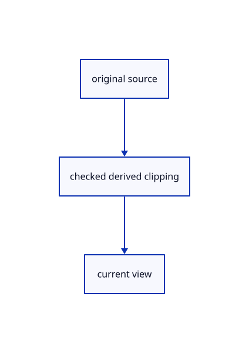

# 17.2.27 · Share clipping at finite original center lines

**Chapter 17 · GPU visibility, clipping and sections · Section 17.2 · Clipping half-spaces** · [Contents](contents.md)

**Typing: 18–36 minutes.** [Estimate](typing-load.md).

Share clipping at finite original center lines.

## Type

Continue from [Invalidate selected masks on clipping changes](87p-invalidate-selected-masks-on-clipping-changes.md). [Save or recover your work](recovery.md).

### 1. `src/finite_visibility.wgsl`

Connect matching source ownership and derived clipping.

<details>
<summary>Locate the existing block</summary>

```wgsl
// The tutorial still converts forward depth; allow two float rounding units until the reversed camera connects.
const FINITE_GRID:bool=false;
@group(1) @binding(0) var<storage,read> finite_projected:array<ProjectedTriangle>;
@group(1) @binding(1) var<storage,read> finite_tiles:array<vec4<u32>>;
@group(1) @binding(2) var finite_depth:texture_depth_2d;
fn finite_physical(pixel:vec2<f32>,depth:f32,tolerance:f32)->bool{let at=finite_depth_pixel(pixel);let size=vec2<i32>(textureDimensions(finite_depth));if(any(at<vec2<i32>(0))||any(at>=size)){return false;}let z=1.0-textureLoad(finite_depth,at,0);return select(z<=depth+tolerance,z<depth-tolerance,FINITE_GRID);}
fn finite_screen(p:vec4<f32>)->vec2<f32>{return(p.xy/p.w*vec2<f32>(0.5,-0.5)+0.5)*view.size;}
fn finite_axis(a:vec4<f32>,b:vec4<f32>)->vec4<f32>{return vec4<f32>(finite_screen(a),finite_screen(b));}
fn finite_visible(pixel:vec2<f32>,axis:vec4<f32>,depths:vec2<f32>)->bool{
 let delta=axis.zw-axis.xy;let length2=dot(delta,delta);let t=clamp(dot(pixel-axis.xy,delta)/max(length2,1e-20),0.0,1.0);let at=axis.xy+t*delta;let depth=mix(depths.x,depths.y,t);let relative=abs(depth)*1.9073486e-6+abs(1.0-depth)*2.3841858e-7;
 if(any(at<vec2<f32>(0.0))||any(at>=view.size)){return finite_physical(pixel,depth,relative);}
 if(finite_tiles[0].x==0u){return finite_physical(pixel,depth,relative);}
 let span=f32(visibility_tile_span_of(u32(view.size.x),u32(view.size.y)));let size=vec2<u32>(ceil(view.size/span));let cell=vec2<u32>(at/span);let head=finite_tiles[1u+cell.y*size.x+cell.x];
 if(head.w!=0u||head.z!=head.x){return finite_physical(pixel,depth,relative);}
 for(var i=0u;i<head.x;i++){
  let offset=head.y+i*2u;let nearest=bitcast<f32>(finite_tiles[(offset+1u)/4u][(offset+1u)%4u]);if(nearest<depth-relative||(!FINITE_GRID&&nearest<=depth+relative)){continue;}
  let primitive=finite_tiles[offset/4u][offset%4u];if(primitive==0u||primitive>arrayLength(&finite_projected)){continue;}
  let triangle=finite_projected[primitive-1u];let hit=projected_triangle_at(triangle,at);let tolerance=relative+0.00390625*(abs(triangle.gradient.x)+abs(triangle.gradient.y));
  if(hit.y>0.5&&select(hit.x>depth+tolerance,hit.x>=depth-tolerance,FINITE_GRID)){return false;}
 }
 return true;
}
```

</details>

Edit the existing block to match this code; keep unchanged lines:

```wgsl
// The tutorial still converts forward depth; allow two float rounding units until the reversed camera connects.
const FINITE_GRID:bool=false;
@group(1) @binding(0) var<storage,read> finite_projected:array<ProjectedTriangle>;
@group(1) @binding(1) var<storage,read> finite_tiles:array<vec4<u32>>;
@group(1) @binding(2) var finite_depth:texture_depth_2d;
fn finite_physical(pixel:vec2<f32>,depth:f32,tolerance:f32)->bool{let at=finite_depth_pixel(pixel);let size=vec2<i32>(textureDimensions(finite_depth));if(any(at<vec2<i32>(0))||any(at>=size)){return false;}let z=1.0-textureLoad(finite_depth,at,0);return select(z<=depth+tolerance,z<depth-tolerance,FINITE_GRID);}
fn finite_screen(p:vec4<f32>)->vec2<f32>{return(p.xy/p.w*vec2<f32>(0.5,-0.5)+0.5)*view.size;}
fn finite_axis(a:vec4<f32>,b:vec4<f32>)->vec4<f32>{return vec4<f32>(finite_screen(a),finite_screen(b));}
fn finite_visible(pixel:vec2<f32>,axis:vec4<f32>,depths:vec2<f32>,flags:u32)->bool{
 let delta=axis.zw-axis.xy;let length2=dot(delta,delta);let t=clamp(dot(pixel-axis.xy,delta)/max(length2,1e-20),0.0,1.0);let at=axis.xy+t*delta;let depth=mix(depths.x,depths.y,t);let relative=abs(depth)*1.9073486e-6+abs(1.0-depth)*2.3841858e-7;
 if(clip_active()&&clip_cut_ndc(flags,clip_ndc(at,view.size,1.0-depth))){return false;}
 if(any(at<vec2<f32>(0.0))||any(at>=view.size)){return finite_physical(pixel,depth,relative);}
 if(finite_tiles[0].x==0u){return finite_physical(pixel,depth,relative);}
 let span=f32(visibility_tile_span_of(u32(view.size.x),u32(view.size.y)));let size=vec2<u32>(ceil(view.size/span));let cell=vec2<u32>(at/span);let head=finite_tiles[1u+cell.y*size.x+cell.x];
 if(head.w!=0u||head.z!=head.x){return finite_physical(pixel,depth,relative);}
 for(var i=0u;i<head.x;i++){
  let offset=head.y+i*2u;let nearest=bitcast<f32>(finite_tiles[(offset+1u)/4u][(offset+1u)%4u]);if(nearest<depth-relative||(!FINITE_GRID&&nearest<=depth+relative)){continue;}
  let primitive=finite_tiles[offset/4u][offset%4u];if(primitive==0u||primitive>arrayLength(&finite_projected)){continue;}
  let triangle=finite_projected[primitive-1u];let hit=projected_triangle_at(triangle,at);let tolerance=relative+0.00390625*(abs(triangle.gradient.x)+abs(triangle.gradient.y));
  if(hit.y>0.5&&!(clip_active()&&clip_cut_ndc(0u,clip_ndc(at,view.size,1.0-hit.x)))&&select(hit.x>depth+tolerance,hit.x>=depth-tolerance,FINITE_GRID)){return false;}
 }
 return true;
}
```

<details>
<summary>Optional patch references</summary>

Use these original edit fragments when comparing a saved checkpoint. Apply the complete blocks above.

```text
--8<-- "journey/code/87q-share-clipping-at-finite-original-center-lines-01.rs"
```

```text
--8<-- "journey/code/87q-share-clipping-at-finite-original-center-lines-02.rs"
```

</details>

### 2. `src/finite_sources.rs`

Connect matching source ownership and derived clipping.

<details>
<summary>Locate the existing block</summary>

```rust
 let base=crate::finite_project_source::expand(base).replace("#include \"finite_visibility.wgsl\"",include_str!("finite_visibility.wgsl"));
 let base=if grid{base.replace("const FINITE_GRID:bool=false;","const FINITE_GRID:bool=true;")}else{base};
 if pick{format!("{}\n{}\n{ids}",base.replace("@group(1)","@group(2)").replace("return vec2<i32>(pixel);","return vec2<i32>(pixel)-vec2<i32>(i32(crop._a),i32(crop._b));"),include_str!("pick_crop.wgsl"))}else{base}
}
```

</details>

Edit the existing block to match this code; keep unchanged lines:

```rust
--8<-- "journey/code/87q-share-clipping-at-finite-original-center-lines-03-shared-expansion.rs"
```

### 3. `src/finite_stroke.wgsl`

Use the same shared clipping predicate before original-plane flags connect.

<details>
<summary>Locate the existing block</summary>

```wgsl
    @builtin(vertex_index) index: u32) -> Output { return geometry(start, end, colour, width, index); }
@fragment
fn fragment(input: Output) -> @location(0) vec4<f32> {if(!finite_visible(input.finite_pixel,input.finite_axis_value,input.finite_depths)){discard;}return colour(input);}
```

</details>

Edit the existing block to match this code; keep unchanged lines:

```wgsl
--8<-- "journey/code/87q-share-clipping-at-finite-original-center-lines-04.rs"
```

### 4. `src/finite_stroke_pick.wgsl`

Use the same shared clipping predicate before original-plane flags connect.

<details>
<summary>Locate the existing block</summary>

```wgsl
    if (!wanted(input.id.y, crop.mode)) { discard; }
    if (colour(source).a <= 0.0) { discard; }
    if(!finite_visible(input.finite_pixel,input.finite_axis_value,input.finite_depths)){discard;}
    return input.id;
}
```

</details>

Edit the existing block to match this code; keep unchanged lines:

```wgsl
--8<-- "journey/code/87q-share-clipping-at-finite-original-center-lines-05.rs"
```

### 5. `src/finite_chain.wgsl`

Use the same shared clipping predicate before original-plane flags connect.

<details>
<summary>Locate the existing block</summary>

```wgsl
    @location(6) heads: u32, @builtin(vertex_index) index: u32) -> Output { return geometry(start, end, colour, width, previous, next, heads, index); }
@fragment
fn fragment(input: Output) -> @location(0) vec4<f32> {if(!finite_visible(input.finite_pixel,input.finite_axis_value,input.finite_depths)){discard;}return colour(input);}
```

</details>

Edit the existing block to match this code; keep unchanged lines:

```wgsl
--8<-- "journey/code/87q-share-clipping-at-finite-original-center-lines-06.rs"
```

### 6. `src/finite_chain_pick.wgsl`

Use the same shared clipping predicate before original-plane flags connect.

<details>
<summary>Locate the existing block</summary>

```wgsl
    if (!wanted(input.id.y, crop.mode)) { discard; }
    if (colour(source).a <= 0.0) { discard; }
    if(!finite_visible(input.finite_pixel,input.finite_axis_value,input.finite_depths)){discard;}
    return input.id;
}
```

</details>

Edit the existing block to match this code; keep unchanged lines:

```wgsl
--8<-- "journey/code/87q-share-clipping-at-finite-original-center-lines-07.rs"
```

### 7. `src/finite_marker.wgsl`

Use the same shared clipping predicate before original-plane flags connect.

<details>
<summary>Locate the existing block</summary>

```wgsl
    @location(2) colour: vec4<f32>, @builtin(vertex_index) index: u32) -> Output { return geometry(center, diameter, colour, index); }
@fragment
fn fragment(input: Output) -> @location(0) vec4<f32> {if(!finite_visible(input.finite_pixel,input.finite_axis_value,input.finite_depths)){discard;}return colour(input);}
```

</details>

Edit the existing block to match this code; keep unchanged lines:

```wgsl
--8<-- "journey/code/87q-share-clipping-at-finite-original-center-lines-08.rs"
```

### 8. `src/finite_marker_pick.wgsl`

Use the same shared clipping predicate before original-plane flags connect.

<details>
<summary>Locate the existing block</summary>

```wgsl
    if (!wanted(input.id.y, crop.mode)) { discard; }
    if (colour(source).a <= 0.0) { discard; }
    if(!finite_visible(input.finite_pixel,input.finite_axis_value,input.finite_depths)){discard;}
    return input.id;
}
```

</details>

Edit the existing block to match this code; keep unchanged lines:

```wgsl
--8<-- "journey/code/87q-share-clipping-at-finite-original-center-lines-09.rs"
```

### 9. `src/finite_ink.rs`

Add the compatible shared clipping layout without changing original attributes yet.

<details>
<summary>Locate the existing block</summary>

```rust
fn pipeline(device:&wgpu::Device,format:wgpu::TextureFormat,stride:u64,grid:bool,picking:bool,view:&wgpu::BindGroupLayout,crop:&wgpu::BindGroupLayout,layout:&wgpu::BindGroupLayout,attributes:&[wgpu::VertexAttribute])->wgpu::RenderPipeline{
   let source=crate::finite_sources::source_style(stride,picking,grid);let shader=device.create_shader_module(wgpu::ShaderModuleDescriptor{label:Some("finite original ink"),source:wgpu::ShaderSource::Wgsl(source.into())});
   let groups=if picking{vec![Some(view),Some(crop),Some(layout)]}else{vec![Some(view),Some(layout)]};let pipeline_layout=device.create_pipeline_layout(&wgpu::PipelineLayoutDescriptor{label:Some("finite original ink"),bind_group_layouts:&groups,immediate_size:0});
   let mut buffers=vec![wgpu::VertexBufferLayout{array_stride:stride,step_mode:wgpu::VertexStepMode::Instance,attributes}];let ids=wgpu::vertex_attr_array![7=>Uint32x2];if picking{buffers.push(wgpu::VertexBufferLayout{array_stride:8,step_mode:wgpu::VertexStepMode::Instance,attributes:&ids});}
   let mut depth = crate::depth::ink();
    depth.depth_compare = Some(wgpu::CompareFunction::Always);
    depth.bias = Default::default();
```

</details>

Edit the existing block to match this code; keep unchanged lines:

```rust
--8<-- "journey/code/87q-share-clipping-at-finite-original-center-lines-10.rs"
```

## Run and check

Run this from `session_viewer` to select the fixed dependency versions and install supplied binary assets. It updates Cargo.lock and preserves the previous lock. It does not write implementation code:

```sh
npm --prefix ../session_tests run course -- dependencies 17.2.27
```

In your project:

```sh
cd workspace/journey
REGEN_PROTO=0 cargo build --lib --locked --target wasm32-unknown-unknown -j1
REGEN_PROTO=0 CARGO_BUILD_JOBS=1 trunk serve --port 8780
```

Open `http://127.0.0.1:8780/`. Keep an existing Trunk server running; saving rebuilds it.


### Recorded visual result

**Previous native render — current verification pending.**

Actual finite visibility keeps the front red originals and blue solid visible while suppressing the hidden rear stroke.


*This recorded image predates a source or checker change. Rebuild this checkpoint before using it as current evidence; browser controls require separate acceptance.*

This reference image is shared with [17.2.5 · Gather six visible original world planes](87a-gather-six-visible-original-world-planes.md). It does not demonstrate a new feature by itself.

<details>
<summary>Code explanation and diagram</summary>


original source → checked derived clipping → current view.



Does a wide ribbon test its displaced pixel against the cut?

No. Test the original centerline point, and exclude cut triangles from its finite occluders.

Study estimate, including typing and experiments: 0.5–1 hours.

</details>

<details>
<summary>Optional experiment</summary>

Compare retained ink behind a removed solid and full-canvas coordinates before cropped picking.

</details>

<details>
<summary>Check and save your work</summary>

Restore experimental edits, then run from `session_viewer`:

```sh
npm --prefix ../session_tests run course -- check 17.2.27
npm --prefix ../session_tests run course -- save 17.2.27
```

Source comparison leaves your project untouched. [Save and recovery instructions](recovery.md).

</details>

<details>
<summary>Viewer coverage and verification</summary>


The browser contract is supplied and requires an actual enabled browser. Native software-GPU pixels and picks do not measure Lenovo performance.

[Full validation scope](release.md).

To reproduce the scripted acceptance of the reference checkpoint, run from `session_viewer` with the [course bundle server](release.md#reproduce) running on port 8781:

```sh
npm --prefix ../session_tests run course -- capture 17.2.27
```

This uses the verified reference bundle; it does not check or change your typed project.

</details>
