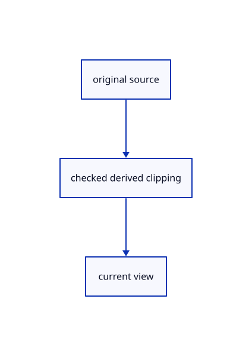

# 17.2.30 · Keep stroke color and pick exemptions aligned

**Chapter 17 · GPU visibility, clipping and sections · Section 17.2 · Clipping half-spaces** · [Contents](contents.md)

**Typing: 16–31 minutes.** [Estimate](typing-load.md).

Keep stroke color and pick exemptions aligned.

## Type

Continue from [Bind original flags without changing instance strides](87s-bind-original-flags-without-changing-instance-strides.md). [Save or recover your work](recovery.md).

### 1. `src/finite_stroke.wgsl`

Connect matching source ownership and derived clipping.

<details>
<summary>Locate the existing block</summary>

```wgsl
struct View { transform: mat4x4<f32>, size: vec2<f32>, density: f32 }
@group(0) @binding(0) var<uniform> view: View;

struct Output {
    @builtin(position) position: vec4<f32>,
    @location(0) colour: vec4<f32>,
    @location(1) @interpolate(linear) side: f32,
    @location(2) @interpolate(flat) half_width: f32,
    @location(9) @interpolate(flat) finite_axis_value:vec4<f32>,
    @location(10) @interpolate(flat) finite_depths:vec2<f32>,
    @location(11) @interpolate(linear) finite_pixel:vec2<f32>,
}

fn hidden(colour: vec4<f32>) -> Output {
    return Output(vec4<f32>(2.0, 2.0, 2.0, 1.0), colour, 0.0, 0.0,vec4<f32>(0.0),vec2<f32>(0.0),vec2<f32>(0.0));
}

fn geometry(start: vec3<f32>, end: vec3<f32>, colour: vec4<f32>, width: f32, index: u32) -> Output {
    var a = view.transform * vec4<f32>(start, 1.0);
    var b = view.transform * vec4<f32>(end, 1.0);
    if (a.z < 0.0 && b.z < 0.0) { return hidden(colour); }
    if (a.z < 0.0) { a = mix(a, b, -a.z / (b.z - a.z)); }
    if (b.z < 0.0) { b = mix(b, a, -b.z / (a.z - b.z)); }
    if (a.w <= 0.0 || b.w <= 0.0) { return hidden(colour); }
    let delta = (b.xy / b.w - a.xy / a.w) * view.size;
    let length2 = dot(delta, delta);
    if (length2 < 0.000001) { return hidden(colour); }
    let normal = vec2<f32>(-delta.y, delta.x) * inverseSqrt(length2);
    let corners = array<vec2<f32>, 6>(vec2<f32>(0.0, -1.0), vec2<f32>(1.0, -1.0),
        vec2<f32>(0.0, 1.0), vec2<f32>(0.0, 1.0), vec2<f32>(1.0, -1.0), vec2<f32>(1.0, 1.0));
    let corner = corners[index];
    let half_width = width * view.density * 0.5;
    let extent = half_width + 0.70711;
    var position = select(a, b, corner.x > 0.5);
    position = vec4<f32>(position.xy + normal * extent * 2.0 / view.size * corner.y * position.w, position.zw);
    return Output(position, colour, corner.y * extent, half_width,finite_axis(a,b),vec2<f32>(1.0-a.z/a.w,1.0-b.z/b.w),finite_screen(position));
}

#include "stroke_coverage.wgsl"

@vertex
fn vertex(@location(0) start: vec3<f32>, @location(1) end: vec3<f32>,
    @location(2) colour: vec4<f32>, @location(3) width: f32,
    @builtin(vertex_index) index: u32) -> Output { return geometry(start, end, colour, width, index); }
@fragment
fn fragment(input: Output) -> @location(0) vec4<f32> {if(!finite_visible(input.finite_pixel,input.finite_axis_value,input.finite_depths,0u)){discard;}return colour(input);}


#include "projected_triangle.wgsl"
#include "finite_visibility.wgsl"
fn finite_depth_pixel(pixel:vec2<f32>)->vec2<i32>{return vec2<i32>(pixel);}
```

</details>

Edit the existing block to match this code; keep unchanged lines:

```wgsl
struct View { transform: mat4x4<f32>, size: vec2<f32>, density: f32 }
@group(0) @binding(0) var<uniform> view: View;

struct Output {
    @builtin(position) position: vec4<f32>,
    @location(0) colour: vec4<f32>,
    @location(1) @interpolate(linear) side: f32,
    @location(2) @interpolate(flat) half_width: f32,
    @location(8) @interpolate(flat) clip_flags:u32,
    @location(9) @interpolate(flat) finite_axis_value:vec4<f32>,
    @location(10) @interpolate(flat) finite_depths:vec2<f32>,
    @location(11) @interpolate(linear) finite_pixel:vec2<f32>,
}

fn hidden(colour: vec4<f32>,flags:u32) -> Output {
    return Output(vec4<f32>(2.0, 2.0, 2.0, 1.0), colour, 0.0, 0.0,flags,vec4<f32>(0.0),vec2<f32>(0.0),vec2<f32>(0.0));
}

fn geometry(start: vec3<f32>, end: vec3<f32>, colour: vec4<f32>, width: f32, index: u32,flags:u32) -> Output {
    var a = view.transform * vec4<f32>(start, 1.0);
    var b = view.transform * vec4<f32>(end, 1.0);
    if (a.z < 0.0 && b.z < 0.0) { return hidden(colour,flags); }
    if (a.z < 0.0) { a = mix(a, b, -a.z / (b.z - a.z)); }
    if (b.z < 0.0) { b = mix(b, a, -b.z / (a.z - b.z)); }
    if (a.w <= 0.0 || b.w <= 0.0) { return hidden(colour,flags); }
    let delta = (b.xy / b.w - a.xy / a.w) * view.size;
    let length2 = dot(delta, delta);
    if (length2 < 0.000001) { return hidden(colour,flags); }
    let normal = vec2<f32>(-delta.y, delta.x) * inverseSqrt(length2);
    let corners = array<vec2<f32>, 6>(vec2<f32>(0.0, -1.0), vec2<f32>(1.0, -1.0),
        vec2<f32>(0.0, 1.0), vec2<f32>(0.0, 1.0), vec2<f32>(1.0, -1.0), vec2<f32>(1.0, 1.0));
    let corner = corners[index];
    let half_width = width * view.density * 0.5;
    let extent = half_width + 0.70711;
    var position = select(a, b, corner.x > 0.5);
    position = vec4<f32>(position.xy + normal * extent * 2.0 / view.size * corner.y * position.w, position.zw);
    return Output(position, colour, corner.y * extent, half_width,flags,finite_axis(a,b),vec2<f32>(1.0-a.z/a.w,1.0-b.z/b.w),finite_screen(position));
}

#include "stroke_coverage.wgsl"

@vertex
fn vertex(@location(0) start: vec3<f32>, @location(1) end: vec3<f32>,
    @location(2) colour: vec4<f32>, @location(3) width: f32,
    @builtin(vertex_index) index: u32,@location(8) flags:u32) -> Output { return geometry(start, end, colour, width, index,flags); }
@fragment
fn fragment(input: Output) -> @location(0) vec4<f32> {if(!finite_visible(input.finite_pixel,input.finite_axis_value,input.finite_depths,input.clip_flags)){discard;}return colour(input);}


#include "projected_triangle.wgsl"
#include "finite_visibility.wgsl"
fn finite_depth_pixel(pixel:vec2<f32>)->vec2<i32>{return vec2<i32>(pixel);}
```

<details>
<summary>Optional patch references</summary>

Use these original edit fragments when comparing a saved checkpoint. Apply the complete blocks above.

```text
--8<-- "journey/code/87t-keep-stroke-color-and-pick-exemptions-aligned-01.rs"
```

```text
--8<-- "journey/code/87t-keep-stroke-color-and-pick-exemptions-aligned-02.rs"
```

```text
--8<-- "journey/code/87t-keep-stroke-color-and-pick-exemptions-aligned-03.rs"
```

```text
--8<-- "journey/code/87t-keep-stroke-color-and-pick-exemptions-aligned-04.rs"
```

</details>

### 2. `src/finite_stroke_pick.wgsl`

Connect matching source ownership and derived clipping.

<details>
<summary>Locate the existing block</summary>

```wgsl
@group(1) @binding(0) var<uniform> crop: Crop;
struct PickOutput {
    @builtin(position) position: vec4<f32>,
    @location(0) colour: vec4<f32>,
    @location(1) @interpolate(linear) side: f32,
    @location(2) @interpolate(flat) half_width: f32,
    @location(7) @interpolate(flat) id: vec2<u32>,
    @location(9) @interpolate(flat) finite_axis_value:vec4<f32>,
    @location(10) @interpolate(flat) finite_depths:vec2<f32>,
    @location(11) @interpolate(linear) finite_pixel:vec2<f32>,
}
@vertex
fn pick_vertex(@location(0) start: vec3<f32>, @location(1) end: vec3<f32>,
    @location(2) colour: vec4<f32>, @location(3) width: f32,
    @builtin(vertex_index) index: u32, @location(7) id: vec2<u32>) -> PickOutput {
    let source = geometry(start, end, colour, width, index);
    var output: PickOutput;
    output.position = crop.transform * source.position;
    output.colour = source.colour;
    output.side = source.side;
    output.half_width = source.half_width;
    output.finite_axis_value=source.finite_axis_value;output.finite_depths=source.finite_depths;output.finite_pixel=source.finite_pixel;
    output.id = id; return output;
}
@fragment
fn pick_fragment(input: PickOutput) -> @location(0) vec2<u32> {
    let source = Output(input.position, input.colour, input.side, input.half_width,input.finite_axis_value,input.finite_depths,input.finite_pixel);
    if (!wanted(input.id.y, crop.mode)) { discard; }
    if (colour(source).a <= 0.0) { discard; }
    if(!finite_visible(input.finite_pixel,input.finite_axis_value,input.finite_depths,0u)){discard;}
    return input.id;
}
```

</details>

Edit the existing block to match this code; keep unchanged lines:

```wgsl
@group(1) @binding(0) var<uniform> crop: Crop;
struct PickOutput {
    @builtin(position) position: vec4<f32>,
    @location(0) colour: vec4<f32>,
    @location(1) @interpolate(linear) side: f32,
    @location(2) @interpolate(flat) half_width: f32,
    @location(7) @interpolate(flat) id: vec2<u32>,
    @location(8) @interpolate(flat) clip_flags:u32,
    @location(9) @interpolate(flat) finite_axis_value:vec4<f32>,
    @location(10) @interpolate(flat) finite_depths:vec2<f32>,
    @location(11) @interpolate(linear) finite_pixel:vec2<f32>,
}
@vertex
fn pick_vertex(@location(0) start: vec3<f32>, @location(1) end: vec3<f32>,
    @location(2) colour: vec4<f32>, @location(3) width: f32,
    @builtin(vertex_index) index: u32, @location(7) id: vec2<u32>,@location(8) flags:u32) -> PickOutput {
    let source = geometry(start, end, colour, width, index,flags);
    var output: PickOutput;
    output.position = crop.transform * source.position;
    output.colour = source.colour;
    output.side = source.side;
    output.half_width = source.half_width;
    output.clip_flags=source.clip_flags;
    output.finite_axis_value=source.finite_axis_value;output.finite_depths=source.finite_depths;output.finite_pixel=source.finite_pixel;
    output.id = id; return output;
}
@fragment
fn pick_fragment(input: PickOutput) -> @location(0) vec2<u32> {
    let source = Output(input.position, input.colour, input.side, input.half_width,input.clip_flags,input.finite_axis_value,input.finite_depths,input.finite_pixel);
    if (!wanted(input.id.y, crop.mode)) { discard; }
    if (colour(source).a <= 0.0) { discard; }
    if(!finite_visible(input.finite_pixel,input.finite_axis_value,input.finite_depths,input.clip_flags)){discard;}
    return input.id;
}
```

<details>
<summary>Optional patch references</summary>

Use these original edit fragments when comparing a saved checkpoint. Apply the complete blocks above.

```text
--8<-- "journey/code/87t-keep-stroke-color-and-pick-exemptions-aligned-05.rs"
```

```text
--8<-- "journey/code/87t-keep-stroke-color-and-pick-exemptions-aligned-06.rs"
```

```text
--8<-- "journey/code/87t-keep-stroke-color-and-pick-exemptions-aligned-07.rs"
```

```text
--8<-- "journey/code/87t-keep-stroke-color-and-pick-exemptions-aligned-08.rs"
```

</details>

## Run and check

Run this from `session_viewer` to select the fixed dependency versions and install supplied binary assets. It updates Cargo.lock and preserves the previous lock. It does not write implementation code:

```sh
npm --prefix ../session_tests run course -- dependencies 17.2.30
```

In your project:

```sh
cd workspace/journey
REGEN_PROTO=0 cargo build --lib --locked --target wasm32-unknown-unknown -j1
REGEN_PROTO=0 CARGO_BUILD_JOBS=1 trunk serve --port 8780
```

Open `http://127.0.0.1:8780/`. Keep an existing Trunk server running; saving rebuilds it.


### Recorded visual result

**Previous native render — current verification pending.**

Actual finite visibility keeps the front red originals and blue solid visible while suppressing the hidden rear stroke.


*This recorded image predates a source or checker change. Rebuild this checkpoint before using it as current evidence; browser controls require separate acceptance.*

This reference image is shared with [17.2.5 · Gather six visible original world planes](87a-gather-six-visible-original-world-planes.md). It does not demonstrate a new feature by itself.

<details>
<summary>Code explanation and diagram</summary>


original source → checked derived clipping → current view.



Can color and picking disagree about original plane flags?

No. Carry the same flag through their original geometry recipes and shared visibility predicate.

Study estimate, including typing and experiments: 0.5–1 hours.

</details>

<details>
<summary>Optional experiment</summary>

Compare cut ordinary originals with immune original-plane boundaries.

</details>

<details>
<summary>Check and save your work</summary>

Restore experimental edits, then run from `session_viewer`:

```sh
npm --prefix ../session_tests run course -- check 17.2.30
npm --prefix ../session_tests run course -- save 17.2.30
```

Source comparison leaves your project untouched. [Save and recovery instructions](recovery.md).

</details>

<details>
<summary>Viewer coverage and verification</summary>


The browser contract is supplied and requires an actual enabled browser. Native software-GPU pixels and picks do not measure Lenovo performance.

[Full validation scope](release.md).

To reproduce the scripted acceptance of the reference checkpoint, run from `session_viewer` with the [course bundle server](release.md#reproduce) running on port 8781:

```sh
npm --prefix ../session_tests run course -- capture 17.2.30
```

This uses the verified reference bundle; it does not check or change your typed project.

</details>
