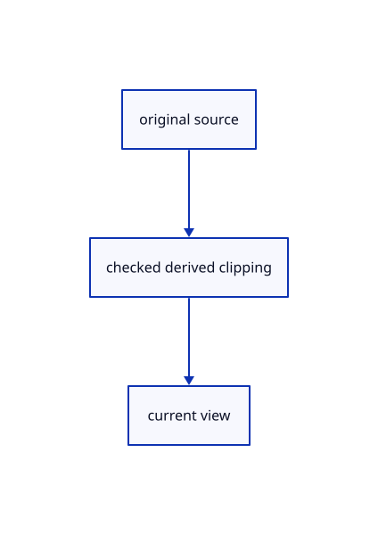

# 17.2.34 · Clip cached original point cloud discs

**Chapter 17 · GPU visibility, clipping and sections · Section 17.2 · Clipping half-spaces** · [Contents](contents.md)

**Typing: 14–27 minutes.** [Estimate](typing-load.md).

Clip cached original point cloud discs.

## Type

Continue from [Resolve locked and selected original plane boundaries](87w-resolve-locked-and-selected-original-plane-boundaries.md). [Save or recover your work](recovery.md).

### 1. `src/cloud_gpu.rs`

Connect matching source ownership and derived clipping.

Edit these blocks from bottom to top. Keep the surrounding lines unchanged.

<details>
<summary>Locate this block</summary>

```rust
  let point = pipeline(
    &ctx.device,
    &shader,
    &[&layouts.uniform, &layouts.columns],
    "vs_point",
    "fs_point",
    &[wgpu::TextureFormat::Rgba8Unorm, wgpu::TextureFormat::Rg32Uint],
```

</details>

Replace it with:

```rust
  let point = pipeline(
    &ctx.device,
    &shader,
    &[&layouts.uniform, &layouts.columns,&crate::clipping_gpu::layout(&ctx.device)],
    "vs_point",
    "fs_point",
    &[wgpu::TextureFormat::Rgba8Unorm, wgpu::TextureFormat::Rg32Uint],
```

<details>
<summary>Locate this block</summary>

```rust
fn pipelines(ctx: &GpuCtx, format: wgpu::TextureFormat, layouts: &Layouts) -> [wgpu::RenderPipeline; 3] {
  let shader = ctx.device.create_shader_module(wgpu::ShaderModuleDescriptor {
    label: Some("current production cloud discs"),
    source: wgpu::ShaderSource::Wgsl(include_str!("cloud_points.wgsl").into()),
  });
  let resolver = ctx.device.create_shader_module(wgpu::ShaderModuleDescriptor {
    label: Some("forward-depth cloud resolve"),
```

</details>

Replace it with:

```rust
fn pipelines(ctx: &GpuCtx, format: wgpu::TextureFormat, layouts: &Layouts) -> [wgpu::RenderPipeline; 3] {
  let shader = ctx.device.create_shader_module(wgpu::ShaderModuleDescriptor {
    label: Some("current production cloud discs"),
    source: wgpu::ShaderSource::Wgsl(crate::clipping_gpu::source(include_str!("cloud_points.wgsl"),2,0).into()),
  });
  let resolver = ctx.device.create_shader_module(wgpu::ShaderModuleDescriptor {
    label: Some("forward-depth cloud resolve"),
```

<details>
<summary>Locate this block</summary>

```rust
      eye: view.eye.map(f32::to_bits),
      ortho: view.ortho_h.to_bits(),
      lod: view.lod_px.to_bits(),
      revision: self.revision,
    };
    if self.key.as_ref() == Some(&key) {
      self.skips += 1;
```

</details>

Replace it with:

```rust
      eye: view.eye.map(f32::to_bits),
      ortho: view.ortho_h.to_bits(),
      lod: view.lod_px.to_bits(),
      revision: self.revision,clipping:self.clip_revision,
    };
    if self.key.as_ref() == Some(&key) {
      self.skips += 1;
```

<details>
<summary>Locate this block</summary>

```rust
        ..Default::default()
      });
      pass.set_pipeline(&self.point);
      pass.set_bind_group(0, &self.settings_group, &[]);
      for draw in &self.draws {
        if draw.total > 0 {
```

</details>

Replace it with:

```rust
        ..Default::default()
      });
      pass.set_pipeline(&self.point);
      pass.set_bind_group(2,&self.clipping,&[]);
      pass.set_bind_group(0, &self.settings_group, &[]);
      for draw in &self.draws {
        if draw.total > 0 {
```

<details>
<summary>Locate this block</summary>

```rust
      total: 0,
    }
  }
  pub fn set_scene(
    &mut self,
    ctx: &GpuCtx,
```

</details>

Replace it with:

```rust
      total: 0,
    }
  }
  pub fn set_clipping(&mut self,revision:u64){self.clip_revision=revision;}
  pub fn set_scene(
    &mut self,
    ctx: &GpuCtx,
```

<details>
<summary>Locate this block</summary>

```rust
    let window = make_buffer("cloud pick origin", 16);
    let window_group = resource_group(ctx, &layouts.window, "cloud pick origin", [(0, window.as_entire_binding())]);
    let [point, resolve, pick] = pipelines(ctx, format, &layouts);
    Self {
      point,
      resolve,
      pick,
```

</details>

Replace it with:

```rust
    let window = make_buffer("cloud pick origin", 16);
    let window_group = resource_group(ctx, &layouts.window, "cloud pick origin", [(0, window.as_entire_binding())]);
    let [point, resolve, pick] = pipelines(ctx, format, &layouts);
    Self {clipping:clipping.clone(),clip_revision:0,
      point,
      resolve,
      pick,
```

<details>
<summary>Locate this block</summary>

```rust
  pub total: u64,
}
impl Lane {
  pub fn new(ctx: &GpuCtx, format: wgpu::TextureFormat) -> Self {
    let layouts = layouts(ctx);
    let make_buffer = |label, size| {
      ctx.device.create_buffer(&wgpu::BufferDescriptor {
```

</details>

Replace it with:

```rust
  pub total: u64,
}
impl Lane {
  pub fn new(ctx: &GpuCtx, format: wgpu::TextureFormat,clipping:&wgpu::BindGroup) -> Self {
    let layouts = layouts(ctx);
    let make_buffer = |label, size| {
      ctx.device.create_buffer(&wgpu::BufferDescriptor {
```

<details>
<summary>Locate this block</summary>

```rust
  ortho: u32,
  lod: u32,
  revision: u64,
}

pub struct Lane {
  point: wgpu::RenderPipeline,
  resolve: wgpu::RenderPipeline,
  pick: wgpu::RenderPipeline,
```

</details>

Replace it with:

```rust
  ortho: u32,
  lod: u32,
  revision: u64,
  clipping:u64,
}

pub struct Lane {
  clipping:wgpu::BindGroup,clip_revision:u64,
  point: wgpu::RenderPipeline,
  resolve: wgpu::RenderPipeline,
  pick: wgpu::RenderPipeline,
```

<details>
<summary>Complete updated block reference</summary>

```rust
use crate::{
  cloud::Row,
  cloud_lod::{LodWalk, Projection},
  text_gpu_support::{GpuCtx, resource_group},
};
use std::{collections::HashMap, rc::Rc};
use wgpu::util::DeviceExt;
const MAX_RECORDS: usize = 4096;

#[derive(Clone, Copy)]
pub struct View {
  pub eye: [f32; 3],
  pub ortho_h: f32,
  pub lod_px: f32,
}
impl Default for View {
  fn default() -> Self {
    Self { eye: [0., 0., 3.], ortho_h: 0., lod_px: 2. }
  }
}
impl View {
  pub fn camera(camera: &crate::camera::Camera) -> Self {
    let forward = camera.orientation.rotate_vector(session_rust::Vector::y_axis());
    Self {
      eye: std::array::from_fn(|i| (camera.target[i] - forward[i] * camera.distance) as f32),
      ortho_h: if camera.projection == crate::camera::Projection::Orthographic {
        (camera.distance * std::f64::consts::FRAC_PI_6.tan()) as f32
      } else {
        0.
      },
      lod_px: 2.,
    }
  }
}
struct Columns {
  _page:Option<Rc<crate::page_cache::Held<crate::range_page::Page>>>,
  positions: wgpu::Buffer,
  colors: wgpu::Buffer,
  normals: wgpu::Buffer,
  has_normals: bool,
}
impl Columns {
  fn new(ctx: &GpuCtx, row: &Row) -> Result<Self, &'static str> {
    let source = &row.prepared.source;
    let count = source.len();
    let limit = ctx.device.limits().max_storage_buffer_binding_size as usize;
    if count.checked_mul(12).is_none_or(|n| n > limit) {
      return Err("Cloud positions exceed this device's storage binding limit");
    }
    let positions = source.coords().iter().flat_map(|v| (*v as f32).to_ne_bytes()).collect::<Vec<_>>();
    let colors = (0..count)
      .map(|i| {
        if source.colors().is_empty() {
          0xff00_0000
        } else {
          let c = &source.colors()[i * 4..i * 4 + 4];
          (c[0] as u32) | (c[1] as u32) << 8 | (c[2] as u32) << 16 | (c[3] as u32) << 24
        }
      })
      .flat_map(u32::to_ne_bytes)
      .collect::<Vec<_>>();
    let has_normals = !source.normals().is_empty();
    let normals = source
      .normals()
      .chunks_exact(3)
      .map(|n| crate::cloud_normals::oct16(&[n[0], n[1], n[2]]).unwrap_or(0))
      .flat_map(u32::to_ne_bytes)
      .collect::<Vec<_>>();
    Ok(Self {
      _page:None,
      positions: buffer(&ctx.device, "original cloud positions", &positions),
      colors: buffer(&ctx.device, "original cloud colors", &colors),
      normals: buffer(&ctx.device, "original cloud normals", &normals),
      has_normals,
    })
  }
  fn page(ctx:&GpuCtx,held:Rc<crate::page_cache::Held<crate::range_page::Page>>)->Result<Self,&'static str> {
    let page=&held.value;let count=page.rows.end-page.rows.start;
    if u64::from(count)*12>u64::from(ctx.device.limits().max_storage_buffer_binding_size) {return Err("Cloud page exceeds the device storage binding limit");}
    let positions=page.display.iter().flat_map(|value|value.to_ne_bytes()).collect::<Vec<_>>();let colors=(0..count as usize).flat_map(|i|page.colors.get(i).copied().unwrap_or(0xff00_0000).to_ne_bytes()).collect::<Vec<_>>();let normals=page.normals.iter().flat_map(|v|v.to_ne_bytes()).collect::<Vec<_>>();
    Ok(Self {positions:buffer(&ctx.device,"streamed source positions",&positions),colors:buffer(&ctx.device,"streamed source colours",&colors),normals:buffer(&ctx.device,"streamed source normals",&normals),has_normals:!page.normals.is_empty(),_page:Some(held)})
  }
  fn bytes(&self) -> u64 {
    self.positions.size() + self.colors.size() + self.normals.size()
  }
}
fn buffer(device: &wgpu::Device, label: &str, bytes: &[u8]) -> wgpu::Buffer {
  device.create_buffer_init(&wgpu::util::BufferInitDescriptor {
    label: Some(label),
    contents: if bytes.is_empty() { &[0; 4] } else { bytes },
    usage: wgpu::BufferUsages::STORAGE,
  })
}
enum Keep {Resident(Rc<session_rust::PointCloud>),Stream(Rc<crate::range_cloud::Prepared>)}
impl Keep {
  fn key(&self,first:u32)->(usize,u32) {match self {Self::Resident(source)=>(Rc::as_ptr(source) as usize,first),Self::Stream(source)=>(Rc::as_ptr(source) as usize,first)}}
}
struct RowView {
  keep:Keep,
  id:crate::scene::ObjectId,
  model:session_rust::Xform,
  nodes:Rc<Vec<crate::cloud::LodNode>>,
  descriptor:crate::cloud::Cloud,
  controls_visible:bool,
  point_px:f32,
  rows:std::ops::Range<u32>,
  address:u32,
}
impl RowView {
  fn resident(row:&Row)->Self {Self {keep:Keep::Resident(row.prepared.source.clone()),id:row.id,model:row.model.clone(),nodes:row.prepared.nodes.clone(),descriptor:row.prepared.descriptor(),controls_visible:row.controls_visible,point_px:if row.point_px>0. {row.point_px} else {row.prepared.source.point_size as f32},rows:0..row.prepared.source.len() as u32,address:0}}
  fn streamed(row:&crate::range_cloud::Row,rows:std::ops::Range<u32>,address:u32)->Self {Self {keep:Keep::Stream(row.prepared.clone()),id:row.id,model:row.model.clone(),nodes:row.prepared.nodes.clone(),descriptor:crate::cloud::Cloud {spacing:row.prepared.source.lod.spacing[0] as f32,node_first:0,node_count:row.prepared.nodes.len() as u32,resident:row.prepared.source.fields.count},controls_visible:row.controls_visible,point_px:if row.point_px>0. {row.point_px} else {row.prepared.source.properties.point_px},rows,address}}
  fn key(&self)->(usize,u32,u32) {let (source,first)=self.keep.key(self.rows.start);(source,first,self.rows.end)}
}
struct Draw {
  row:RowView,
  columns:Rc<Columns>,
  records:wgpu::Buffer,
  group:wgpu::BindGroup,
  visible:bool,
  pickable:bool,
  selected:bool,
  color:Option<[f32;4]>,
  total:u32,
}
struct Image {
  texture: wgpu::Texture,
  view: wgpu::TextureView,
  bytes: u64,
}
impl Image {
  fn new(device: &wgpu::Device, size: [u32; 2], format: wgpu::TextureFormat, bytes: u64) -> Self {
    let texture = device.create_texture(&wgpu::TextureDescriptor {
      label: Some("cached cloud image"),
      size: wgpu::Extent3d { width: size[0], height: size[1], depth_or_array_layers: 1 },
      mip_level_count: 1,
      sample_count: 1,
      dimension: wgpu::TextureDimension::D2,
      format,
      usage: wgpu::TextureUsages::RENDER_ATTACHMENT | wgpu::TextureUsages::TEXTURE_BINDING,
      view_formats: &[],
    });
    let view = texture.create_view(&Default::default());
    Self { texture, view, bytes: bytes * size[0] as u64 * size[1] as u64 }
  }
}
impl Drop for Image {
  fn drop(&mut self) {
    self.texture.destroy();
  }
}
struct Targets {
  color: Image,
  depth: Image,
  ids: Image,
  size: [u32; 2],
  group: wgpu::BindGroup,
}
#[derive(PartialEq)]
struct Key {
  transform: [f32; 16],
  size: [u32; 2],
  density: u32,
  eye: [u32; 3],
  ortho: u32,
  lod: u32,
  revision: u64,
  clipping:u64,
}

pub struct Lane {
  clipping:wgpu::BindGroup,clip_revision:u64,
  point: wgpu::RenderPipeline,
  resolve: wgpu::RenderPipeline,
  pick: wgpu::RenderPipeline,
  settings: wgpu::Buffer,
  settings_group: wgpu::BindGroup,
  columns_layout: wgpu::BindGroupLayout,
  image_layout: wgpu::BindGroupLayout,
  window: wgpu::Buffer,
  window_group: wgpu::BindGroup,
  draws: Vec<Draw>,
  targets: Option<Targets>,
  key: Option<Key>,
  revision: u64,
  pub uploads: u64,
  pub preparations: u64,
  pub skips: u64,
  pub total: u64,
}
impl Lane {
  pub fn new(ctx: &GpuCtx, format: wgpu::TextureFormat,clipping:&wgpu::BindGroup) -> Self {
    let layouts = layouts(ctx);
    let make_buffer = |label, size| {
      ctx.device.create_buffer(&wgpu::BufferDescriptor {
        label: Some(label),
        size,
        usage: wgpu::BufferUsages::UNIFORM | wgpu::BufferUsages::COPY_DST,
        mapped_at_creation: false,
      })
    };
    let settings = make_buffer("cloud frame settings", 48);
    let settings_group =
      resource_group(ctx, &layouts.uniform, "cloud frame settings", [(0, settings.as_entire_binding())]);
    let window = make_buffer("cloud pick origin", 16);
    let window_group = resource_group(ctx, &layouts.window, "cloud pick origin", [(0, window.as_entire_binding())]);
    let [point, resolve, pick] = pipelines(ctx, format, &layouts);
    Self {clipping:clipping.clone(),clip_revision:0,
      point,
      resolve,
      pick,
      settings,
      settings_group,
      columns_layout: layouts.columns,
      image_layout: layouts.image,
      window,
      window_group,
      draws: Vec::new(),
      targets: None,
      key: None,
      revision: 0,
      uploads: 0,
      preparations: 0,
      skips: 0,
      total: 0,
    }
  }
  pub fn set_clipping(&mut self,revision:u64){self.clip_revision=revision;}
  pub fn set_scene(
    &mut self,
    ctx: &GpuCtx,
    scene: &crate::scene::Scene,
    selected: &[crate::scene::ObjectId],
  ) -> Result<(), &'static str> {
    let mut cache:HashMap<(usize,u32,u32),Rc<Columns>>=self.draws.iter().map(|draw|(draw.row.key(),draw.columns.clone())).collect();
    let mut candidates=Vec::new();
    for row in scene.clouds() {let view=RowView::resident(row);let key=view.key();let columns=if let Some(columns)=cache.get(&key) {columns.clone()} else {let columns=Rc::new(Columns::new(ctx,row)?);self.uploads+=1;cache.insert(key,columns.clone());columns};candidates.push((view,columns));}
    for row in scene.streams() {let mut address=0u32;for page in row.prepared.pages() {
      let view=RowView::streamed(row,page.value.rows.clone(),address);let key=view.key();let columns=if let Some(columns)=cache.get(&key) {columns.clone()} else {let columns=Rc::new(Columns::page(ctx,page.clone())?);self.uploads+=1;cache.insert(key,columns.clone());columns};address=address.checked_add(page.value.rows.end-page.value.rows.start).filter(|value|*value<=crate::sub_id::LIMIT).ok_or("Streamed pick addresses exceed their source table")?;candidates.push((view,columns));
    }}
    let mut old=std::mem::take(&mut self.draws);let mut draws=Vec::with_capacity(candidates.len());
    for (row,columns) in candidates {
      let (records,group)=if let Some(i)=old.iter().position(|draw|draw.row.id==row.id&&draw.row.rows==row.rows&&Rc::ptr_eq(&draw.columns,&columns)) {let draw=old.swap_remove(i);(draw.records,draw.group)} else {
        let records=ctx.device.create_buffer(&wgpu::BufferDescriptor {label:Some("bounded cloud draw records"),size:16,usage:wgpu::BufferUsages::STORAGE|wgpu::BufferUsages::COPY_DST,mapped_at_creation:false});
        let group=resource_group(ctx,&self.columns_layout,"cloud source and records",[(0,records.as_entire_binding()),(1,columns.positions.as_entire_binding()),(2,columns.colors.as_entire_binding()),(3,columns.normals.as_entire_binding())]);(records,group)
      };
      let id=row.id;draws.push(Draw {row,columns,records,group,visible:scene.visible(id),pickable:scene.pick_id(id.value()).is_some(),selected:selected.contains(&id),color:scene.face_rgba(id),total:0});
    }
    self.draws = draws;
    self.revision = self.revision.wrapping_add(1);
    self.key = None;
    Ok(())
  }
  fn records(
    &mut self,
    ctx: &GpuCtx,
    transform: [f32; 16],
    size: [u32; 2],
    density: f32,
    view: View,
  ) -> Result<(), &'static str> {
    let mut total = 0u64;
    let mut records_used = 0usize;
    let mut walk = LodWalk::default();
    for draw in &mut self.draws {
      draw.total = 0;
      if !draw.visible {
        continue;
      }
      let row = &draw.row;
      let model = row.model.to_f32();
      let projection = Projection {
        eye: view.eye,
        ortho_h: view.ortho_h,
        height_px: size[1],
        lod_px: if row.controls_visible {0.} else {view.lod_px},
        nodes: &row.nodes,
      };
      walk.select(&projection, &row.descriptor, &model);
      walk.ranges.retain_mut(|range| {let start=range.first.max(row.rows.start);let end=(range.first+range.count).min(row.rows.end);range.first=start;range.count=end.saturating_sub(start);range.count>0});
      records_used += walk.ranges.len();
      if records_used > MAX_RECORDS {
        return Err("Cloud view exceeds the 4096-record budget");
      }
      let (bytes, count) = record_bytes(draw, transform, density, view, &walk.ranges)?;
      draw.total = count;
      if bytes.len() as u64 > draw.records.size() {
        let capacity = walk.ranges.len().next_power_of_two().min(MAX_RECORDS);
        draw.records = ctx.device.create_buffer(&wgpu::BufferDescriptor {
          label: Some("bounded cloud draw records"),
          size: 16 + 160 * capacity as u64,
          usage: wgpu::BufferUsages::STORAGE | wgpu::BufferUsages::COPY_DST,
          mapped_at_creation: false,
        });
        draw.group = resource_group(
          ctx,
          &self.columns_layout,
          "cloud source and records",
          [
            (0, draw.records.as_entire_binding()),
            (1, draw.columns.positions.as_entire_binding()),
            (2, draw.columns.colors.as_entire_binding()),
            (3, draw.columns.normals.as_entire_binding()),
          ],
        );
      }
      ctx.queue.write_buffer(&draw.records, 0, &bytes);
      total += draw.total as u64;
    }
    self.total = total;
    Ok(())
  }
  fn render_points(&self, ctx: &GpuCtx, size: [u32; 2]) {
    let settings = [1., size[0] as f32, size[1] as f32, 0., 0., 0., 0., 0., size[0] as f32, size[1] as f32, 0., 0.];
    ctx.queue.write_buffer(&self.settings, 0, &settings.into_iter().flat_map(f32::to_ne_bytes).collect::<Vec<_>>());
    let t = self.targets.as_ref().unwrap();
    let mut encoder = ctx.device.create_command_encoder(&Default::default());
    {
      let color = |view| {
        Some(wgpu::RenderPassColorAttachment {
          view,
          depth_slice: None,
          resolve_target: None,
          ops: wgpu::Operations { load: wgpu::LoadOp::Clear(wgpu::Color::TRANSPARENT), store: wgpu::StoreOp::Store },
        })
      };
      let mut pass = encoder.begin_render_pass(&wgpu::RenderPassDescriptor {
        label: Some("cached original cloud discs"),
        color_attachments: &[color(&t.color.view), color(&t.ids.view)],
        depth_stencil_attachment: Some(wgpu::RenderPassDepthStencilAttachment {
          view: &t.depth.view,
          depth_ops: Some(wgpu::Operations { load: wgpu::LoadOp::Clear(1.), store: wgpu::StoreOp::Store }),
          stencil_ops: None,
        }),
        ..Default::default()
      });
      pass.set_pipeline(&self.point);
      pass.set_bind_group(2,&self.clipping,&[]);
      pass.set_bind_group(0, &self.settings_group, &[]);
      for draw in &self.draws {
        if draw.total > 0 {
          pass.set_bind_group(1, &draw.group, &[]);
          pass.draw(0..6 * draw.total, 0..1);
        }
      }
    }
    ctx.queue.submit([encoder.finish()]);
  }
  pub fn prepare(
    &mut self,
    ctx: &GpuCtx,
    transform: [f32; 16],
    size: [u32; 2],
    density: f32,
    view: View,
  ) -> Result<(), &'static str> {
    let key = Key {
      transform,
      size,
      density: density.to_bits(),
      eye: view.eye.map(f32::to_bits),
      ortho: view.ortho_h.to_bits(),
      lod: view.lod_px.to_bits(),
      revision: self.revision,clipping:self.clip_revision,
    };
    if self.key.as_ref() == Some(&key) {
      self.skips += 1;
      return Ok(());
    }
    self.records(ctx, transform, size, density, view)?;
    if self.targets.as_ref().is_none_or(|t| t.size != size) {
      let color = Image::new(&ctx.device, size, wgpu::TextureFormat::Rgba8Unorm, 4);
      let depth = Image::new(&ctx.device, size, crate::depth::FORMAT, 4);
      let ids = Image::new(&ctx.device, size, wgpu::TextureFormat::Rg32Uint, 8);
      let group = resource_group(
        ctx,
        &self.image_layout,
        "cached cloud pixels",
        [
          (0, wgpu::BindingResource::TextureView(&depth.view)),
          (1, wgpu::BindingResource::TextureView(&color.view)),
          (2, wgpu::BindingResource::TextureView(&ids.view)),
        ],
      );
      self.targets = Some(Targets { color, depth, ids, size, group });
    }
    self.render_points(ctx, size);
    self.key = Some(key);
    self.preparations += 1;
    Ok(())
  }
  pub fn failed(&mut self) {
    self.targets = None;
    self.key = None;
    self.total = 0;
  }
  pub fn draw(&self, pass: &mut wgpu::RenderPass<'_>) {
    let Some(t) = &self.targets else {
      return;
    };
    pass.set_pipeline(&self.resolve);
    pass.set_bind_group(0, &t.group, &[]);
    pass.set_bind_group(1, &self.window_group, &[]);
    pass.draw(0..3, 0..1);
  }
  pub fn pick(
    &self,
    ctx: &GpuCtx,
    pass: &mut wgpu::RenderPass<'_>,
    window: crate::pick_window::Window,
    mode: crate::pick_sources::Mode,
  ) {
    let Some(t) = &self.targets else {
      return;
    };
    let words = [window.draw[0], window.draw[1], mode as u32, 0];
    ctx.queue.write_buffer(&self.window, 0, &words.into_iter().flat_map(u32::to_ne_bytes).collect::<Vec<_>>());
    pass.set_pipeline(&self.pick);
    pass.set_bind_group(0, &t.group, &[]);
    pass.set_bind_group(1, &self.window_group, &[]);
    pass.draw(0..3, 0..1);
  }
  pub fn usage(&self) -> [u64; 5] {
    let mut seen = std::collections::HashSet::new();
    let columns =
      self.draws.iter().filter(|d| seen.insert(Rc::as_ptr(&d.columns))).map(|d| d.columns.bytes()).sum::<u64>();
    let targets = self.targets.as_ref().map_or(0, |t| t.color.bytes + t.depth.bytes + t.ids.bytes);
    [
      self.total,
      columns
        + self.draws.iter().map(|d| d.records.size()).sum::<u64>()
        + targets
        + self.settings.size()
        + self.window.size(),
      self.uploads,
      self.preparations,
      self.skips,
    ]
  }
}
fn pipeline(
  device: &wgpu::Device,
  shader: &wgpu::ShaderModule,
  groups: &[&wgpu::BindGroupLayout],
  vertex: &str,
  fragment: &str,
  formats: &[wgpu::TextureFormat],
) -> wgpu::RenderPipeline {
  let layout = device.create_pipeline_layout(&wgpu::PipelineLayoutDescriptor {
    label: Some(fragment),
    bind_group_layouts: &groups.iter().map(|g| Some(*g)).collect::<Vec<_>>(),
    immediate_size: 0,
  });
  device.create_render_pipeline(&wgpu::RenderPipelineDescriptor {
    label: Some(fragment),
    layout: Some(&layout),
    vertex: wgpu::VertexState {
      module: shader,
      entry_point: Some(vertex),
      buffers: &[],
      compilation_options: Default::default(),
    },
    fragment: Some(wgpu::FragmentState {
      module: shader,
      entry_point: Some(fragment),
      targets: &formats.iter().copied().map(|format| Some(format.into())).collect::<Vec<_>>(),
      compilation_options: Default::default(),
    }),
    primitive: Default::default(),
    depth_stencil: Some(wgpu::DepthStencilState {
      format: crate::depth::FORMAT,
      depth_write_enabled: Some(true),
      depth_compare: Some(wgpu::CompareFunction::LessEqual),
      stencil: Default::default(),
      bias: Default::default(),
    }),
    multisample: Default::default(),
    multiview_mask: None,
    cache: None,
  })
}

struct Layouts {
  uniform: wgpu::BindGroupLayout,
  window: wgpu::BindGroupLayout,
  columns: wgpu::BindGroupLayout,
  image: wgpu::BindGroupLayout,
}
fn layouts(ctx: &GpuCtx) -> Layouts {
  let uniform = crate::gpu_layout::uniform(&ctx.device, 48);
  let window_layout = crate::gpu_layout::uniform(&ctx.device, 16);
  let storage = |binding| wgpu::BindGroupLayoutEntry {
    binding,
    visibility: wgpu::ShaderStages::VERTEX,
    ty: wgpu::BindingType::Buffer {
      ty: wgpu::BufferBindingType::Storage { read_only: true },
      has_dynamic_offset: false,
      min_binding_size: None,
    },
    count: None,
  };
  let columns_layout = ctx.device.create_bind_group_layout(&wgpu::BindGroupLayoutDescriptor {
    label: Some("cloud source columns and bounded records"),
    entries: &[storage(0), storage(1), storage(2), storage(3)],
  });
  let texture = |binding, sample_type| {
    crate::text_gpu_support::texture_entry(binding, wgpu::ShaderStages::FRAGMENT, sample_type, false)
  };
  let image_layout = ctx.device.create_bind_group_layout(&wgpu::BindGroupLayoutDescriptor {
    label: Some("cached cloud images"),
    entries: &[
      texture(0, wgpu::TextureSampleType::Depth),
      texture(1, wgpu::TextureSampleType::Float { filterable: false }),
      texture(2, wgpu::TextureSampleType::Uint),
    ],
  });
  Layouts { uniform, window: window_layout, columns: columns_layout, image: image_layout }
}
fn pipelines(ctx: &GpuCtx, format: wgpu::TextureFormat, layouts: &Layouts) -> [wgpu::RenderPipeline; 3] {
  let shader = ctx.device.create_shader_module(wgpu::ShaderModuleDescriptor {
    label: Some("current production cloud discs"),
    source: wgpu::ShaderSource::Wgsl(crate::clipping_gpu::source(include_str!("cloud_points.wgsl"),2,0).into()),
  });
  let resolver = ctx.device.create_shader_module(wgpu::ShaderModuleDescriptor {
    label: Some("forward-depth cloud resolve"),
    source: wgpu::ShaderSource::Wgsl(include_str!("cloud_resolve.wgsl").into()),
  });
  let point = pipeline(
    &ctx.device,
    &shader,
    &[&layouts.uniform, &layouts.columns,&crate::clipping_gpu::layout(&ctx.device)],
    "vs_point",
    "fs_point",
    &[wgpu::TextureFormat::Rgba8Unorm, wgpu::TextureFormat::Rg32Uint],
  );
  let resolve = pipeline(&ctx.device, &resolver, &[&layouts.image, &layouts.window], "vertex", "color", &[format]);
  let pick = pipeline(
    &ctx.device,
    &resolver,
    &[&layouts.image, &layouts.window],
    "vertex",
    "pick",
    &[wgpu::TextureFormat::Rg32Uint],
  );
  [point, resolve, pick]
}

fn record_bytes(
  draw: &Draw,
  transform: [f32; 16],
  density: f32,
  view: View,
  ranges: &[crate::cloud_lod::Range],
) -> Result<(Vec<u8>, u32), &'static str> {
  let row = &draw.row;
  let model = row.model.to_f32();
  let scale = row.model.uniform_scale();
  let mut total = 0u32;
  let m = (&session_rust::Xform::from_matrix(transform.map(f64::from)) * &row.model).to_f32();
  let rot = [
    model[0], model[1], model[2], model[12], model[4], model[5], model[6], model[13], model[8], model[9], model[10],
    model[14],
  ];
  let rgb = draw.color.map_or([1., 1., 1.], |c| [c[0],c[1],c[2]]);
  let px = row.point_px;
  let flags = u32::from(draw.selected) | if draw.color.is_some() { 256 } else { 0 };
  let instance = if draw.pickable { row.id.value() - 1 } else { u32::MAX };
  let mut bytes = vec![0; 16];
  for range in ranges {
    let cumulative = total;
    total = total
      .checked_add(range.count)
      .filter(|n| *n <= u32::MAX / 6)
      .ok_or("Cloud vertex count exceeds the draw limit")?;
    let words = m
      .map(f32::to_bits)
      .into_iter()
      .chain([rgb[0].to_bits(), rgb[1].to_bits(), rgb[2].to_bits(), (px * density * 0.5).max(0.5).to_bits()])
      .chain([range.first-row.rows.start, range.count, cumulative, radius_factor(range, px, scale, view.ortho_h).to_bits()])
      .chain(rot.map(f32::to_bits))
      .chain([if draw.columns.has_normals { range.first-row.rows.start } else { u32::MAX }, instance, flags, row.address]);
    bytes.extend(words.flat_map(u32::to_ne_bytes));
  }
  bytes[..4].copy_from_slice(&(ranges.len() as u32).to_ne_bytes());
  bytes[4..8].copy_from_slice(&total.to_ne_bytes());
  Ok((bytes, total))
}

pub fn radius_factor(range: &crate::cloud_lod::Range, px: f32, scale: f64, ortho_h: f32) -> f32 {
  crate::cloud_lod::radius_factor(range, px, scale, ortho_h) * if ortho_h > 0. { 1. } else { 1000. }
}
```

</details>

<details>
<summary>Optional patch references</summary>

Use these original edit fragments when comparing a saved checkpoint. Apply the complete blocks above.

```text
--8<-- "journey/code/87x-clip-cached-original-point-cloud-discs-01.rs"
```

```text
--8<-- "journey/code/87x-clip-cached-original-point-cloud-discs-02.rs"
```

```text
--8<-- "journey/code/87x-clip-cached-original-point-cloud-discs-03.rs"
```

```text
--8<-- "journey/code/87x-clip-cached-original-point-cloud-discs-04.rs"
```

```text
--8<-- "journey/code/87x-clip-cached-original-point-cloud-discs-05.rs"
```

```text
--8<-- "journey/code/87x-clip-cached-original-point-cloud-discs-06.rs"
```

```text
--8<-- "journey/code/87x-clip-cached-original-point-cloud-discs-07.rs"
```

```text
--8<-- "journey/code/87x-clip-cached-original-point-cloud-discs-08.rs"
```

</details>

### 2. `src/cloud_points.wgsl`

Connect matching source ownership and derived clipping.

<details>
<summary>Locate the existing block</summary>

```wgsl
    let ndc = clip.xyz / clip.w;

    if (ndc.z < 0.0 || ndc.z > 1.0) {
        return s;
    }
```

</details>

Edit the existing block to match this code; keep unchanged lines:

```wgsl
--8<-- "journey/code/87x-clip-cached-original-point-cloud-discs-09.rs"
```

### 3. `src/renderer.rs`

Connect the completed owner through this method. Check the same assembled clipping source used by the actual point pipeline.

Edit these blocks from bottom to top. Keep the surrounding lines unchanged.

<details>
<summary>Locate this block</summary>

```rust
    pub fn cloud_error(&self)->Option<String> {self.cloud_error.borrow().clone()}
    fn set_clouds(&self,scene:&Scene,selected:&[ObjectId])->Result<(),&'static str> {
        if scene.clouds().is_empty()&&scene.streams().is_empty() {self.clouds.borrow_mut().take();self.cloud_error.borrow_mut().take();return Ok(());}
        let mut owner=self.clouds.borrow_mut();let lane=owner.get_or_insert_with(||crate::cloud_gpu::Lane::new(&self.text_context(),self.format));lane.set_scene(&self.text_context(),scene,selected)
    }
    fn prepare_clouds(&self,transform:[f32;16]) {
        if let Some(lane)=self.clouds.borrow_mut().as_mut() {if let Err(error)=lane.prepare(&self.text_context(),transform,self.size,self.density,self.cloud_view.get()) {lane.failed();*self.cloud_error.borrow_mut()=Some(error.to_string());} else {self.cloud_error.borrow_mut().take();}}
    }
    pub fn outline_usage(&self)->[u64;4] {self.outline.borrow().as_ref().map_or([0;4],|outline|outline.usage())}
```

</details>

Replace it with:

```rust
    pub fn cloud_error(&self)->Option<String> {self.cloud_error.borrow().clone()}
    fn set_clouds(&self,scene:&Scene,selected:&[ObjectId])->Result<(),&'static str> {
        if scene.clouds().is_empty()&&scene.streams().is_empty() {self.clouds.borrow_mut().take();self.cloud_error.borrow_mut().take();return Ok(());}
        let mut owner=self.clouds.borrow_mut();let lane=owner.get_or_insert_with(||crate::cloud_gpu::Lane::new(&self.text_context(),self.format,&self.clipping.borrow().group));lane.set_scene(&self.text_context(),scene,selected)
    }
    fn prepare_clouds(&self,transform:[f32;16]) {
        if let Some(lane)=self.clouds.borrow_mut().as_mut() {lane.set_clipping(self.clipping.borrow().writes);if let Err(error)=lane.prepare(&self.text_context(),transform,self.size,self.density,self.cloud_view.get()) {lane.failed();*self.cloud_error.borrow_mut()=Some(error.to_string());} else {self.cloud_error.borrow_mut().take();}}
    }
    pub fn outline_usage(&self)->[u64;4] {self.outline.borrow().as_ref().map_or([0;4],|outline|outline.usage())}
```

<details>
<summary>Locate this block</summary>

```rust
        format: wgpu::TextureFormat,
        scene: &Scene,
    ) -> Self {
        crate::shader_check::check(&device, include_str!("cloud_points.wgsl").into(), "Cloud points");
        crate::shader_check::check(&device, include_str!("cloud_resolve.wgsl").into(), "Cloud resolve");
        crate::shader_check::check(&device, crate::finite_project_source::source(), "Finite projection");
        crate::shader_check::check(&device, crate::finite_project_source::tiles(), "Finite tiles");
```

</details>

Replace it with:

```rust
        format: wgpu::TextureFormat,
        scene: &Scene,
    ) -> Self {
        crate::shader_check::check(&device, crate::clipping_gpu::source(include_str!("cloud_points.wgsl"),2,0), "Cloud points");
        crate::shader_check::check(&device, include_str!("cloud_resolve.wgsl").into(), "Cloud resolve");
        crate::shader_check::check(&device, crate::finite_project_source::source(), "Finite projection");
        crate::shader_check::check(&device, crate::finite_project_source::tiles(), "Finite tiles");
```

<details>
<summary>Complete updated block reference</summary>

```rust
use crate::{gpu_mesh::GpuMesh, scene::{ObjectId, Scene}};

pub struct Renderer {
    clipping:std::cell::RefCell<crate::clipping_gpu::Clipping>,
    tiles:std::cell::RefCell<crate::tile_gpu::Tiles>,
    guides:crate::guide_gpu::Guide,
    measurement:crate::measure_gpu::Measurement,
    sheets:crate::sheet_gpu::Lane,
    clouds:std::cell::RefCell<Option<crate::cloud_gpu::Lane>>,
    cloud_view:std::cell::Cell<crate::cloud_gpu::View>,
    cloud_error:std::cell::RefCell<Option<String>>,
    outline:std::cell::RefCell<Option<crate::outline_gpu::Outline>>,
    text:std::cell::RefCell<Option<crate::scene_text_gpu::Lane>>,
    text_error:std::cell::RefCell<Option<String>>,
    full_text_fonts:std::cell::RefCell<Option<Vec<Vec<u8>>>>,
    presentation_text:std::cell::RefCell<Vec<crate::text::TextLabel>>,
    scene_text:std::cell::RefCell<Vec<crate::text::TextLabel>>,
    format:wgpu::TextureFormat,
    pub device: wgpu::Device,
    pub queue: wgpu::Queue,
    instances:crate::instance_gpu::Lane,
    instance_rows:std::collections::HashSet<ObjectId>,
    pipeline: wgpu::RenderPipeline,
    highlight_pipeline: wgpu::RenderPipeline,
    highlight: crate::highlight::Highlight,
    preview: crate::tool_preview::Preview,
    widget: crate::widget::Widget,
    meshes: Vec<GpuMesh>,
    geometry: crate::geometry_cache::GeometryCache,
    settings_allocations: usize,
    settings_writes: usize,
    settings_bytes: usize,
    uniform: wgpu::Buffer,
    view_group: wgpu::BindGroup,
    depth: wgpu::TextureView,
    strokes: crate::stroke_gpu::Lane,
    paths: crate::stroke_gpu::Lane,
    markers: crate::stroke_gpu::Lane,
    grid: crate::stroke_gpu::Lane,
    grid_settings: Option<crate::grid::Settings>,
    grid_plane:crate::cplane::CPlane,
    size: [u32; 2],
    density: f32,
    picker: crate::pick_gpu::Picker,
    sources: crate::pick_sources::Sources,
    faces: crate::face_pick::Faces,
    mesh_ink: crate::stroke_gpu::Lane,
    pick_mode: crate::pick_sources::Mode,
}

impl Renderer {
    pub fn new(
        device: wgpu::Device,
        queue: wgpu::Queue,
        format: wgpu::TextureFormat,
        scene: &Scene,
    ) -> Self {
        crate::shader_check::check(&device, crate::clipping_gpu::source(include_str!("cloud_points.wgsl"),2,0), "Cloud points");
        crate::shader_check::check(&device, include_str!("cloud_resolve.wgsl").into(), "Cloud resolve");
        crate::shader_check::check(&device, crate::finite_project_source::source(), "Finite projection");
        crate::shader_check::check(&device, crate::finite_project_source::tiles(), "Finite tiles");
        crate::shader_check::check(&device, crate::finite_project_source::scan(), "Finite scan");
        let shader = device.create_shader_module(wgpu::ShaderModuleDescriptor {
            label: Some("triangle"),
            source: wgpu::ShaderSource::Wgsl(crate::clipping_gpu::source(include_str!("triangle.wgsl"),2,0).into()),
        });
        let view_layout = crate::gpu_layout::uniform(&device, 80);
        let model_layout = crate::gpu_layout::uniform(&device, 160);
        let layout = device.create_pipeline_layout(&wgpu::PipelineLayoutDescriptor {
            label: Some("mesh settings"), bind_group_layouts: &[Some(&view_layout), Some(&model_layout),Some(&crate::clipping_gpu::layout(&device))], immediate_size: 0 });
        let mesh_pipeline = |depth| device.create_render_pipeline(&wgpu::RenderPipelineDescriptor {
            label: Some("triangle"),
            layout: Some(&layout),
            vertex: wgpu::VertexState {
                module: &shader,
                entry_point: Some("vertex"),
                compilation_options: Default::default(),
                buffers: &[wgpu::VertexBufferLayout {
                    array_stride: 24,
                    step_mode: wgpu::VertexStepMode::Vertex,
                    attributes: &wgpu::vertex_attr_array![0 => Float32x3, 1 => Float32x3],
                }, wgpu::VertexBufferLayout {
                    array_stride: 12, step_mode: wgpu::VertexStepMode::Vertex,
                    attributes: &wgpu::vertex_attr_array![2 => Float32x3],
                }],
            },
            fragment: Some(wgpu::FragmentState {
                module: &shader,
                entry_point: Some("fragment"),
                compilation_options: Default::default(),
                targets: &[Some(format.into())],
            }),
            primitive: Default::default(),
            depth_stencil: Some(depth),
            multisample: Default::default(),
            multiview_mask: None,
            cache: None,
        });
        let pipeline = mesh_pipeline(crate::depth::surface());
        let tiles=std::cell::RefCell::new(crate::tile_gpu::Tiles::new(&device,&view_layout));
        let instances=crate::instance_gpu::Lane::new(&device,format,&view_layout);
        let highlight_pipeline = mesh_pipeline(crate::depth::ink());
        let highlight = crate::highlight::Highlight::new(&device, format);
        let preview = crate::tool_preview::Preview::new(&device, format);
        let widget = crate::widget::Widget::new(&device, format);
        let uniform = device.create_buffer(&wgpu::BufferDescriptor {
            label: Some("view transform and normal diagnostic"),
            size: 80,
            usage: wgpu::BufferUsages::UNIFORM | wgpu::BufferUsages::COPY_DST,
            mapped_at_creation: false,
        });
        let view_group = device.create_bind_group(&wgpu::BindGroupDescriptor {
            label: Some("view settings"),
            layout: &pipeline.get_bind_group_layout(0),
            entries: &[wgpu::BindGroupEntry {
                binding: 0,
                resource: uniform.as_entire_binding(),
            }],
        });
        let depth = Self::depth(&device, 640, 480);
        let strokes = crate::stroke_gpu::Lane::new(&device, format);
        let paths = crate::stroke_gpu::Lane::joined(&device, format);
        let markers = crate::stroke_gpu::Lane::markers(&device, format);
        let grid = crate::stroke_gpu::Lane::grid(&device, format);
        let picker = crate::pick_gpu::Picker::new(&device, &view_layout, &model_layout);
        let faces = crate::face_pick::Faces::new(&device);
        let mesh_ink = crate::stroke_gpu::Lane::new(&device, format);
        let sheets=crate::sheet_gpu::Lane::new(&device,format);
        let measurement=crate::measure_gpu::Measurement::new(&device,format);let guides=crate::guide_gpu::Guide::new(&device,format);
        let mut renderer = Self {clipping:std::cell::RefCell::new(crate::clipping_gpu::Clipping::new(&device)),tiles,guides,measurement,sheets,instances,instance_rows:Default::default(),clouds:Default::default(),cloud_view:Default::default(),cloud_error:Default::default(),outline:Default::default(),full_text_fonts:Default::default(),presentation_text:Default::default(),scene_text:Default::default(), text:std::cell::RefCell::new(None),text_error:std::cell::RefCell::new(None),format,device, queue, pipeline, highlight_pipeline, highlight, preview, widget, meshes: Vec::new(),
            geometry: Default::default(), settings_allocations: 0, settings_writes: 0,
            settings_bytes: 0, uniform, view_group, depth, strokes, paths, markers, grid, grid_settings: None,grid_plane:crate::cplane::CPlane::Xy, size: [640, 480], density: 1.0, picker, faces, mesh_ink, sources: Default::default(), pick_mode: Default::default() };
        for lane in [&mut renderer.mesh_ink,&mut renderer.strokes,&mut renderer.paths,&mut renderer.markers,&mut renderer.grid]{lane.enable_finite(&renderer.device,format);}
        renderer.highlight.enable_finite(&renderer.device,format);
        renderer.set_scene(scene, None);
        renderer
    }

    fn depth(device: &wgpu::Device, width: u32, height: u32) -> wgpu::TextureView {
        let depth_texture = device.create_texture(&wgpu::TextureDescriptor {
            label: Some("opaque depth"),
            size: wgpu::Extent3d { width, height, depth_or_array_layers: 1 },
            mip_level_count: 1,
            sample_count: 1,
            dimension: wgpu::TextureDimension::D2,
            format: crate::depth::FORMAT,
            usage: wgpu::TextureUsages::RENDER_ATTACHMENT|wgpu::TextureUsages::TEXTURE_BINDING,
            view_formats: &[],
        });
        depth_texture.create_view(&Default::default())
    }

    pub fn resize(&mut self, size: crate::viewport::Viewport) {
        if self.size != [size.width, size.height] { self.picker.cancel(); }
        self.size = [size.width, size.height];
        self.depth = Self::depth(&self.device, size.width, size.height);
    }

    pub fn set_density(&mut self, density: f32) {
        if density.is_finite() && density > 0.0 && density != self.density { self.picker.cancel(); self.density = density; }
    }

    pub fn stroke_usage(&self) -> [u64; 4] {
        let [count, bytes] = self.strokes.usage();
        [count, bytes, self.strokes.uploads, self.strokes.uploaded_bytes]
    }

    pub fn path_usage(&self) -> [u64; 4] {
        let [count, bytes] = self.paths.usage();
        [count, bytes, self.paths.uploads, self.paths.uploaded_bytes]
    }

    pub fn point_usage(&self) -> [u64; 4] {
        let [count, bytes] = self.markers.usage();
        [count, bytes, self.markers.uploads, self.markers.uploaded_bytes]
    }

    pub fn set_scene(&mut self, scene: &Scene, selected: Option<ObjectId>) {
        self.clipping.borrow_mut().set(scene);
        if let Some(outline)=self.outline.borrow_mut().as_mut() {outline.invalidate();}
        self.picker.cancel(); self.faces.clear();
        self.preview.set(&self.device, None).expect("Empty tool preview");
        self.highlight.set(&self.device, &self.pipeline.get_bind_group_layout(1), scene, None).expect("Empty selection");
        self.sources = crate::pick_sources::Sources::new(scene).expect("Prepared source topology is bounded");
        self.mesh_ink.set(&self.device, self.sources.mesh_ink.iter().copied()).expect("Prepared source edges");
        self.mesh_ink.set_ids(&self.device, self.sources.mesh_ids.iter().copied()).expect("Source edge IDs match");
        let planes=crate::clipping_rows::owners(scene);let flags=self.sources.mesh_ids.iter().map(|id|crate::sub_id::decode(id[1]).and_then(|(_,address)|self.sources.edges.get(address)).map_or(0,|target|if planes.contains(&target.owner){4096}else{0})).collect();self.mesh_ink.set_flags(&self.device,flags).expect("Original plane ink flags match source addresses");
        self.markers.set_points(&self.device, scene.points().iter().filter(|row| scene.visible(row.id)).map(|row| {let mut marker=row.marker();if let Some(colour)=scene.face_rgba(row.id) {marker.colour=colour;}marker}).chain(scene.control_markers().into_iter().map(|c| c.display)))
            .expect("Prepared point placement fits the display range");
        self.paths.set_chains(&self.device, scene.paths().iter().filter(|row| scene.visible(row.id)).flat_map(|row| {let mut segments=row.segments();if let Some(colour)=scene.face_rgba(row.id) {for segment in &mut segments {segment.stroke.colour=colour;}}segments}))
            .expect("Prepared path placement fits the display range");
        self.strokes.set(&self.device, scene.lines().iter().filter(|row| scene.visible(row.id)).map(|row| {let mut stroke=row.stroke();if let Some(colour)=scene.face_rgba(row.id) {stroke.colour=colour;}stroke}))
            .expect("Prepared line placement fits the display range");
        self.markers.set_ids(&self.device, self.sources.marker_ids.iter().copied()).expect("Marker owners match");
        self.paths.set_ids(&self.device, self.sources.path_ids.iter().copied()).expect("Path owners match");
        self.strokes.set_ids(&self.device, self.sources.line_ids.iter().copied()).expect("Line owners match");
        let layout = self.pipeline.get_bind_group_layout(1);
        let mut old = std::mem::take(&mut self.meshes);
        for object in scene.objects().iter().filter(|row| scene.visible(row.id)) {
            let matching = old.iter().position(|row| row.id == object.id
                && std::rc::Rc::ptr_eq(&row.geometry.source, &object.mesh));
            let row = if let Some(index) = matching {
                let mut row = old.swap_remove(index);
                let [calls, bytes] = row.update(&self.queue, object,style(scene,object.id,selected==Some(object.id)));
                self.settings_writes += calls;
                self.settings_bytes += bytes;
                row
            } else {
                let geometry = self.geometry.get(&self.device, &object.mesh);
                self.settings_allocations += 1;
                GpuMesh::with_geometry(&self.device, &layout, object,
                    style(scene,object.id,selected==Some(object.id)), geometry)
            };
            self.meshes.push(row);
        }
        drop(old);
        self.tiles.borrow_mut().set(&self.device,&self.meshes);
        self.instance_rows=scene.instances.keys().copied().collect();
        self.instances.set(&self.device,&self.queue,self.meshes.iter().filter(|row|self.instance_rows.contains(&row.id))).expect("Validated instance records fit device limits");
        self.sheets.set(&self.device,&self.queue,scene,selected.as_slice(),&self.sources.sheet_bases).expect("Prepared original sheet batches fit device limits");
        self.geometry.prune();
        if !self.meshes.iter().any(GpuMesh::selected) {self.outline.borrow_mut().take();}
        if let Err(error)=self.set_clouds(scene,selected.as_slice()) {*self.cloud_error.borrow_mut()=Some(error.to_string());}
        if let Err(error)=self.set_scene_text(scene,selected.as_slice()) {*self.text_error.borrow_mut()=Some(error.to_string());}
    }

    pub fn request_pick(&mut self, screen: [f32; 2], transform: [f32; 16]) -> Result<(), &'static str> {
        let window = crate::pick_window::Window::new(screen, self.size, self.density).ok_or("Invalid pick cursor")?;
        self.picker.queue(crate::pick_gpu::Request { window, transform, density: self.density, mode: self.pick_mode })?;
        self.pump_pick(transform); Ok(())
    }

    fn pump_pick(&mut self, transform: [f32; 16]) {
        let Ok(view) = crate::pick_view::View::new(transform, self.size, self.density) else { self.picker.cancel(); return; };
        if self.pick_mode == crate::pick_sources::Mode::Face && !self.faces.ready(self.meshes.len()) {
            self.faces.set(&self.device, &self.meshes, &self.sources.mesh_bases,&self.clipping.borrow().buffer);
        }
        if let Some(lane)=self.text.borrow_mut().as_mut() {if let Err(error)=lane.prepare(&self.text_context(),&self.text_frame(transform)) {*self.text_error.borrow_mut()=Some(error.to_string());return;}}
        self.clipping.borrow_mut().frame(&self.queue,transform,self.size[1],self.density);
        self.prepare_clouds(transform);
        if let Some(request) = self.picker.next(view) {
            let mut clipping=self.clipping.borrow_mut();clipping.frame(&self.queue,transform,self.size[1],self.density);
            let mut bytes=transform.iter().flat_map(|v|v.to_ne_bytes()).collect::<Vec<_>>();bytes.resize(80,0);self.queue.write_buffer(&self.uniform,0,&bytes);
            let tables={let mut tiles=self.tiles.borrow_mut();tiles.prepare(&self.device,&self.queue,self.size);let mut encoder=self.device.create_command_encoder(&Default::default());tiles.encode(&self.device,&mut encoder,&self.view_group,transform);self.queue.submit([encoder.finish()]);tiles.map_report();crate::finite_ink::Tables{projected:tiles.projected.clone(),tiles:tiles.buffer.clone()}};
            self.picker.submit_finite(&self.device, &self.queue, request,
            &self.meshes, &[&self.mesh_ink, &self.strokes, &self.paths, &self.markers], &self.faces,self.text.borrow().as_ref(),self.clouds.borrow().as_ref(),Some(&self.sheets),Some(&tables),&clipping.group); }
    }

    pub fn take_pick(&mut self, transform: [f32; 16]) -> Option<Result<Option<[u32; 2]>, &'static str>> {
        let view = match crate::pick_view::View::new(transform, self.size, self.density) { Ok(view) => view, Err(error) => {
            self.picker.cancel(); return Some(Err(error));
        } };
        match self.picker.take(view) {
            Some(Ok(crate::pick_gpu::Reply::Hit(hit))) => Some(Ok(hit)),
            Some(Ok(crate::pick_gpu::Reply::Stale)) => { self.pump_pick(transform); None },
            Some(Err(error)) => Some(Err(error)), None => None,
        }
    }

    pub fn set_pick_mode(&mut self, mode: crate::pick_sources::Mode) {
        if self.pick_mode != mode { self.picker.cancel(); self.pick_mode = mode; }
    }

    pub fn resolve_pick(&self, scene: &Scene, pixel: [u32; 2]) -> Option<crate::pick_sources::Target> {
        self.sources.resolve(scene, pixel, self.pick_mode)
    }

    pub fn part_usage(&self) -> [u64; 4] { let [count, bytes] = self.mesh_ink.usage(); [count, bytes, self.faces.bytes(), self.sources.bytes() as u64] }

    pub fn cancel_pick(&mut self) { self.picker.cancel(); }

    pub fn pick_usage(&self) -> [u64; 5] {
        let [active, pending, bytes] = self.picker.usage();
        [active, pending, bytes + self.strokes.pick_bytes() + self.paths.pick_bytes() + self.markers.pick_bytes() + self.mesh_ink.pick_bytes() + self.mesh_ink.usage()[1] + self.faces.bytes(),
            self.picker.submitted, self.picker.coalesced]
    }

    pub fn geometry_owners(&self) -> impl Iterator<Item = &std::rc::Rc<crate::gpu_geometry::GpuGeometry>> {
        self.meshes.iter().map(|row| &row.geometry)
    }

    pub fn usage(&self) -> [u64; 4] { crate::memory::gpu(&self.meshes) }

    pub fn uploaded_bytes(&self) -> u64 {
        self.instances.written_bytes + self.geometry.uploaded_bytes + self.settings_allocations as u64 * 160 + self.settings_bytes as u64
            + self.strokes.uploaded_bytes + self.paths.uploaded_bytes + self.markers.uploaded_bytes + self.grid.uploaded_bytes
    }

    pub fn set_grid(&mut self,settings:Option<crate::grid::Settings>)->Result<(),&'static str>{self.set_grid_on(settings,crate::cplane::CPlane::Xy)}
    pub fn set_grid_on(&mut self,settings:Option<crate::grid::Settings>,plane:crate::cplane::CPlane)->Result<(),&'static str>{
        if settings==self.grid_settings&&plane==self.grid_plane{return Ok(())}
        let strokes=settings.map(|s|s.strokes_on(plane)).transpose()?.unwrap_or_default();
        self.grid.set(&self.device,strokes)?;self.grid_settings=settings;self.grid_plane=plane;Ok(())
    }

    pub fn grid_usage(&self) -> [u64; 4] {
        let [count, bytes] = self.grid.usage(); [count, bytes, self.grid.uploads, self.grid.uploaded_bytes]
    }

    pub fn set_highlight(&mut self, scene: &Scene, target: Option<crate::pick_sources::Target>) -> Result<(), &'static str> {
        if let Some(outline)=self.outline.borrow_mut().as_mut() {outline.invalidate();}
        self.highlight.set(&self.device, &self.pipeline.get_bind_group_layout(1), scene, target)
    }

    pub fn select_objects(&mut self, scene: &Scene, ids: &[ObjectId]) -> Result<(), &'static str> {
        if let Some(outline)=self.outline.borrow_mut().as_mut() {outline.invalidate();}
        for mesh in &mut self.meshes { if let Some(row) = scene.objects().iter().find(|r| r.id == mesh.id) {
            let [calls, bytes] = mesh.update(&self.queue, row,style(scene,row.id,ids.contains(&row.id)));
            self.settings_writes += calls; self.settings_bytes += bytes;
        } }
        self.instances.set(&self.device,&self.queue,self.meshes.iter().filter(|row|self.instance_rows.contains(&row.id)))?;
        if !self.meshes.iter().any(GpuMesh::selected) {self.outline.borrow_mut().take();}
        self.set_clouds(scene,ids)?;self.sheets.set(&self.device,&self.queue,scene,ids,&self.sources.sheet_bases)?;
        if !ids.is_empty() { self.highlight.objects(&self.device, scene, ids)?; }self.set_scene_text(scene,ids).map_err(|_|"Cannot prepare scene labels")?; Ok(())
    }

    pub fn set_guides(&mut self,overlay:&crate::guide_gpu::Overlay)->Result<(),&'static str>{if self.guides.set(&self.device,overlay)?{self.set_scene_measure_text().map_err(|_|"Cannot prepare editing guide label")?}Ok(())}
    pub fn guide_bytes(&self)->u64{self.guides.bytes()}
    pub fn set_measurement(&mut self,mark:Option<&crate::measure_mark::Mark>)->Result<(),&'static str>{if self.measurement.mark.as_ref()==mark{return Ok(())}self.measurement.set(&self.device,mark)?;self.set_scene_measure_text().map_err(|_|"Cannot prepare measurement annotation")}
    pub fn measurement_bytes(&self)->u64{self.measurement.bytes()}
    fn merge_measurement(&self,mut labels:Vec<crate::text::TextLabel>)->Vec<crate::text::TextLabel>{if let Some(mark)=&self.measurement.mark{labels.extend(mark.labels(&labels));}labels.extend(self.guides.overlay.labels(&labels));labels}
    fn set_scene_measure_text(&self)->anyhow::Result<()>{let mut labels=self.scene_text.borrow().clone();labels.extend(self.presentation_text.borrow().clone());self.adopt_text(self.merge_measurement(labels))}
    pub fn set_preview(&mut self, draft: Option<&crate::tool::Draft>) -> Result<(), &'static str> { self.preview.set(&self.device, draft) }
    pub fn preview_bytes(&self) -> u64 { self.preview.bytes() }

    pub fn set_gizmo(&mut self, camera:&crate::camera::Camera, origin:Option<[f64;3]>, active:f32) {
        let matrix=camera.view_projection();
        let layout=origin.and_then(|p|crate::widget_layout::world_per_pixel(&matrix,p,self.size[1] as f64/self.density as f64)
            .and_then(|scale|crate::widget_layout::layout(&matrix,p,scale,self.size,active)));
        self.widget.prepare(&self.device,&self.queue,layout);
    }
    pub fn gizmo_usage(&self) -> [u64;4] { self.widget.usage() }
    pub fn gizmo_extent(&self) -> Option<[u32;2]> {self.widget.extent()}

    fn text_context(&self)->crate::text_gpu_support::GpuCtx {crate::text_gpu_support::GpuCtx::new(&self.device,&self.queue)}
    fn text_frame(&self,transform:[f32;16])->crate::scene_text_gpu::TextFrame {crate::scene_text_gpu::TextFrame {mvp:transform,origin:[0.;3],framebuffer:self.size,logical:[self.size[0] as f64/self.density as f64,self.size[1] as f64/self.density as f64],ortho_half_height:0.,clip:[[0.;4];4]}}
    fn adopt_text(&self,labels:Vec<crate::text::TextLabel>)->anyhow::Result<()> {
        if labels.is_empty() {self.text.borrow_mut().take();self.text_error.borrow_mut().take();return Ok(());}
        let mut lane=self.text.borrow_mut();if lane.is_none() {let mut new=crate::scene_text_gpu::Lane::new(&self.text_context(),crate::text_gpu_support::Target {format:self.format,samples:1});if let Some(fonts)=self.full_text_fonts.borrow().as_ref() {new.document.replace_fonts(fonts.clone())?;}*lane=Some(new);}lane.as_mut().unwrap().set_labels(labels)
    }
    pub fn set_text(&self,mut labels:Vec<crate::text::TextLabel>)->anyhow::Result<()> {
        for (i,label) in labels.iter_mut().enumerate() {label.id=u32::MAX-i as u32;label.object=None;}
        let mut merged=self.scene_text.borrow().clone();merged.extend(labels.clone());self.adopt_text(self.merge_measurement(merged))?;*self.presentation_text.borrow_mut()=labels;Ok(())
    }
    fn set_scene_text(&self,scene:&Scene,selected:&[ObjectId])->anyhow::Result<()> {
        let labels=scene.text_labels(selected).map_err(anyhow::Error::msg)?;let mut merged=labels.clone();merged.extend(self.presentation_text.borrow().clone());self.adopt_text(self.merge_measurement(merged))?;*self.scene_text.borrow_mut()=labels;Ok(())
    }
    pub fn refresh_text_bounds(&self,scene:&mut Scene) {
        if let Some(lane)=self.text.borrow().as_ref() {for row in scene.texts_mut() {if let Some(run)=lane.document.runs.iter().find(|run|run.label.id==row.id.value()) {row.prepared.extent=run.buffer.layout_runs().fold([0f64;2],|[w,h],line|[w.max(line.line_w as f64),h.max((line.line_top+line.line_height) as f64)]);}}}
    }
    pub fn text_stats(&self)->Option<crate::scene_text_gpu::TextStats> {self.text.borrow().as_ref().map(|lane|lane.stats.clone())}
    pub fn text_scene_usage(&self)->[u64;4] {self.text.borrow().as_ref().map_or([0;4],|lane|[lane.allocated_bytes(),lane.texture_bytes(),lane.stats.world_plane_rasterizations,lane.document.runs.len() as u64])}
    pub fn replace_text_fonts(&self,fonts:Vec<Vec<u8>>)->anyhow::Result<()> {if let Some(lane)=self.text.borrow_mut().as_mut() {lane.document.replace_fonts(fonts.clone())?;} else {let mut document=crate::text::TextDocument::new();document.replace_fonts(fonts.clone())?;}*self.full_text_fonts.borrow_mut()=Some(fonts);Ok(())}
    pub fn clear_text_fonts(&self) {self.full_text_fonts.borrow_mut().take();}

    pub fn text_error(&self)->Option<String> {self.text_error.borrow().clone()}
    pub fn text_usage(&self)->[u64;6] {self.text.borrow().as_ref().map_or([0;6],|lane|{[lane.document.shape_count,lane.stats.preparations,lane.stats.skipped_preparations,lane.stats.raster_images as u64,lane.stats.raster_image_capacity_bytes as u64,lane.stats.atlas_resets]})}
    pub fn text_demo(&self)->anyhow::Result<()> {self.set_text(vec![crate::text_example::label()])}

    pub fn cloud_camera(&self,camera:&crate::camera::Camera) {self.cloud_view.set(crate::cloud_gpu::View::camera(camera));self.sheets.camera(camera);}
    pub fn cloud_usage(&self)->[u64;5] {self.clouds.borrow().as_ref().map_or([0;5],|lane|lane.usage())}
    pub fn cloud_error(&self)->Option<String> {self.cloud_error.borrow().clone()}
    fn set_clouds(&self,scene:&Scene,selected:&[ObjectId])->Result<(),&'static str> {
        if scene.clouds().is_empty()&&scene.streams().is_empty() {self.clouds.borrow_mut().take();self.cloud_error.borrow_mut().take();return Ok(());}
        let mut owner=self.clouds.borrow_mut();let lane=owner.get_or_insert_with(||crate::cloud_gpu::Lane::new(&self.text_context(),self.format,&self.clipping.borrow().group));lane.set_scene(&self.text_context(),scene,selected)
    }
    fn prepare_clouds(&self,transform:[f32;16]) {
        if let Some(lane)=self.clouds.borrow_mut().as_mut() {lane.set_clipping(self.clipping.borrow().writes);if let Err(error)=lane.prepare(&self.text_context(),transform,self.size,self.density,self.cloud_view.get()) {lane.failed();*self.cloud_error.borrow_mut()=Some(error.to_string());} else {self.cloud_error.borrow_mut().take();}}
    }
    pub fn outline_usage(&self)->[u64;4] {self.outline.borrow().as_ref().map_or([0;4],|outline|outline.usage())}

    pub fn highlight_bytes(&self) -> u64 { self.highlight.bytes() }

    pub fn sheet_camera(&self,camera:&crate::camera::Camera) {self.sheets.camera(camera);}
    #[cfg(test)]
    pub(crate) fn tile_buffers(&self)->[wgpu::Buffer;2]{let tiles=self.tiles.borrow();[tiles.projected.clone(),tiles.buffer.clone()]}
    pub fn set_clipping(&self,enabled:bool,solid:bool){let mut clip=self.clipping.borrow_mut();clip.enabled=enabled;clip.solid=solid;}
    pub fn clipping_usage(&self)->[u64;5]{let clip=self.clipping.borrow();[clip.rows.len()as u64,u64::from(clip.enabled),u64::from(clip.solid),clip.writes,clip.buffer.size()]}
    pub fn clipping_ink_bytes(&self)->[u64;2]{[&self.mesh_ink,&self.strokes,&self.paths,&self.markers,&self.grid].into_iter().map(crate::stroke_gpu::Lane::clipping_bytes).fold(self.highlight.clipping_bytes(),|a,b|[a[0]+b[0],a[1]+b[1]])}
    pub fn clipping_error(&self)->Option<&'static str>{self.clipping.borrow().error}
    pub fn tile_usage(&self)->[u64;7]{self.tiles.borrow().usage()}
    pub fn sheet_usage(&self)->[u64;5] {self.sheets.usage()}
    pub fn instance_usage(&self)->[u64;5] {self.instances.usage()}
    pub fn stats(&self) -> [usize; 4] {
        [self.geometry.uploads, self.settings_allocations, self.settings_writes, self.settings_bytes]
    }

    pub fn draw(
        &self,
        view: &wgpu::TextureView,
        background: &crate::background::Background,
        transform: &[f32; 16],
    ) { self.draw_mode(view, background, transform, false); }

    pub fn draw_mode(&self, view: &wgpu::TextureView, background: &crate::background::Background,
        transform: &[f32; 16], normals: bool,
    ) {
        let (clip_group,clip_revision)={let mut clip=self.clipping.borrow_mut();clip.frame(&self.queue,*transform,self.size[1],self.density);(clip.group.clone(),clip.writes)};
        self.prepare_clouds(*transform);
        let mut bytes: Vec<u8> = transform.iter().flat_map(|value| value.to_ne_bytes()).collect();
        let display = [if normals { 1.0f32 } else { 0.0 }, 0.0, 0.0, 0.0];
        bytes.extend(display.iter().flat_map(|value| value.to_ne_bytes()));
        self.queue.write_buffer(&self.uniform, 0, &bytes);
        self.strokes.view(&self.queue, transform, self.size, self.density);
        self.sheets.view(&self.queue,transform,self.size,self.density);
        self.paths.view(&self.queue, transform, self.size, self.density);
        self.markers.view(&self.queue, transform, self.size, self.density);
        self.grid.view(&self.queue, transform, self.size, self.density);
        self.mesh_ink.view(&self.queue, transform, self.size, self.density);
        self.highlight.view(&self.queue, transform, self.size, self.density);
        self.preview.view(&self.queue, transform, self.size, self.density);
        self.measurement.view(&self.queue,transform,self.size,self.density);self.guides.view(&self.queue,transform,self.size,self.density);
        let [r, g, b] = background.rgb();
        let mut encoder = self.device.create_command_encoder(&Default::default());
        let mut tiles=self.tiles.borrow_mut();tiles.prepare(&self.device,&self.queue,self.size);tiles.encode(&self.device,&mut encoder,&self.view_group,*transform);
        let tables=crate::finite_ink::Tables{projected:tiles.projected.clone(),tiles:tiles.buffer.clone()};for lane in [&self.mesh_ink,&self.strokes,&self.paths,&self.markers,&self.grid]{lane.finite_frame(&self.device,&tables,&self.depth);}self.highlight.finite_frame(&self.device,&tables,&self.depth);
        {
            // The pass borrows the encoder. This scope ends that borrow before finish takes it.
            let mut pass = encoder.begin_render_pass(&wgpu::RenderPassDescriptor {
                label: Some("canvas"),
                depth_stencil_attachment: Some(wgpu::RenderPassDepthStencilAttachment {
                    view: &self.depth,
                    depth_ops: Some(wgpu::Operations {
                        load: wgpu::LoadOp::Clear(1.0),
                        store: wgpu::StoreOp::Store,
                    }),
                    stencil_ops: None,
                }),
                color_attachments: &[Some(wgpu::RenderPassColorAttachment {
                    view,
                    depth_slice: None,
                    resolve_target: None,
                    ops: wgpu::Operations {
                        load: wgpu::LoadOp::Clear(wgpu::Color {
                            r, g, b, a: 1.0,
                        }),
                        store: wgpu::StoreOp::Store,
                    },
                })],
                ..Default::default()
            });
            pass.set_bind_group(2,&clip_group,&[]);
            pass.set_pipeline(&self.pipeline);
            pass.set_bind_group(0, &self.view_group, &[]);
            for mesh in self.meshes.iter().filter(|row|!self.instance_rows.contains(&row.id)) {mesh.draw(&mut pass);}
            self.instances.draw(&mut pass);
            pass.set_pipeline(&self.highlight_pipeline); pass.set_bind_group(0, &self.view_group, &[]);
            self.highlight.mesh(&mut pass);
        }
        {let mut pass=encoder.begin_render_pass(&wgpu::RenderPassDescriptor{label:Some("cloud depth composite"),color_attachments:&[Some(wgpu::RenderPassColorAttachment{view,depth_slice:None,resolve_target:None,ops:wgpu::Operations{load:wgpu::LoadOp::Load,store:wgpu::StoreOp::Store}})],depth_stencil_attachment:Some(wgpu::RenderPassDepthStencilAttachment{view:&self.depth,depth_ops:Some(wgpu::Operations{load:wgpu::LoadOp::Load,store:wgpu::StoreOp::Store}),stencil_ops:None}),..Default::default()});if let Some(clouds)=self.clouds.borrow().as_ref(){clouds.draw(&mut pass);}}
        {
            let mut pass=encoder.begin_render_pass(&wgpu::RenderPassDescriptor{label:Some("finite scene ink"),color_attachments:&[Some(wgpu::RenderPassColorAttachment{view,depth_slice:None,resolve_target:None,ops:wgpu::Operations{load:wgpu::LoadOp::Load,store:wgpu::StoreOp::Store}})],depth_stencil_attachment:Some(wgpu::RenderPassDepthStencilAttachment{view:&self.depth,depth_ops:None,stencil_ops:None}),timestamp_writes:None,occlusion_query_set:None,multiview_mask:None});
            pass.set_bind_group(2,&clip_group,&[]);
            self.highlight.ink(&mut pass);
            self.mesh_ink.draw(&mut pass);
            self.grid.draw(&mut pass);
            self.strokes.draw(&mut pass);self.sheets.draw(&mut pass);
            self.paths.draw(&mut pass);
            self.markers.draw(&mut pass);
            self.preview.draw(&mut pass);
        }
        {let mut pass=encoder.begin_render_pass(&wgpu::RenderPassDescriptor{label:Some("measurement overlay"),color_attachments:&[Some(wgpu::RenderPassColorAttachment{view,depth_slice:None,resolve_target:None,ops:wgpu::Operations{load:wgpu::LoadOp::Load,store:wgpu::StoreOp::Store}})],depth_stencil_attachment:Some(wgpu::RenderPassDepthStencilAttachment{view:&self.depth,depth_ops:Some(wgpu::Operations{load:wgpu::LoadOp::Load,store:wgpu::StoreOp::Store}),stencil_ops:None}),timestamp_writes:None,occlusion_query_set:None,multiview_mask:None});self.measurement.draw(&mut pass);self.guides.draw(&mut pass);}
        if self.meshes.iter().any(GpuMesh::selected) {
            let mut outline=self.outline.borrow_mut();let outline=outline.get_or_insert_with(||crate::outline_gpu::Outline::new(&self.text_context(),self.format));outline.encode(&self.text_context(),&mut encoder,view,&self.depth,&self.view_group,&self.meshes,*transform,self.size,self.density,&clip_group,clip_revision);
        } else {self.outline.borrow_mut().take();}
        self.widget.draw(&mut encoder,view);
        self.text_error.borrow_mut().take();
        if let Some(lane)=self.text.borrow_mut().as_mut() {
            match lane.prepare(&self.text_context(),&self.text_frame(*transform)) {
            Ok(())=>{
                let mut pass=encoder.begin_render_pass(&wgpu::RenderPassDescriptor {label:Some("scene glyphs"),depth_stencil_attachment:Some(wgpu::RenderPassDepthStencilAttachment {view:&self.depth,depth_ops:Some(wgpu::Operations {load:wgpu::LoadOp::Load,store:wgpu::StoreOp::Store}),stencil_ops:None}),color_attachments:&[Some(wgpu::RenderPassColorAttachment {view,depth_slice:None,resolve_target:None,ops:wgpu::Operations {load:wgpu::LoadOp::Load,store:wgpu::StoreOp::Store}})],..Default::default()});if let Err(error)=lane.draw(&mut pass) {*self.text_error.borrow_mut()=Some(error.to_string());}
            }
            Err(error)=>{*self.text_error.borrow_mut()=Some(error.to_string());}
            }
        }
        self.queue.submit([encoder.finish()]);tiles.map_report();
    }
}

fn style(scene:&Scene,id:ObjectId,selected:bool)->crate::gpu_mesh::Style {crate::gpu_mesh::Style {selected,pickable:scene.pick_id(id.value()).is_some(),colour:scene.face_rgba(id)}}

fn rgba(rgb:[u8;3])->[f32;4] {[rgb[0] as f32/255.,rgb[1] as f32/255.,rgb[2] as f32/255.,1.]}

#[cfg(all(test,not(target_arch="wasm32")))]
impl Renderer {
 pub fn outline_alpha(&self)->Vec<u8> {
  let owner=self.outline.borrow();let Some(outline)=owner.as_ref() else {return Vec::new();};let Some(texture)=outline.alpha_texture() else {return Vec::new();};let [width,height]=self.size;let pitch=width.div_ceil(256)*256;
  let buffer=self.device.create_buffer(&wgpu::BufferDescriptor {label:Some("actual outline alpha readback"),size:pitch as u64*height as u64,usage:wgpu::BufferUsages::COPY_DST|wgpu::BufferUsages::MAP_READ,mapped_at_creation:false});let mut encoder=self.device.create_command_encoder(&Default::default());encoder.copy_texture_to_buffer(texture.as_image_copy(),wgpu::TexelCopyBufferInfo {buffer:&buffer,layout:wgpu::TexelCopyBufferLayout {offset:0,bytes_per_row:Some(pitch),rows_per_image:Some(height)}},wgpu::Extent3d {width,height,depth_or_array_layers:1});self.queue.submit([encoder.finish()]);let (tx,rx)=std::sync::mpsc::channel();buffer.slice(..).map_async(wgpu::MapMode::Read,move|r|tx.send(r).unwrap());self.device.poll(wgpu::PollType::Wait {submission_index:None,timeout:Some(std::time::Duration::from_secs(5))}).unwrap();rx.recv().unwrap().unwrap();let bytes=buffer.slice(..).get_mapped_range();let pixels=bytes.chunks_exact(pitch as usize).flat_map(|row|row[..width as usize].iter().copied()).collect();drop(bytes);buffer.unmap();pixels
 }
}
```

</details>

<details>
<summary>Optional patch references</summary>

Use these original edit fragments when comparing a saved checkpoint. Apply the complete blocks above.

```text
--8<-- "journey/code/87x-clip-cached-original-point-cloud-discs-10.rs"
```

```text
--8<-- "journey/code/87x-clip-cached-original-point-cloud-discs-11.rs"
```

```text
--8<-- "journey/code/87x-clip-cached-original-point-cloud-discs-12.rs"
```

</details>

<details>
<summary>Supplied validation fixture</summary>

Copy this supplied authoring fixture once. Continue with the browser build below; the course does not require running native tests.

### 4. `src/cloud_shader_contract.rs`

Validate the completed clipped point source rather than its unexpanded file.

<details>
<summary>Locate the existing block</summary>

```text
#[test]
fn completed_cloud_modules_have_valid_vertex_and_fragment_interfaces() {
    use wgpu::naga;
    for source in [include_str!("cloud_points.wgsl"), include_str!("cloud_resolve.wgsl")] {
        let module = naga::front::wgsl::parse_str(source)
            .unwrap_or_else(|error| panic!("{}", error.emit_to_string(source)));
        naga::valid::Validator::new(naga::valid::ValidationFlags::all(), naga::valid::Capabilities::all())
            .validate(&module).unwrap();
        assert!(module.entry_points.iter().any(|entry| entry.stage == naga::ShaderStage::Vertex));
        assert!(module.entry_points.iter().any(|entry| entry.stage == naga::ShaderStage::Fragment));
    }
}
```

</details>

Update the existing block with this supplied code; keep unchanged lines:

```text
--8<-- "journey/code/87x-clip-cached-original-point-cloud-discs-13.rs"
```

</details>

## Run and check

Run this from `session_viewer` to select the fixed dependency versions and install supplied binary assets. It updates Cargo.lock and preserves the previous lock. It does not write implementation code:

```sh
npm --prefix ../session_tests run course -- dependencies 17.2.34
```

In your project:

```sh
cd workspace/journey
REGEN_PROTO=0 cargo build --lib --locked --target wasm32-unknown-unknown -j1
REGEN_PROTO=0 CARGO_BUILD_JOBS=1 trunk serve --port 8780
```

Open `http://127.0.0.1:8780/`. Keep an existing Trunk server running; saving rebuilds it.


### Recorded visual result

**Previous native render — current verification pending.**

Actual finite visibility keeps the front red originals and blue solid visible while suppressing the hidden rear stroke.


*This recorded image predates a source or checker change. Rebuild this checkpoint before using it as current evidence; browser controls require separate acceptance.*

This reference image is shared with [17.1.52 · Exercise finite color and original picking](86aq-exercise-finite-color-and-original-picking.md). It does not demonstrate a new feature by itself.

<details>
<summary>Code explanation and diagram</summary>


original source → checked derived clipping → current view.



Does changing a plane reupload the cloud columns?

No. Include the clipping revision in the cached disc-image key and bind the shared uniform before preparing it.

Study estimate, including typing and experiments: 0.5–1 hours.

</details>

<details>
<summary>Optional experiment</summary>

Compare On/Off, unchanged resting views, exact original u32 addresses and one retained source upload.

</details>

<details>
<summary>Check and save your work</summary>

Restore experimental edits, then run from `session_viewer`:

```sh
npm --prefix ../session_tests run course -- check 17.2.34
npm --prefix ../session_tests run course -- save 17.2.34
```

Source comparison leaves your project untouched. [Save and recovery instructions](recovery.md).

</details>

<details>
<summary>Viewer coverage and verification</summary>


The browser contract is supplied and requires an actual enabled browser. Native software-GPU pixels and picks do not measure Lenovo performance.

[Full validation scope](release.md).

To reproduce the scripted acceptance of the reference checkpoint, run from `session_viewer` with the [course bundle server](release.md#reproduce) running on port 8781:

```sh
npm --prefix ../session_tests run course -- capture 17.2.34
```

This uses the verified reference bundle; it does not check or change your typed project.

</details>
