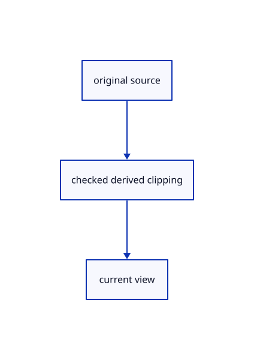

# 17.2.35 · Clip original sheet pens and integer entities

**Chapter 17 · GPU visibility, clipping and sections · Section 17.2 · Clipping half-spaces** · [Contents](contents.md)

**Typing: 11–22 minutes.** [Estimate](typing-load.md).

Clip original sheet pens and integer entities.

## Type

Continue from [Clip cached original point cloud discs](87x-clip-cached-original-point-cloud-discs.md). [Save or recover your work](recovery.md).

### 1. `src/sheet_pipeline.rs`

Connect matching source ownership and derived clipping.

Edit these blocks from bottom to top. Keep the surrounding lines unchanged.

<details>
<summary>Locate this block</summary>

```rust
    let model_layout = crate::gpu_layout::uniform(device, 96);
    let crop_layout = crate::gpu_layout::uniform(device, 80);
    let source = include_str!("sheet.wgsl");
    let shader = device.create_shader_module(wgpu::ShaderModuleDescriptor {
        label: Some("sheet pens"),
        source: wgpu::ShaderSource::Wgsl(source.into()),
    });
    let pick_shader = device.create_shader_module(wgpu::ShaderModuleDescriptor {
        label: Some("sheet original entities"),
        source: wgpu::ShaderSource::Wgsl(
            format!(
                "{source}\n{}\n{}",
                include_str!("pick_crop.wgsl"),
                include_str!("sheet_pick.wgsl")
            )
            .into(),
        ),
    });
    let layout = device.create_pipeline_layout(&wgpu::PipelineLayoutDescriptor {
        label: Some("sheet pens"),
        bind_group_layouts: &[Some(&view_layout), Some(&model_layout)],
        immediate_size: 0,
    });
    let pick_layout = device.create_pipeline_layout(&wgpu::PipelineLayoutDescriptor {
        label: Some("sheet entity picks"),
        bind_group_layouts: &[Some(&view_layout), Some(&model_layout), Some(&crop_layout)],
        immediate_size: 0,
    });
    let pipeline = make(
```

</details>

Replace it with:

```rust
    let model_layout = crate::gpu_layout::uniform(device, 96);
    let crop_layout = crate::gpu_layout::uniform(device, 80);
    let source = include_str!("sheet.wgsl");
    let clip_layout=crate::clipping_gpu::layout(device);
    let shader = device.create_shader_module(wgpu::ShaderModuleDescriptor {
        label: Some("sheet pens"),
        source: wgpu::ShaderSource::Wgsl(crate::clipping_gpu::source(source,2,0).into()),
    });
    let pick_shader = device.create_shader_module(wgpu::ShaderModuleDescriptor {
        label: Some("sheet original entities"),
        source: wgpu::ShaderSource::Wgsl(
            crate::clipping_gpu::source(&format!(
                "{source}\n{}\n{}",
                include_str!("pick_crop.wgsl"),
                include_str!("sheet_pick.wgsl")
            ),3,0)
            .into(),
        ),
    });
    let layout = device.create_pipeline_layout(&wgpu::PipelineLayoutDescriptor {
        label: Some("sheet pens"),
        bind_group_layouts: &[Some(&view_layout), Some(&model_layout),Some(&clip_layout)],
        immediate_size: 0,
    });
    let pick_layout = device.create_pipeline_layout(&wgpu::PipelineLayoutDescriptor {
        label: Some("sheet entity picks"),
        bind_group_layouts: &[Some(&view_layout), Some(&model_layout), Some(&crop_layout),Some(&clip_layout)],
        immediate_size: 0,
    });
    let pipeline = make(
```

<details>
<summary>Complete updated block reference</summary>

```rust
pub fn make(
    device: &wgpu::Device,
    layout: &wgpu::PipelineLayout,
    shader: &wgpu::ShaderModule,
    vertex: &str,
    fragment: &str,
    format: wgpu::TextureFormat,
    blend: Option<wgpu::BlendState>,
) -> wgpu::RenderPipeline {
    device.create_render_pipeline(&wgpu::RenderPipelineDescriptor {label:Some("sheet batch"),layout:Some(layout),vertex:wgpu::VertexState {module:shader,entry_point:Some(vertex),compilation_options:Default::default(),buffers:&[wgpu::VertexBufferLayout {array_stride:32,step_mode:wgpu::VertexStepMode::Instance,attributes:&wgpu::vertex_attr_array![0=>Float32x3,1=>Float32,2=>Float32x3,3=>Uint32]}]},fragment:Some(wgpu::FragmentState {module:shader,entry_point:Some(fragment),compilation_options:Default::default(),targets:&[Some(wgpu::ColorTargetState {format,blend,write_mask:wgpu::ColorWrites::ALL})]}),primitive:Default::default(),depth_stencil:Some(crate::depth::ink()),multisample:Default::default(),multiview_mask:None,cache:None})
}

pub fn pipelines(
    device: &wgpu::Device,
    format: wgpu::TextureFormat,
) -> (wgpu::RenderPipeline, wgpu::RenderPipeline) {
    let view_layout = crate::gpu_layout::uniform(device, 80);
    let model_layout = crate::gpu_layout::uniform(device, 96);
    let crop_layout = crate::gpu_layout::uniform(device, 80);
    let source = include_str!("sheet.wgsl");
    let clip_layout=crate::clipping_gpu::layout(device);
    let shader = device.create_shader_module(wgpu::ShaderModuleDescriptor {
        label: Some("sheet pens"),
        source: wgpu::ShaderSource::Wgsl(crate::clipping_gpu::source(source,2,0).into()),
    });
    let pick_shader = device.create_shader_module(wgpu::ShaderModuleDescriptor {
        label: Some("sheet original entities"),
        source: wgpu::ShaderSource::Wgsl(
            crate::clipping_gpu::source(&format!(
                "{source}\n{}\n{}",
                include_str!("pick_crop.wgsl"),
                include_str!("sheet_pick.wgsl")
            ),3,0)
            .into(),
        ),
    });
    let layout = device.create_pipeline_layout(&wgpu::PipelineLayoutDescriptor {
        label: Some("sheet pens"),
        bind_group_layouts: &[Some(&view_layout), Some(&model_layout),Some(&clip_layout)],
        immediate_size: 0,
    });
    let pick_layout = device.create_pipeline_layout(&wgpu::PipelineLayoutDescriptor {
        label: Some("sheet entity picks"),
        bind_group_layouts: &[Some(&view_layout), Some(&model_layout), Some(&crop_layout),Some(&clip_layout)],
        immediate_size: 0,
    });
    let pipeline = make(
        device,
        &layout,
        &shader,
        "vertex",
        "fragment",
        format,
        Some(wgpu::BlendState::ALPHA_BLENDING),
    );
    let pick = make(
        device,
        &pick_layout,
        &pick_shader,
        "pick_vertex",
        "pick_fragment",
        wgpu::TextureFormat::Rg32Uint,
        None,
    );
    (pipeline, pick)
}
```

</details>

<details>
<summary>Optional patch references</summary>

Use these original edit fragments when comparing a saved checkpoint. Apply the complete blocks above.

```text
--8<-- "journey/code/87y-clip-original-sheet-pens-and-integer-entities-01.rs"
```

```text
--8<-- "journey/code/87y-clip-original-sheet-pens-and-integer-entities-02.rs"
```

</details>

### 2. `src/sheet.wgsl`

Connect matching source ownership and derived clipping.

<details>
<summary>Locate the existing block</summary>

```wgsl
struct View { transform: mat4x4<f32>, size: vec2<f32>, density: f32, projection_y: f32 }
struct Model { transform: mat4x4<f32>, tint: vec4<f32>, ids: vec4<u32> }
@group(0) @binding(0) var<uniform> view: View;
@group(1) @binding(0) var<uniform> model: Model;
struct Output {
    @builtin(position) position: vec4<f32>,
    @location(0) colour: vec4<f32>,
    @location(1) @interpolate(linear) side: f32,
    @location(2) @interpolate(linear) half_width: f32,
    @location(7) @interpolate(flat) id: vec2<u32>,
}
fn geometry(start: vec3<f32>, end: vec3<f32>, radius: f32, packed: u32, vertex: u32, segment: u32) -> Output {
    var colour = vec4<f32>(f32(packed & 255u), f32((packed >> 8u) & 255u), f32((packed >> 16u) & 255u), f32(packed >> 24u)) / 255.0;
    if (model.ids.z == 1u) { colour = vec4<f32>(1.0, 0.68, 0.05, colour.a); }
    else if (model.tint.a > 0.0) { colour = vec4<f32>(model.tint.rgb, colour.a); }
    var output = Output(vec4<f32>(2.0,2.0,2.0,1.0), colour, 0.0, 0.0, vec2<u32>(model.ids.x, (0x80000000u | (model.ids.y + segment)) + 1u));
    var a = view.transform * model.transform * vec4<f32>(start, 1.0);
    var b = view.transform * model.transform * vec4<f32>(end, 1.0);
    if (a.z < 0.0 && b.z < 0.0) { return output; }
    if (a.z < 0.0) { a = mix(a,b,-a.z/(b.z-a.z)); }
    if (b.z < 0.0) { b = mix(b,a,-b.z/(a.z-b.z)); }
    if (a.w <= 0.0 || b.w <= 0.0) { return output; }
    let delta = (b.xy/b.w-a.xy/a.w)*view.size;
    let length2 = dot(delta,delta);
    if (length2 < 0.000001) { return output; }
    let normal = vec2<f32>(-delta.y,delta.x)*inverseSqrt(length2);
    let corners = array<vec2<f32>,6>(vec2<f32>(0.0,-1.0),vec2<f32>(1.0,-1.0),vec2<f32>(0.0,1.0),vec2<f32>(0.0,1.0),vec2<f32>(1.0,-1.0),vec2<f32>(1.0,1.0));
    let corner = corners[vertex];
    var position = select(a,b,corner.x>0.5);
    var half_width = view.density*0.5;
    // Sheet pens are authored in world millimetres; instance scale changes positions while the authored pen remains unchanged.
    if (radius>0.0) { half_width = radius*view.projection_y*view.size.y*0.5/position.w; }
    if (model.ids.z == 1u) {half_width=max(half_width,view.density);}
    let fade=select(1.0,max(half_width/0.5,0.5),half_width<0.5);colour.a=colour.a*fade;output.colour=colour;
    half_width=max(half_width,0.5);
    let extent = half_width+0.70711;
    output.position = vec4<f32>(position.xy+normal*extent*2.0/view.size*corner.y*position.w,position.zw);
    output.side = corner.y*extent; output.half_width = half_width;
    return output;
}
fn coverage(input:Output)->f32 {return input.colour.a*clamp(input.half_width+0.5-abs(input.side),0.0,1.0);}
@vertex
fn vertex(@location(0) start:vec3<f32>,@location(1) radius:f32,@location(2) end:vec3<f32>,@location(3) packed:u32,@builtin(vertex_index) v:u32,@builtin(instance_index) i:u32)->Output {return geometry(start,end,radius,packed,v,i);}
@fragment
fn fragment(input:Output)->@location(0) vec4<f32> {return vec4<f32>(input.colour.rgb,coverage(input));}
```

</details>

Edit the existing block to match this code; keep unchanged lines:

```wgsl
struct View { transform: mat4x4<f32>, size: vec2<f32>, density: f32, projection_y: f32 }
struct Model { transform: mat4x4<f32>, tint: vec4<f32>, ids: vec4<u32> }
@group(0) @binding(0) var<uniform> view: View;
@group(1) @binding(0) var<uniform> model: Model;
struct Output {
    @builtin(position) position: vec4<f32>,
    @location(0) colour: vec4<f32>,
    @location(1) @interpolate(linear) side: f32,
    @location(2) @interpolate(linear) half_width: f32,
    @location(7) @interpolate(flat) id: vec2<u32>,
    @location(8) original_clip:vec4<f32>,
}
fn geometry(start: vec3<f32>, end: vec3<f32>, radius: f32, packed: u32, vertex: u32, segment: u32) -> Output {
    var colour = vec4<f32>(f32(packed & 255u), f32((packed >> 8u) & 255u), f32((packed >> 16u) & 255u), f32(packed >> 24u)) / 255.0;
    if (model.ids.z == 1u) { colour = vec4<f32>(1.0, 0.68, 0.05, colour.a); }
    else if (model.tint.a > 0.0) { colour = vec4<f32>(model.tint.rgb, colour.a); }
    var output = Output(vec4<f32>(2.0,2.0,2.0,1.0), colour, 0.0, 0.0, vec2<u32>(model.ids.x, (0x80000000u | (model.ids.y + segment)) + 1u),vec4<f32>(0.0,0.0,0.0,1.0));
    var a = view.transform * model.transform * vec4<f32>(start, 1.0);
    var b = view.transform * model.transform * vec4<f32>(end, 1.0);
    if (a.z < 0.0 && b.z < 0.0) { return output; }
    if (a.z < 0.0) { a = mix(a,b,-a.z/(b.z-a.z)); }
    if (b.z < 0.0) { b = mix(b,a,-b.z/(a.z-b.z)); }
    if (a.w <= 0.0 || b.w <= 0.0) { return output; }
    let delta = (b.xy/b.w-a.xy/a.w)*view.size;
    let length2 = dot(delta,delta);
    if (length2 < 0.000001) { return output; }
    let normal = vec2<f32>(-delta.y,delta.x)*inverseSqrt(length2);
    let corners = array<vec2<f32>,6>(vec2<f32>(0.0,-1.0),vec2<f32>(1.0,-1.0),vec2<f32>(0.0,1.0),vec2<f32>(0.0,1.0),vec2<f32>(1.0,-1.0),vec2<f32>(1.0,1.0));
    let corner = corners[vertex];
    var position = select(a,b,corner.x>0.5);
    var half_width = view.density*0.5;
    // Sheet pens are authored in world millimetres; instance scale changes positions while the authored pen remains unchanged.
    if (radius>0.0) { half_width = radius*view.projection_y*view.size.y*0.5/position.w; }
    if (model.ids.z == 1u) {half_width=max(half_width,view.density);}
    let fade=select(1.0,max(half_width/0.5,0.5),half_width<0.5);colour.a=colour.a*fade;output.colour=colour;
    half_width=max(half_width,0.5);
    let extent = half_width+0.70711;
    output.position = vec4<f32>(position.xy+normal*extent*2.0/view.size*corner.y*position.w,position.zw);
    output.original_clip=position;
    output.side = corner.y*extent; output.half_width = half_width;
    return output;
}
fn coverage(input:Output)->f32 {if(clip_cut_ndc(0u,input.original_clip.xyz/input.original_clip.w)){discard;}return input.colour.a*clamp(input.half_width+0.5-abs(input.side),0.0,1.0);}
@vertex
fn vertex(@location(0) start:vec3<f32>,@location(1) radius:f32,@location(2) end:vec3<f32>,@location(3) packed:u32,@builtin(vertex_index) v:u32,@builtin(instance_index) i:u32)->Output {return geometry(start,end,radius,packed,v,i);}
@fragment
fn fragment(input:Output)->@location(0) vec4<f32> {return vec4<f32>(input.colour.rgb,coverage(input));}
```

<details>
<summary>Optional patch references</summary>

Use these original edit fragments when comparing a saved checkpoint. Apply the complete blocks above.

```text
--8<-- "journey/code/87y-clip-original-sheet-pens-and-integer-entities-03.rs"
```

```text
--8<-- "journey/code/87y-clip-original-sheet-pens-and-integer-entities-04.rs"
```

```text
--8<-- "journey/code/87y-clip-original-sheet-pens-and-integer-entities-05.rs"
```

</details>

### 3. `src/sheet_gpu.rs`

Connect matching source ownership and derived clipping.

<details>
<summary>Locate the existing block</summary>

```rust
        }
    }
    pub fn pick(&self, pass: &mut wgpu::RenderPass<'_>, crop: &wgpu::BindGroup) {
        pass.set_pipeline(&self.pick);
        pass.set_bind_group(0, &self.group, &[]);
        pass.set_bind_group(2, crop, &[]);
```

</details>

Edit the existing block to match this code; keep unchanged lines:

```rust
--8<-- "journey/code/87y-clip-original-sheet-pens-and-integer-entities-06.rs"
```

### 4. `src/pick_encode.rs`

Connect matching source ownership and derived clipping.

<details>
<summary>Locate the existing block</summary>

```rust
            let mut pass=encoder.begin_render_pass(&wgpu::RenderPassDescriptor{label:Some("other original integer owners"),color_attachments:&[Some(wgpu::RenderPassColorAttachment{view:&image.colour,depth_slice:None,resolve_target:None,ops:wgpu::Operations{load:wgpu::LoadOp::Load,store:wgpu::StoreOp::Store}})],depth_stencil_attachment:Some(wgpu::RenderPassDepthStencilAttachment{view:&image.depth,depth_ops:Some(wgpu::Operations{load:wgpu::LoadOp::Load,store:wgpu::StoreOp::Store}),stencil_ops:None}),..Default::default()});
            if let Some(clouds)=clouds {clouds.pick(ctx,&mut pass,window,mode);}
            if let Some(sheets)=sheets {sheets.pick(&mut pass,crop_group);}
            if let Some(text)=text {text.draw_ids(&mut pass,crop_group);}
        }
```

</details>

Edit the existing block to match this code; keep unchanged lines:

```rust
--8<-- "journey/code/87y-clip-original-sheet-pens-and-integer-entities-07.rs"
```

## Run and check

Run this from `session_viewer` to select the fixed dependency versions and install supplied binary assets. It updates Cargo.lock and preserves the previous lock. It does not write implementation code:

```sh
npm --prefix ../session_tests run course -- dependencies 17.2.35
```

In your project:

```sh
cd workspace/journey
REGEN_PROTO=0 cargo build --lib --locked --target wasm32-unknown-unknown -j1
REGEN_PROTO=0 CARGO_BUILD_JOBS=1 trunk serve --port 8780
```

Open `http://127.0.0.1:8780/`. Keep an existing Trunk server running; saving rebuilds it.


### Recorded visual result

**Previous native render — current verification pending.**

Actual finite visibility keeps the front red originals and blue solid visible while suppressing the hidden rear stroke.


*This recorded image predates a source or checker change. Rebuild this checkpoint before using it as current evidence; browser controls require separate acceptance.*

This reference image is shared with [17.2.5 · Gather six visible original world planes](87a-gather-six-visible-original-world-planes.md). It does not demonstrate a new feature by itself.

<details>
<summary>Code explanation and diagram</summary>


original source → checked derived clipping → current view.



Does a cropped pick lose the original sheet centerline?

No. Retain its un-cropped homogeneous position, authored pen width, original source entity and parent placement.

Study estimate, including typing and experiments: 0.5–1 hours.

</details>

<details>
<summary>Optional experiment</summary>

Compare a segment crossing a cut, before-color picks and unchanged original columns.

</details>

<details>
<summary>Check and save your work</summary>

Restore experimental edits, then run from `session_viewer`:

```sh
npm --prefix ../session_tests run course -- check 17.2.35
npm --prefix ../session_tests run course -- save 17.2.35
```

Source comparison leaves your project untouched. [Save and recovery instructions](recovery.md).

</details>

<details>
<summary>Viewer coverage and verification</summary>


The browser contract is supplied and requires an actual enabled browser. Native software-GPU pixels and picks do not measure Lenovo performance.

[Full validation scope](release.md).

To reproduce the scripted acceptance of the reference checkpoint, run from `session_viewer` with the [course bundle server](release.md#reproduce) running on port 8781:

```sh
npm --prefix ../session_tests run course -- capture 17.2.35
```

This uses the verified reference bundle; it does not check or change your typed project.

</details>
