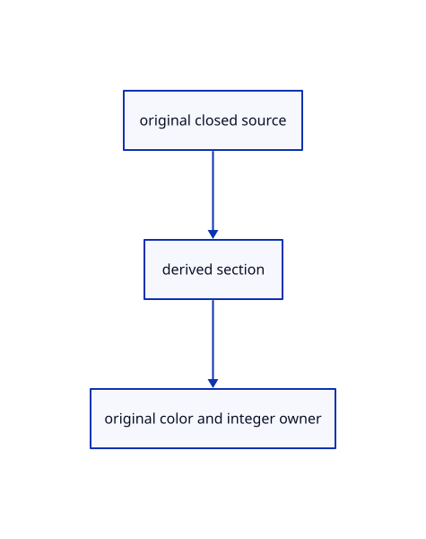

# 17.3.1 · Classify original closedness and winding

**Chapter 17 · GPU visibility, clipping and sections · Section 17.3 · Closed sections and cap rendering** · [Contents](contents.md)

**Typing: 21–42 minutes.** [Estimate](typing-load.md).

Pair each original mesh edge with the opposite face direction to detect a closed shell.

## Type

Continue from [Exercise original clipping color and picking](87ab-exercise-original-clipping-color-and-picking.md). [Save or recover your work](recovery.md).

### 1. `src/solid_orientation.rs`

Type the complete original geometry query and reuse its current consumer.

Create the file and type:

```rust
--8<-- "journey/code/88-copy-original-closedness-and-winding-typed-solid_orientation.rs"
```

<details>
<summary>Supplied validation fixture</summary>

Copy this supplied authoring fixture once. Continue with the browser build below; the course does not require running native tests.

### 2. `src/solid_orientation.rs`

Supply only the unchanged original geometry validation fixtures.

<details>
<summary>Locate the existing block</summary>

```text
use session_rust::Mesh;
use crate::clipping_geometry::{dot,cross};
pub const CLOSED:u32=8192;pub const INWARD:u32=16384;
pub fn solid_orientation(mesh: &Mesh) -> Option<bool> {
    if mesh.vertex.is_empty() {
        return None;
    }

    // hole rings: the kernel decides
    if !mesh.face_holes.is_empty() {
        return mesh.is_closed().then(|| six_volume(mesh) < 0.0);
    }

    let mut edges: Vec<u64> = Vec::with_capacity(mesh.face.values().map(Vec::len).sum());

    for corners in mesh.face.values() {
        for (i, &a) in corners.iter().enumerate() {
            let b = corners[(i + 1) % corners.len()];
            let (lo, hi) = (a.min(b), a.max(b));

            if lo == hi {
                continue;
            }

            // keys too big to pack: the kernel decides
            if hi >= 1 << 31 {
                return mesh.is_closed().then(|| six_volume(mesh) < 0.0);
            }

            // the edge, then which way this face walks it
            edges.push((lo as u64) << 33 | (hi as u64) << 1 | u64::from(a > b));
        }
    }

    edges.sort_unstable();

    for run in edges.chunk_by(|a, b| a >> 1 == b >> 1) {
        let forward = run.iter().filter(|edge| *edge & 1 == 0).count();

        if forward * 2 != run.len() {
            return None;
        }
    }

    Some(six_volume(mesh) < 0.0)
}
pub fn solid_flags(solid: Option<bool>) -> u32 {
    match solid {
        Some(true) => CLOSED | INWARD,
        Some(false) => CLOSED,
        None => 0,
    }
}
fn six_volume(mesh: &Mesh) -> f64 {
    let mut volume = 0.0;

    for corners in mesh.face.values() {
        let Some(first) = corners.first().and_then(|key| mesh.vertex.get(key)) else {
            continue;
        };
        let a = [first.x, first.y, first.z];

        for pair in corners[1..].windows(2) {
            if let (Some(b), Some(c)) = (mesh.vertex.get(&pair[0]), mesh.vertex.get(&pair[1])) {
                volume += dot(a, cross([b.x, b.y, b.z], [c.x, c.y, c.z]));
            }
        }
    }

    volume
}
```

</details>

After that block, append this supplied code:

```text
--8<-- "journey/code/88-copy-original-closedness-and-winding-typed-solid_orientation-fixtures.rs" skip=2037
```

</details>

### 3. `src/lib.rs`

Register the completed section component.

<details>
<summary>Locate the existing block</summary>

```rust
#[cfg(test)]
mod clipping_uniform_tests;
```

</details>

After that block, type:

```rust
--8<-- "journey/code/88-copy-original-closedness-and-winding-02.rs" skip=41
```

## Run and check

Run this from `session_viewer` to select the fixed dependency versions and install supplied binary assets. It updates Cargo.lock and preserves the previous lock. It does not write implementation code:

```sh
npm --prefix ../session_tests run course -- dependencies 17.3.1
```

In your project:

```sh
cd workspace/journey
REGEN_PROTO=0 cargo build --lib --locked --target wasm32-unknown-unknown -j1
REGEN_PROTO=0 CARGO_BUILD_JOBS=1 trunk serve --port 8780
```

Open `http://127.0.0.1:8780/`. Keep an existing Trunk server running; saving rebuilds it.


### Recorded visual result

**Previous native render — current verification pending.**

Actual color clipping removes the right halves while retaining original geometry on the left.


*This recorded image predates a source or checker change. Rebuild this checkpoint before using it as current evidence; browser controls require separate acceptance.*

<details>
<summary>Code explanation and diagram</summary>

Pair each original mesh edge with the opposite face direction to detect a closed shell. Reuse the existing clipping dot and cross helpers to determine its signed volume and inward winding. Defer hole rings and oversized edge keys to the kernel, then encode the existing cap flags.

original closed source → derived section → original color and integer owner.



Does a display triangle soup prove a solid is closed?

No. Verify the original topology and its winding; derived boundaries alone cannot decide which sections should fill.

Study estimate, including typing and experiments: 0.5–1 hours.

</details>

<details>
<summary>Optional experiment</summary>

Inspect outward, inward, open and mixed-winding fixtures. Compare closedness flags with the unchanged original faces.

</details>

<details>
<summary>Check and save your work</summary>

Restore experimental edits, then run from `session_viewer`:

```sh
npm --prefix ../session_tests run course -- check 17.3.1
npm --prefix ../session_tests run course -- save 17.3.1
```

Source comparison leaves your project untouched. [Save and recovery instructions](recovery.md).

</details>

<details>
<summary>Viewer coverage and verification</summary>


The supplied browser exercise requires an actual browser. Native software-GPU rendering does not measure Lenovo performance.

[Full validation scope](release.md).

To reproduce the scripted acceptance of the reference checkpoint, run from `session_viewer` with the [course bundle server](release.md#reproduce) running on port 8781:

```sh
npm --prefix ../session_tests run course -- capture 17.3.1
```

This uses the verified reference bundle; it does not check or change your typed project.

</details>
