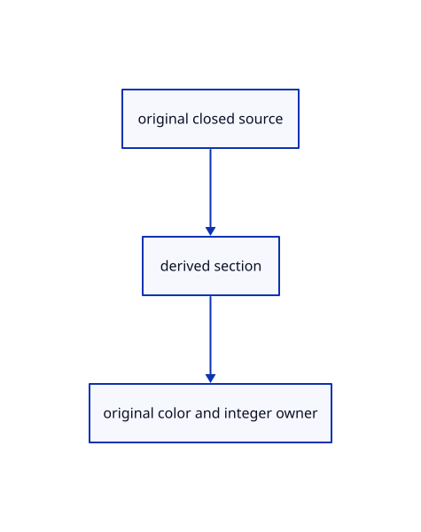

# 17.3.29 · Hide original ink behind visible caps

**Chapter 17 · GPU visibility, clipping and sections · Section 17.3 · Closed sections and cap rendering** · [Contents](contents.md)

**Typing: 7–13 minutes.** [Estimate](typing-load.md).

Hide original ink behind visible caps.

## Type

Continue from [Retain ink exactly on sloping sections](88z-retain-ink-exactly-on-sloping-sections.md). [Save or recover your work](recovery.md).

### 1. `src/finite_visibility.wgsl`

Apply section visibility at the original finite centerline.

<details>
<summary>Locate the existing block</summary>

```wgsl
// The tutorial still converts forward depth; allow two float rounding units until the reversed camera connects.
const FINITE_GRID:bool=false;
@group(1) @binding(0) var<storage,read> finite_projected:array<ProjectedTriangle>;
@group(1) @binding(1) var<storage,read> finite_tiles:array<vec4<u32>>;
@group(1) @binding(2) var finite_depth:texture_depth_2d;
fn finite_physical(pixel:vec2<f32>,depth:f32,tolerance:f32)->bool{let at=finite_depth_pixel(pixel);let size=vec2<i32>(textureDimensions(finite_depth));if(any(at<vec2<i32>(0))||any(at>=size)){return false;}let z=1.0-textureLoad(finite_depth,at,0);return select(z<=depth+tolerance,z<depth-tolerance,FINITE_GRID);}
fn finite_screen(p:vec4<f32>)->vec2<f32>{return(p.xy/p.w*vec2<f32>(0.5,-0.5)+0.5)*view.size;}
fn finite_axis(a:vec4<f32>,b:vec4<f32>)->vec4<f32>{return vec4<f32>(finite_screen(a),finite_screen(b));}
fn finite_visible(pixel:vec2<f32>,axis:vec4<f32>,depths:vec2<f32>,flags:u32)->bool{
 let delta=axis.zw-axis.xy;let length2=dot(delta,delta);let t=clamp(dot(pixel-axis.xy,delta)/max(length2,1e-20),0.0,1.0);let at=axis.xy+t*delta;let depth=mix(depths.x,depths.y,t);let relative=abs(depth)*1.9073486e-6+abs(1.0-depth)*2.3841858e-7;
 if(clip_active()&&clip_cut_ndc(flags,clip_ndc(at,view.size,1.0-depth))){return false;}
 if(any(at<vec2<f32>(0.0))||any(at>=view.size)){return finite_physical(pixel,depth,relative);}
 if(finite_tiles[0].x==0u){return finite_physical(pixel,depth,relative);}
 let span=f32(visibility_tile_span_of(u32(view.size.x),u32(view.size.y)));let size=vec2<u32>(ceil(view.size/span));let cell=vec2<u32>(at/span);let head=finite_tiles[1u+cell.y*size.x+cell.x];
 if(head.w!=0u||head.z!=head.x){return finite_physical(pixel,depth,relative);}
 for(var i=0u;i<head.x;i++){
  let offset=head.y+i*2u;let nearest=bitcast<f32>(finite_tiles[(offset+1u)/4u][(offset+1u)%4u]);if(nearest<depth-relative||(!FINITE_GRID&&nearest<=depth+relative)){continue;}
  let primitive=finite_tiles[offset/4u][offset%4u];if(primitive==0u||primitive>arrayLength(&finite_projected)){continue;}
  let triangle=finite_projected[primitive-1u];let hit=projected_triangle_at(triangle,at);let tolerance=relative+0.00390625*(abs(triangle.gradient.x)+abs(triangle.gradient.y));
  if(hit.y>0.5&&!(clip_active()&&clip_cut_ndc(0u,clip_ndc(at,view.size,1.0-hit.x)))&&select(hit.x>depth+tolerance,hit.x>=depth-tolerance,FINITE_GRID)){return false;}
 }
 return true;
}
```

</details>

Edit the existing block to match this code; keep unchanged lines:

```wgsl
// The tutorial still converts forward depth; allow two float rounding units until the reversed camera connects.
const FINITE_GRID:bool=false;
@group(1) @binding(0) var<storage,read> finite_projected:array<ProjectedTriangle>;
@group(1) @binding(1) var<storage,read> finite_tiles:array<vec4<u32>>;
@group(1) @binding(2) var finite_depth:texture_depth_2d;
@group(1) @binding(3) var finite_sections:texture_2d<f32>;
fn finite_section(pixel:vec2<f32>,depth:f32,tolerance:f32)->bool{
 let at=finite_depth_pixel(pixel);let size=vec2<i32>(textureDimensions(finite_sections));if(any(at<vec2<i32>(0))||any(at>=size)){return true;}let cap=textureLoad(finite_sections,at,0).xy;if(cap.y<0.5){return true;}let plane=(u32(cap.y)-1u)&7u;let z=1.0-clip_plane_depth(plane,clip_ndc(pixel,view.size,0.0).xy);return select(z<=depth+tolerance,z<depth-tolerance,FINITE_GRID);
}
fn finite_physical(pixel:vec2<f32>,depth:f32,tolerance:f32)->bool{let at=finite_depth_pixel(pixel);let size=vec2<i32>(textureDimensions(finite_depth));if(any(at<vec2<i32>(0))||any(at>=size)){return false;}let z=1.0-textureLoad(finite_depth,at,0);return select(z<=depth+tolerance,z<depth-tolerance,FINITE_GRID);}
fn finite_screen(p:vec4<f32>)->vec2<f32>{return(p.xy/p.w*vec2<f32>(0.5,-0.5)+0.5)*view.size;}
fn finite_axis(a:vec4<f32>,b:vec4<f32>)->vec4<f32>{return vec4<f32>(finite_screen(a),finite_screen(b));}
fn finite_visible(pixel:vec2<f32>,axis:vec4<f32>,depths:vec2<f32>,flags:u32)->bool{
 let delta=axis.zw-axis.xy;let length2=dot(delta,delta);let t=clamp(dot(pixel-axis.xy,delta)/max(length2,1e-20),0.0,1.0);let at=axis.xy+t*delta;let depth=mix(depths.x,depths.y,t);let relative=abs(depth)*1.9073486e-6+abs(1.0-depth)*2.3841858e-7;
 if(!finite_section(at,depth,relative)){return false;}
 if(clip_active()&&clip_cut_ink_ndc(flags,clip_ndc(at,view.size,1.0-depth))){return false;}
 if(any(at<vec2<f32>(0.0))||any(at>=view.size)){return finite_physical(pixel,depth,relative);}
 if(finite_tiles[0].x==0u){return finite_physical(pixel,depth,relative);}
 let span=f32(visibility_tile_span_of(u32(view.size.x),u32(view.size.y)));let size=vec2<u32>(ceil(view.size/span));let cell=vec2<u32>(at/span);let head=finite_tiles[1u+cell.y*size.x+cell.x];
 if(head.w!=0u||head.z!=head.x){return finite_physical(pixel,depth,relative);}
 for(var i=0u;i<head.x;i++){
  let offset=head.y+i*2u;let nearest=bitcast<f32>(finite_tiles[(offset+1u)/4u][(offset+1u)%4u]);if(nearest<depth-relative||(!FINITE_GRID&&nearest<=depth+relative)){continue;}
  let primitive=finite_tiles[offset/4u][offset%4u];if(primitive==0u||primitive>arrayLength(&finite_projected)){continue;}
  let triangle=finite_projected[primitive-1u];let hit=projected_triangle_at(triangle,at);let tolerance=relative+0.00390625*(abs(triangle.gradient.x)+abs(triangle.gradient.y));
  if(hit.y>0.5&&!(clip_active()&&clip_cut_ndc(0u,clip_ndc(at,view.size,1.0-hit.x)))&&select(hit.x>depth+tolerance,hit.x>=depth-tolerance,FINITE_GRID)){return false;}
 }
 return true;
}
```

<details>
<summary>Optional patch references</summary>

Use these original edit fragments when comparing a saved checkpoint. Apply the complete blocks above.

```text
--8<-- "journey/code/88aa-hide-original-ink-behind-visible-caps-01.rs"
```

```text
--8<-- "journey/code/88aa-hide-original-ink-behind-visible-caps-02.rs"
```

</details>

## Run and check

Run this from `session_viewer` to select the fixed dependency versions and install supplied binary assets. It updates Cargo.lock and preserves the previous lock. It does not write implementation code:

```sh
npm --prefix ../session_tests run course -- dependencies 17.3.29
```

In your project:

```sh
cd workspace/journey
REGEN_PROTO=0 cargo build --lib --locked --target wasm32-unknown-unknown -j1
REGEN_PROTO=0 CARGO_BUILD_JOBS=1 trunk serve --port 8780
```

Open `http://127.0.0.1:8780/`. Keep an existing Trunk server running; saving rebuilds it.


### Recorded visual result

**Previous native render — current verification pending.**

Actual color clipping removes the right halves while retaining original geometry on the left.


*This recorded image predates a source or checker change. Rebuild this checkpoint before using it as current evidence; browser controls require separate acceptance.*

This reference image is shared with [17.2.38 · Exercise original clipping color and picking](87ab-exercise-original-clipping-color-and-picking.md). It does not demonstrate a new feature by itself.

<details>
<summary>Code explanation and diagram</summary>


original closed source → derived section → original color and integer owner.



Should a sloping section compare a rounded neighboring pixel depth?

No. Recover the visible plane address and evaluate its analytic depth at the original centerline point.

Study estimate, including typing and experiments: 0.5–1 hours.

</details>

<details>
<summary>Optional experiment</summary>

Compare hidden lines/points and full-width coplanar ink, including the cropped pick origin.

</details>

<details>
<summary>Check and save your work</summary>

Restore experimental edits, then run from `session_viewer`:

```sh
npm --prefix ../session_tests run course -- check 17.3.29
npm --prefix ../session_tests run course -- save 17.3.29
```

Source comparison leaves your project untouched. [Save and recovery instructions](recovery.md).

</details>

<details>
<summary>Viewer coverage and verification</summary>


The supplied browser exercise requires an actual browser. Native software-GPU rendering does not measure Lenovo performance.

[Full validation scope](release.md).

To reproduce the scripted acceptance of the reference checkpoint, run from `session_viewer` with the [course bundle server](release.md#reproduce) running on port 8781:

```sh
npm --prefix ../session_tests run course -- capture 17.3.29
```

This uses the verified reference bundle; it does not check or change your typed project.

</details>
