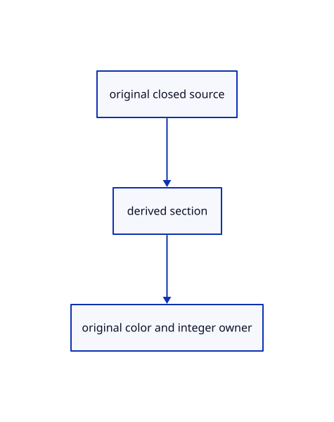

# 17.3.31 · Observe actual section owners and errors

**Chapter 17 · GPU visibility, clipping and sections · Section 17.3 · Closed sections and cap rendering** · [Contents](contents.md)

**Typing: 5–9 minutes.** [Estimate](typing-load.md).

Observe actual section owners and errors.

## Type

Continue from [Pick sections before any color frame](88ab-pick-sections-before-any-color-frame.md). [Save or recover your work](recovery.md).

### 1. `src/browser.rs`

Expose actual current section diagnostics.

<details>
<summary>Locate the existing block</summary>

```rust
    canvas.set_attribute("data-gizmo",&serde_json::json!({"origin":editor.gizmo_origin(),"active":editor.gizmo_active(),"pointer":editor.gizmo_edit.as_ref().and_then(|e|e.pointer),"typing":editor.gizmo_edit.as_ref().and_then(|e|e.gizmo.typing).map(|h|h.title()),"matrix":editor.gizmo_edit.as_ref().map(|e|e.preview.matrix()),"gpu":renderer.gizmo_usage()}).to_string())?;
    canvas.set_attribute("data-row-placements", &serde_json::to_string(&placements).map_err(|error| JsValue::from_str(&error.to_string()))?)?;
    canvas.set_attribute("data-clipping",&serde_json::json!({"usage":renderer.clipping_usage(),"ink_flags":renderer.clipping_ink_bytes(),"error":renderer.clipping_error(),"rows":crate::clipping_rows::current(&editor.scene).ok().map(|rows|rows.iter().map(|r|serde_json::json!({"id":r.id.value(),"normal":r.plane.normal,"offset":r.plane.offset})).collect::<Vec<_>>())}).to_string())?;
    canvas.set_attribute("data-triangle-tiles",&serde_json::to_string(&renderer.tile_usage()).unwrap())?;
    canvas.set_attribute("data-pick-gpu", &serde_json::to_string(&renderer.pick_usage()).unwrap())?;
```

</details>

Edit the existing block to match this code; keep unchanged lines:

```rust
--8<-- "journey/code/88ac-observe-actual-section-owners-and-errors-01.rs"
```

## Run and check

Run this from `session_viewer` to select the fixed dependency versions and install supplied binary assets. It updates Cargo.lock and preserves the previous lock. It does not write implementation code:

```sh
npm --prefix ../session_tests run course -- dependencies 17.3.31
```

In your project:

```sh
cd workspace/journey
REGEN_PROTO=0 cargo build --lib --locked --target wasm32-unknown-unknown -j1
REGEN_PROTO=0 CARGO_BUILD_JOBS=1 trunk serve --port 8780
```

Open `http://127.0.0.1:8780/`. Keep an existing Trunk server running; saving rebuilds it.


### Recorded visual result

**Previous native render — current verification pending.**

Actual color clipping removes the right halves while retaining original geometry on the left.


*This recorded image predates a source or checker change. Rebuild this checkpoint before using it as current evidence; browser controls require separate acceptance.*

This reference image is shared with [17.2.38 · Exercise original clipping color and picking](87ab-exercise-original-clipping-color-and-picking.md). It does not demonstrate a new feature by itself.

<details>
<summary>Code explanation and diagram</summary>


original closed source → derived section → original color and integer owner.



Do pass counts prove Lenovo speed?

No. They expose section allocation and original owner state; hardware rotation and zoom need measured timings.

Study estimate, including typing and experiments: 0.5–1 hours.

</details>

<details>
<summary>Optional experiment</summary>

Compare On/Off, cache checks, release and bounded-pick failures.

</details>

<details>
<summary>Check and save your work</summary>

Restore experimental edits, then run from `session_viewer`:

```sh
npm --prefix ../session_tests run course -- check 17.3.31
npm --prefix ../session_tests run course -- save 17.3.31
```

Source comparison leaves your project untouched. [Save and recovery instructions](recovery.md).

</details>

<details>
<summary>Viewer coverage and verification</summary>


The supplied browser exercise requires an actual browser. Native software-GPU rendering does not measure Lenovo performance.

[Full validation scope](release.md).

To reproduce the scripted acceptance of the reference checkpoint, run from `session_viewer` with the [course bundle server](release.md#reproduce) running on port 8781:

```sh
npm --prefix ../session_tests run course -- capture 17.3.31
```

This uses the verified reference bundle; it does not check or change your typed project.

</details>
