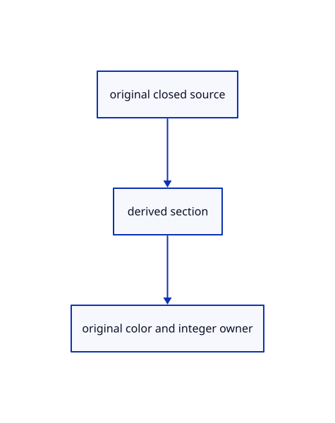

# 17.3.32 · Exercise original sections bores and ink

**Chapter 17 · GPU visibility, clipping and sections · Section 17.3 · Closed sections and cap rendering** · [Contents](contents.md)

**Typing: 1–2 minutes.** [Estimate](typing-load.md).

Exercise original sections bores and ink.

## Type

Continue from [Observe actual section owners and errors](88ac-observe-actual-section-owners-and-errors.md). [Save or recover your work](recovery.md).

<details>
<summary>Supplied validation fixture</summary>

Copy this supplied authoring fixture once. Continue with the browser build below; the course does not require running native tests.

### 1. `src/cap_gpu_tests.rs`

Copy supplied actual native section fixtures.

Copy this supplied file:

```text
--8<-- "journey/code/88ad-exercise-original-sections-bores-and-ink-01.rs"
```

</details>

<details>
<summary>Supplied validation fixture</summary>

Copy this supplied authoring fixture once. Continue with the browser build below; the course does not require running native tests.

### 2. `src/lib.rs`

Register the completed section component.

<details>
<summary>Locate the existing block</summary>

```text

pub mod caps_gpu;
```

</details>

After that block, append this supplied code:

```text
--8<-- "journey/code/88ad-exercise-original-sections-bores-and-ink-02.rs" skip=19
```

</details>

<details>
<summary>Supplied validation fixture</summary>

Copy this supplied authoring fixture once. Continue with the browser build below; the course does not require running native tests.

### 3. `src/cap_pick_tests.rs`

Copy actual original-owner section fixtures inside the Scene test module.

Copy this supplied file:

```text
--8<-- "journey/code/88ad-exercise-original-sections-bores-and-ink-03.rs"
```

</details>

### 4. `src/scene.rs`

Register the supplied Scene-private ID fixtures.

<details>
<summary>Locate the existing block</summary>

```rust
        row.prepared=prepared;Ok(())
    }
}
```

</details>

After that block, type:

```rust
--8<-- "journey/code/88ad-exercise-original-sections-bores-and-ink-04.rs" skip=45
```

## Run and check

Run this from `session_viewer` to select the fixed dependency versions and install supplied binary assets. It updates Cargo.lock and preserves the previous lock. It does not write implementation code:

```sh
npm --prefix ../session_tests run course -- dependencies 17.3.32
```

In your project:

```sh
cd workspace/journey
REGEN_PROTO=0 cargo build --lib --locked --target wasm32-unknown-unknown -j1
REGEN_PROTO=0 CARGO_BUILD_JOBS=1 trunk serve --port 8780
```

Open `http://127.0.0.1:8780/`. Keep an existing Trunk server running; saving rebuilds it.

A grey section through the original red closed solid retains a circular bore and black boundaries.

### Recorded visual result

**Previous native render — current verification pending.**

Actual closed-solid section fill preserves the original bore and element ownership.


*This recorded image predates a source or checker change. Rebuild this checkpoint before using it as current evidence; browser controls require separate acceptance.*

<details>
<summary>Code explanation and diagram</summary>


original closed source → derived section → original color and integer owner.



What proves a section is attached to its original element?

Actual integer readback returns that element before color. Pixel checks preserve bores and hide retained ink behind locked caps.

Study estimate, including typing and experiments: 0.5–1 hours.

</details>

<details>
<summary>Optional experiment</summary>

Run closed/open, mirrored/inward, nested/high-ID, two-plane, bore, horizontal/sloping width and empty-release fixtures.

</details>

<details>
<summary>Check and save your work</summary>

Restore experimental edits, then run from `session_viewer`:

```sh
npm --prefix ../session_tests run course -- check 17.3.32
npm --prefix ../session_tests run course -- save 17.3.32
```

Source comparison leaves your project untouched. [Save and recovery instructions](recovery.md).

</details>

<details>
<summary>Viewer coverage and verification</summary>

Retain maintained closedness, winding, crossing bounds and hatch recipes. Adapt the earlier forward-depth renderer through explicit color and integer section owners. Caps keep original element IDs and source geometry; full current primitive/MRT/selection-mask/MSAA integration follows in the later 96-series renderer-integration lessons, with GPU rebasing in95.

The browser reference uses an image-only 2× render scale before canvas composition at the original output size. It improves section-ink coverage while retaining this lesson’s single-sample shader.

Retain all earlier checks. Supplied section fixtures read actual color and integer targets for closed/open sources, high-u32 IDs before color, nested and locked owners, hidden ink, coplanar and sloping widths, mirrored/inward sources, CAD bores, two-plane corners and release.

The supplied browser exercise requires an actual browser. Native software-GPU rendering does not measure Lenovo performance.

[Full validation scope](release.md).

To reproduce the scripted acceptance of the reference checkpoint, run from `session_viewer` with the [course bundle server](release.md#reproduce) running on port 8781:

```sh
npm --prefix ../session_tests run course -- capture 17.3.32
```

This uses the verified reference bundle; it does not check or change your typed project.

</details>
