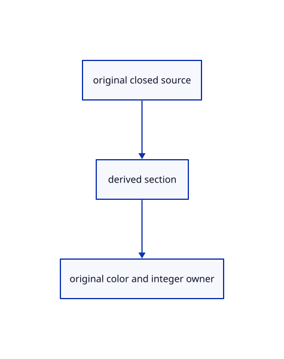

# 17.3.3 · Bound conservative plane crossings

**Chapter 17 · GPU visibility, clipping and sections · Section 17.3 · Closed sections and cap rendering** · [Contents](contents.md)

**Typing: 8–16 minutes.** [Estimate](typing-load.md).

Project the original box half-extents onto the clipping-plane normal to bound its reach. Compare the center distance with that reach and the existing rounding allowance. Keep the check conservative so a face near the plane is not incorrectly skipped.

## Type

Continue from [Cache verified original solids weakly](88a-cache-verified-original-solids-weakly.md). [Save or recover your work](recovery.md).

### 1. `src/cap_bounds.rs`

Type the complete original geometry query and reuse its current consumer.

Create the file and type:

```rust
--8<-- "journey/code/88b-copy-conservative-plane-crossing-bounds-typed-cap_bounds.rs"
```

<details>
<summary>Supplied validation fixture</summary>

Copy this supplied authoring fixture once. Continue with the browser build below; the course does not require running native tests.

### 2. `src/cap_bounds.rs`

Supply only the unchanged original geometry validation fixtures.

<details>
<summary>Locate the existing block</summary>

```text
use session_rust::AABB;
use crate::clipping_geometry::ClipPlane;
impl ClipPlane{
    pub fn crosses(&self, b: &AABB, anchor: [f64; 3]) -> bool {
        let reach =
            self.normal[0].abs() * b.hx + self.normal[1].abs() * b.hy + self.normal[2].abs() * b.hz;
        let center = [b.cx, b.cy, b.cz];
        let size = b.hx + b.hy + b.hz;
        let local: f64 = (0..3).map(|i| (center[i] - anchor[i]).abs()).sum();
        let world: f64 = center.iter().map(|v| v.abs()).sum();
        // 32 times CLIP_SLACK in clip.wgsl, plus the f32 rounding of the vertices themselves
        let slack =
            (local + size + self.distance(anchor).abs()) / 4096.0 + (world + size) / 1048576.0;
        self.distance(center).abs() <= reach + slack
    }
}
```

</details>

After that block, append this supplied code:

```text
--8<-- "journey/code/88b-copy-conservative-plane-crossing-bounds-typed-cap_bounds-fixtures.rs" skip=758
```

</details>

### 3. `src/lib.rs`

Register the completed section component.

<details>
<summary>Locate the existing block</summary>

```rust

pub mod solid_cache;
```

</details>

After that block, type:

```rust
--8<-- "journey/code/88b-copy-conservative-plane-crossing-bounds-02.rs" skip=22
```

## Run and check

Run this from `session_viewer` to select the fixed dependency versions and install supplied binary assets. It updates Cargo.lock and preserves the previous lock. It does not write implementation code:

```sh
npm --prefix ../session_tests run course -- dependencies 17.3.3
```

In your project:

```sh
cd workspace/journey
REGEN_PROTO=0 cargo build --lib --locked --target wasm32-unknown-unknown -j1
REGEN_PROTO=0 CARGO_BUILD_JOBS=1 trunk serve --port 8780
```

Open `http://127.0.0.1:8780/`. Keep an existing Trunk server running; saving rebuilds it.


### Recorded visual result

**Previous native render — current verification pending.**

Actual color clipping removes the right halves while retaining original geometry on the left.


*This recorded image predates a source or checker change. Rebuild this checkpoint before using it as current evidence; browser controls require separate acceptance.*

This reference image is shared with [17.3.1 · Classify original closedness and winding](88-copy-original-closedness-and-winding.md). It does not demonstrate a new feature by itself.

<details>
<summary>Code explanation and diagram</summary>


original closed source → derived section → original color and integer owner.



Must every closed element be drawn into every section count?

No. A conservative plane/AABB test rejects solids the plane cannot cross while retaining touching and rounded bounds.

Study estimate, including typing and experiments: 0.5–1 hours.

</details>

<details>
<summary>Optional experiment</summary>

Inspect maintained crossing, touching and large-coordinate f32-rounding fixtures.

</details>

<details>
<summary>Check and save your work</summary>

Restore experimental edits, then run from `session_viewer`:

```sh
npm --prefix ../session_tests run course -- check 17.3.3
npm --prefix ../session_tests run course -- save 17.3.3
```

Source comparison leaves your project untouched. [Save and recovery instructions](recovery.md).

</details>

<details>
<summary>Viewer coverage and verification</summary>


The supplied browser exercise requires an actual browser. Native software-GPU rendering does not measure Lenovo performance.

[Full validation scope](release.md).

To reproduce the scripted acceptance of the reference checkpoint, run from `session_viewer` with the [course bundle server](release.md#reproduce) running on port 8781:

```sh
npm --prefix ../session_tests run course -- capture 17.3.3
```

This uses the verified reference bundle; it does not check or change your typed project.

</details>
