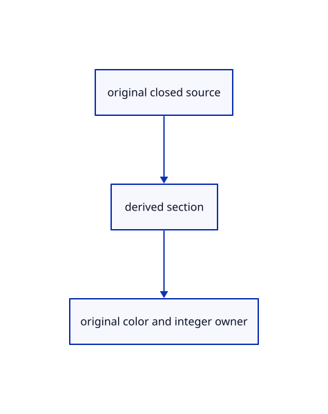

# 17.3.4 · Cache local bounds and apply placement once

**Chapter 17 · GPU visibility, clipping and sections · Section 17.3 · Closed sections and cap rendering** · [Contents](contents.md)

**Typing: 12–24 minutes.** [Estimate](typing-load.md).

Cache local bounds and apply placement once.

## Type

Continue from [Bound conservative plane crossings](88b-copy-conservative-plane-crossing-bounds.md). [Save or recover your work](recovery.md).

### 1. `src/cap_source_bounds.rs`

Own weak immutable bounds and derive placed crossing candidates.

Create the file and type:

```rust
--8<-- "journey/code/88c-cache-local-bounds-and-apply-placement-once-01.rs"
```

### 2. `src/lib.rs`

Register the completed section component.

<details>
<summary>Locate the existing block</summary>

```rust

pub mod cap_bounds;
```

</details>

After that block, type:

```rust
--8<-- "journey/code/88c-cache-local-bounds-and-apply-placement-once-02.rs" skip=21
```

## Run and check

Run this from `session_viewer` to select the fixed dependency versions and install supplied binary assets. It updates Cargo.lock and preserves the previous lock. It does not write implementation code:

```sh
npm --prefix ../session_tests run course -- dependencies 17.3.4
```

In your project:

```sh
cd workspace/journey
REGEN_PROTO=0 cargo build --lib --locked --target wasm32-unknown-unknown -j1
REGEN_PROTO=0 CARGO_BUILD_JOBS=1 trunk serve --port 8780
```

Open `http://127.0.0.1:8780/`. Keep an existing Trunk server running; saving rebuilds it.


### Recorded visual result

**Previous native render — current verification pending.**

Actual color clipping removes the right halves while retaining original geometry on the left.


*This recorded image predates a source or checker change. Rebuild this checkpoint before using it as current evidence; browser controls require separate acceptance.*

This reference image is shared with [17.2.38 · Exercise original clipping color and picking](87ab-exercise-original-clipping-color-and-picking.md). It does not demonstrate a new feature by itself.

<details>
<summary>Code explanation and diagram</summary>


original closed source → derived section → original color and integer owner.



Should orbit rescan every source vertex?

No. Cache immutable local display bounds, then transform their eight corners by the original f64 model.

Study estimate, including typing and experiments: 0.5–1 hours.

</details>

<details>
<summary>Optional experiment</summary>

Trace two placements sharing one display mesh and ensure empty source caches release.

</details>

<details>
<summary>Check and save your work</summary>

Restore experimental edits, then run from `session_viewer`:

```sh
npm --prefix ../session_tests run course -- check 17.3.4
npm --prefix ../session_tests run course -- save 17.3.4
```

Source comparison leaves your project untouched. [Save and recovery instructions](recovery.md).

</details>

<details>
<summary>Viewer coverage and verification</summary>


The supplied browser exercise requires an actual browser. Native software-GPU rendering does not measure Lenovo performance.

[Full validation scope](release.md).

To reproduce the scripted acceptance of the reference checkpoint, run from `session_viewer` with the [course bundle server](release.md#reproduce) running on port 8781:

```sh
npm --prefix ../session_tests run course -- capture 17.3.4
```

This uses the verified reference bundle; it does not check or change your typed project.

</details>
