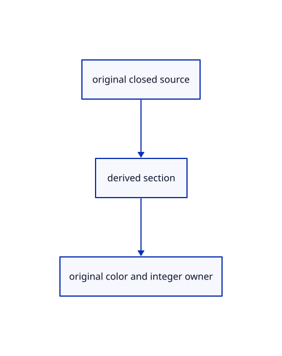

# 17.3.5 · Carry closedness and dense cap addresses

**Chapter 17 · GPU visibility, clipping and sections · Section 17.3 · Closed sections and cap rendering** · [Contents](contents.md)

**Typing: 13–26 minutes.** [Estimate](typing-load.md).

Carry closedness and dense cap addresses.

## Type

Continue from [Cache local bounds and apply placement once](88c-cache-local-bounds-and-apply-placement-once.md). [Save or recover your work](recovery.md).

### 1. `src/gpu_mesh.rs`

Carry derived cap flags and addresses without changing original geometry.

<details>
<summary>Locate the existing block</summary>

```rust
use crate::{gpu_geometry::GpuGeometry, scene::Object};
use std::rc::Rc;
use wgpu::util::DeviceExt;

pub struct GpuMesh {
    pub geometry: Rc<GpuGeometry>,
    model_group: wgpu::BindGroup,
    pub id: crate::scene::ObjectId,
    model: wgpu::Buffer,
    previous: [u8; 160],
}

#[derive(Clone,Copy)]
pub struct Style {pub selected:bool,pub pickable:bool,pub colour:Option<[f32;4]>}

fn settings(object: &Object, style:Style) -> [u8; 160] {
    let mut bytes = [0; 160];
    for (index, value) in object.model.m.iter().enumerate() {
        bytes[index * 4..index * 4 + 4].copy_from_slice(&(*value as f32).to_ne_bytes());
    }
    // Integer settings preserve every object identity, including 16,777,217, which a single-precision float rounds to another value.
    bytes[64..68].copy_from_slice(&u32::from(style.selected).to_ne_bytes());
    let id=if style.pickable {object.id.value()} else {0};
    bytes[68..72].copy_from_slice(&id.to_ne_bytes());
    let flags=if matches!(&object.original,Some(session_rust::Geometry::Plane(p)) if crate::clipping_geometry::is_clipping(p)){4096u32}else{0};bytes[72..76].copy_from_slice(&flags.to_ne_bytes());
    let normals = crate::normals::matrix(&object.model).expect("Scene placements are checked before insertion or editing");
    for (index, value) in normals.iter().enumerate() {
        bytes[80 + index * 4..84 + index * 4].copy_from_slice(&value.to_ne_bytes());
    }
    if let Some(colour)=style.colour {for (index,value) in colour[..3].iter().copied().chain([1.]).enumerate() {bytes[144+index*4..148+index*4].copy_from_slice(&value.to_ne_bytes());}}
    bytes
}

impl GpuMesh {
    pub fn upload(device: &wgpu::Device, layout: &wgpu::BindGroupLayout, object: &Object, selected: bool) -> Self {
        let geometry = Rc::new(GpuGeometry::upload(device, Rc::clone(&object.mesh)));
        Self::with_geometry(device, layout, object, Style {selected,pickable:!object.metadata.is_locked,colour:None}, geometry)
    }

    pub fn with_geometry(device: &wgpu::Device, layout: &wgpu::BindGroupLayout,
        object: &Object, style:Style, geometry: Rc<GpuGeometry>) -> Self
    {
        let bytes = settings(object, style);
        let model = device.create_buffer_init(&wgpu::util::BufferInitDescriptor {
            label: Some("object placement"),
            contents: &bytes,
            usage: wgpu::BufferUsages::UNIFORM | wgpu::BufferUsages::COPY_DST,
        });
        let model_group = device.create_bind_group(&wgpu::BindGroupDescriptor {
            label: Some("object placement"),
            layout,
            entries: &[wgpu::BindGroupEntry { binding: 0, resource: model.as_entire_binding() }],
        });
        Self { geometry, model_group, id: object.id, model, previous: bytes }
    }

    pub(crate) fn model_buffer(&self)->&wgpu::Buffer{&self.model}
    pub(crate) fn packed(&self)->[u8;160] {self.previous}
    pub fn selected(&self)->bool {u32::from_ne_bytes(self.previous[64..68].try_into().unwrap())!=0}

    pub fn settings_bytes(&self) -> u64 { self.model.size() }

    pub fn update(&mut self, queue: &wgpu::Queue, object: &Object, style:Style) -> [usize; 2] {
        let next = settings(object, style);
        let mut writes = [0, 0];
        for (start, end) in [(0, 64), (64, 80), (80, 144), (144,160)] {
            if next[start..end] != self.previous[start..end] {
                queue.write_buffer(&self.model, start as u64, &next[start..end]);
                writes[0] += 1;
                writes[1] += end - start;
            }
        }
        self.previous = next;
        writes
    }

    pub fn bind_model(&self, pass: &mut wgpu::RenderPass<'_>) { pass.set_bind_group(1, &self.model_group, &[]); }

    pub fn draw(&self, pass: &mut wgpu::RenderPass<'_>) {
        pass.set_bind_group(1, &self.model_group, &[]);
        self.geometry.draw(pass);
    }
}
```

</details>

Edit the existing block to match this code; keep unchanged lines:

```rust
use crate::{gpu_geometry::GpuGeometry, scene::Object};
use std::rc::Rc;
use wgpu::util::DeviceExt;

pub struct GpuMesh {
    pub geometry: Rc<GpuGeometry>,
    model_group: wgpu::BindGroup,
    pub id: crate::scene::ObjectId,
    model: wgpu::Buffer,
    previous: [u8; 160],cap_flags:u32,cap_token:u32,
}

#[derive(Clone,Copy)]
pub struct Style {pub selected:bool,pub pickable:bool,pub colour:Option<[f32;4]>}

fn settings(object: &Object, style:Style,cap_flags:u32,cap_token:u32) -> [u8; 160] {
    let mut bytes = [0; 160];
    for (index, value) in object.model.m.iter().enumerate() {
        bytes[index * 4..index * 4 + 4].copy_from_slice(&(*value as f32).to_ne_bytes());
    }
    // Integer settings preserve every object identity, including 16,777,217, which a single-precision float rounds to another value.
    bytes[64..68].copy_from_slice(&u32::from(style.selected).to_ne_bytes());
    let id=if style.pickable {object.id.value()} else {0};
    bytes[68..72].copy_from_slice(&id.to_ne_bytes());
    let flags=if matches!(&object.original,Some(session_rust::Geometry::Plane(p)) if crate::clipping_geometry::is_clipping(p)){4096u32}else{0};bytes[72..76].copy_from_slice(&(flags|cap_flags).to_ne_bytes());bytes[76..80].copy_from_slice(&cap_token.to_ne_bytes());
    let normals = crate::normals::matrix(&object.model).expect("Scene placements are checked before insertion or editing");
    for (index, value) in normals.iter().enumerate() {
        bytes[80 + index * 4..84 + index * 4].copy_from_slice(&value.to_ne_bytes());
    }
    if let Some(colour)=style.colour {for (index,value) in colour[..3].iter().copied().chain([1.]).enumerate() {bytes[144+index*4..148+index*4].copy_from_slice(&value.to_ne_bytes());}}
    bytes
}

impl GpuMesh {
    pub fn upload(device: &wgpu::Device, layout: &wgpu::BindGroupLayout, object: &Object, selected: bool) -> Self {
        let geometry = Rc::new(GpuGeometry::upload(device, Rc::clone(&object.mesh)));
        Self::with_geometry(device, layout, object, Style {selected,pickable:!object.metadata.is_locked,colour:None}, geometry)
    }

    pub fn with_geometry(device: &wgpu::Device, layout: &wgpu::BindGroupLayout,
        object: &Object, style:Style, geometry: Rc<GpuGeometry>) -> Self
    {
        let bytes = settings(object, style,0,0);
        let model = device.create_buffer_init(&wgpu::util::BufferInitDescriptor {
            label: Some("object placement"),
            contents: &bytes,
            usage: wgpu::BufferUsages::UNIFORM | wgpu::BufferUsages::COPY_DST,
        });
        let model_group = device.create_bind_group(&wgpu::BindGroupDescriptor {
            label: Some("object placement"),
            layout,
            entries: &[wgpu::BindGroupEntry { binding: 0, resource: model.as_entire_binding() }],
        });
        Self { geometry, model_group, id: object.id, model, previous: bytes,cap_flags:0,cap_token:0 }
    }

    pub(crate) fn model_buffer(&self)->&wgpu::Buffer{&self.model}
    pub(crate) fn packed(&self)->[u8;160] {self.previous}
    pub fn selected(&self)->bool {u32::from_ne_bytes(self.previous[64..68].try_into().unwrap())!=0}

    pub fn closed(&self)->bool{self.cap_flags&crate::solid_orientation::CLOSED!=0}
    pub fn pickable(&self)->bool{u32::from_ne_bytes(self.previous[68..72].try_into().unwrap())!=0}
    pub fn set_caps(&mut self,queue:&wgpu::Queue,flags:u32,token:u32){
        if self.cap_flags==flags&&self.cap_token==token{return;}let plane=u32::from_ne_bytes(self.previous[72..76].try_into().unwrap())&4096;self.previous[72..76].copy_from_slice(&(plane|flags).to_ne_bytes());self.previous[76..80].copy_from_slice(&token.to_ne_bytes());queue.write_buffer(&self.model,72,&self.previous[72..80]);self.cap_flags=flags;self.cap_token=token;
    }
    pub fn settings_bytes(&self) -> u64 { self.model.size() }

    pub fn update(&mut self, queue: &wgpu::Queue, object: &Object, style:Style) -> [usize; 2] {
        let next = settings(object, style,self.cap_flags,self.cap_token);
        let mut writes = [0, 0];
        for (start, end) in [(0, 64), (64, 80), (80, 144), (144,160)] {
            if next[start..end] != self.previous[start..end] {
                queue.write_buffer(&self.model, start as u64, &next[start..end]);
                writes[0] += 1;
                writes[1] += end - start;
            }
        }
        self.previous = next;
        writes
    }

    pub fn bind_model(&self, pass: &mut wgpu::RenderPass<'_>) { pass.set_bind_group(1, &self.model_group, &[]); }

    pub fn draw(&self, pass: &mut wgpu::RenderPass<'_>) {
        pass.set_bind_group(1, &self.model_group, &[]);
        self.geometry.draw(pass);
    }
}
```

<details>
<summary>Optional patch references</summary>

Use these original edit fragments when comparing a saved checkpoint. Apply the complete blocks above.

```text
--8<-- "journey/code/88d-carry-closedness-and-dense-cap-addresses-01.rs"
```

```text
--8<-- "journey/code/88d-carry-closedness-and-dense-cap-addresses-02.rs"
```

```text
--8<-- "journey/code/88d-carry-closedness-and-dense-cap-addresses-03.rs"
```

```text
--8<-- "journey/code/88d-carry-closedness-and-dense-cap-addresses-04.rs"
```

```text
--8<-- "journey/code/88d-carry-closedness-and-dense-cap-addresses-05.rs"
```

```text
--8<-- "journey/code/88d-carry-closedness-and-dense-cap-addresses-06.rs"
```

</details>

## Run and check

Run this from `session_viewer` to select the fixed dependency versions and install supplied binary assets. It updates Cargo.lock and preserves the previous lock. It does not write implementation code:

```sh
npm --prefix ../session_tests run course -- dependencies 17.3.5
```

In your project:

```sh
cd workspace/journey
REGEN_PROTO=0 cargo build --lib --locked --target wasm32-unknown-unknown -j1
REGEN_PROTO=0 CARGO_BUILD_JOBS=1 trunk serve --port 8780
```

Open `http://127.0.0.1:8780/`. Keep an existing Trunk server running; saving rebuilds it.


### Recorded visual result

**Previous native render — current verification pending.**

Actual color clipping removes the right halves while retaining original geometry on the left.


*This recorded image predates a source or checker change. Rebuild this checkpoint before using it as current evidence; browser controls require separate acceptance.*

This reference image is shared with [17.2.38 · Exercise original clipping color and picking](87ab-exercise-original-clipping-color-and-picking.md). It does not demonstrate a new feature by itself.

<details>
<summary>Code explanation and diagram</summary>


original closed source → derived section → original color and integer owner.



Are dense cap addresses saved element IDs?

No. They index a temporary owner table. The table retains exact original u32 IDs and independent pick eligibility.

Study estimate, including typing and experiments: 0.5–1 hours.

</details>

<details>
<summary>Optional experiment</summary>

Compare model bytes72–80, mirrored/inward flags and unchanged original source IDs.

</details>

<details>
<summary>Check and save your work</summary>

Restore experimental edits, then run from `session_viewer`:

```sh
npm --prefix ../session_tests run course -- check 17.3.5
npm --prefix ../session_tests run course -- save 17.3.5
```

Source comparison leaves your project untouched. [Save and recovery instructions](recovery.md).

</details>

<details>
<summary>Viewer coverage and verification</summary>


The supplied browser exercise requires an actual browser. Native software-GPU rendering does not measure Lenovo performance.

[Full validation scope](release.md).

To reproduce the scripted acceptance of the reference checkpoint, run from `session_viewer` with the [course bundle server](release.md#reproduce) running on port 8781:

```sh
npm --prefix ../session_tests run course -- capture 17.3.5
```

This uses the verified reference bundle; it does not check or change your typed project.

</details>
