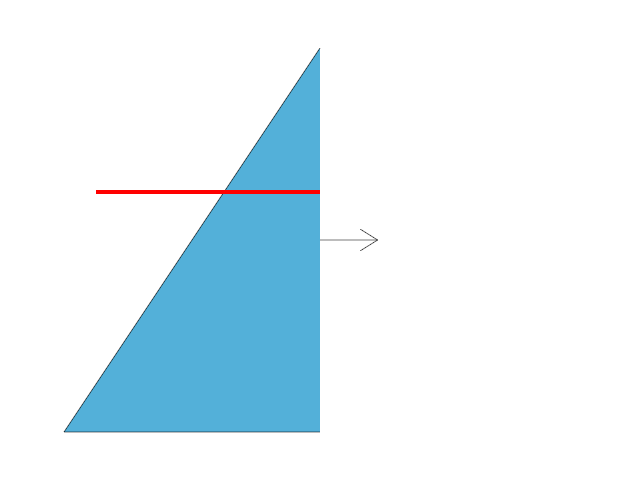

# 17.3.8 · Filter section bands over a pixel footprint

**Chapter 17 · GPU visibility, clipping and sections · Section 17.3 · Closed sections and cap rendering** · [Contents](contents.md)

**Typing: 19–37 minutes.** [Estimate](typing-load.md).

Generate one fullscreen triangle from vertex_index; instance_index chooses the clipping plane.

## Type

Continue from [Count exact original cap pick candidates](88f-count-exact-original-cap-pick-candidates.md). [Save or recover your work](recovery.md).

### 1. `src/cap_color.wgsl`

Write a fullscreen section vertex and integrate a line band over the pixel square.

Create the file and type:

```wgsl
--8<-- "journey/code/88g-copy-section-coverage-and-hatch-filtering-typed-1.rs"
```

## Run and check

Run this from `session_viewer` to select the fixed dependency versions and install supplied binary assets. It updates Cargo.lock and preserves the previous lock. It does not write implementation code:

```sh
npm --prefix ../session_tests run course -- dependencies 17.3.8
```

In your project:

```sh
cd workspace/journey
REGEN_PROTO=0 cargo build --lib --locked --target wasm32-unknown-unknown -j1
REGEN_PROTO=0 CARGO_BUILD_JOBS=1 trunk serve --port 8780
```

Open `http://127.0.0.1:8780/`. Keep an existing Trunk server running; saving rebuilds it.


### Recorded visual result

**Previous native render — current verification pending.**

Actual color clipping removes the right halves while retaining original geometry on the left.



*This recorded image predates a source or checker change. Rebuild this checkpoint before using it as current evidence; browser controls require separate acceptance.*

This reference image is shared with [17.3.1 · Classify original closedness and winding](88-copy-original-closedness-and-winding.md). It does not demonstrate a new feature by itself.

<details>
<summary>Code explanation and diagram</summary>

Declare color, primitive, depth and sample-mask outputs without changing the original solid. A signed-distance threshold covers only part of a pixel. Integrate the projected square with box_cdf, then subtract its two tails to obtain exact band area. Clamp small denominators for axis-aligned bands.

original clipping plane → anchor-relative projection → shared pixel and sample coverage.


Why integrate a band instead of testing its center?

A center test flickers as a thin band moves between pixels. Area coverage changes smoothly with the fraction of the pixel that the band covers.

Study estimate, including typing and experiments: 0.5–1 hours.

</details>

<details>
<summary>Optional experiment</summary>

Predict the area of an axis-aligned band through the pixel center, then move it towards a corner.

</details>

<details>
<summary>Check and save your work</summary>

Restore experimental edits, then run from `session_viewer`:

```sh
npm --prefix ../session_tests run course -- check 17.3.8
npm --prefix ../session_tests run course -- save 17.3.8
```

Source comparison leaves your project untouched. [Save and recovery instructions](recovery.md).

</details>

<details>
<summary>Viewer coverage and verification</summary>


Preparation. The later clipping and section browser contracts exercise the completed GPU passes.

[Full validation scope](release.md).

</details>
