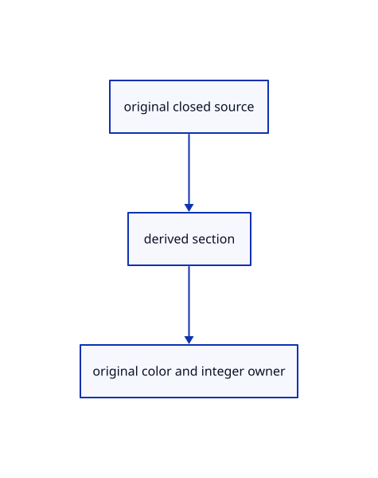

# 17.3.11 · Adapt color sections to forward depth

**Chapter 17 · GPU visibility, clipping and sections · Section 17.3 · Closed sections and cap rendering** · [Contents](contents.md)

**Typing: 6–12 minutes.** [Estimate](typing-load.md).

Adapt color sections to forward depth.

## Type

Continue from [Shade sections with shared original depth and sample ownership](88gb-shade-sections-with-shared-original-depth-and-sample-ownership.md). [Save or recover your work](recovery.md).

### 1. `src/cap_color.wgsl`

Adapt borrowed frame/count bindings and the explicit section-data output.

Edit these blocks from bottom to top. Keep the surrounding lines unchanged.

<details>
<summary>Locate this block</summary>

```wgsl
    edge = max(edge, section_outline(in.pos.xy));
    let color = mix(select(hatched, solid, clipping.fill == 1u), vec3<f32>(0.0), edge);
    let marker = CAP_PRIMITIVE + i * 2u + select(0u, 1u, selected);
    return CapOut(vec4<f32>(color, 1.0), physical_primitive(marker), z, mask);
}
```

</details>

Replace it with:

```wgsl
    edge = max(edge, section_outline(in.pos.xy));
    let color = mix(select(hatched, solid, clipping.fill == 1u), vec3<f32>(0.0), edge);
    let marker = CAP_PRIMITIVE + i * 2u + select(0u, 1u, selected);
    return CapOut(vec4<f32>(color, 1.0), vec2<f32>(z,f32(i+1u)+select(0.0,8.0,selected)), z, mask);
}
```

<details>
<summary>Locate this block</summary>

```wgsl
// Where the view ray meets a plane inside a closed solid: outlined hatch or solid grey.
fn fs_cap(in: CapVertex) -> CapOut {
    let i = in.plane;
    let ndc = clip_ndc(in.pos.xy + line.origin, line.frame, 0.0).xy;
    let z = clip_plane_depth(i, ndc);
    let h = vec3<f32>(ndc, 1.0);
    // scene units across the hatch lines, and their change per pixel
```

</details>

Replace it with:

```wgsl
// Where the view ray meets a plane inside a closed solid: outlined hatch or solid grey.
fn fs_cap(in: CapVertex) -> CapOut {
    let i = in.plane;
    let ndc = clip_ndc(in.pos.xy + cap_frame.origin, cap_frame.size, 0.0).xy;
    let z = clip_plane_depth(i, ndc);
    let h = vec3<f32>(ndc, 1.0);
    // scene units across the hatch lines, and their change per pixel
```

<details>
<summary>Locate this block</summary>

```wgsl
// A section cap fragment: color, triangle id, the plane's depth and the samples it covers.
struct CapOut {
    @location(0) color: vec4<f32>, // hatch or light grey, with a black boundary
    @location(1) primitive: vec2<u32>, // cap marker in 16-bit halves
    @builtin(frag_depth) depth: f32, // depth of the plane here
    @builtin(sample_mask) mask: u32, // samples inside a solid and kept by the other planes
}
```

</details>

Replace it with:

```wgsl
// A section cap fragment: color, triangle id, the plane's depth and the samples it covers.
struct CapOut {
    @location(0) color: vec4<f32>, // hatch or light grey, with a black boundary
    @location(1) section_depth: vec2<f32>, // visible section depth and presence
    @builtin(frag_depth) depth: f32, // depth of the plane here
    @builtin(sample_mask) mask: u32, // samples inside a solid and kept by the other planes
}
```

<details>
<summary>Locate this block</summary>

```wgsl
// Prefixed in Rust: `counts` and `primitives` at group 3, SAMPLES, `count_at` and `primitive_at`.

// One corner of a fullscreen triangle; the instance picks the plane or the caps.
```

</details>

Replace it with:

```wgsl
struct CapFrame{size:vec2<f32>,origin:vec2<f32>}
@group(0) @binding(0) var<uniform> cap_frame:CapFrame;
@group(2) @binding(0) var counts:texture_2d<f32>;
const SAMPLES:u32=1u;const SELECT_COLOR:vec3<f32>=vec3<f32>(1.0,1.0,0.0);
fn count_at(at:vec2<i32>,sample:u32)->f32{return textureLoad(counts,at,0).x;}
// Prefixed in Rust: `counts` and `primitives` at group 3, SAMPLES, `count_at` and `primitive_at`.

// One corner of a fullscreen triangle; the instance picks the plane or the caps.
```

<details>
<summary>Complete updated block reference</summary>

```wgsl
struct CapFrame{size:vec2<f32>,origin:vec2<f32>}
@group(0) @binding(0) var<uniform> cap_frame:CapFrame;
@group(2) @binding(0) var counts:texture_2d<f32>;
const SAMPLES:u32=1u;const SELECT_COLOR:vec3<f32>=vec3<f32>(1.0,1.0,0.0);
fn count_at(at:vec2<i32>,sample:u32)->f32{return textureLoad(counts,at,0).x;}
// Prefixed in Rust: `counts` and `primitives` at group 3, SAMPLES, `count_at` and `primitive_at`.

// One corner of a fullscreen triangle; the instance picks the plane or the caps.
struct CapVertex {
    @builtin(position) pos: vec4<f32>, // clip position
    @location(0) @interpolate(flat) plane: u32, // clipping plane; for the masks 1 = selected caps only
}

@vertex
// A triangle over the whole target.
fn vs_cap(@builtin(vertex_index) vertex: u32, @builtin(instance_index) plane: u32) -> CapVertex {
    let xy = vec2<f32>(f32((vertex << 1u) & 2u), f32(vertex & 2u));
    var out: CapVertex;
    out.pos = vec4<f32>(xy * 2.0 - 1.0, 0.0, 1.0);
    out.plane = plane;
    return out;
}

// A section cap fragment: color, triangle id, the plane's depth and the samples it covers.
struct CapOut {
    @location(0) color: vec4<f32>, // hatch or light grey, with a black boundary
    @location(1) section_depth: vec2<f32>, // visible section depth and presence
    @builtin(frag_depth) depth: f32, // depth of the plane here
    @builtin(sample_mask) mask: u32, // samples inside a solid and kept by the other planes
}

// Fraction of a pixel square lying below signed distance `t` from a line; the ribbon filter.
fn box_cdf(t: f32, hi: f32, lo: f32, m: f32, q: f32) -> f32 {
    let s = clamp(t, -hi, hi);
    let e = hi - abs(s);
    let tail = select(e * e / q, 1.0 - e * e / q, s > 0.0);
    return select(tail, 0.5 + s / m, abs(s) <= lo);
}

// Exact area of this pixel within `hw` of a line `d` away, across direction `g`.
fn band_area(d: f32, hw: f32, g: vec2<f32>) -> f32 {
    let a = abs(g.x);
    let b = abs(g.y);
    let hi = 0.5 * (a + b);
    let lo = 0.5 * abs(a - b);
    let m = max(max(a, b), 1e-6);
    let q = max(2.0 * a * b, 1e-6);
    return box_cdf(hw - d, hi, lo, m, q) + box_cdf(hw + d, hi, lo, m, q) - 1.0;
}


// Coverage of the nearest hatch line; `slope` is the change of `u` per pixel.
fn hatch_ink(u: f32, slope: vec2<f32>) -> f32 {
    let rate = max(length(slope), 1e-30); // scene units per pixel across the lines
    let level = log2(clipping.spacing * rate);
    // lines every power of two in scene units; every other one fades out over the last half octave
    let step = exp2(floor(level));
    let fade = smoothstep(0.5, 1.0, fract(level));
    let n = u / step;
    let nearest = round(n);
    let distance = abs(n - nearest) * step / rate;
    let odd = abs(nearest - 2.0 * round(nearest * 0.5)) > 0.5;
    let ink = clamp(band_area(distance, clipping.width * 0.5, slope / rate), 0.0, 1.0);
    return ink * select(1.0, 1.0 - fade, odd);
}

// Coverage of the section's union, including holes, without a border at the viewport edge.
fn section_coverage(at: vec2<i32>) -> f32 {
    if (any(at < vec2<i32>(0)) || any(at >= vec2<i32>(textureDimensions(counts)))) {
        return 1.0;
    }
    var covered = 0.0;
    for (var k = 0u; k < SAMPLES; k++) {
        covered += select(0.0, 1.0, count_at(at, k) > 0.5);
    }
    return covered / f32(SAMPLES);
}

fn section_outline(at: vec2<f32>) -> f32 {
    let directions = array<vec2<f32>, 8>(
        vec2<f32>(1.0, 0.0), vec2<f32>(-1.0, 0.0),
        vec2<f32>(0.0, 1.0), vec2<f32>(0.0, -1.0),
        vec2<f32>(0.7071, 0.7071), vec2<f32>(-0.7071, 0.7071),
        vec2<f32>(0.7071, -0.7071), vec2<f32>(-0.7071, -0.7071)
    );
    var edge = 0.0;
    for (var k = 0u; k < 8u; k++) {
        edge = max(edge, 1.0 - section_coverage(vec2<i32>(floor(at + directions[k] * clipping.outline))));
    }
    return edge;
}


@fragment
// Where the view ray meets a plane inside a closed solid: outlined hatch or solid grey.
fn fs_cap(in: CapVertex) -> CapOut {
    let i = in.plane;
    let ndc = clip_ndc(in.pos.xy + cap_frame.origin, cap_frame.size, 0.0).xy;
    let z = clip_plane_depth(i, ndc);
    let h = vec3<f32>(ndc, 1.0);
    // scene units across the hatch lines, and their change per pixel
    let u = dot(clipping.hatch[i].xyz, h) / dot(clipping.hatch_w[i].xyz, h);
    let slope = vec2<f32>(dpdx(u), dpdy(u));
    var kept = 0xffffffffu;
    var edge = 0.0;

    // the other planes cut the cap sample by sample
    for (var j = 0u; j < clipping.count; j++) {
        let t = dot(clipping.screen[j], vec4<f32>(ndc, z, 1.0));
        let gradient = vec2<f32>(dpdx(t), dpdy(t));
        let samples = clip_samples(t, gradient);
        kept &= select(samples, 0xffffffffu, j == i);
        if (j != i && dot(gradient, gradient) > 1e-30) {
            let distance = t / max(length(gradient), 1e-20);
            edge = max(edge, 1.0 - smoothstep(clipping.outline - 0.5, clipping.outline + 0.5, distance));
        }
    }

    let at = vec2<i32>(in.pos.xy);
    var inside = 0u;
    var selected = false;

    // inside a solid where more crossings leave than enter behind the plane
    for (var k = 0u; k < SAMPLES; k++) {
        let count = count_at(at, k);
        inside |= select(0u, 1u << k, count > 0.5);
        selected = selected || count > SELECTED_CROSSING - 0.5;
    }

    let mask = inside & kept;

    if (mask == 0u || !(z >= 0.0 && z <= 1.0)) {
        discard;
    }

    let paper = select(vec3<f32>(1.0), SELECT_COLOR, selected);
    let hatched = mix(paper, vec3<f32>(0.0), hatch_ink(u, slope));
    let solid = select(vec3<f32>(0.6), SELECT_COLOR, selected);
    edge = max(edge, section_outline(in.pos.xy));
    let color = mix(select(hatched, solid, clipping.fill == 1u), vec3<f32>(0.0), edge);
    let marker = CAP_PRIMITIVE + i * 2u + select(0u, 1u, selected);
    return CapOut(vec4<f32>(color, 1.0), vec2<f32>(z,f32(i+1u)+select(0.0,8.0,selected)), z, mask);
}
```

</details>

<details>
<summary>Optional patch references</summary>

Use these original edit fragments when comparing a saved checkpoint. Apply the complete blocks above.

```text
--8<-- "journey/code/88h-adapt-color-sections-to-forward-depth-01.rs"
```

```text
--8<-- "journey/code/88h-adapt-color-sections-to-forward-depth-02.rs"
```

```text
--8<-- "journey/code/88h-adapt-color-sections-to-forward-depth-03.rs"
```

```text
--8<-- "journey/code/88h-adapt-color-sections-to-forward-depth-04.rs"
```

</details>

## Run and check

Run this from `session_viewer` to select the fixed dependency versions and install supplied binary assets. It updates Cargo.lock and preserves the previous lock. It does not write implementation code:

```sh
npm --prefix ../session_tests run course -- dependencies 17.3.11
```

In your project:

```sh
cd workspace/journey
REGEN_PROTO=0 cargo build --lib --locked --target wasm32-unknown-unknown -j1
REGEN_PROTO=0 CARGO_BUILD_JOBS=1 trunk serve --port 8780
```

Open `http://127.0.0.1:8780/`. Keep an existing Trunk server running; saving rebuilds it.


### Recorded visual result

**Previous native render — current verification pending.**

Actual color clipping removes the right halves while retaining original geometry on the left.


*This recorded image predates a source or checker change. Rebuild this checkpoint before using it as current evidence; browser controls require separate acceptance.*

This reference image is shared with [17.2.38 · Exercise original clipping color and picking](87ab-exercise-original-clipping-color-and-picking.md). It does not demonstrate a new feature by itself.

<details>
<summary>Code explanation and diagram</summary>


original closed source → derived section → original color and integer owner.



What does the extra section target store?

Visible section depth and plane address. Finite ink uses that plane to compare its original centerline analytically.

Study estimate, including typing and experiments: 0.5–1 hours.

</details>

<details>
<summary>Optional experiment</summary>

Compare grey, hatch and selected yellow outputs with the forward-depth attachment and plane marker.

</details>

<details>
<summary>Check and save your work</summary>

Restore experimental edits, then run from `session_viewer`:

```sh
npm --prefix ../session_tests run course -- check 17.3.11
npm --prefix ../session_tests run course -- save 17.3.11
```

Source comparison leaves your project untouched. [Save and recovery instructions](recovery.md).

</details>

<details>
<summary>Viewer coverage and verification</summary>


The supplied browser exercise requires an actual browser. Native software-GPU rendering does not measure Lenovo performance.

[Full validation scope](release.md).

To reproduce the scripted acceptance of the reference checkpoint, run from `session_viewer` with the [course bundle server](release.md#reproduce) running on port 8781:

```sh
npm --prefix ../session_tests run course -- capture 17.3.11
```

This uses the verified reference bundle; it does not check or change your typed project.

</details>
