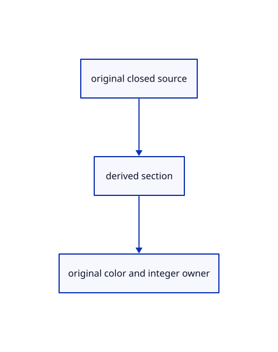

# 17.3.15 · Add signed counts and grey hatch color

**Chapter 17 · GPU visibility, clipping and sections · Section 17.3 · Closed sections and cap rendering** · [Contents](contents.md)

**Typing: 15–30 minutes.** [Estimate](typing-load.md).

Add signed counts and grey hatch color.

## Type

Continue from [Build compatible section render pipelines](88k-build-compatible-section-render-pipelines.md). [Save or recover your work](recovery.md).

### 1. `src/cap_pipeline.rs`

Build the explicit count and section-color pipelines.

<details>
<summary>Locate the existing block</summary>

```rust
 device.create_render_pipeline(&wgpu::RenderPipelineDescriptor{label:Some("original closed-solid sections"),layout:Some(&layout),vertex:wgpu::VertexState{module:&shader,entry_point:Some(vertex),compilation_options:Default::default(),buffers:&buffers},fragment:Some(wgpu::FragmentState{module:&shader,entry_point:Some(fragment),compilation_options:Default::default(),targets:&targets.iter().cloned().map(Some).collect::<Vec<_>>()}),primitive:Default::default(),depth_stencil:if count{None}else{Some(crate::depth::surface())},multisample:Default::default(),multiview_mask:None,cache:None})
}
```

</details>

After that block, type:

```rust
--8<-- "journey/code/88l-add-signed-counts-and-grey-hatch-color-01.rs" skip=590
```

## Run and check

Run this from `session_viewer` to select the fixed dependency versions and install supplied binary assets. It updates Cargo.lock and preserves the previous lock. It does not write implementation code:

```sh
npm --prefix ../session_tests run course -- dependencies 17.3.15
```

In your project:

```sh
cd workspace/journey
REGEN_PROTO=0 cargo build --lib --locked --target wasm32-unknown-unknown -j1
REGEN_PROTO=0 CARGO_BUILD_JOBS=1 trunk serve --port 8780
```

Open `http://127.0.0.1:8780/`. Keep an existing Trunk server running; saving rebuilds it.


### Recorded visual result

**Previous native render — current verification pending.**

Actual color clipping removes the right halves while retaining original geometry on the left.


*This recorded image predates a source or checker change. Rebuild this checkpoint before using it as current evidence; browser controls require separate acceptance.*

This reference image is shared with [17.2.38 · Exercise original clipping color and picking](87ab-exercise-original-clipping-color-and-picking.md). It does not demonstrate a new feature by itself.

<details>
<summary>Code explanation and diagram</summary>


original closed source → derived section → original color and integer owner.



Why use additive counts before color?

Each solid contributes signed crossings; the fullscreen pass colors only pixels inside the resulting union.

Study estimate, including typing and experiments: 0.5–1 hours.

</details>

<details>
<summary>Optional experiment</summary>

Compare additive R16Float counts, RGBA color and RG32Float section data.

</details>

<details>
<summary>Check and save your work</summary>

Restore experimental edits, then run from `session_viewer`:

```sh
npm --prefix ../session_tests run course -- check 17.3.15
npm --prefix ../session_tests run course -- save 17.3.15
```

Source comparison leaves your project untouched. [Save and recovery instructions](recovery.md).

</details>

<details>
<summary>Viewer coverage and verification</summary>


The supplied browser exercise requires an actual browser. Native software-GPU rendering does not measure Lenovo performance.

[Full validation scope](release.md).

To reproduce the scripted acceptance of the reference checkpoint, run from `session_viewer` with the [course bundle server](release.md#reproduce) running on port 8781:

```sh
npm --prefix ../session_tests run course -- capture 17.3.15
```

This uses the verified reference bundle; it does not check or change your typed project.

</details>
