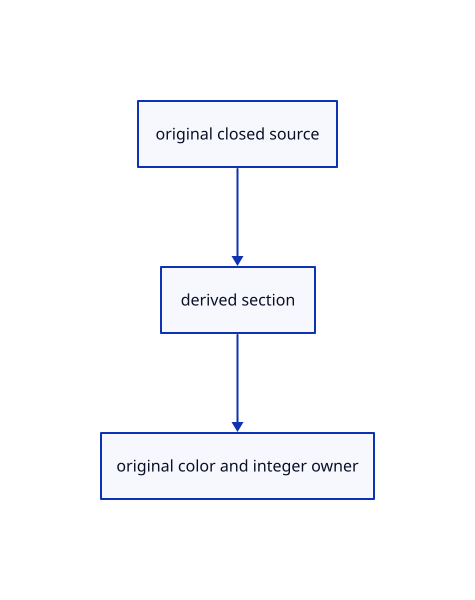

# 17.3.16 · Build bounded integer section pipelines

**Chapter 17 · GPU visibility, clipping and sections · Section 17.3 · Closed sections and cap rendering** · [Contents](contents.md)

**Typing: 21–42 minutes.** [Estimate](typing-load.md).

Build bounded integer section pipelines.

## Type

Continue from [Add signed counts and grey hatch color](88l-add-signed-counts-and-grey-hatch-color.md). [Save or recover your work](recovery.md).

### 1. `src/cap_pick_pipeline.rs`

Build count, nearest-owner and original integer pipelines.

Create the file and type:

```rust
--8<-- "journey/code/88m-build-bounded-integer-section-pipelines-01.rs"
```

### 2. `src/lib.rs`

Register the completed section component.

<details>
<summary>Locate the existing block</summary>

```rust

pub mod cap_pipeline;
```

</details>

After that block, type:

```rust
--8<-- "journey/code/88m-build-bounded-integer-section-pipelines-02.rs" skip=23
```

## Run and check

Run this from `session_viewer` to select the fixed dependency versions and install supplied binary assets. It updates Cargo.lock and preserves the previous lock. It does not write implementation code:

```sh
npm --prefix ../session_tests run course -- dependencies 17.3.16
```

In your project:

```sh
cd workspace/journey
REGEN_PROTO=0 cargo build --lib --locked --target wasm32-unknown-unknown -j1
REGEN_PROTO=0 CARGO_BUILD_JOBS=1 trunk serve --port 8780
```

Open `http://127.0.0.1:8780/`. Keep an existing Trunk server running; saving rebuilds it.


### Recorded visual result

**Previous native render — current verification pending.**

Actual color clipping removes the right halves while retaining original geometry on the left.


*This recorded image predates a source or checker change. Rebuild this checkpoint before using it as current evidence; browser controls require separate acceptance.*

This reference image is shared with [17.2.38 · Exercise original clipping color and picking](87ab-exercise-original-clipping-color-and-picking.md). It does not demonstrate a new feature by itself.

<details>
<summary>Code explanation and diagram</summary>


original closed source → derived section → original color and integer owner.



Will a fifth bind group fit the browser limit?

No. Count/crop/record bindings fit four groups, and the final original-owner lookup fits three.

Study estimate, including typing and experiments: 0.5–1 hours.

</details>

<details>
<summary>Optional experiment</summary>

Inspect atomic storage, owner rows and exact RG32Uint targets.

</details>

<details>
<summary>Check and save your work</summary>

Restore experimental edits, then run from `session_viewer`:

```sh
npm --prefix ../session_tests run course -- check 17.3.16
npm --prefix ../session_tests run course -- save 17.3.16
```

Source comparison leaves your project untouched. [Save and recovery instructions](recovery.md).

</details>

<details>
<summary>Viewer coverage and verification</summary>


The supplied browser exercise requires an actual browser. Native software-GPU rendering does not measure Lenovo performance.

[Full validation scope](release.md).

To reproduce the scripted acceptance of the reference checkpoint, run from `session_viewer` with the [course bundle server](release.md#reproduce) running on port 8781:

```sh
npm --prefix ../session_tests run course -- capture 17.3.16
```

This uses the verified reference bundle; it does not check or change your typed project.

</details>
