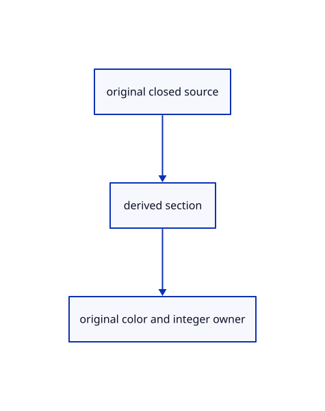

# 17.3.18 · Prepare exact cap crop and owners

**Chapter 17 · GPU visibility, clipping and sections · Section 17.3 · Closed sections and cap rendering** · [Contents](contents.md)

**Typing: 24–48 minutes.** [Estimate](typing-load.md).

Prepare exact cap crop and owners.

## Type

Continue from [Own bounded cap pick storage](88n-own-bounded-cap-pick-storage.md). [Save or recover your work](recovery.md).

### 1. `src/cap_pick_gpu.rs`

Connect the bounded original section picker.

<details>
<summary>Locate the existing block</summary>

```rust
 pub fn new(device:&wgpu::Device)->Self{let pipes=crate::cap_pick_pipeline::Pipelines::new(device);let buffer=|label,size,usage|device.create_buffer(&wgpu::BufferDescriptor{label:Some(label),size,usage:usage|wgpu::BufferUsages::COPY_DST,mapped_at_creation:false});let records=buffer("bounded original cap crossings",16,wgpu::BufferUsages::STORAGE|wgpu::BufferUsages::COPY_SRC);let owners=buffer("exact original cap owners",8,wgpu::BufferUsages::STORAGE);let frame=buffer("cap physical crop frame",32,wgpu::BufferUsages::UNIFORM);let frame_group=crate::gpu_layout::group(device,&pipes.frame,&frame);Self{pipes,records,owners,frame,frame_group,record_group:None,owner_group:None,target:None,preparations:0}}
 fn capacity(device:&wgpu::Device,needed:u64,buffer:&mut wgpu::Buffer,label:&str)->Result<(),&'static str>{if needed>u64::from(device.limits().max_storage_buffer_binding_size){return Err("Cap picking exceeds the device storage binding limit")}if buffer.size()<needed{*buffer=device.create_buffer(&wgpu::BufferDescriptor{label:Some(label),size:needed,usage:buffer.usage(),mapped_at_creation:false});}Ok(())}
```

</details>

Edit the existing block to match this code; keep unchanged lines:

```rust
--8<-- "journey/code/88o-prepare-exact-cap-crop-and-owners-01.rs"
```

### 2. `src/pick_image.rs`

Own actual cropped RG32Float section data.

<details>
<summary>Locate the existing block</summary>

```rust
use crate::pick_window::Window;

pub(crate) struct Image {
    pub texture: wgpu::Texture,
    pub colour: wgpu::TextureView,
    pub depth: wgpu::TextureView,
    pub readback: wgpu::Buffer,
    pub window: Window,
}

impl Image {
    pub fn new(device: &wgpu::Device, window: Window) -> Self {
        let size = wgpu::Extent3d { width: window.draw[2], height: window.draw[3], depth_or_array_layers: 1 };
        let texture = device.create_texture(&wgpu::TextureDescriptor { label: Some("bounded pick image"), size,
            mip_level_count: 1, sample_count: 1, dimension: wgpu::TextureDimension::D2,
            format: wgpu::TextureFormat::Rg32Uint, usage: wgpu::TextureUsages::RENDER_ATTACHMENT | wgpu::TextureUsages::COPY_SRC, view_formats: &[] });
        let colour = texture.create_view(&Default::default());
        let depth = device.create_texture(&wgpu::TextureDescriptor { label: Some("pick depth"), size,
            mip_level_count: 1, sample_count: 1, dimension: wgpu::TextureDimension::D2,
            format: crate::depth::FORMAT, usage: wgpu::TextureUsages::RENDER_ATTACHMENT|wgpu::TextureUsages::TEXTURE_BINDING, view_formats: &[] }).create_view(&Default::default());
        // GPU image rows need 256-byte copy alignment; the decoder skips that padding and reads only the logical columns.
        let readback = device.create_buffer(&wgpu::BufferDescriptor { label: Some("bounded pick readback"), size: window.bytes(),
            usage: wgpu::BufferUsages::COPY_DST | wgpu::BufferUsages::MAP_READ, mapped_at_creation: false });
        Self { texture, colour, depth, readback, window }
    }

}
```

</details>

Edit the existing block to match this code; keep unchanged lines:

```rust
use crate::pick_window::Window;

pub(crate) struct Image {
    pub texture: wgpu::Texture,
    pub colour: wgpu::TextureView,
    pub depth: wgpu::TextureView,
    pub section:wgpu::TextureView,
    pub readback: wgpu::Buffer,
    pub window: Window,
}

impl Image {
    pub fn new(device: &wgpu::Device, window: Window) -> Self {
        let size = wgpu::Extent3d { width: window.draw[2], height: window.draw[3], depth_or_array_layers: 1 };
        let texture = device.create_texture(&wgpu::TextureDescriptor { label: Some("bounded pick image"), size,
            mip_level_count: 1, sample_count: 1, dimension: wgpu::TextureDimension::D2,
            format: wgpu::TextureFormat::Rg32Uint, usage: wgpu::TextureUsages::RENDER_ATTACHMENT | wgpu::TextureUsages::COPY_SRC, view_formats: &[] });
        let colour = texture.create_view(&Default::default());
        let depth = device.create_texture(&wgpu::TextureDescriptor { label: Some("pick depth"), size,
            mip_level_count: 1, sample_count: 1, dimension: wgpu::TextureDimension::D2,
            format: crate::depth::FORMAT, usage: wgpu::TextureUsages::RENDER_ATTACHMENT|wgpu::TextureUsages::TEXTURE_BINDING, view_formats: &[] }).create_view(&Default::default());
        // GPU image rows need 256-byte copy alignment; the decoder skips that padding and reads only the logical columns.
        let readback = device.create_buffer(&wgpu::BufferDescriptor { label: Some("bounded pick readback"), size: window.bytes(),
            usage: wgpu::BufferUsages::COPY_DST | wgpu::BufferUsages::MAP_READ, mapped_at_creation: false });
        let section=device.create_texture(&wgpu::TextureDescriptor{label:Some("bounded section depth"),size,mip_level_count:1,sample_count:1,dimension:wgpu::TextureDimension::D2,format:wgpu::TextureFormat::Rg32Float,usage:wgpu::TextureUsages::RENDER_ATTACHMENT|wgpu::TextureUsages::TEXTURE_BINDING,view_formats:&[]}).create_view(&Default::default());
        Self { texture, colour, depth, section,readback, window }
    }

}
```

<details>
<summary>Optional patch references</summary>

Use these original edit fragments when comparing a saved checkpoint. Apply the complete blocks above.

```text
--8<-- "journey/code/88w-give-integer-images-a-section-attachment-01.rs"
```

```text
--8<-- "journey/code/88w-give-integer-images-a-section-attachment-02.rs"
```

</details>

### 3. `src/pick_gpu.rs`

Charge the real twenty-byte cropped integer/depth/section images.

<details>
<summary>Locate the existing block</summary>

```rust
    pub fn usage(&self) -> [u64; 3] {
        [u64::from(self.active.is_some()), u64::from(self.pending.is_some()), self.image.as_ref().map_or(0, |image|
            image.readback.size() + u64::from(image.window.draw[2]) * u64::from(image.window.draw[3]) * 12) + 160+u64::from(self.legacy_clipping.is_some())*448]
    }
}
```

</details>

Edit the existing block to match this code; keep unchanged lines:

```rust
--8<-- "journey/code/88w-give-integer-images-a-section-attachment-03.rs"
```

<details>
<summary>Supplied validation fixture</summary>

Copy this supplied authoring fixture once. Continue with the browser build below; the course does not require running native tests.

### 4. `src/pick_gpu_tests.rs`

Copy the actual bounded crop-allocation fixture with its section attachment.

<details>
<summary>Locate the existing block</summary>

```text
    assert_eq!(finish(&mut renderer), None);
    assert_eq!(&renderer.pick_usage()[..2], &[0, 0]);
    assert!(renderer.pick_usage()[2] <= 25 * 256 + 31 * 31 * 12 + 192 + 3 * 52, "Readback does not grow with the full drawing");
}
```

</details>

Update the existing block with this supplied code; keep unchanged lines:

```text
--8<-- "journey/code/88w-give-integer-images-a-section-attachment-04.rs"
```

</details>

## Run and check

Run this from `session_viewer` to select the fixed dependency versions and install supplied binary assets. It updates Cargo.lock and preserves the previous lock. It does not write implementation code:

```sh
npm --prefix ../session_tests run course -- dependencies 17.3.18
```

In your project:

```sh
cd workspace/journey
REGEN_PROTO=0 cargo build --lib --locked --target wasm32-unknown-unknown -j1
REGEN_PROTO=0 CARGO_BUILD_JOBS=1 trunk serve --port 8780
```

Open `http://127.0.0.1:8780/`. Keep an existing Trunk server running; saving rebuilds it.


### Recorded visual result

**Previous native render — current verification pending.**

Actual color clipping removes the right halves while retaining original geometry on the left.


*This recorded image predates a source or checker change. Rebuild this checkpoint before using it as current evidence; browser controls require separate acceptance.*

This reference image is shared with [17.2.38 · Exercise original clipping color and picking](87ab-exercise-original-clipping-color-and-picking.md). It does not demonstrate a new feature by itself.

<details>
<summary>Code explanation and diagram</summary>


original closed source → derived section → original color and integer owner.



Does the small pick crop change original coordinates?

No. Its integer full size and origin describe the draw window; source placement stays in the original model.

Study estimate, including typing and experiments: 0.5–1 hours.

</details>

<details>
<summary>Optional experiment</summary>

Trace owner upload, crop buffer borrowing, bounded allocation and physical target resizing.

</details>

<details>
<summary>Check and save your work</summary>

Restore experimental edits, then run from `session_viewer`:

```sh
npm --prefix ../session_tests run course -- check 17.3.18
npm --prefix ../session_tests run course -- save 17.3.18
```

Source comparison leaves your project untouched. [Save and recovery instructions](recovery.md).

</details>

<details>
<summary>Viewer coverage and verification</summary>


The supplied browser exercise requires an actual browser. Native software-GPU rendering does not measure Lenovo performance.

[Full validation scope](release.md).

To reproduce the scripted acceptance of the reference checkpoint, run from `session_viewer` with the [course bundle server](release.md#reproduce) running on port 8781:

```sh
npm --prefix ../session_tests run course -- capture 17.3.18
```

This uses the verified reference bundle; it does not check or change your typed project.

</details>
