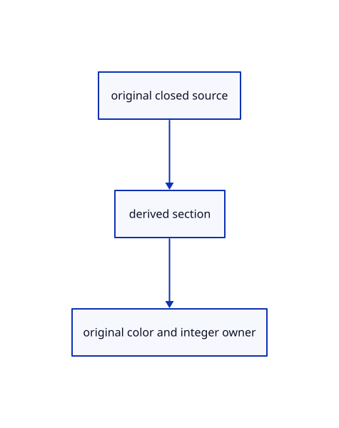

# 17.3.19 · Draw cap count nearest owner and integer ID

**Chapter 17 · GPU visibility, clipping and sections · Section 17.3 · Closed sections and cap rendering** · [Contents](contents.md)

**Typing: 24–47 minutes.** [Estimate](typing-load.md).

Draw cap count nearest owner and integer ID.

## Type

Continue from [Prepare exact cap crop and owners](88o-prepare-exact-cap-crop-and-owners.md). [Save or recover your work](recovery.md).

### 1. `src/cap_pick_gpu.rs`

Connect the bounded original section picker.

<details>
<summary>Locate the existing block</summary>

```rust
  self.owner_group=Some(device.create_bind_group(&wgpu::BindGroupDescriptor{label:Some("original cap owners"),layout:&self.pipes.owners,entries:&[wgpu::BindGroupEntry{binding:0,resource:self.records.as_entire_binding()},wgpu::BindGroupEntry{binding:1,resource:self.owners.as_entire_binding()}]}));if self.target.as_ref().is_none_or(|t|t.size!=size){self.target=Some(Image::new(device,size,wgpu::TextureFormat::R8Unorm,1));}self.preparations+=1;Ok(())
 }


}
```

</details>

Edit the existing block to match this code; keep unchanged lines:

```rust
--8<-- "journey/code/88p-draw-cap-count-nearest-owner-and-integer-id-01.rs"
```

## Run and check

Run this from `session_viewer` to select the fixed dependency versions and install supplied binary assets. It updates Cargo.lock and preserves the previous lock. It does not write implementation code:

```sh
npm --prefix ../session_tests run course -- dependencies 17.3.19
```

In your project:

```sh
cd workspace/journey
REGEN_PROTO=0 cargo build --lib --locked --target wasm32-unknown-unknown -j1
REGEN_PROTO=0 CARGO_BUILD_JOBS=1 trunk serve --port 8780
```

Open `http://127.0.0.1:8780/`. Keep an existing Trunk server running; saving rebuilds it.


### Recorded visual result

**Previous native render — current verification pending.**

Actual color clipping removes the right halves while retaining original geometry on the left.


*This recorded image predates a source or checker change. Rebuild this checkpoint before using it as current evidence; browser controls require separate acceptance.*

This reference image is shared with [17.2.38 · Exercise original clipping color and picking](87ab-exercise-original-clipping-color-and-picking.md). It does not demonstrate a new feature by itself.

<details>
<summary>Code explanation and diagram</summary>


original closed source → derived section → original color and integer owner.



Why separate nearest-owner resolution?

The atomic maximum finds exit depth first. A second pass names the exact original reaching that depth.

Study estimate, including typing and experiments: 0.5–1 hours.

</details>

<details>
<summary>Optional experiment</summary>

Compare count, nearest and final ID passes, source mesh crossing masks and actual allocation.

</details>

<details>
<summary>Check and save your work</summary>

Restore experimental edits, then run from `session_viewer`:

```sh
npm --prefix ../session_tests run course -- check 17.3.19
npm --prefix ../session_tests run course -- save 17.3.19
```

Source comparison leaves your project untouched. [Save and recovery instructions](recovery.md).

</details>

<details>
<summary>Viewer coverage and verification</summary>


The supplied browser exercise requires an actual browser. Native software-GPU rendering does not measure Lenovo performance.

[Full validation scope](release.md).

To reproduce the scripted acceptance of the reference checkpoint, run from `session_viewer` with the [course bundle server](release.md#reproduce) running on port 8781:

```sh
npm --prefix ../session_tests run course -- capture 17.3.19
```

This uses the verified reference bundle; it does not check or change your typed project.

</details>
