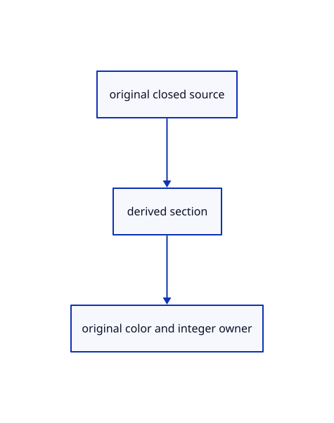

# 17.3.27 · Cache finite section bindings

**Chapter 17 · GPU visibility, clipping and sections · Section 17.3 · Closed sections and cap rendering** · [Contents](contents.md)

**Typing: 24–47 minutes.** [Estimate](typing-load.md).

Cache finite section bindings.

## Type

Continue from [Expose section data to finite ink tables](88x-expose-section-data-to-finite-ink-tables.md). [Save or recover your work](recovery.md).

### 1. `src/finite_ink.rs`

Bind section coverage beside existing finite and opaque-depth data.

<details>
<summary>Locate the existing block</summary>

```rust
fn pipeline(device:&wgpu::Device,format:wgpu::TextureFormat,stride:u64,grid:bool,picking:bool,view:&wgpu::BindGroupLayout,crop:&wgpu::BindGroupLayout,layout:&wgpu::BindGroupLayout,attributes:&[wgpu::VertexAttribute])->wgpu::RenderPipeline{
   let source=crate::finite_sources::source_style(stride,picking,grid);let shader=device.create_shader_module(wgpu::ShaderModuleDescriptor{label:Some("finite original ink"),source:wgpu::ShaderSource::Wgsl(source.into())});
   let clipping=crate::clipping_gpu::layout(device);let groups=if picking{vec![Some(view),Some(crop),Some(layout),Some(&clipping)]}else{vec![Some(view),Some(layout),Some(&clipping)]};let pipeline_layout=device.create_pipeline_layout(&wgpu::PipelineLayoutDescriptor{label:Some("finite original ink"),bind_group_layouts:&groups,immediate_size:0});
   let mut buffers=vec![wgpu::VertexBufferLayout{array_stride:stride,step_mode:wgpu::VertexStepMode::Instance,attributes}];let ids=wgpu::vertex_attr_array![7=>Uint32x2];if picking{buffers.push(wgpu::VertexBufferLayout{array_stride:8,step_mode:wgpu::VertexStepMode::Instance,attributes:&ids});}
   let flags=wgpu::vertex_attr_array![8=>Uint32];buffers.push(wgpu::VertexBufferLayout{array_stride:4,step_mode:wgpu::VertexStepMode::Instance,attributes:&flags});
   let mut depth=crate::depth::ink();depth.depth_compare=Some(wgpu::CompareFunction::Always);
   device.create_render_pipeline(&wgpu::RenderPipelineDescriptor{label:Some("finite original ink"),layout:Some(&pipeline_layout),vertex:wgpu::VertexState{module:&shader,entry_point:Some(if picking{"pick_vertex"}else{"vertex"}),compilation_options:Default::default(),buffers:&buffers},fragment:Some(wgpu::FragmentState{module:&shader,entry_point:Some(if picking{"pick_fragment"}else{"fragment"}),compilation_options:Default::default(),targets:&[Some(wgpu::ColorTargetState{format:if picking{wgpu::TextureFormat::Rg32Uint}else{format},blend:if picking{None}else{Some(wgpu::BlendState::ALPHA_BLENDING)},write_mask:wgpu::ColorWrites::ALL})]}),primitive:Default::default(),depth_stencil:Some(depth),multisample:Default::default(),multiview_mask:None,cache:None})
  }
use std::cell::RefCell;
pub struct Ink{color:wgpu::RenderPipeline,pick:wgpu::RenderPipeline,layout:wgpu::BindGroupLayout,bindings:RefCell<Option<(wgpu::Buffer,wgpu::Buffer,wgpu::TextureView,wgpu::BindGroup)>>}
#[derive(Clone)]
pub struct Tables{pub projected:wgpu::Buffer,pub tiles:wgpu::Buffer,pub caps:wgpu::TextureView}
impl Ink{
 pub fn new(device:&wgpu::Device,format:wgpu::TextureFormat,stride:u64,grid:bool)->Self{
  let attributes=match stride{44=>wgpu::vertex_attr_array![0=>Float32x3,1=>Float32x3,2=>Float32x4,3=>Float32].to_vec(),72=>wgpu::vertex_attr_array![0=>Float32x3,1=>Float32x3,2=>Float32x4,3=>Float32,4=>Float32x3,5=>Float32x3,6=>Uint32].to_vec(),32=>wgpu::vertex_attr_array![0=>Float32x3,1=>Float32,2=>Float32x4].to_vec(),_=>panic!("Unsupported finite ink layout")};
  let view=crate::gpu_layout::uniform(device,80);let crop=crate::gpu_layout::uniform(device,80);
  let layout=device.create_bind_group_layout(&wgpu::BindGroupLayoutDescriptor{label:Some("finite ink coverage"),entries:&[crate::tile_pipelines::entry(0,wgpu::ShaderStages::FRAGMENT,wgpu::BufferBindingType::Storage{read_only:true}),crate::tile_pipelines::entry(1,wgpu::ShaderStages::FRAGMENT,wgpu::BufferBindingType::Storage{read_only:true}),wgpu::BindGroupLayoutEntry{binding:2,visibility:wgpu::ShaderStages::FRAGMENT,ty:wgpu::BindingType::Texture{sample_type:wgpu::TextureSampleType::Depth,view_dimension:wgpu::TextureViewDimension::D2,multisampled:false},count:None}]});
let color=pipeline(device,format,stride,grid,false,&view,&crop,&layout,&attributes);let pick=pipeline(device,format,stride,grid,true,&view,&crop,&layout,&attributes);Self{color,pick,layout,bindings:RefCell::new(None)}
 }
 fn group(&self,device:&wgpu::Device,tables:&Tables,depth:&wgpu::TextureView)->wgpu::BindGroup{device.create_bind_group(&wgpu::BindGroupDescriptor{label:Some("finite original ink coverage"),layout:&self.layout,entries:&[wgpu::BindGroupEntry{binding:0,resource:tables.projected.as_entire_binding()},wgpu::BindGroupEntry{binding:1,resource:tables.tiles.as_entire_binding()},wgpu::BindGroupEntry{binding:2,resource:wgpu::BindingResource::TextureView(depth)}]})}
 pub fn set(&self,device:&wgpu::Device,tables:&Tables,depth:&wgpu::TextureView){let mut bindings=self.bindings.borrow_mut();if bindings.as_ref().is_some_and(|(p,t,d,_)|p==&tables.projected&&t==&tables.tiles&&d==depth){return}let group=self.group(device,tables,depth);*bindings=Some((tables.projected.clone(),tables.tiles.clone(),depth.clone(),group));}
 pub fn draw(&self,pass:&mut wgpu::RenderPass<'_>,view:&wgpu::BindGroup,vertices:&wgpu::Buffer,flags:&wgpu::Buffer,count:u32,verts:u32)->bool{let bindings=self.bindings.borrow();let Some((_,_,_,group))=bindings.as_ref()else{return false};pass.set_pipeline(&self.color);pass.set_bind_group(0,view,&[]);pass.set_bind_group(1,group,&[]);pass.set_vertex_buffer(0,vertices.slice(..));pass.set_vertex_buffer(1,flags.slice(..));pass.draw(0..verts,0..count);true}
 pub fn pick(&self,device:&wgpu::Device,pass:&mut wgpu::RenderPass<'_>,view:&wgpu::BindGroup,crop:&wgpu::BindGroup,vertices:&wgpu::Buffer,ids:&wgpu::Buffer,flags:&wgpu::Buffer,count:u32,verts:u32,tables:&Tables,depth:&wgpu::TextureView){let group=self.group(device,tables,depth);pass.set_pipeline(&self.pick);pass.set_bind_group(0,view,&[]);pass.set_bind_group(1,crop,&[]);pass.set_bind_group(2,&group,&[]);pass.set_vertex_buffer(0,vertices.slice(..));pass.set_vertex_buffer(1,ids.slice(..));pass.set_vertex_buffer(2,flags.slice(..));pass.draw(0..verts,0..count);}
}
```

</details>

Edit the existing block to match this code; keep unchanged lines:

```rust
fn pipeline(device:&wgpu::Device,format:wgpu::TextureFormat,stride:u64,grid:bool,picking:bool,view:&wgpu::BindGroupLayout,crop:&wgpu::BindGroupLayout,layout:&wgpu::BindGroupLayout,attributes:&[wgpu::VertexAttribute])->wgpu::RenderPipeline{
   let source=crate::finite_sources::source_style(stride,picking,grid);let shader=device.create_shader_module(wgpu::ShaderModuleDescriptor{label:Some("finite original ink"),source:wgpu::ShaderSource::Wgsl(source.into())});
   let clipping=crate::clipping_gpu::layout(device);let groups=if picking{vec![Some(view),Some(crop),Some(layout),Some(&clipping)]}else{vec![Some(view),Some(layout),Some(&clipping)]};let pipeline_layout=device.create_pipeline_layout(&wgpu::PipelineLayoutDescriptor{label:Some("finite original ink"),bind_group_layouts:&groups,immediate_size:0});
   let mut buffers=vec![wgpu::VertexBufferLayout{array_stride:stride,step_mode:wgpu::VertexStepMode::Instance,attributes}];let ids=wgpu::vertex_attr_array![7=>Uint32x2];if picking{buffers.push(wgpu::VertexBufferLayout{array_stride:8,step_mode:wgpu::VertexStepMode::Instance,attributes:&ids});}
   let flags=wgpu::vertex_attr_array![8=>Uint32];buffers.push(wgpu::VertexBufferLayout{array_stride:4,step_mode:wgpu::VertexStepMode::Instance,attributes:&flags});
   let mut depth=crate::depth::ink();depth.depth_compare=Some(wgpu::CompareFunction::Always);
   device.create_render_pipeline(&wgpu::RenderPipelineDescriptor{label:Some("finite original ink"),layout:Some(&pipeline_layout),vertex:wgpu::VertexState{module:&shader,entry_point:Some(if picking{"pick_vertex"}else{"vertex"}),compilation_options:Default::default(),buffers:&buffers},fragment:Some(wgpu::FragmentState{module:&shader,entry_point:Some(if picking{"pick_fragment"}else{"fragment"}),compilation_options:Default::default(),targets:&[Some(wgpu::ColorTargetState{format:if picking{wgpu::TextureFormat::Rg32Uint}else{format},blend:if picking{None}else{Some(wgpu::BlendState::ALPHA_BLENDING)},write_mask:wgpu::ColorWrites::ALL})]}),primitive:Default::default(),depth_stencil:Some(depth),multisample:Default::default(),multiview_mask:None,cache:None})
  }
use std::cell::RefCell;
pub struct Ink{color:wgpu::RenderPipeline,pick:wgpu::RenderPipeline,layout:wgpu::BindGroupLayout,bindings:RefCell<Option<(wgpu::Buffer,wgpu::Buffer,wgpu::TextureView,wgpu::TextureView,wgpu::BindGroup)>>}
#[derive(Clone)]
pub struct Tables{pub projected:wgpu::Buffer,pub tiles:wgpu::Buffer,pub caps:wgpu::TextureView}
impl Ink{
 pub fn new(device:&wgpu::Device,format:wgpu::TextureFormat,stride:u64,grid:bool)->Self{
  let attributes=match stride{44=>wgpu::vertex_attr_array![0=>Float32x3,1=>Float32x3,2=>Float32x4,3=>Float32].to_vec(),72=>wgpu::vertex_attr_array![0=>Float32x3,1=>Float32x3,2=>Float32x4,3=>Float32,4=>Float32x3,5=>Float32x3,6=>Uint32].to_vec(),32=>wgpu::vertex_attr_array![0=>Float32x3,1=>Float32,2=>Float32x4].to_vec(),_=>panic!("Unsupported finite ink layout")};
  let view=crate::gpu_layout::uniform(device,80);let crop=crate::gpu_layout::uniform(device,80);
  let layout=device.create_bind_group_layout(&wgpu::BindGroupLayoutDescriptor{label:Some("finite ink coverage"),entries:&[crate::tile_pipelines::entry(0,wgpu::ShaderStages::FRAGMENT,wgpu::BufferBindingType::Storage{read_only:true}),crate::tile_pipelines::entry(1,wgpu::ShaderStages::FRAGMENT,wgpu::BufferBindingType::Storage{read_only:true}),wgpu::BindGroupLayoutEntry{binding:2,visibility:wgpu::ShaderStages::FRAGMENT,ty:wgpu::BindingType::Texture{sample_type:wgpu::TextureSampleType::Depth,view_dimension:wgpu::TextureViewDimension::D2,multisampled:false},count:None},crate::text_gpu_support::texture_entry(3,wgpu::ShaderStages::FRAGMENT,wgpu::TextureSampleType::Float{filterable:false},false)]});
let color=pipeline(device,format,stride,grid,false,&view,&crop,&layout,&attributes);let pick=pipeline(device,format,stride,grid,true,&view,&crop,&layout,&attributes);Self{color,pick,layout,bindings:RefCell::new(None)}
 }
 fn group(&self,device:&wgpu::Device,tables:&Tables,depth:&wgpu::TextureView)->wgpu::BindGroup{device.create_bind_group(&wgpu::BindGroupDescriptor{label:Some("finite original ink coverage"),layout:&self.layout,entries:&[wgpu::BindGroupEntry{binding:0,resource:tables.projected.as_entire_binding()},wgpu::BindGroupEntry{binding:1,resource:tables.tiles.as_entire_binding()},wgpu::BindGroupEntry{binding:2,resource:wgpu::BindingResource::TextureView(depth)},wgpu::BindGroupEntry{binding:3,resource:wgpu::BindingResource::TextureView(&tables.caps)}]})}
 pub fn set(&self,device:&wgpu::Device,tables:&Tables,depth:&wgpu::TextureView){let mut bindings=self.bindings.borrow_mut();if bindings.as_ref().is_some_and(|(p,t,d,c,_)|p==&tables.projected&&t==&tables.tiles&&d==depth&&c==&tables.caps){return}let group=self.group(device,tables,depth);*bindings=Some((tables.projected.clone(),tables.tiles.clone(),depth.clone(),tables.caps.clone(),group));}
 pub fn draw(&self,pass:&mut wgpu::RenderPass<'_>,view:&wgpu::BindGroup,vertices:&wgpu::Buffer,flags:&wgpu::Buffer,count:u32,verts:u32)->bool{let bindings=self.bindings.borrow();let Some((_,_,_,_,group))=bindings.as_ref()else{return false};pass.set_pipeline(&self.color);pass.set_bind_group(0,view,&[]);pass.set_bind_group(1,group,&[]);pass.set_vertex_buffer(0,vertices.slice(..));pass.set_vertex_buffer(1,flags.slice(..));pass.draw(0..verts,0..count);true}
 pub fn pick(&self,device:&wgpu::Device,pass:&mut wgpu::RenderPass<'_>,view:&wgpu::BindGroup,crop:&wgpu::BindGroup,vertices:&wgpu::Buffer,ids:&wgpu::Buffer,flags:&wgpu::Buffer,count:u32,verts:u32,tables:&Tables,depth:&wgpu::TextureView){let group=self.group(device,tables,depth);pass.set_pipeline(&self.pick);pass.set_bind_group(0,view,&[]);pass.set_bind_group(1,crop,&[]);pass.set_bind_group(2,&group,&[]);pass.set_vertex_buffer(0,vertices.slice(..));pass.set_vertex_buffer(1,ids.slice(..));pass.set_vertex_buffer(2,flags.slice(..));pass.draw(0..verts,0..count);}
}
```

<details>
<summary>Optional patch references</summary>

Use these original edit fragments when comparing a saved checkpoint. Apply the complete blocks above.

```text
--8<-- "journey/code/88y-cache-finite-section-bindings-01.rs"
```

```text
--8<-- "journey/code/88y-cache-finite-section-bindings-02.rs"
```

</details>

## Run and check

Run this from `session_viewer` to select the fixed dependency versions and install supplied binary assets. It updates Cargo.lock and preserves the previous lock. It does not write implementation code:

```sh
npm --prefix ../session_tests run course -- dependencies 17.3.27
```

In your project:

```sh
cd workspace/journey
REGEN_PROTO=0 cargo build --lib --locked --target wasm32-unknown-unknown -j1
REGEN_PROTO=0 CARGO_BUILD_JOBS=1 trunk serve --port 8780
```

Open `http://127.0.0.1:8780/`. Keep an existing Trunk server running; saving rebuilds it.


### Recorded visual result

**Previous native render — current verification pending.**

Actual color clipping removes the right halves while retaining original geometry on the left.


*This recorded image predates a source or checker change. Rebuild this checkpoint before using it as current evidence; browser controls require separate acceptance.*

This reference image is shared with [17.2.38 · Exercise original clipping color and picking](87ab-exercise-original-clipping-color-and-picking.md). It does not demonstrate a new feature by itself.

<details>
<summary>Code explanation and diagram</summary>


original closed source → derived section → original color and integer owner.



Does a content update require a new bind group?

No. Compare projected buffers, opaque depth and section-view identity; changing contents preserves their bindings.

Study estimate, including typing and experiments: 0.5–1 hours.

</details>

<details>
<summary>Optional experiment</summary>

Inspect the sampled RG32Float layout and cached witness before drawing original ink.

</details>

<details>
<summary>Check and save your work</summary>

Restore experimental edits, then run from `session_viewer`:

```sh
npm --prefix ../session_tests run course -- check 17.3.27
npm --prefix ../session_tests run course -- save 17.3.27
```

Source comparison leaves your project untouched. [Save and recovery instructions](recovery.md).

</details>

<details>
<summary>Viewer coverage and verification</summary>


The supplied browser exercise requires an actual browser. Native software-GPU rendering does not measure Lenovo performance.

[Full validation scope](release.md).

To reproduce the scripted acceptance of the reference checkpoint, run from `session_viewer` with the [course bundle server](release.md#reproduce) running on port 8781:

```sh
npm --prefix ../session_tests run course -- capture 17.3.27
```

This uses the verified reference bundle; it does not check or change your typed project.

</details>
