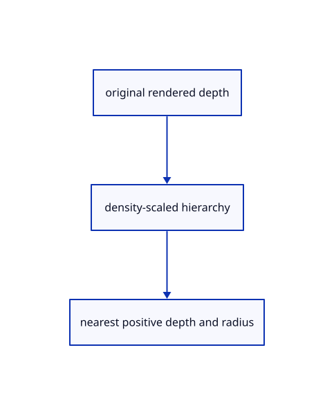

# 18.1.5 · Prepare cached pyramid inputs and images

**Chapter 18 · Lighting, render quality and comparison · Section 18.1 · Depth pyramids** · [Contents](contents.md)

**Typing: 21–42 minutes.** [Estimate](typing-load.md).

Prepare cached pyramid inputs and images.

## Type

Continue from [Build prepare and nearest-depth pipelines](89c-build-prepare-and-nearest-depth-pipelines.md). [Save or recover your work](recovery.md).

### 1. `src/pyramid_gpu.rs`

Own lazy pyramid images and their current depth input.

Create the file and type:

```rust
--8<-- "journey/code/89d-prepare-cached-pyramid-inputs-and-images-01.rs"
```

### 2. `src/lib.rs`

Register the completed section component.

<details>
<summary>Locate the existing block</summary>

```rust

pub mod pyramid_pipeline;
```

</details>

After that block, type:

```rust
--8<-- "journey/code/89d-prepare-cached-pyramid-inputs-and-images-02.rs" skip=27
```

## Run and check

Run this from `session_viewer` to select the fixed dependency versions and install supplied binary assets. It updates Cargo.lock and preserves the previous lock. It does not write implementation code:

```sh
npm --prefix ../session_tests run course -- dependencies 18.1.5
```

In your project:

```sh
cd workspace/journey
REGEN_PROTO=0 cargo build --lib --locked --target wasm32-unknown-unknown -j1
REGEN_PROTO=0 CARGO_BUILD_JOBS=1 trunk serve --port 8780
```

Open `http://127.0.0.1:8780/`. Keep an existing Trunk server running; saving rebuilds it.


### Recorded visual result

**Previous native render — current verification pending.**

Actual closed-solid section fill preserves the original bore and element ownership.


*This recorded image predates a source or checker change. Rebuild this checkpoint before using it as current evidence; browser controls require separate acceptance.*

This reference image is shared with [18.1.1 · Reduce depth and radius at a bounded display resolution](89-copy-density-scaled-depth-reduction.md). It does not demonstrate a new feature by itself.

<details>
<summary>Code explanation and diagram</summary>


original rendered depth → density-scaled hierarchy → nearest positive depth and radius.



Does a new frame require a new texture?

Only when its density-scaled size changes. Rebind source depth when its view changes and invalidate cached contents.

Study estimate, including typing and experiments: 0.5–1 hours.

</details>

<details>
<summary>Optional experiment</summary>

Compare source-depth view identity, six levels, five previous-level groups and actual resize allocation.

</details>

<details>
<summary>Check and save your work</summary>

Restore experimental edits, then run from `session_viewer`:

```sh
npm --prefix ../session_tests run course -- check 18.1.5
npm --prefix ../session_tests run course -- save 18.1.5
```

Source comparison leaves your project untouched. [Save and recovery instructions](recovery.md).

</details>

<details>
<summary>Viewer coverage and verification</summary>


The browser contract checks that the preparatory depth owner stays inactive before ambient styles connect in90. It is syntaxchecked and requires an actual browser; native fixtures exercise the enabled owner.

[Full validation scope](release.md).

To reproduce the scripted acceptance of the reference checkpoint, run from `session_viewer` with the [course bundle server](release.md#reproduce) running on port 8781:

```sh
npm --prefix ../session_tests run course -- capture 18.1.5
```

This uses the verified reference bundle; it does not check or change your typed project.

</details>
