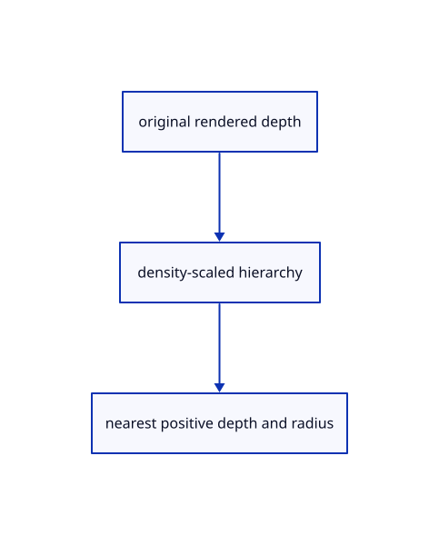

# 18.1.6 · Encode six levels only when inputs change

**Chapter 18 · Lighting, render quality and comparison · Section 18.1 · Depth pyramids** · [Contents](contents.md)

**Typing: 19–38 minutes.** [Estimate](typing-load.md).

Encode six levels only when inputs change.

## Type

Continue from [Prepare cached pyramid inputs and images](89d-prepare-cached-pyramid-inputs-and-images.md). [Save or recover your work](recovery.md).

### 1. `src/pyramid_gpu.rs`

Validate the current camera and encode changed pyramid contents.

<details>
<summary>Locate the existing block</summary>

```rust
  if self.input.as_ref().is_none_or(|(old,_)|old!=depth){let group=device.create_bind_group(&wgpu::BindGroupDescriptor{label:Some("ambient source depth"),layout:&self.pipes.input,entries:&[wgpu::BindGroupEntry{binding:0,resource:wgpu::BindingResource::TextureView(depth)},wgpu::BindGroupEntry{binding:1,resource:self.frame.as_entire_binding()}]});self.input=Some((depth.clone(),group));self.cached=None;}
 }
```

</details>

Edit the existing block to match this code; keep unchanged lines:

```rust
--8<-- "journey/code/89e-encode-six-levels-only-when-inputs-change-01.rs"
```

## Run and check

Run this from `session_viewer` to select the fixed dependency versions and install supplied binary assets. It updates Cargo.lock and preserves the previous lock. It does not write implementation code:

```sh
npm --prefix ../session_tests run course -- dependencies 18.1.6
```

In your project:

```sh
cd workspace/journey
REGEN_PROTO=0 cargo build --lib --locked --target wasm32-unknown-unknown -j1
REGEN_PROTO=0 CARGO_BUILD_JOBS=1 trunk serve --port 8780
```

Open `http://127.0.0.1:8780/`. Keep an existing Trunk server running; saving rebuilds it.


### Recorded visual result

**Previous native render — current verification pending.**

Actual closed-solid section fill preserves the original bore and element ownership.


*This recorded image predates a source or checker change. Rebuild this checkpoint before using it as current evidence; browser controls require separate acceptance.*

This reference image is shared with [18.1.1 · Reduce depth and radius at a bounded display resolution](89-copy-density-scaled-depth-reduction.md). It does not demonstrate a new feature by itself.

<details>
<summary>Code explanation and diagram</summary>


original rendered depth → density-scaled hierarchy → nearest positive depth and radius.



Can a resting viewer skip all pyramid passes?

Yes. Witness camera bits, full size, density and source/clipping revisions; unchanged input reuses all six levels.

Study estimate, including typing and experiments: 0.5–1 hours.

</details>

<details>
<summary>Optional experiment</summary>

Inspect singular/nonfinite cameras, exact uniform writes and one prepare pass followed by five reductions.

</details>

<details>
<summary>Check and save your work</summary>

Restore experimental edits, then run from `session_viewer`:

```sh
npm --prefix ../session_tests run course -- check 18.1.6
npm --prefix ../session_tests run course -- save 18.1.6
```

Source comparison leaves your project untouched. [Save and recovery instructions](recovery.md).

</details>

<details>
<summary>Viewer coverage and verification</summary>


The browser contract checks that the preparatory depth owner stays inactive before ambient styles connect in90. It is syntaxchecked and requires an actual browser; native fixtures exercise the enabled owner.

[Full validation scope](release.md).

To reproduce the scripted acceptance of the reference checkpoint, run from `session_viewer` with the [course bundle server](release.md#reproduce) running on port 8781:

```sh
npm --prefix ../session_tests run course -- capture 18.1.6
```

This uses the verified reference bundle; it does not check or change your typed project.

</details>
