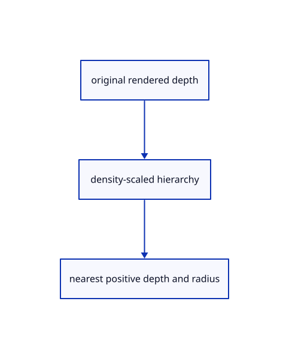

# 18.1.9 · Exercise actual depth levels and cache release

**Chapter 18 · Lighting, render quality and comparison · Section 18.1 · Depth pyramids** · [Contents](contents.md)

**Typing: 1–2 minutes.** [Estimate](typing-load.md).

Exercise actual depth levels and cache release.

## Type

Continue from [Route original depth into the pyramid owner](89g-route-original-depth-into-the-pyramid-owner.md). [Save or recover your work](recovery.md).

<details>
<summary>Supplied validation fixture</summary>

Copy this supplied authoring fixture once. Continue with the browser build below; the course does not require running native tests.

### 1. `src/pyramid_gpu_tests.rs`

Copy supplied actual mip/readback and cache fixtures.

Copy this supplied file:

```text
--8<-- "journey/code/89h-exercise-actual-depth-levels-and-cache-release-01.rs"
```

</details>

### 2. `src/renderer.rs`

Register the supplied renderer-local GPU fixtures.

<details>
<summary>Locate the existing block</summary>

```rust
  let buffer=self.device.create_buffer(&wgpu::BufferDescriptor {label:Some("actual outline alpha readback"),size:pitch as u64*height as u64,usage:wgpu::BufferUsages::COPY_DST|wgpu::BufferUsages::MAP_READ,mapped_at_creation:false});let mut encoder=self.device.create_command_encoder(&Default::default());encoder.copy_texture_to_buffer(texture.as_image_copy(),wgpu::TexelCopyBufferInfo {buffer:&buffer,layout:wgpu::TexelCopyBufferLayout {offset:0,bytes_per_row:Some(pitch),rows_per_image:Some(height)}},wgpu::Extent3d {width,height,depth_or_array_layers:1});self.queue.submit([encoder.finish()]);let (tx,rx)=std::sync::mpsc::channel();buffer.slice(..).map_async(wgpu::MapMode::Read,move|r|tx.send(r).unwrap());self.device.poll(wgpu::PollType::Wait {submission_index:None,timeout:Some(std::time::Duration::from_secs(5))}).unwrap();rx.recv().unwrap().unwrap();let bytes=buffer.slice(..).get_mapped_range();let pixels=bytes.chunks_exact(pitch as usize).flat_map(|row|row[..width as usize].iter().copied()).collect();drop(bytes);buffer.unmap();pixels
 }
}
```

</details>

After that block, type:

```rust
--8<-- "journey/code/89h-exercise-actual-depth-levels-and-cache-release-02.rs" skip=1050
```

## Run and check

Run this from `session_viewer` to select the fixed dependency versions and install supplied binary assets. It updates Cargo.lock and preserves the previous lock. It does not write implementation code:

```sh
npm --prefix ../session_tests run course -- dependencies 18.1.9
```

In your project:

```sh
cd workspace/journey
REGEN_PROTO=0 cargo build --lib --locked --target wasm32-unknown-unknown -j1
REGEN_PROTO=0 CARGO_BUILD_JOBS=1 trunk serve --port 8780
```

Open `http://127.0.0.1:8780/`. Keep an existing Trunk server running; saving rebuilds it.

The original grey section stays visible while its actual depth is reduced into six cached levels.

### Recorded visual result

**Previous native render — current verification pending.**

This independently rendered native frame is byte-identical to 89g: the original section color is unchanged. The supplied GPU readbacks inspect all six actual depth/radius levels, cache reuse, resizing and release; the illustration alone does not show those checks.


*This recorded image predates a source or checker change. Rebuild this checkpoint before using it as current evidence; browser controls require separate acceptance.*

This reference image is shared with [18.1.1 · Reduce depth and radius at a bounded display resolution](89-copy-density-scaled-depth-reduction.md). It does not demonstrate a new feature by itself.

<details>
<summary>Code explanation and diagram</summary>


original rendered depth → density-scaled hierarchy → nearest positive depth and radius.



What proves the hierarchy follows rendered geometry?

Read the real GPU mip images and verify every nearest-positive reduction and radius address against its preceding level.

Study estimate, including typing and experiments: 0.5–1 hours.

</details>

<details>
<summary>Optional experiment</summary>

Run source section depth, empty pixels, six exact reductions, unchanged-frame caching, density/resize and disabled-release checks.

</details>

<details>
<summary>Check and save your work</summary>

Restore experimental edits, then run from `session_viewer`:

```sh
npm --prefix ../session_tests run course -- check 18.1.9
npm --prefix ../session_tests run course -- save 18.1.9
```

Source comparison leaves your project untouched. [Save and recovery instructions](recovery.md).

</details>

<details>
<summary>Viewer coverage and verification</summary>

Copy the maintained density policy and nearest-positive depth/radius reduction. Adapt the earlier forward-depth source image and camera to six real mip levels. Ambient per-object radii, normals, ground and composition follow90; current reversed camera and complete geometry input follow94–95.

Retain all earlier checks. Supplied GPU fixtures read every actual mip and radius address, compare each reduction with the previous level, check source section depth, resting cache reuse, density/resize and disabled release.

The browser contract checks that the preparatory depth owner stays inactive before ambient styles connect in90. It is syntaxchecked and requires an actual browser; native fixtures exercise the enabled owner.

[Full validation scope](release.md).

To reproduce the scripted acceptance of the reference checkpoint, run from `session_viewer` with the [course bundle server](release.md#reproduce) running on port 8781:

```sh
npm --prefix ../session_tests run course -- capture 18.1.9
```

This uses the verified reference bundle; it does not check or change your typed project.

</details>
