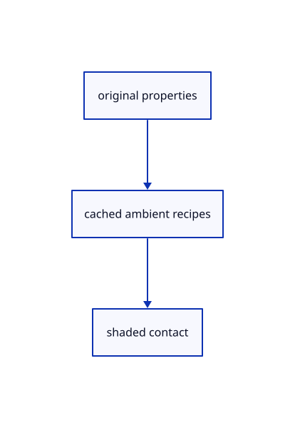

# 18.2.1 · Derive original contact radius

**Chapter 18 · Lighting, render quality and comparison · Section 18.2 · Contact and ambient light** · [Contents](contents.md)

**Typing: 3–5 minutes.** [Estimate](typing-load.md).

Derive the existing contact radius from the original scene bounds. Return zero for invalid bounds, scale the half-diagonal and retain the minimum radius. Reuse this scalar in the following ambient resources.

## Type

Continue from [Exercise actual depth levels and cache release](89h-exercise-actual-depth-levels-and-cache-release.md). [Save or recover your work](recovery.md).

### 1. `src/ambient_radius.rs`

Type the complete original geometry query and reuse its current consumer.

Create the file and type:

```rust
--8<-- "journey/code/90-copy-maintained-original-contact-radius-typed-ambient_radius.rs"
```

### 2. `src/lib.rs`

Register the completed section component.

<details>
<summary>Locate the existing block</summary>

```rust

pub mod pyramid_gpu;
```

</details>

After that block, type:

```rust
--8<-- "journey/code/90-copy-maintained-original-contact-radius-02.rs" skip=22
```

## Run and check

Run this from `session_viewer` to select the fixed dependency versions and install supplied binary assets. It updates Cargo.lock and preserves the previous lock. It does not write implementation code:

```sh
npm --prefix ../session_tests run course -- dependencies 18.2.1
```

In your project:

```sh
cd workspace/journey
REGEN_PROTO=0 cargo build --lib --locked --target wasm32-unknown-unknown -j1
REGEN_PROTO=0 CARGO_BUILD_JOBS=1 trunk serve --port 8780
```

Open `http://127.0.0.1:8780/`. Keep an existing Trunk server running; saving rebuilds it.


### Recorded visual result

**Previous native render — current verification pending.**

The original section color is unchanged; supplied readback checks inspect all six actual depth/radius levels.


*This recorded image predates a source or checker change. Rebuild this checkpoint before using it as current evidence; browser controls require separate acceptance.*

This reference image is shared with [17.3.32 · Exercise original sections bores and ink](88ad-exercise-original-sections-bores-and-ink.md). It does not demonstrate a new feature by itself.

<details>
<summary>Code explanation and diagram</summary>


original properties → cached ambient recipes → shaded contact.



Is contact radius a screen-space constant?

No. It derives from the placed original bounds, with the maintained minimum. Zoom changes its pixel footprint rather than its world size.

Study estimate, including typing and experiments: 0.5–1 hours.

</details>

<details>
<summary>Optional experiment</summary>

Inspect half-extents, five-percent radius and the invalid-bounds guard.

</details>

<details>
<summary>Check and save your work</summary>

Restore experimental edits, then run from `session_viewer`:

```sh
npm --prefix ../session_tests run course -- check 18.2.1
npm --prefix ../session_tests run course -- save 18.2.1
```

Source comparison leaves your project untouched. [Save and recovery instructions](recovery.md).

</details>

<details>
<summary>Viewer coverage and verification</summary>


The supplied real-browser contract checks actual Arctic On/Off state, allocation and errors. It is syntaxchecked and requires an actual enabled browser. Software-GPU fixtures do not measure Lenovo navigation speed.

[Full validation scope](release.md).

To reproduce the scripted acceptance of the reference checkpoint, run from `session_viewer` with the [course bundle server](release.md#reproduce) running on port 8781:

```sh
npm --prefix ../session_tests run course -- capture 18.2.1
```

This uses the verified reference bundle; it does not check or change your typed project.

</details>
